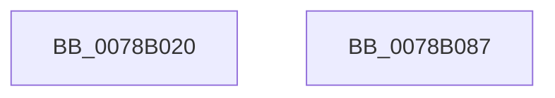

# RtlCreateUserThread

- RVA: `0x0078B020`–`0x0078B088` (길이 `104` bytes)
- VA: `0x000000014078B020`
- 실행 섹션: `PAGE`
- PDB 이름 있음: `예`; PDB Function 태그: `아니요`
- unwind 정보 RVA: `0x0007A034`
- 디코드: `22`개 명령, `104/104` bytes 표시
- 미해석 바이트: `0` (있으면 어셈블리에 `.byte`로 보존)

> 이 문서는 커널 이미지의 기계어와 PDB 기호를 분석해 생성했습니다. 4번과 5번은 함수 원형과 자료형을 바이너리 사용 방식에서 추정한 C 해석이며 원본 소스 복구 결과는 아닙니다.

## 1. Dependencies

- 직접 호출 지점: **1**; 고유 호출 대상: **1**
- 직접 호출자로 확인된 함수: **0**
- RIP 상대 이미지 참조: **0**

### Outgoing calls
- `0x0078B07D` → [RtlpCreateUserThreadEx](../A1/RtlpCreateUserThreadEx_function_00A1E5D4.md) (function, `0x00A1E5D4`)

### Direct callers
- 이 함수 시작 RVA로 연결되는 직접 call은 확인되지 않았습니다. 간접 호출은 완전히 역산할 수 없습니다.

### Static image references
- 디코드된 RIP-relative 메모리 참조가 없습니다.

## 2. Other-region calls and transfers

- 다른 실행 섹션으로 향하는 call: **0**
- 별도 외부 분기/꼬리 이동을 확인하지 못했습니다.

## 3. Assembly (complete function range)

```asm
0078B020  4C 8B DC                        mov r11, rsp
0078B023  48 83 EC 68                     sub rsp, 0x68
0078B027  48 8B 84 24 B8 00 00 00         mov rax, qword ptr [rsp + 0xb8]
0078B02F  45 33 D2                        xor r10d, r10d
0078B032  49 89 43 E8                     mov qword ptr [r11 - 0x18], rax
0078B036  41 80 F8 01                     cmp r8b, 1
0078B03A  48 8B 84 24 B0 00 00 00         mov rax, qword ptr [rsp + 0xb0]
0078B042  49 89 43 E0                     mov qword ptr [r11 - 0x20], rax
0078B046  41 0F 94 C2                     sete r10b
0078B04A  48 8B 84 24 A8 00 00 00         mov rax, qword ptr [rsp + 0xa8]
0078B052  45 8B C2                        mov r8d, r10d
0078B055  49 89 43 D8                     mov qword ptr [r11 - 0x28], rax
0078B059  48 8B 84 24 A0 00 00 00         mov rax, qword ptr [rsp + 0xa0]
0078B061  49 89 43 D0                     mov qword ptr [r11 - 0x30], rax
0078B065  48 8B 84 24 98 00 00 00         mov rax, qword ptr [rsp + 0x98]
0078B06D  49 89 43 C0                     mov qword ptr [r11 - 0x40], rax
0078B071  48 8B 84 24 90 00 00 00         mov rax, qword ptr [rsp + 0x90]
0078B079  49 89 43 B8                     mov qword ptr [r11 - 0x48], rax
0078B07D  E8 52 35 29 00                  call 0x140a1e5d4
0078B082  48 83 C4 68                     add rsp, 0x68
0078B086  C3                              ret
0078B087  CC                              int3
```

## 4. C-style interpretation (structured pseudocode)

```c
__int64 __fastcall RtlCreateUserThread(__int64 a1, __int64 a2, unsigned __int8 a3, __int64 a4, __int64 a5, __int64 a6, __int64 a7, __int64 a8, __int64 a9, __int64 a10)
{
    __int64 result;
    __int64 v_r10;
    __int64 v_rsp;

    v_rsp = (v_rsp) - (104);
    v_r10 = 0;
    *(unsigned __int64 *)(v_rsp - 24) = a10;
    *(unsigned __int64 *)(v_rsp - 32) = a9;
    v_r10 = (a3 == 1) ? 1 : 0;
    *(unsigned __int64 *)(v_rsp - 40) = a8;
    *(unsigned __int64 *)(v_rsp - 48) = a7;
    *(unsigned __int64 *)(v_rsp - 64) = a6;
    *(unsigned __int64 *)(v_rsp - 72) = a5;
    result = RtlpCreateUserThreadEx(a1, a2, (unsigned int)((unsigned int)(v_r10)), a4);
    v_rsp = (v_rsp) + (104);
    return result;
}
```

## 5. (Beta) C Style

```c
int64_t RtlCreateUserThread(int64_t Arg1, int64_t Arg2, uint8_t Arg3, int64_t Arg4, int64_t Arg5, int64_t Arg6, int64_t Arg7, int64_t Arg8, int64_t Arg9, int64_t Arg10)
{
    int64_t result;
    int64_t local_r10;
    int64_t local_rsp;

    local_rsp = (local_rsp) - (104);
    local_r10 = 0;
    *(uint64_t *)(local_rsp - 0x18) = Arg10;
    *(uint64_t *)(local_rsp - 0x20) = Arg9;
    local_r10 = (Arg3 == 1) ? 1 : 0;
    *(uint64_t *)(local_rsp - 0x28) = Arg8;
    *(uint64_t *)(local_rsp - 0x30) = Arg7;
    *(uint64_t *)(local_rsp - 0x40) = Arg6;
    *(uint64_t *)(local_rsp - 0x48) = Arg5;
    result = RtlpCreateUserThreadEx(Arg1, Arg2, (uint32_t)((uint32_t)(local_r10)), Arg4);
    local_rsp = (local_rsp) + (104);
    return result;
}
```

## 6. Execution-region graph

[열기: 2D/3D 그래프와 함수 탐색 컨트롤 패널](../../../control-panel.html?section=page&rva=0x0078B020&view=graph)

- 2D 그래프는 위에서 아래로 흐르고, 3D 그래프는 빈 공간을 드래그해 회전합니다. Shift+드래그는 이동, 휠은 확대·축소, 함수 노드 선택은 대상 보고서 이동입니다.

### Static fallback


