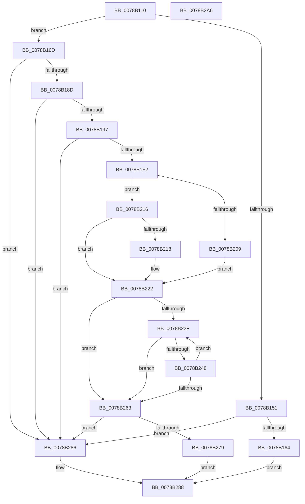

# RtlCutoverTimeToSystemTime

- RVA: `0x0078B110`–`0x0078B2A7` (길이 `407` bytes)
- VA: `0x000000014078B110`
- 실행 섹션: `PAGE`
- PDB 이름 있음: `예`; PDB Function 태그: `아니요`
- unwind 정보 RVA: `0x000CD730`
- 디코드: `113`개 명령, `407/407` bytes 표시
- 미해석 바이트: `0` (있으면 어셈블리에 `.byte`로 보존)

> 이 문서는 커널 이미지의 기계어와 PDB 기호를 분석해 생성했습니다. 4번과 5번은 함수 원형과 자료형을 바이너리 사용 방식에서 추정한 C 해석이며 원본 소스 복구 결과는 아닙니다.

## 1. Dependencies

- 직접 호출 지점: **7**; 고유 호출 대상: **2**
- 직접 호출자로 확인된 함수: **2**
- RIP 상대 이미지 참조: **0**

### Outgoing calls
- `0x0078B143` → [RtlTimeToTimeFields](../../text/42/RtlTimeToTimeFields_function_0042E0F0.md) (function, `0x0042E0F0`)
- `0x0078B157` → [RtlTimeFieldsToTime](../../text/42/RtlTimeFieldsToTime_function_0042E6B0.md) (function, `0x0042E6B0`)
- `0x0078B1E5` → [RtlTimeFieldsToTime](../../text/42/RtlTimeFieldsToTime_function_0042E6B0.md) (function, `0x0042E6B0`)
- `0x0078B1FA` → [RtlTimeToTimeFields](../../text/42/RtlTimeToTimeFields_function_0042E0F0.md) (function, `0x0042E0F0`)
- `0x0078B23F` → [RtlTimeFieldsToTime](../../text/42/RtlTimeFieldsToTime_function_0042E6B0.md) (function, `0x0042E6B0`)
- `0x0078B250` → [RtlTimeToTimeFields](../../text/42/RtlTimeToTimeFields_function_0042E0F0.md) (function, `0x0042E0F0`)
- `0x0078B270` → [RtlTimeFieldsToTime](../../text/42/RtlTimeFieldsToTime_function_0042E6B0.md) (function, `0x0042E6B0`)

### Direct callers
- [ExInitializeUtcTimeZoneBias](../7C/ExInitializeUtcTimeZoneBias_function_007C5818.md) at `0x007C58E9`
- [ExInitializeUtcTimeZoneBias](../7C/ExInitializeUtcTimeZoneBias_function_007C5818.md) at `0x007C5902`
- [ExpRefreshTimeZoneInformation](../A6/ExpRefreshTimeZoneInformation_function_00A6B46C.md) at `0x00A6B73A`
- [ExpRefreshTimeZoneInformation](../A6/ExpRefreshTimeZoneInformation_function_00A6B46C.md) at `0x00A6B78E`

### Static image references
- 디코드된 RIP-relative 메모리 참조가 없습니다.

## 2. Other-region calls and transfers

- 다른 실행 섹션으로 향하는 call: **7**
  - `0x0078B143` → [RtlTimeToTimeFields](../../text/42/RtlTimeToTimeFields_function_0042E0F0.md) (`PAGE` → `.text`)
  - `0x0078B157` → [RtlTimeFieldsToTime](../../text/42/RtlTimeFieldsToTime_function_0042E6B0.md) (`PAGE` → `.text`)
  - `0x0078B1E5` → [RtlTimeFieldsToTime](../../text/42/RtlTimeFieldsToTime_function_0042E6B0.md) (`PAGE` → `.text`)
  - `0x0078B1FA` → [RtlTimeToTimeFields](../../text/42/RtlTimeToTimeFields_function_0042E0F0.md) (`PAGE` → `.text`)
  - `0x0078B23F` → [RtlTimeFieldsToTime](../../text/42/RtlTimeFieldsToTime_function_0042E6B0.md) (`PAGE` → `.text`)
  - `0x0078B250` → [RtlTimeToTimeFields](../../text/42/RtlTimeToTimeFields_function_0042E0F0.md) (`PAGE` → `.text`)
  - `0x0078B270` → [RtlTimeFieldsToTime](../../text/42/RtlTimeFieldsToTime_function_0042E6B0.md) (`PAGE` → `.text`)
- 별도 외부 분기/꼬리 이동을 확인하지 못했습니다.

## 3. Assembly (complete function range)

```asm
0078B110  48 89 5C 24 10                  mov qword ptr [rsp + 0x10], rbx
0078B115  48 89 74 24 18                  mov qword ptr [rsp + 0x18], rsi
0078B11A  48 89 7C 24 20                  mov qword ptr [rsp + 0x20], rdi
0078B11F  55                              push rbp
0078B120  41 54                           push r12
0078B122  41 55                           push r13
0078B124  41 56                           push r14
0078B126  41 57                           push r15
0078B128  48 8B EC                        mov rbp, rsp
0078B12B  48 83 EC 50                     sub rsp, 0x50
0078B12F  4C 8B E2                        mov r12, rdx
0078B132  48 8B F1                        mov rsi, rcx
0078B135  0F 57 C0                        xorps xmm0, xmm0
0078B138  48 8D 55 F0                     lea rdx, [rbp - 0x10]
0078B13C  49 8B C8                        mov rcx, r8
0078B13F  0F 11 45 F0                     movups xmmword ptr [rbp - 0x10], xmm0
0078B143  E8 A8 2F CA FF                  call 0x14042e0f0
0078B148  45 33 ED                        xor r13d, r13d
0078B14B  66 44 39 2E                     cmp word ptr [rsi], r13w
0078B14F  74 1C                           je 0x14078b16d
0078B151  49 8B D4                        mov rdx, r12
0078B154  48 8B CE                        mov rcx, rsi
0078B157  E8 54 35 CA FF                  call 0x14042e6b0
0078B15C  84 C0                           test al, al
0078B15E  0F 84 22 01 00 00               je 0x14078b286
0078B164  41 8D 45 01                     lea eax, [r13 + 1]
0078B168  E9 1B 01 00 00                  jmp 0x14078b288
0078B16D  44 0F B7 76 04                  movzx r14d, word ptr [rsi + 4]
0078B172  0F 57 C0                        xorps xmm0, xmm0
0078B175  66 44 89 6D D4                  mov word ptr [rbp - 0x2c], r13w
0078B17A  4C 89 6D 30                     mov qword ptr [rbp + 0x30], r13
0078B17E  0F 11 45 E0                     movups xmmword ptr [rbp - 0x20], xmm0
0078B182  66 41 83 FE 05                  cmp r14w, 5
0078B187  0F 8F F9 00 00 00               jg 0x14078b286
0078B18D  66 45 85 F6                     test r14w, r14w
0078B191  0F 84 EF 00 00 00               je 0x14078b286
0078B197  44 0F B7 7E 0E                  movzx r15d, word ptr [rsi + 0xe]
0078B19C  0F B7 4E 02                     movzx ecx, word ptr [rsi + 2]
0078B1A0  0F B7 45 F0                     movzx eax, word ptr [rbp - 0x10]
0078B1A4  66 89 45 D0                     mov word ptr [rbp - 0x30], ax
0078B1A8  48 8D 55 30                     lea rdx, [rbp + 0x30]
0078B1AC  0F B7 46 06                     movzx eax, word ptr [rsi + 6]
0078B1B0  BF 01 00 00 00                  mov edi, 1
0078B1B5  66 89 45 D6                     mov word ptr [rbp - 0x2a], ax
0078B1B9  0F B7 DF                        movzx ebx, di
0078B1BC  0F B7 46 08                     movzx eax, word ptr [rsi + 8]
0078B1C0  66 89 45 D8                     mov word ptr [rbp - 0x28], ax
0078B1C4  0F B7 46 0A                     movzx eax, word ptr [rsi + 0xa]
0078B1C8  66 89 45 DA                     mov word ptr [rbp - 0x26], ax
0078B1CC  0F B7 46 0C                     movzx eax, word ptr [rsi + 0xc]
0078B1D0  66 89 4D D2                     mov word ptr [rbp - 0x2e], cx
0078B1D4  48 8D 4D D0                     lea rcx, [rbp - 0x30]
0078B1D8  66 89 45 DC                     mov word ptr [rbp - 0x24], ax
0078B1DC  66 89 5D D4                     mov word ptr [rbp - 0x2c], bx
0078B1E0  66 44 89 6D DE                  mov word ptr [rbp - 0x22], r13w
0078B1E5  E8 C6 34 CA FF                  call 0x14042e6b0
0078B1EA  84 C0                           test al, al
0078B1EC  0F 84 94 00 00 00               je 0x14078b286
0078B1F2  48 8D 55 E0                     lea rdx, [rbp - 0x20]
0078B1F6  48 8D 4D 30                     lea rcx, [rbp + 0x30]
0078B1FA  E8 F1 2E CA FF                  call 0x14042e0f0
0078B1FF  0F B7 45 EE                     movzx eax, word ptr [rbp - 0x12]
0078B203  66 41 3B C7                     cmp ax, r15w
0078B207  7E 0D                           jle 0x14078b216
0078B209  41 0F B7 DF                     movzx ebx, r15w
0078B20D  66 2B D8                        sub bx, ax
0078B210  66 83 C3 08                     add bx, 8
0078B214  EB 0C                           jmp 0x14078b222
0078B216  7D 0A                           jge 0x14078b222
0078B218  41 0F B7 DF                     movzx ebx, r15w
0078B21C  66 2B D8                        sub bx, ax
0078B21F  66 03 DF                        add bx, di
0078B222  44 0F B7 FB                     movzx r15d, bx
0078B226  0F B7 F7                        movzx esi, di
0078B229  66 41 3B FE                     cmp di, r14w
0078B22D  7D 34                           jge 0x14078b263
0078B22F  66 83 C3 07                     add bx, 7
0078B233  48 8D 55 30                     lea rdx, [rbp + 0x30]
0078B237  48 8D 4D D0                     lea rcx, [rbp - 0x30]
0078B23B  66 89 5D D4                     mov word ptr [rbp - 0x2c], bx
0078B23F  E8 6C 34 CA FF                  call 0x14042e6b0
0078B244  84 C0                           test al, al
0078B246  74 1B                           je 0x14078b263
0078B248  48 8D 55 E0                     lea rdx, [rbp - 0x20]
0078B24C  48 8D 4D 30                     lea rcx, [rbp + 0x30]
0078B250  E8 9B 2E CA FF                  call 0x14042e0f0
0078B255  44 0F B7 7D E4                  movzx r15d, word ptr [rbp - 0x1c]
0078B25A  66 03 F7                        add si, di
0078B25D  66 41 3B F6                     cmp si, r14w
0078B261  7C CC                           jl 0x14078b22f
0078B263  48 8D 55 30                     lea rdx, [rbp + 0x30]
0078B267  66 44 89 7D D4                  mov word ptr [rbp - 0x2c], r15w
0078B26C  48 8D 4D D0                     lea rcx, [rbp - 0x30]
0078B270  E8 3B 34 CA FF                  call 0x14042e6b0
0078B275  84 C0                           test al, al
0078B277  74 0D                           je 0x14078b286
0078B279  48 8B 45 30                     mov rax, qword ptr [rbp + 0x30]
0078B27D  49 89 04 24                     mov qword ptr [r12], rax
0078B281  40 8A C7                        mov al, dil
0078B284  EB 02                           jmp 0x14078b288
0078B286  32 C0                           xor al, al
0078B288  4C 8D 5C 24 50                  lea r11, [rsp + 0x50]
0078B28D  49 8B 5B 38                     mov rbx, qword ptr [r11 + 0x38]
0078B291  49 8B 73 40                     mov rsi, qword ptr [r11 + 0x40]
0078B295  49 8B 7B 48                     mov rdi, qword ptr [r11 + 0x48]
0078B299  49 8B E3                        mov rsp, r11
0078B29C  41 5F                           pop r15
0078B29E  41 5E                           pop r14
0078B2A0  41 5D                           pop r13
0078B2A2  41 5C                           pop r12
0078B2A4  5D                              pop rbp
0078B2A5  C3                              ret
0078B2A6  CC                              int3
```

## 4. C-style interpretation (structured pseudocode)

```c
__int64 __fastcall RtlCutoverTimeToSystemTime(__int64 a1, __int64 a2, __int64 a3)
{
    __int64 result;
    __int64 v_r13;
    __int64 v_rbx;
    __int64 v_rsi;
    __int64 v_rsp;
    unsigned __int64 v_stack_m28;
    unsigned __int64 v_stack_m38;
    unsigned __int16 v_stack_m3A;
    unsigned __int16 v_stack_m44;
    unsigned __int64 v_stack_m48;
    unsigned __int16 v_stack_m4A;
    unsigned __int16 v_stack_m4C;
    unsigned __int16 v_stack_m4E;
    unsigned __int16 v_stack_m50;
    unsigned __int16 v_stack_m52;
    unsigned __int16 v_stack_m54;
    unsigned __int16 v_stack_m56;
    unsigned __int16 v_stack_m58;
    unsigned __int64 v_stack_p10;
    unsigned __int64 v_stack_p18;
    unsigned __int64 v_stack_p20;
    unsigned __int64 v_stack_p8;

    v_stack_p10 = v_rbx;
    v_stack_p18 = v_rsi;
    v_stack_p20 = v_rdi;
    v_rsp = (v_rsp) - (80);
    v_stack_m38 = v_xmm0;
    result = RtlTimeToTimeFields(a3, v_stack_m38, a3, a4);
    v_r13 = 0;
    if ((*(unsigned __int16 *)(a1)) == 0) goto loc_0078B16D;
    result = RtlTimeFieldsToTime(a1, a2, a3, a4);
    if ((unsigned __int8)(result) == 0) goto loc_0078B286;
    goto loc_0078B288;
loc_0078B16D:
    v_stack_m54 = 0;
    v_stack_p8 = 0;
    v_stack_m48 = v_xmm0;
    if (((unsigned __int16)(*(unsigned __int16 *)(a1 + 4))) > 5) goto loc_0078B286;
    if ((unsigned __int16)(*(unsigned __int16 *)(a1 + 4)) == 0) goto loc_0078B286;
    v_stack_m58 = (unsigned __int16)(v_stack_m38);
    v_stack_m52 = (unsigned __int16)(*(unsigned __int16 *)(a1 + 6));
    v_stack_m50 = (unsigned __int16)(*(unsigned __int16 *)(a1 + 8));
    v_stack_m4E = (unsigned __int16)(*(unsigned __int16 *)(a1 + 10));
    v_stack_m56 = (unsigned __int16)(*(unsigned __int16 *)(a1 + 2));
    v_stack_m4C = (unsigned __int16)(*(unsigned __int16 *)(a1 + 12));
    v_stack_m54 = 1;
    v_stack_m4A = 0;
    result = RtlTimeFieldsToTime(v_stack_m58, v_stack_p8, a3, a4);
    if ((unsigned __int8)(result) == 0) goto loc_0078B286;
    result = RtlTimeToTimeFields(v_stack_p8, v_stack_m48, a3, a4);
    if (((unsigned __int16)(v_stack_m3A)) <= ((unsigned __int16)(*(unsigned __int16 *)(a1 + 14)))) goto loc_0078B216;
    v_rbx = (unsigned __int16)(((unsigned __int16)(*(unsigned __int16 *)(a1 + 14))) - ((unsigned __int16)(v_stack_m3A)));
    v_rbx = (unsigned __int16)((v_rbx) + (8));
    goto loc_0078B222;
loc_0078B216:
    if (!(condition_is_greater_or_equal)) {
        v_rbx = (unsigned __int16)(*(unsigned __int16 *)(a1 + 14));
        v_rbx = (unsigned __int16)((v_rbx) - ((unsigned __int16)(v_stack_m3A)));
        v_rbx = (unsigned __int16)((v_rbx) + (1));
    }
    if (1 >= ((unsigned __int16)(*(unsigned __int16 *)(a1 + 4)))) goto loc_0078B263;
loc_0078B22F:
    v_rbx = (unsigned __int16)((v_rbx) + (7));
    v_stack_m54 = (unsigned __int16)(v_rbx);
    result = RtlTimeFieldsToTime(v_stack_m58, v_stack_p8, a3, a4);
    if ((unsigned __int8)(result) == 0) goto loc_0078B263;
    result = RtlTimeToTimeFields(v_stack_p8, v_stack_m48, a3, a4);
    v_rsi = (unsigned __int16)((1) + (1));
    if (((unsigned __int16)(v_rsi)) < ((unsigned __int16)(*(unsigned __int16 *)(a1 + 4)))) goto loc_0078B22F;
loc_0078B263:
    v_stack_m54 = (unsigned __int16)(v_stack_m44);
    result = RtlTimeFieldsToTime(v_stack_m58, v_stack_p8, a3, a4);
    if ((unsigned __int8)(result) == 0) goto loc_0078B286;
    *(unsigned __int64 *)(a2) = v_stack_p8;
    goto loc_0078B288;
loc_0078B286:
    result = 0;
loc_0078B288:
    return result;
}
```

## 5. (Beta) C Style

```c
int64_t RtlCutoverTimeToSystemTime(void *Arg1, void *Arg2, int64_t Arg3)
{
    uint8_t *arg1 = (uint8_t *)Arg1;
    uint8_t *arg2 = (uint8_t *)Arg2;

    int64_t result;
    int64_t local_r13;
    int64_t local_rbx;
    int64_t local_rsi;
    int64_t local_rsp;
    uint64_t v_stack_m28;
    uint64_t v_stack_m38;
    uint16_t v_stack_m3A;
    uint16_t v_stack_m44;
    uint64_t v_stack_m48;
    uint16_t v_stack_m4A;
    uint16_t v_stack_m4C;
    uint16_t v_stack_m4E;
    uint16_t v_stack_m50;
    uint16_t v_stack_m52;
    uint16_t v_stack_m54;
    uint16_t v_stack_m56;
    uint16_t v_stack_m58;
    uint64_t v_stack_p10;
    uint64_t v_stack_p18;
    uint64_t v_stack_p20;
    uint64_t v_stack_p8;

    v_stack_p10 = local_rbx;
    v_stack_p18 = local_rsi;
    v_stack_p20 = local_rdi;
    local_rsp = (local_rsp) - (80);
    v_stack_m38 = v_xmm0;
    result = RtlTimeToTimeFields(Arg3, v_stack_m38, Arg3, a4);
    local_r13 = 0;
    if ((*(uint16_t *)(arg1)) == 0) goto loc_0078B16D;
    result = RtlTimeFieldsToTime(Arg1, Arg2, Arg3, a4);
    if ((uint8_t)(result) == 0) goto loc_0078B286;
    goto loc_0078B288;
loc_0078B16D:
    v_stack_m54 = 0;
    v_stack_p8 = 0;
    v_stack_m48 = v_xmm0;
    if (((uint16_t)(*(uint16_t *)(arg1 + 0x4))) > 5) goto loc_0078B286;
    if ((uint16_t)(*(uint16_t *)(arg1 + 0x4)) == 0) goto loc_0078B286;
    v_stack_m58 = (uint16_t)(v_stack_m38);
    v_stack_m52 = (uint16_t)(*(uint16_t *)(arg1 + 0x6));
    v_stack_m50 = (uint16_t)(*(uint16_t *)(arg1 + 0x8));
    v_stack_m4E = (uint16_t)(*(uint16_t *)(arg1 + 0xA));
    v_stack_m56 = (uint16_t)(*(uint16_t *)(arg1 + 0x2));
    v_stack_m4C = (uint16_t)(*(uint16_t *)(arg1 + 0xC));
    v_stack_m54 = 1;
    v_stack_m4A = 0;
    result = RtlTimeFieldsToTime(v_stack_m58, v_stack_p8, Arg3, a4);
    if ((uint8_t)(result) == 0) goto loc_0078B286;
    result = RtlTimeToTimeFields(v_stack_p8, v_stack_m48, Arg3, a4);
    if (((uint16_t)(v_stack_m3A)) <= ((uint16_t)(*(uint16_t *)(arg1 + 0xE)))) goto loc_0078B216;
    local_rbx = (uint16_t)(((uint16_t)(*(uint16_t *)(arg1 + 0xE))) - ((uint16_t)(v_stack_m3A)));
    local_rbx = (uint16_t)((local_rbx) + (8));
    goto loc_0078B222;
loc_0078B216:
    if (!(condition_is_greater_or_equal)) {
        local_rbx = (uint16_t)(*(uint16_t *)(arg1 + 0xE));
        local_rbx = (uint16_t)((local_rbx) - ((uint16_t)(v_stack_m3A)));
        local_rbx = (uint16_t)((local_rbx) + (1));
    }
    if (1 >= ((uint16_t)(*(uint16_t *)(arg1 + 0x4)))) goto loc_0078B263;
loc_0078B22F:
    local_rbx = (uint16_t)((local_rbx) + (7));
    v_stack_m54 = (uint16_t)(local_rbx);
    result = RtlTimeFieldsToTime(v_stack_m58, v_stack_p8, Arg3, a4);
    if ((uint8_t)(result) == 0) goto loc_0078B263;
    result = RtlTimeToTimeFields(v_stack_p8, v_stack_m48, Arg3, a4);
    local_rsi = (uint16_t)((1) + (1));
    if (((uint16_t)(local_rsi)) < ((uint16_t)(*(uint16_t *)(arg1 + 0x4)))) goto loc_0078B22F;
loc_0078B263:
    v_stack_m54 = (uint16_t)(v_stack_m44);
    result = RtlTimeFieldsToTime(v_stack_m58, v_stack_p8, Arg3, a4);
    if ((uint8_t)(result) == 0) goto loc_0078B286;
    *(uint64_t *)(arg2) = v_stack_p8;
    goto loc_0078B288;
loc_0078B286:
    result = 0;
loc_0078B288:
    return result;
}
```

### 관측된 메모리 오프셋

구조체 형식이 확인되지 않은 접근은 인자 기준의 오프셋으로만 기록했습니다.

| 기준 인자 | 오프셋 표현 | 폭 (bit) | 접근 |
|---|---:|---:|---|
| `Arg1` | `+ 0x0` | `16` | `R` |
| `Arg1` | `+ 0x2` | `16` | `R` |
| `Arg1` | `+ 0x4` | `16` | `R` |
| `Arg1` | `+ 0x6` | `16` | `R` |
| `Arg1` | `+ 0x8` | `16` | `R` |
| `Arg1` | `+ 0xA` | `16` | `R` |
| `Arg1` | `+ 0xC` | `16` | `R` |
| `Arg1` | `+ 0xE` | `16` | `R` |
| `Arg2` | `+ 0x0` | `64` | `W` |

## 6. Execution-region graph

[열기: 2D/3D 그래프와 함수 탐색 컨트롤 패널](../../../control-panel.html?section=page&rva=0x0078B110&view=graph)

- 2D 그래프는 위에서 아래로 흐르고, 3D 그래프는 빈 공간을 드래그해 회전합니다. Shift+드래그는 이동, 휠은 확대·축소, 함수 노드 선택은 대상 보고서 이동입니다.

### Static fallback


