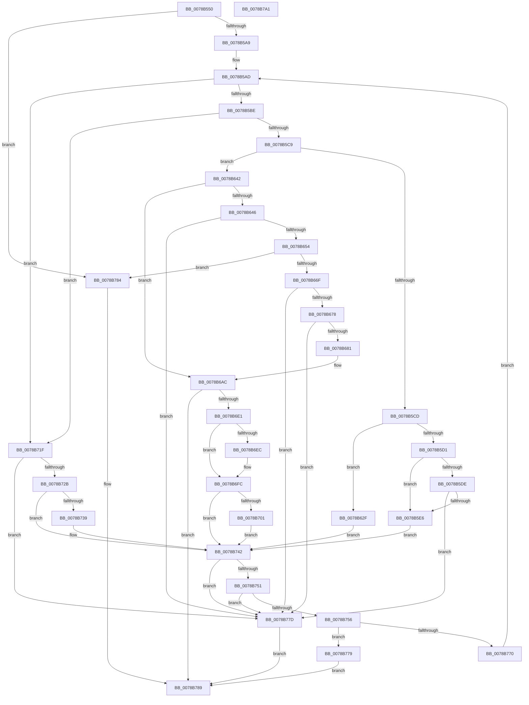

# RtlDecompressChunks

- RVA: `0x0078B550`–`0x0078B7A2` (길이 `594` bytes)
- VA: `0x000000014078B550`
- 실행 섹션: `PAGE`
- PDB 이름 있음: `예`; PDB Function 태그: `아니요`
- unwind 정보 RVA: `0x000717C4`
- 디코드: `163`개 명령, `594/594` bytes 표시
- 미해석 바이트: `0` (있으면 어셈블리에 `.byte`로 보존)

> 이 문서는 커널 이미지의 기계어와 PDB 기호를 분석해 생성했습니다. 4번과 5번은 함수 원형과 자료형을 바이너리 사용 방식에서 추정한 C 해석이며 원본 소스 복구 결과는 아닙니다.

## 1. Dependencies

- 직접 호출 지점: **8**; 고유 호출 대상: **3**
- 직접 호출자로 확인된 함수: **0**
- RIP 상대 이미지 참조: **0**

### Outgoing calls
- `0x0078B5F1` → [memcpy](../../text/6C/memcpy_function_006C6840.md) (function, `0x006C6840`)
- `0x0078B608` → [memcpy](../../text/6C/memcpy_function_006C6840.md) (function, `0x006C6840`)
- `0x0078B638` → [memcpy](../../text/6C/memcpy_function_006C6840.md) (function, `0x006C6840`)
- `0x0078B687` → [memcpy](../../text/6C/memcpy_function_006C6840.md) (function, `0x006C6840`)
- `0x0078B69D` → [memcpy](../../text/6C/memcpy_function_006C6840.md) (function, `0x006C6840`)
- `0x0078B6D4` → [RtlDecompressBuffer](../../text/46/RtlDecompressBuffer_function_004638C0.md) (function, `0x004638C0`)
- `0x0078B6F7` → [memset](../../text/6C/memset_function_006C6C40.md) (function, `0x006C6C40`)
- `0x0078B730` → [memset](../../text/6C/memset_function_006C6C40.md) (function, `0x006C6C40`)

### Direct callers
- 이 함수 시작 RVA로 연결되는 직접 call은 확인되지 않았습니다. 간접 호출은 완전히 역산할 수 없습니다.

### Static image references
- 디코드된 RIP-relative 메모리 참조가 없습니다.

## 2. Other-region calls and transfers

- 다른 실행 섹션으로 향하는 call: **8**
  - `0x0078B5F1` → [memcpy](../../text/6C/memcpy_function_006C6840.md) (`PAGE` → `.text`)
  - `0x0078B608` → [memcpy](../../text/6C/memcpy_function_006C6840.md) (`PAGE` → `.text`)
  - `0x0078B638` → [memcpy](../../text/6C/memcpy_function_006C6840.md) (`PAGE` → `.text`)
  - `0x0078B687` → [memcpy](../../text/6C/memcpy_function_006C6840.md) (`PAGE` → `.text`)
  - `0x0078B69D` → [memcpy](../../text/6C/memcpy_function_006C6840.md) (`PAGE` → `.text`)
  - `0x0078B6D4` → [RtlDecompressBuffer](../../text/46/RtlDecompressBuffer_function_004638C0.md) (`PAGE` → `.text`)
  - `0x0078B6F7` → [memset](../../text/6C/memset_function_006C6C40.md) (`PAGE` → `.text`)
  - `0x0078B730` → [memset](../../text/6C/memset_function_006C6C40.md) (`PAGE` → `.text`)
- 별도 외부 분기/꼬리 이동을 확인하지 못했습니다.

## 3. Assembly (complete function range)

```asm
0078B550  48 8B C4                        mov rax, rsp
0078B553  48 89 58 18                     mov qword ptr [rax + 0x18], rbx
0078B557  55                              push rbp
0078B558  56                              push rsi
0078B559  57                              push rdi
0078B55A  41 54                           push r12
0078B55C  41 55                           push r13
0078B55E  41 56                           push r14
0078B560  41 57                           push r15
0078B562  48 83 EC 40                     sub rsp, 0x40
0078B566  83 60 08 00                     and dword ptr [rax + 8], 0
0078B56A  48 8B E9                        mov rbp, rcx
0078B56D  48 8B 84 24 B0 00 00 00         mov rax, qword ptr [rsp + 0xb0]
0078B575  41 8B F1                        mov esi, r9d
0078B578  44 8B E2                        mov r12d, edx
0078B57B  4D 8B F8                        mov r15, r8
0078B57E  BA 01 00 00 00                  mov edx, 1
0078B583  8A 48 03                        mov cl, byte ptr [rax + 3]
0078B586  0F B7 58 06                     movzx ebx, word ptr [rax + 6]
0078B58A  D3 E2                           shl edx, cl
0078B58C  49 8D 0C 2C                     lea rcx, [r12 + rbp]
0078B590  89 9C 24 88 00 00 00            mov dword ptr [rsp + 0x88], ebx
0078B597  89 54 24 30                     mov dword ptr [rsp + 0x30], edx
0078B59B  48 89 4C 24 38                  mov qword ptr [rsp + 0x38], rcx
0078B5A0  48 3B CD                        cmp rcx, rbp
0078B5A3  0F 82 DB 01 00 00               jb 0x14078b784
0078B5A9  4C 8D 70 08                     lea r14, [rax + 8]
0078B5AD  44 3B E2                        cmp r12d, edx
0078B5B0  41 8B FC                        mov edi, r12d
0078B5B3  0F 43 FA                        cmovae edi, edx
0078B5B6  85 DB                           test ebx, ebx
0078B5B8  0F 84 61 01 00 00               je 0x14078b71f
0078B5BE  41 8B 06                        mov eax, dword ptr [r14]
0078B5C1  85 C0                           test eax, eax
0078B5C3  0F 84 56 01 00 00               je 0x14078b71f
0078B5C9  3B C2                           cmp eax, edx
0078B5CB  75 75                           jne 0x14078b642
0078B5CD  3B FE                           cmp edi, esi
0078B5CF  72 5E                           jb 0x14078b62f
0078B5D1  44 8B AC 24 A8 00 00 00         mov r13d, dword ptr [rsp + 0xa8]
0078B5D9  45 85 ED                        test r13d, r13d
0078B5DC  75 08                           jne 0x14078b5e6
0078B5DE  3B FE                           cmp edi, esi
0078B5E0  0F 87 97 01 00 00               ja 0x14078b77d
0078B5E6  44 8B C6                        mov r8d, esi
0078B5E9  49 8B D7                        mov rdx, r15
0078B5EC  48 8B CD                        mov rcx, rbp
0078B5EF  8B DE                           mov ebx, esi
0078B5F1  E8 4A B2 F3 FF                  call 0x1406c6840
0078B5F6  48 8B 94 24 A0 00 00 00         mov rdx, qword ptr [rsp + 0xa0]
0078B5FE  48 8D 0C 2B                     lea rcx, [rbx + rbp]
0078B602  44 8B C7                        mov r8d, edi
0078B605  44 2B C6                        sub r8d, esi
0078B608  E8 33 B2 F3 FF                  call 0x1406c6840
0078B60D  4C 8B BC 24 A0 00 00 00         mov r15, qword ptr [rsp + 0xa0]
0078B615  41 03 F5                        add esi, r13d
0078B618  4C 2B FB                        sub r15, rbx
0078B61B  8B 9C 24 88 00 00 00            mov ebx, dword ptr [rsp + 0x88]
0078B622  83 A4 24 A8 00 00 00 00         and dword ptr [rsp + 0xa8], 0
0078B62A  E9 13 01 00 00                  jmp 0x14078b742
0078B62F  44 8B C7                        mov r8d, edi
0078B632  49 8B D7                        mov rdx, r15
0078B635  48 8B CD                        mov rcx, rbp
0078B638  E8 03 B2 F3 FF                  call 0x1406c6840
0078B63D  E9 00 01 00 00                  jmp 0x14078b742
0078B642  3B C6                           cmp eax, esi
0078B644  76 66                           jbe 0x14078b6ac
0078B646  83 BC 24 A8 00 00 00 00         cmp dword ptr [rsp + 0xa8], 0
0078B64E  0F 84 29 01 00 00               je 0x14078b77d
0078B654  8B C2                           mov eax, edx
0078B656  41 8B DC                        mov ebx, r12d
0078B659  48 2B D8                        sub rbx, rax
0078B65C  44 8B C6                        mov r8d, esi
0078B65F  48 03 DD                        add rbx, rbp
0078B662  4D 8D 2C 18                     lea r13, [r8 + rbx]
0078B666  4C 3B EB                        cmp r13, rbx
0078B669  0F 82 15 01 00 00               jb 0x14078b784
0078B66F  48 3B DD                        cmp rbx, rbp
0078B672  0F 82 05 01 00 00               jb 0x14078b77d
0078B678  4C 3B E9                        cmp r13, rcx
0078B67B  0F 87 FC 00 00 00               ja 0x14078b77d
0078B681  49 8B D7                        mov rdx, r15
0078B684  48 8B CB                        mov rcx, rbx
0078B687  E8 B4 B1 F3 FF                  call 0x1406c6840
0078B68C  45 8B 06                        mov r8d, dword ptr [r14]
0078B68F  49 8B CD                        mov rcx, r13
0078B692  48 8B 94 24 A0 00 00 00         mov rdx, qword ptr [rsp + 0xa0]
0078B69A  44 2B C6                        sub r8d, esi
0078B69D  E8 9E B1 F3 FF                  call 0x1406c6840
0078B6A2  4C 8B FB                        mov r15, rbx
0078B6A5  8B 9C 24 88 00 00 00            mov ebx, dword ptr [rsp + 0x88]
0078B6AC  48 8D 84 24 80 00 00 00         lea rax, [rsp + 0x80]
0078B6B4  4D 8B CF                        mov r9, r15
0078B6B7  48 89 44 24 28                  mov qword ptr [rsp + 0x28], rax
0078B6BC  44 8B C7                        mov r8d, edi
0078B6BF  41 8B 06                        mov eax, dword ptr [r14]
0078B6C2  48 8B D5                        mov rdx, rbp
0078B6C5  89 44 24 20                     mov dword ptr [rsp + 0x20], eax
0078B6C9  48 8B 84 24 B0 00 00 00         mov rax, qword ptr [rsp + 0xb0]
0078B6D1  0F B7 08                        movzx ecx, word ptr [rax]
0078B6D4  E8 E7 81 CD FF                  call 0x1404638c0
0078B6D9  85 C0                           test eax, eax
0078B6DB  0F 88 A8 00 00 00               js 0x14078b789
0078B6E1  8B 8C 24 80 00 00 00            mov ecx, dword ptr [rsp + 0x80]
0078B6E8  3B F9                           cmp edi, ecx
0078B6EA  76 10                           jbe 0x14078b6fc
0078B6EC  44 8B C7                        mov r8d, edi
0078B6EF  33 D2                           xor edx, edx
0078B6F1  44 2B C1                        sub r8d, ecx
0078B6F4  48 03 CD                        add rcx, rbp
0078B6F7  E8 44 B5 F3 FF                  call 0x1406c6c40
0078B6FC  41 39 36                        cmp dword ptr [r14], esi
0078B6FF  72 41                           jb 0x14078b742
0078B701  4C 8B BC 24 A0 00 00 00         mov r15, qword ptr [rsp + 0xa0]
0078B709  8B C6                           mov eax, esi
0078B70B  03 B4 24 A8 00 00 00            add esi, dword ptr [rsp + 0xa8]
0078B712  4C 2B F8                        sub r15, rax
0078B715  83 A4 24 A8 00 00 00 00         and dword ptr [rsp + 0xa8], 0
0078B71D  EB 23                           jmp 0x14078b742
0078B71F  48 8D 04 2F                     lea rax, [rdi + rbp]
0078B723  44 8B C7                        mov r8d, edi
0078B726  48 3B C1                        cmp rax, rcx
0078B729  77 52                           ja 0x14078b77d
0078B72B  33 D2                           xor edx, edx
0078B72D  48 8B CD                        mov rcx, rbp
0078B730  E8 0B B5 F3 FF                  call 0x1406c6c40
0078B735  85 DB                           test ebx, ebx
0078B737  75 09                           jne 0x14078b742
0078B739  BB 01 00 00 00                  mov ebx, 1
0078B73E  49 83 EE 04                     sub r14, 4
0078B742  48 8B 4C 24 38                  mov rcx, qword ptr [rsp + 0x38]
0078B747  8B C7                           mov eax, edi
0078B749  48 03 E8                        add rbp, rax
0078B74C  48 3B E9                        cmp rbp, rcx
0078B74F  77 2C                           ja 0x14078b77d
0078B751  41 3B FC                        cmp edi, r12d
0078B754  77 27                           ja 0x14078b77d
0078B756  41 8B 06                        mov eax, dword ptr [r14]
0078B759  FF CB                           dec ebx
0078B75B  4C 03 F8                        add r15, rax
0078B75E  89 9C 24 88 00 00 00            mov dword ptr [rsp + 0x88], ebx
0078B765  2B F0                           sub esi, eax
0078B767  49 83 C6 04                     add r14, 4
0078B76B  44 2B E7                        sub r12d, edi
0078B76E  74 09                           je 0x14078b779
0078B770  8B 54 24 30                     mov edx, dword ptr [rsp + 0x30]
0078B774  E9 34 FE FF FF                  jmp 0x14078b5ad
0078B779  33 C0                           xor eax, eax
0078B77B  EB 0C                           jmp 0x14078b789
0078B77D  B8 42 02 00 C0                  mov eax, 0xc0000242
0078B782  EB 05                           jmp 0x14078b789
0078B784  B8 0D 00 00 C0                  mov eax, 0xc000000d
0078B789  48 8B 9C 24 90 00 00 00         mov rbx, qword ptr [rsp + 0x90]
0078B791  48 83 C4 40                     add rsp, 0x40
0078B795  41 5F                           pop r15
0078B797  41 5E                           pop r14
0078B799  41 5D                           pop r13
0078B79B  41 5C                           pop r12
0078B79D  5F                              pop rdi
0078B79E  5E                              pop rsi
0078B79F  5D                              pop rbp
0078B7A0  C3                              ret
0078B7A1  CC                              int3
```

## 4. C-style interpretation (structured pseudocode)

```c
__int64 __fastcall RtlDecompressChunks(__int64 a1, int a2, __int64 a3, int a4, __int64 a5, unsigned int a6, __int64 a7)
{
    __int64 result;
    __int64 v_r12;
    __int64 v_r14;
    __int64 v_r15;
    __int64 v_rbp;
    __int64 v_rbx;
    __int64 v_rdi;
    __int64 v_rsi;
    __int64 v_rsp;
    unsigned __int64 v_stack_m40;
    unsigned int v_stack_m48;
    unsigned __int64 v_stack_m50;
    unsigned int v_stack_m58;
    unsigned int v_stack_p10;
    unsigned __int64 v_stack_p18;
    unsigned __int64 v_stack_p8;

    *(unsigned __int64 *)(v_rsp + 24) = v_rbx;
    v_rsp = (v_rsp) - (64);
    a2 = (unsigned int)((1) << ((unsigned __int8)(*(unsigned __int8 *)(a7 + 3))));
    v_stack_p10 = (unsigned int)(*(unsigned __int16 *)(a7 + 6));
    v_stack_m48 = a2;
    v_stack_m40 = (unsigned int)(a2) + a1 * 1;
    if (((unsigned int)(a2) + a1 * 1) < a1) goto loc_0078B784;
loc_0078B5AD:
    v_rdi = (unsigned int)((unsigned int)((unsigned int)(a2)));
    if (((unsigned int)((unsigned int)(a2))) >= a2) { v_rdi = a2; }
    if ((unsigned int)(*(unsigned __int16 *)(a7 + 6)) == 0) goto loc_0078B71F;
    if ((unsigned int)((unsigned int)(*(unsigned int *)(a7 + 8))) == 0) goto loc_0078B71F;
    if (((unsigned int)((unsigned int)(*(unsigned int *)(a7 + 8)))) != a2) goto loc_0078B642;
    if (((unsigned int)(v_rdi)) < ((unsigned int)((unsigned int)(a4)))) goto loc_0078B62F;
    if ((unsigned int)((unsigned int)(a6)) != 0) goto loc_0078B5E6;
    if (((unsigned int)(v_rdi)) > ((unsigned int)((unsigned int)(a4)))) goto loc_0078B77D;
loc_0078B5E6:
    result = memcpy(a1, a3, (unsigned int)((unsigned int)((unsigned int)(a4))), a4);
    a3 = (unsigned int)(((unsigned int)((unsigned int)(v_rdi))) - ((unsigned int)((unsigned int)(a4))));
    result = memcpy((unsigned int)((unsigned int)((unsigned int)(a4))) + a1 * 1, a5, a3, a4);
    v_rsi = (unsigned int)(((unsigned int)(a4)) + ((unsigned int)((unsigned int)(a6))));
    v_r15 = (a5) - ((unsigned int)((unsigned int)((unsigned int)(a4))));
    goto loc_0078B742;
loc_0078B62F:
    result = memcpy(a1, v_r15, (unsigned int)((unsigned int)(v_rdi)), a4);
    goto loc_0078B742;
loc_0078B642:
    if (((unsigned int)(result)) <= ((unsigned int)(v_rsi))) goto loc_0078B6AC;
    if (a6 == 0) goto loc_0078B77D;
    v_rbx = ((unsigned int)((unsigned int)((unsigned int)(a2)))) - ((unsigned int)((unsigned int)(v_r15)));
    v_rbx = (v_rbx) + (a1);
    if (((unsigned int)((unsigned int)(v_rsi)) + v_rbx * 1) < v_rbx) goto loc_0078B784;
    if (v_rbx < a1) goto loc_0078B77D;
    if (((unsigned int)((unsigned int)(v_rsi)) + v_rbx * 1) > a1) goto loc_0078B77D;
    result = memcpy(v_rbx, v_r15, (unsigned int)((unsigned int)(v_rsi)), a4);
    a3 = (unsigned int)(((unsigned int)(*(unsigned int *)(a7 + 8))) - ((unsigned int)(v_rsi)));
    result = memcpy((unsigned int)((unsigned int)(v_rsi)) + v_rbx * 1, a5, a3, a4);
loc_0078B6AC:
    v_stack_m50 = v_stack_p8;
    v_stack_m58 = (unsigned int)((unsigned int)(*(unsigned int *)(a7 + 8)));
    result = RtlDecompressBuffer(*(unsigned __int16 *)(a7), a1, (unsigned int)((unsigned int)(v_rdi)), v_rbx);
    if (sign_flag) goto loc_0078B789;
    if (((unsigned int)(v_rdi)) >= = ((unsigned int)((unsigned int)(v_stack_p8)))) {
        a3 = (unsigned int)(v_rdi);
        a2 = 0;
        a3 = (unsigned int)((a3) - ((unsigned int)((unsigned int)(v_stack_p8))));
        a1 = ((unsigned int)(v_stack_p8)) + (a1);
        result = memset(a1, a2, a3, v_rbx);
    }
    if ((*(unsigned int *)(a7 + 8)) < ((unsigned int)(v_rsi))) goto loc_0078B742;
    v_rsi = (unsigned int)((v_rsi) + (a6));
    v_r15 = (a5) - ((unsigned int)((unsigned int)(v_rsi)));
    goto loc_0078B742;
loc_0078B71F:
    if ((v_rdi + a1 * 1) > a1) goto loc_0078B77D;
    a2 = 0;
    result = memset(a1, a2, (unsigned int)((unsigned int)(v_rdi)), v_rbx);
    v_rbx = (unsigned int)(v_stack_p10);
    v_r14 = a7 + 8;
    if ((unsigned int)((unsigned int)(v_stack_p10)) == 0) {
        v_rbx = 1;
        v_r14 = (a7 + 8) - (4);
    }
    v_rbp = (a1) + ((unsigned int)((unsigned int)(v_rdi)));
    if (v_rbp > v_stack_m40) goto loc_0078B77D;
    if (((unsigned int)(v_rdi)) > ((unsigned int)((unsigned int)(a2)))) goto loc_0078B77D;
    v_rbx = (unsigned int)((v_rbx) - 1);
    v_r15 = (v_r15) + ((unsigned int)(*(unsigned int *)(v_r14)));
    v_stack_p10 = (unsigned int)(v_rbx);
    v_rsi = (unsigned int)((v_rsi) - ((unsigned int)((unsigned int)(*(unsigned int *)(v_r14)))));
    v_r14 = (v_r14) + (4);
    v_r12 = (unsigned int)(((unsigned int)(a2)) - ((unsigned int)(v_rdi)));
    if (condition_is_equal) goto loc_0078B779;
    goto loc_0078B5AD;
loc_0078B779:
    result = 0;
    goto loc_0078B789;
loc_0078B77D:
    goto loc_0078B789;
loc_0078B784:
loc_0078B789:
    v_rsp = (v_rsp) + (64);
    return (unsigned int)(0xC000000DULL);
}
```

## 5. (Beta) C Style

```c
int64_t RtlDecompressChunks(int64_t Arg1, void *Arg2, int64_t Arg3, void *Arg4, int64_t Arg5, uint32_t Arg6, void *Arg7)
{
    uint8_t *arg2 = (uint8_t *)Arg2;
    uint8_t *arg4 = (uint8_t *)Arg4;
    uint8_t *arg7 = (uint8_t *)Arg7;

    int64_t result;
    int64_t local_r12;
    int64_t local_r14;
    int64_t local_r15;
    int64_t local_rbp;
    int64_t local_rbx;
    int64_t local_rdi;
    int64_t local_rsi;
    int64_t local_rsp;
    uint64_t v_stack_m40;
    uint32_t v_stack_m48;
    uint64_t v_stack_m50;
    uint32_t v_stack_m58;
    uint32_t v_stack_p10;
    uint64_t v_stack_p18;
    uint64_t v_stack_p8;

    *(uint64_t *)(local_rsp + 0x18) = local_rbx;
    local_rsp = (local_rsp) - (64);
    Arg2 = (uint32_t)((1) << ((uint8_t)(*(uint8_t *)(arg7 + 0x3))));
    v_stack_p10 = (uint32_t)(*(uint16_t *)(arg7 + 0x6));
    v_stack_m48 = Arg2;
    v_stack_m40 = (uint32_t)(Arg2) + Arg1 * 1;
    if (((uint32_t)(Arg2) + Arg1 * 1) < Arg1) goto loc_0078B784;
loc_0078B5AD:
    local_rdi = (uint32_t)((uint32_t)((uint32_t)(Arg2)));
    if (((uint32_t)((uint32_t)(Arg2))) >= Arg2) { local_rdi = Arg2; }
    if ((uint32_t)(*(uint16_t *)(arg7 + 0x6)) == 0) goto loc_0078B71F;
    if ((uint32_t)((uint32_t)(*(uint32_t *)(arg7 + 0x8))) == 0) goto loc_0078B71F;
    if (((uint32_t)((uint32_t)(*(uint32_t *)(arg7 + 0x8)))) != Arg2) goto loc_0078B642;
    if (((uint32_t)(local_rdi)) < ((uint32_t)((uint32_t)(Arg4)))) goto loc_0078B62F;
    if ((uint32_t)((uint32_t)(Arg6)) != 0) goto loc_0078B5E6;
    if (((uint32_t)(local_rdi)) > ((uint32_t)((uint32_t)(Arg4)))) goto loc_0078B77D;
loc_0078B5E6:
    result = memcpy(Arg1, Arg3, (uint32_t)((uint32_t)((uint32_t)(Arg4))), Arg4);
    Arg3 = (uint32_t)(((uint32_t)((uint32_t)(local_rdi))) - ((uint32_t)((uint32_t)(Arg4))));
    result = memcpy((uint32_t)((uint32_t)((uint32_t)(Arg4))) + Arg1 * 1, Arg5, Arg3, Arg4);
    local_rsi = (uint32_t)(((uint32_t)(Arg4)) + ((uint32_t)((uint32_t)(Arg6))));
    local_r15 = (Arg5) - ((uint32_t)((uint32_t)((uint32_t)(Arg4))));
    goto loc_0078B742;
loc_0078B62F:
    result = memcpy(Arg1, local_r15, (uint32_t)((uint32_t)(local_rdi)), Arg4);
    goto loc_0078B742;
loc_0078B642:
    if (((uint32_t)(result)) <= ((uint32_t)(local_rsi))) goto loc_0078B6AC;
    if (Arg6 == 0) goto loc_0078B77D;
    local_rbx = ((uint32_t)((uint32_t)((uint32_t)(Arg2)))) - ((uint32_t)((uint32_t)(local_r15)));
    local_rbx = (local_rbx) + (Arg1);
    if (((uint32_t)((uint32_t)(local_rsi)) + local_rbx * 1) < local_rbx) goto loc_0078B784;
    if (local_rbx < Arg1) goto loc_0078B77D;
    if (((uint32_t)((uint32_t)(local_rsi)) + local_rbx * 1) > Arg1) goto loc_0078B77D;
    result = memcpy(local_rbx, local_r15, (uint32_t)((uint32_t)(local_rsi)), Arg4);
    Arg3 = (uint32_t)(((uint32_t)(*(uint32_t *)(arg7 + 0x8))) - ((uint32_t)(local_rsi)));
    result = memcpy((uint32_t)((uint32_t)(local_rsi)) + local_rbx * 1, Arg5, Arg3, Arg4);
loc_0078B6AC:
    v_stack_m50 = v_stack_p8;
    v_stack_m58 = (uint32_t)((uint32_t)(*(uint32_t *)(arg7 + 0x8)));
    result = RtlDecompressBuffer(*(uint16_t *)(arg7), Arg1, (uint32_t)((uint32_t)(local_rdi)), local_rbx);
    if (sign_flag) goto loc_0078B789;
    if (((uint32_t)(local_rdi)) >= = ((uint32_t)((uint32_t)(v_stack_p8)))) {
        Arg3 = (uint32_t)(local_rdi);
        Arg2 = 0;
        Arg3 = (uint32_t)((Arg3) - ((uint32_t)((uint32_t)(v_stack_p8))));
        Arg1 = ((uint32_t)(v_stack_p8)) + (Arg1);
        result = memset(Arg1, Arg2, Arg3, local_rbx);
    }
    if ((*(uint32_t *)(arg7 + 0x8)) < ((uint32_t)(local_rsi))) goto loc_0078B742;
    local_rsi = (uint32_t)((local_rsi) + (Arg6));
    local_r15 = (Arg5) - ((uint32_t)((uint32_t)(local_rsi)));
    goto loc_0078B742;
loc_0078B71F:
    if ((local_rdi + Arg1 * 1) > Arg1) goto loc_0078B77D;
    Arg2 = 0;
    result = memset(Arg1, Arg2, (uint32_t)((uint32_t)(local_rdi)), local_rbx);
    local_rbx = (uint32_t)(v_stack_p10);
    local_r14 = Arg7 + 8;
    if ((uint32_t)((uint32_t)(v_stack_p10)) == 0) {
        local_rbx = 1;
        local_r14 = (Arg7 + 8) - (4);
    }
    local_rbp = (Arg1) + ((uint32_t)((uint32_t)(local_rdi)));
    if (local_rbp > v_stack_m40) goto loc_0078B77D;
    if (((uint32_t)(local_rdi)) > ((uint32_t)((uint32_t)(Arg2)))) goto loc_0078B77D;
    local_rbx = (uint32_t)((local_rbx) - 1);
    local_r15 = (local_r15) + ((uint32_t)(*(uint32_t *)(local_r14)));
    v_stack_p10 = (uint32_t)(local_rbx);
    local_rsi = (uint32_t)((local_rsi) - ((uint32_t)((uint32_t)(*(uint32_t *)(local_r14)))));
    local_r14 = (local_r14) + (4);
    local_r12 = (uint32_t)(((uint32_t)(Arg2)) - ((uint32_t)(local_rdi)));
    if (condition_is_equal) goto loc_0078B779;
    goto loc_0078B5AD;
loc_0078B779:
    result = 0;
    goto loc_0078B789;
loc_0078B77D:
    goto loc_0078B789;
loc_0078B784:
loc_0078B789:
    local_rsp = (local_rsp) + (64);
    return (uint32_t)(0xC000000DULL);
}
```

### 관측된 메모리 오프셋

구조체 형식이 확인되지 않은 접근은 인자 기준의 오프셋으로만 기록했습니다.

| 기준 인자 | 오프셋 표현 | 폭 (bit) | 접근 |
|---|---:|---:|---|
| `Arg2` | `+ 0x0 + rbp*1` | `64` | `R` |
| `Arg4` | `+ 0x0 + rbp*1` | `64` | `R` |
| `Arg4` | `+ 0x0 + rbx*1` | `64` | `R` |
| `Arg7` | `+ 0x0` | `16` | `R` |
| `Arg7` | `+ 0x0` | `32` | `R` |
| `Arg7` | `+ 0x3` | `8` | `R` |
| `Arg7` | `+ 0x6` | `16` | `R` |
| `Arg7` | `+ 0x8` | `64` | `R` |

## 6. Execution-region graph

[열기: 2D/3D 그래프와 함수 탐색 컨트롤 패널](../../../control-panel.html?section=page&rva=0x0078B550&view=graph)

- 2D 그래프는 위에서 아래로 흐르고, 3D 그래프는 빈 공간을 드래그해 회전합니다. Shift+드래그는 이동, 휠은 확대·축소, 함수 노드 선택은 대상 보고서 이동입니다.

### Static fallback


