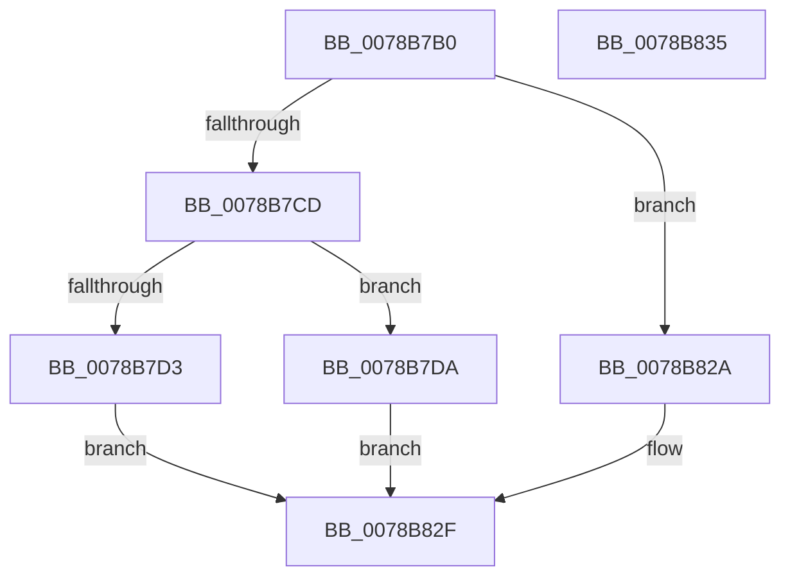

# RtlDecompressFragment

- RVA: `0x0078B7B0`–`0x0078B836` (길이 `134` bytes)
- VA: `0x000000014078B7B0`
- 실행 섹션: `PAGE`
- PDB 이름 있음: `예`; PDB Function 태그: `아니요`
- unwind 정보 RVA: `0x00071A74`
- 디코드: `34`개 명령, `134/134` bytes 표시
- 미해석 바이트: `0` (있으면 어셈블리에 `.byte`로 보존)

> 이 문서는 커널 이미지의 기계어와 PDB 기호를 분석해 생성했습니다. 4번과 5번은 함수 원형과 자료형을 바이너리 사용 방식에서 추정한 C 해석이며 원본 소스 복구 결과는 아닙니다.

## 1. Dependencies

- 직접 호출 지점: **1**; 고유 호출 대상: **1**
- 직접 호출자로 확인된 함수: **0**
- RIP 상대 이미지 참조: **1**

### Outgoing calls
- `0x0078B823` → [guard_dispatch_icall](../../text/6B/guard_dispatch_icall_function_006BAAD0.md) (function, `0x006BAAD0`)

### Direct callers
- 이 함수 시작 RVA로 연결되는 직접 call은 확인되지 않았습니다. 간접 호출은 완전히 역산할 수 없습니다.

### Static image references
- `0x0078B7EB` → RVA `0x00B4CB80` (`RtlDecompressFragmentProcs`; read)

## 2. Other-region calls and transfers

- 다른 실행 섹션으로 향하는 call: **1**
  - `0x0078B823` → [guard_dispatch_icall](../../text/6B/guard_dispatch_icall_function_006BAAD0.md) (`PAGE` → `.text`)
- 별도 외부 분기/꼬리 이동을 확인하지 못했습니다.

## 3. Assembly (complete function range)

```asm
0078B7B0  40 53                           push rbx
0078B7B2  48 83 EC 50                     sub rsp, 0x50
0078B7B6  B8 FF 00 00 00                  mov eax, 0xff
0078B7BB  4D 8B D1                        mov r10, r9
0078B7BE  66 23 C8                        and cx, ax
0078B7C1  45 8B D8                        mov r11d, r8d
0078B7C4  48 8B DA                        mov rbx, rdx
0078B7C7  66 83 F9 02                     cmp cx, 2
0078B7CB  72 5D                           jb 0x14078b82a
0078B7CD  66 83 F9 08                     cmp cx, 8
0078B7D1  76 07                           jbe 0x14078b7da
0078B7D3  B8 5F 02 00 C0                  mov eax, 0xc000025f
0078B7D8  EB 55                           jmp 0x14078b82f
0078B7DA  44 8B 8C 24 80 00 00 00         mov r9d, dword ptr [rsp + 0x80]
0078B7E2  4D 8B C2                        mov r8, r10
0078B7E5  0F B7 C1                        movzx eax, cx
0078B7E8  41 8B D3                        mov edx, r11d
0078B7EB  48 8D 0D 8E 13 3C 00            lea rcx, [rip + 0x3c138e]
0078B7F2  48 8B 04 C1                     mov rax, qword ptr [rcx + rax*8]
0078B7F6  48 8B 8C 24 98 00 00 00         mov rcx, qword ptr [rsp + 0x98]
0078B7FE  48 89 4C 24 38                  mov qword ptr [rsp + 0x38], rcx
0078B803  48 8B 8C 24 90 00 00 00         mov rcx, qword ptr [rsp + 0x90]
0078B80B  48 89 4C 24 30                  mov qword ptr [rsp + 0x30], rcx
0078B810  83 64 24 28 00                  and dword ptr [rsp + 0x28], 0
0078B815  8B 8C 24 88 00 00 00            mov ecx, dword ptr [rsp + 0x88]
0078B81C  89 4C 24 20                     mov dword ptr [rsp + 0x20], ecx
0078B820  48 8B CB                        mov rcx, rbx
0078B823  E8 A8 F2 F2 FF                  call 0x1406baad0
0078B828  EB 05                           jmp 0x14078b82f
0078B82A  B8 0D 00 00 C0                  mov eax, 0xc000000d
0078B82F  48 83 C4 50                     add rsp, 0x50
0078B833  5B                              pop rbx
0078B834  C3                              ret
0078B835  CC                              int3
```

## 4. C-style interpretation (structured pseudocode)

```c
__int64 __fastcall RtlDecompressFragment(unsigned __int16 a1, __int64 a2, int a3, __int64 a4, unsigned int a5, unsigned int a6, __int64 a7, __int64 a8)
{
    __int64 result;
    __int64 v_rsp;
    unsigned __int64 v_stack_m20;
    unsigned __int64 v_stack_m28;
    unsigned int v_stack_m30;
    unsigned int v_stack_m38;

    v_rsp = (v_rsp) - (80);
    a1 = (unsigned __int16)((a1) & (255));
    if (a1 < 2) goto loc_0078B82A;
    if (a1 <= 8) goto loc_0078B7DA;
    goto loc_0078B82F;
loc_0078B7DA:
    v_stack_m20 = a8;
    v_stack_m28 = a7;
    v_stack_m38 = (unsigned int)((unsigned int)(a6));
    result = guard_dispatch_icall(a2, (unsigned int)((unsigned int)((unsigned int)(a3))), a4, (unsigned int)(a5));
    goto loc_0078B82F;
loc_0078B82A:
loc_0078B82F:
    v_rsp = (v_rsp) + (80);
    return (unsigned int)(0xC000000DULL);
}
```

## 5. (Beta) C Style

```c
int64_t RtlDecompressFragment(uint16_t Arg1, int64_t Arg2, int32_t Arg3, int64_t Arg4, uint32_t Arg5, uint32_t Arg6, int64_t Arg7, int64_t Arg8)
{
    int64_t result;
    int64_t local_rsp;
    uint64_t v_stack_m20;
    uint64_t v_stack_m28;
    uint32_t v_stack_m30;
    uint32_t v_stack_m38;

    local_rsp = (local_rsp) - (80);
    Arg1 = (uint16_t)((Arg1) & (255));
    if (Arg1 < 2) goto loc_0078B82A;
    if (Arg1 <= 8) goto loc_0078B7DA;
    goto loc_0078B82F;
loc_0078B7DA:
    v_stack_m20 = Arg8;
    v_stack_m28 = Arg7;
    v_stack_m38 = (uint32_t)((uint32_t)(Arg6));
    result = guard_dispatch_icall(Arg2, (uint32_t)((uint32_t)((uint32_t)(Arg3))), Arg4, (uint32_t)(Arg5));
    goto loc_0078B82F;
loc_0078B82A:
loc_0078B82F:
    local_rsp = (local_rsp) + (80);
    return (uint32_t)(0xC000000DULL);
}
```

## 6. Execution-region graph

[열기: 2D/3D 그래프와 함수 탐색 컨트롤 패널](../../../control-panel.html?section=page&rva=0x0078B7B0&view=graph)

- 2D 그래프는 위에서 아래로 흐르고, 3D 그래프는 빈 공간을 드래그해 회전합니다. Shift+드래그는 이동, 휠은 확대·축소, 함수 노드 선택은 대상 보고서 이동입니다.

### Static fallback


