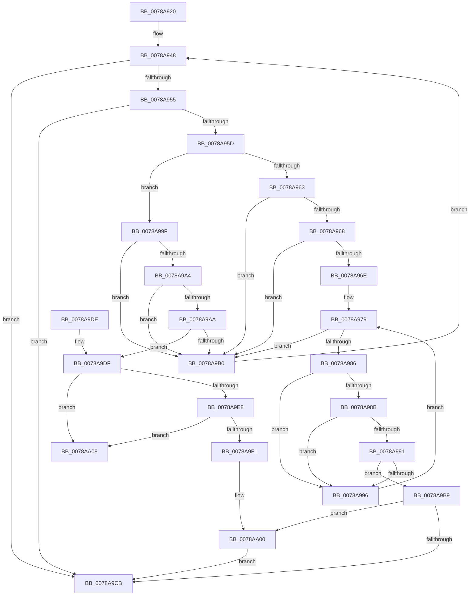

# RtlDeleteRange

- RVA: `0x0078A920`–`0x0078AA0F` (길이 `239` bytes)
- VA: `0x000000014078A920`
- 실행 섹션: `PAGE`
- PDB 이름 있음: `예`; PDB Function 태그: `아니요`
- unwind 정보 RVA: `0x000CF784`
- 디코드: `77`개 명령, `239/239` bytes 표시
- 미해석 바이트: `0` (있으면 어셈블리에 `.byte`로 보존)

> 이 문서는 커널 이미지의 기계어와 PDB 기호를 분석해 생성했습니다. 4번과 5번은 함수 원형과 자료형을 바이너리 사용 방식에서 추정한 C 해석이며 원본 소스 복구 결과는 아닙니다.

## 1. Dependencies

- 직접 호출 지점: **2**; 고유 호출 대상: **2**
- 직접 호출자로 확인된 함수: **2**
- RIP 상대 이미지 참조: **0**

### Outgoing calls
- `0x0078A9BF` → [RtlpDeleteFromMergedRange](RtlpDeleteFromMergedRange_function_0078AE98.md) (function, `0x0078AE98`)
- `0x0078A9F8` → [RtlpFreeRangeListEntry](../A6/RtlpFreeRangeListEntry_function_00A69918.md) (function, `0x00A69918`)

### Direct callers
- [ArbBacktrackAllocation](../70/ArbBacktrackAllocation_function_0070E260.md) at `0x0070E277`
- [IopPortBacktrackAllocation](../72/IopPortBacktrackAllocation_function_0072F360.md) at `0x0072F393`
- [IopPortBacktrackAllocation](../72/IopPortBacktrackAllocation_function_0072F360.md) at `0x0072F3C4`

### Static image references
- 디코드된 RIP-relative 메모리 참조가 없습니다.

## 2. Other-region calls and transfers

- 다른 실행 섹션으로 향하는 call: **0**
- 별도 외부 분기/꼬리 이동을 확인하지 못했습니다.

## 3. Assembly (complete function range)

```asm
0078A920  48 89 5C 24 10                  mov qword ptr [rsp + 0x10], rbx
0078A925  48 89 74 24 18                  mov qword ptr [rsp + 0x18], rsi
0078A92A  57                              push rdi
0078A92B  48 83 EC 20                     sub rsp, 0x20
0078A92F  48 8B 01                        mov rax, qword ptr [rcx]
0078A932  48 8B D9                        mov rbx, rcx
0078A935  49 8B F8                        mov rdi, r8
0078A938  48 8B F2                        mov rsi, rdx
0078A93B  41 BA 8C 02 00 C0               mov r10d, 0xc000028c
0078A941  4C 8B 18                        mov r11, qword ptr [rax]
0078A944  48 8D 48 D8                     lea rcx, [rax - 0x28]
0078A948  49 83 EB 28                     sub r11, 0x28
0078A94C  4C 8D 41 28                     lea r8, [rcx + 0x28]
0078A950  49 3B D8                        cmp rbx, r8
0078A953  74 76                           je 0x14078a9cb
0078A955  48 8B 11                        mov rdx, qword ptr [rcx]
0078A958  48 3B FA                        cmp rdi, rdx
0078A95B  72 6E                           jb 0x14078a9cb
0078A95D  F6 41 22 01                     test byte ptr [rcx + 0x22], 1
0078A961  74 3C                           je 0x14078a99f
0078A963  48 3B F2                        cmp rsi, rdx
0078A966  72 48                           jb 0x14078a9b0
0078A968  48 3B 79 08                     cmp rdi, qword ptr [rcx + 8]
0078A96C  77 42                           ja 0x14078a9b0
0078A96E  48 8B 41 10                     mov rax, qword ptr [rcx + 0x10]
0078A972  48 8B 10                        mov rdx, qword ptr [rax]
0078A975  4C 8D 40 D8                     lea r8, [rax - 0x28]
0078A979  48 83 EA 28                     sub rdx, 0x28
0078A97D  49 8D 40 18                     lea rax, [r8 + 0x18]
0078A981  48 3B C8                        cmp rcx, rax
0078A984  74 2A                           je 0x14078a9b0
0078A986  49 39 30                        cmp qword ptr [r8], rsi
0078A989  75 0B                           jne 0x14078a996
0078A98B  49 39 78 08                     cmp qword ptr [r8 + 8], rdi
0078A98F  75 05                           jne 0x14078a996
0078A991  4C 39 08                        cmp qword ptr [rax], r9
0078A994  74 23                           je 0x14078a9b9
0078A996  4C 8B C2                        mov r8, rdx
0078A999  48 8B 52 28                     mov rdx, qword ptr [rdx + 0x28]
0078A99D  EB DA                           jmp 0x14078a979
0078A99F  48 3B D6                        cmp rdx, rsi
0078A9A2  75 0C                           jne 0x14078a9b0
0078A9A4  48 39 79 08                     cmp qword ptr [rcx + 8], rdi
0078A9A8  75 06                           jne 0x14078a9b0
0078A9AA  4C 39 49 18                     cmp qword ptr [rcx + 0x18], r9
0078A9AE  74 2F                           je 0x14078a9df
0078A9B0  49 8B CB                        mov rcx, r11
0078A9B3  4D 8B 5B 28                     mov r11, qword ptr [r11 + 0x28]
0078A9B7  EB 8F                           jmp 0x14078a948
0078A9B9  48 8B D1                        mov rdx, rcx
0078A9BC  49 8B C8                        mov rcx, r8
0078A9BF  E8 D4 04 00 00                  call 0x14078ae98
0078A9C4  44 8B D0                        mov r10d, eax
0078A9C7  85 C0                           test eax, eax
0078A9C9  79 35                           jns 0x14078aa00
0078A9CB  48 8B 5C 24 38                  mov rbx, qword ptr [rsp + 0x38]
0078A9D0  41 8B C2                        mov eax, r10d
0078A9D3  48 8B 74 24 40                  mov rsi, qword ptr [rsp + 0x40]
0078A9D8  48 83 C4 20                     add rsp, 0x20
0078A9DC  5F                              pop rdi
0078A9DD  C3                              ret
0078A9DE  CC                              int3
0078A9DF  49 8B 10                        mov rdx, qword ptr [r8]
0078A9E2  4C 39 42 08                     cmp qword ptr [rdx + 8], r8
0078A9E6  75 20                           jne 0x14078aa08
0078A9E8  49 8B 40 08                     mov rax, qword ptr [r8 + 8]
0078A9EC  4C 39 00                        cmp qword ptr [rax], r8
0078A9EF  75 17                           jne 0x14078aa08
0078A9F1  48 89 10                        mov qword ptr [rax], rdx
0078A9F4  48 89 42 08                     mov qword ptr [rdx + 8], rax
0078A9F8  E8 1B EF 2D 00                  call 0x140a69918
0078A9FD  45 33 D2                        xor r10d, r10d
0078AA00  FF 4B 14                        dec dword ptr [rbx + 0x14]
0078AA03  FF 43 18                        inc dword ptr [rbx + 0x18]
0078AA06  EB C3                           jmp 0x14078a9cb
0078AA08  B9 03 00 00 00                  mov ecx, 3
0078AA0D  CD 29                           int 0x29
```

## 4. C-style interpretation (structured pseudocode)

```c
__int64 __fastcall RtlDeleteRange(__int64 a1, __int64 a2, __int64 a3, __int64 a4)
{
    __int64 result;
    __int64 v_r10;
    __int64 v_r11;
    __int64 v_rsp;
    unsigned __int64 v_stack_p10;
    unsigned __int64 v_stack_p18;

    v_stack_p10 = v_rbx;
    v_stack_p18 = v_rsi;
    v_rsp = (v_rsp) - (32);
loc_0078A948:
    v_r11 = (*(unsigned __int64 *)(*(unsigned __int64 *)(a1))) - (40);
    if (a1 == (*(unsigned __int64 *)(a1) - 40 + 40)) goto loc_0078A9CB;
    if (a3 < (*(unsigned __int64 *)(*(unsigned __int64 *)(a1) - 40))) goto loc_0078A9CB;
    if (((*(unsigned __int8 *)(*(unsigned __int64 *)(a1) - 40 + 34)) & (1)) == 0) goto loc_0078A99F;
    if (a2 < (*(unsigned __int64 *)(*(unsigned __int64 *)(a1) - 40))) goto loc_0078A9B0;
    if (a3 > (*(unsigned __int64 *)(*(unsigned __int64 *)(a1) - 40 + 8))) goto loc_0078A9B0;
loc_0078A979:
    a2 = (*(unsigned __int64 *)(*(unsigned __int64 *)(*(unsigned __int64 *)(a1) - 40 + 16))) - (40);
    if ((*(unsigned __int64 *)(a1) - 40) == (*(unsigned __int64 *)(*(unsigned __int64 *)(a1) - 40 + 16) - 40 + 24)) goto loc_0078A9B0;
    if ((*(unsigned __int64 *)(*(unsigned __int64 *)(*(unsigned __int64 *)(a1) - 40 + 16) - 40)) != a2) goto loc_0078A996;
    if ((*(unsigned __int64 *)(*(unsigned __int64 *)(*(unsigned __int64 *)(a1) - 40 + 16) - 40 + 8)) != a3) goto loc_0078A996;
    if ((*(unsigned __int64 *)(*(unsigned __int64 *)(*(unsigned __int64 *)(a1) - 40 + 16) - 40 + 24)) == a4) goto loc_0078A9B9;
loc_0078A996:
    goto loc_0078A979;
loc_0078A99F:
    if ((*(unsigned __int64 *)(a2 + 40)) != a2) goto loc_0078A9B0;
    if ((*(unsigned __int64 *)(*(unsigned __int64 *)(a1) - 40 + 8)) != a3) goto loc_0078A9B0;
    if ((*(unsigned __int64 *)(*(unsigned __int64 *)(a1) - 40 + 24)) == a4) goto loc_0078A9DF;
loc_0078A9B0:
    goto loc_0078A948;
loc_0078A9B9:
    result = RtlpDeleteFromMergedRange(a2, v_r11, a2, a4);
    if (!sign_flag) goto loc_0078AA00;
loc_0078A9CB:
    v_rsp = (v_rsp) + (32);
    return (unsigned int)((unsigned int)((unsigned int)((unsigned int)(result))));
loc_0078A9DF:
    if ((*(unsigned __int64 *)(*(unsigned __int64 *)(a2) + 8)) != a2) goto loc_0078AA08;
    if ((*(unsigned __int64 *)(*(unsigned __int64 *)(a2 + 8))) != a2) goto loc_0078AA08;
    *(unsigned __int64 *)(*(unsigned __int64 *)(a2 + 8)) = *(unsigned __int64 *)(a2);
    *(unsigned __int64 *)(*(unsigned __int64 *)(a2) + 8) = *(unsigned __int64 *)(a2 + 8);
    result = RtlpFreeRangeListEntry(a2, *(unsigned __int64 *)(a2), a2, a4);
    v_r10 = 0;
loc_0078AA00:
    goto loc_0078A9CB;
loc_0078AA08:
    return result;
}
```

## 5. (Beta) C Style

```c
int64_t RtlDeleteRange(void *Arg1, int64_t Arg2, int64_t Arg3, int64_t Arg4)
{
    uint8_t *arg1 = (uint8_t *)Arg1;

    int64_t result;
    int64_t local_r10;
    int64_t local_r11;
    int64_t local_rsp;
    uint64_t v_stack_p10;
    uint64_t v_stack_p18;

    v_stack_p10 = local_rbx;
    v_stack_p18 = local_rsi;
    local_rsp = (local_rsp) - (32);
loc_0078A948:
    local_r11 = (*(uint64_t *)(*(uint64_t *)(arg1))) - (40);
    if (Arg1 == (*(uint64_t *)(arg1) - 40 + 40)) goto loc_0078A9CB;
    if (Arg3 < (*(uint64_t *)(*(uint64_t *)(arg1) - 0x28))) goto loc_0078A9CB;
    if (((*(uint8_t *)(*(uint64_t *)(arg1) - 0x28 + 0x22)) & (1)) == 0) goto loc_0078A99F;
    if (Arg2 < (*(uint64_t *)(*(uint64_t *)(arg1) - 0x28))) goto loc_0078A9B0;
    if (Arg3 > (*(uint64_t *)(*(uint64_t *)(arg1) - 0x28 + 0x8))) goto loc_0078A9B0;
loc_0078A979:
    Arg2 = (*(uint64_t *)(*(uint64_t *)(*(uint64_t *)(arg1) - 0x28 + 0x10))) - (40);
    if ((*(uint64_t *)(arg1) - 40) == (*(uint64_t *)(*(uint64_t *)(arg1) - 0x28 + 0x10) - 40 + 24)) goto loc_0078A9B0;
    if ((*(uint64_t *)(*(uint64_t *)(*(uint64_t *)(arg1) - 0x28 + 0x10) - 0x28)) != Arg2) goto loc_0078A996;
    if ((*(uint64_t *)(*(uint64_t *)(*(uint64_t *)(arg1) - 0x28 + 0x10) - 0x28 + 0x8)) != Arg3) goto loc_0078A996;
    if ((*(uint64_t *)(*(uint64_t *)(*(uint64_t *)(arg1) - 0x28 + 0x10) - 0x28 + 0x18)) == Arg4) goto loc_0078A9B9;
loc_0078A996:
    goto loc_0078A979;
loc_0078A99F:
    if ((*(uint64_t *)(Arg2 + 0x28)) != Arg2) goto loc_0078A9B0;
    if ((*(uint64_t *)(*(uint64_t *)(arg1) - 0x28 + 0x8)) != Arg3) goto loc_0078A9B0;
    if ((*(uint64_t *)(*(uint64_t *)(arg1) - 0x28 + 0x18)) == Arg4) goto loc_0078A9DF;
loc_0078A9B0:
    goto loc_0078A948;
loc_0078A9B9:
    result = RtlpDeleteFromMergedRange(Arg2, local_r11, Arg2, Arg4);
    if (!sign_flag) goto loc_0078AA00;
loc_0078A9CB:
    local_rsp = (local_rsp) + (32);
    return (uint32_t)((uint32_t)((uint32_t)((uint32_t)(result))));
loc_0078A9DF:
    if ((*(uint64_t *)(*(uint64_t *)(Arg2) + 0x8)) != Arg2) goto loc_0078AA08;
    if ((*(uint64_t *)(*(uint64_t *)(Arg2 + 0x8))) != Arg2) goto loc_0078AA08;
    *(uint64_t *)(*(uint64_t *)(Arg2 + 0x8)) = *(uint64_t *)(Arg2);
    *(uint64_t *)(*(uint64_t *)(Arg2) + 0x8) = *(uint64_t *)(Arg2 + 0x8);
    result = RtlpFreeRangeListEntry(Arg2, *(uint64_t *)(Arg2), Arg2, Arg4);
    local_r10 = 0;
loc_0078AA00:
    goto loc_0078A9CB;
loc_0078AA08:
    return result;
}
```

### 관측된 메모리 오프셋

구조체 형식이 확인되지 않은 접근은 인자 기준의 오프셋으로만 기록했습니다.

| 기준 인자 | 오프셋 표현 | 폭 (bit) | 접근 |
|---|---:|---:|---|
| `Arg1` | `+ 0x0` | `64` | `R` |

## 6. Execution-region graph

[열기: 2D/3D 그래프와 함수 탐색 컨트롤 패널](../../../control-panel.html?section=page&rva=0x0078A920&view=graph)

- 2D 그래프는 위에서 아래로 흐르고, 3D 그래프는 빈 공간을 드래그해 회전합니다. Shift+드래그는 이동, 휠은 확대·축소, 함수 노드 선택은 대상 보고서 이동입니다.

### Static fallback


