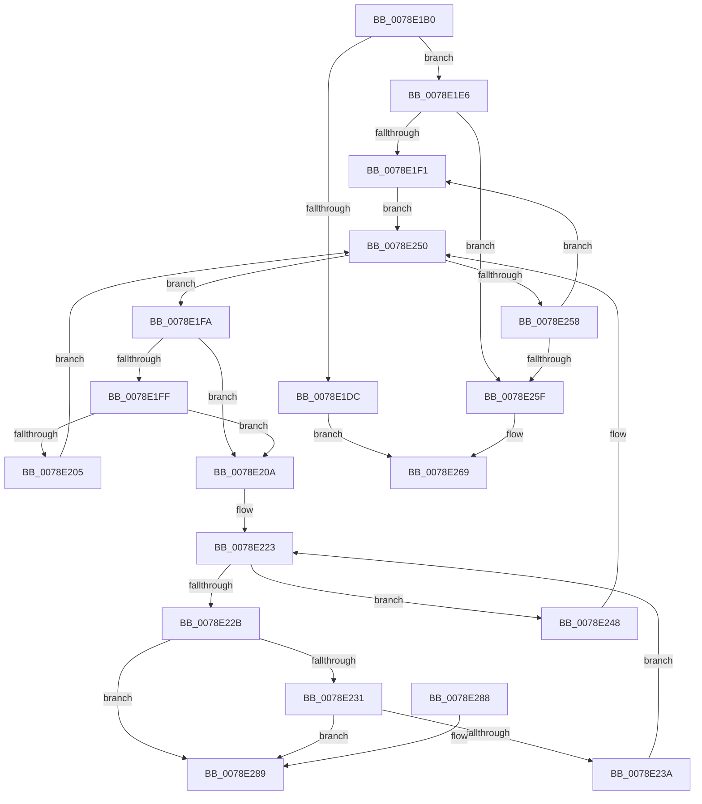

# RtlEmptyAtomTable

- RVA: `0x0078E1B0`–`0x0078E290` (길이 `224` bytes)
- VA: `0x000000014078E1B0`
- 실행 섹션: `PAGE`
- PDB 이름 있음: `예`; PDB Function 태그: `아니요`
- unwind 정보 RVA: `0x000C45E0`
- 디코드: `71`개 명령, `224/224` bytes 표시
- 미해석 바이트: `0` (있으면 어셈블리에 `.byte`로 보존)

> 이 문서는 커널 이미지의 기계어와 PDB 기호를 분석해 생성했습니다. 4번과 5번은 함수 원형과 자료형을 바이너리 사용 방식에서 추정한 C 해석이며 원본 소스 복구 결과는 아닙니다.

## 1. Dependencies

- 직접 호출 지점: **5**; 고유 호출 대상: **4**
- 직접 호출자로 확인된 함수: **0**
- RIP 상대 이미지 참조: **0**

### Outgoing calls
- `0x0078E1D3` → [RtlpLockAtomTable](../9C/RtlpLockAtomTable_function_009C4A10.md) (function, `0x009C4A10`)
- `0x0078E21A` → [RtlpFreeHandleForAtom](../88/RtlpFreeHandleForAtom_function_00887F08.md) (function, `0x00887F08`)
- `0x0078E241` → [RtlpFreeAtom](../8B/RtlpFreeAtom_function_008BD87C.md) (function, `0x008BD87C`)
- `0x0078E24B` → [RtlpFreeAtom](../8B/RtlpFreeAtom_function_008BD87C.md) (function, `0x008BD87C`)
- `0x0078E262` → [RtlpUnlockAtomTable](../9C/RtlpUnlockAtomTable_function_009C4A8C.md) (function, `0x009C4A8C`)

### Direct callers
- 이 함수 시작 RVA로 연결되는 직접 call은 확인되지 않았습니다. 간접 호출은 완전히 역산할 수 없습니다.

### Static image references
- 디코드된 RIP-relative 메모리 참조가 없습니다.

## 2. Other-region calls and transfers

- 다른 실행 섹션으로 향하는 call: **0**
- 별도 외부 분기/꼬리 이동을 확인하지 못했습니다.

## 3. Assembly (complete function range)

```asm
0078E1B0  48 8B C4                        mov rax, rsp
0078E1B3  48 89 58 08                     mov qword ptr [rax + 8], rbx
0078E1B7  48 89 68 10                     mov qword ptr [rax + 0x10], rbp
0078E1BB  48 89 70 18                     mov qword ptr [rax + 0x18], rsi
0078E1BF  48 89 78 20                     mov qword ptr [rax + 0x20], rdi
0078E1C3  41 54                           push r12
0078E1C5  41 56                           push r14
0078E1C7  41 57                           push r15
0078E1C9  48 83 EC 20                     sub rsp, 0x20
0078E1CD  44 8A E2                        mov r12b, dl
0078E1D0  48 8B F9                        mov rdi, rcx
0078E1D3  E8 38 68 23 00                  call 0x1409c4a10
0078E1D8  84 C0                           test al, al
0078E1DA  75 0A                           jne 0x14078e1e6
0078E1DC  B8 0D 00 00 C0                  mov eax, 0xc000000d
0078E1E1  E9 83 00 00 00                  jmp 0x14078e269
0078E1E6  33 ED                           xor ebp, ebp
0078E1E8  4C 8D 7F 20                     lea r15, [rdi + 0x20]
0078E1EC  39 6F 1C                        cmp dword ptr [rdi + 0x1c], ebp
0078E1EF  76 6E                           jbe 0x14078e25f
0078E1F1  49 8B F7                        mov rsi, r15
0078E1F4  49 83 C7 08                     add r15, 8
0078E1F8  EB 56                           jmp 0x14078e250
0078E1FA  45 84 E4                        test r12b, r12b
0078E1FD  75 0B                           jne 0x14078e20a
0078E1FF  F6 43 26 01                     test byte ptr [rbx + 0x26], 1
0078E203  74 05                           je 0x14078e20a
0078E205  48 8B F3                        mov rsi, rbx
0078E208  EB 46                           jmp 0x14078e250
0078E20A  48 8B 03                        mov rax, qword ptr [rbx]
0078E20D  48 8B D3                        mov rdx, rbx
0078E210  48 89 06                        mov qword ptr [rsi], rax
0078E213  48 8B CF                        mov rcx, rdi
0078E216  48 83 23 00                     and qword ptr [rbx], 0
0078E21A  E8 E9 9C 0F 00                  call 0x140887f08
0078E21F  4C 8D 73 10                     lea r14, [rbx + 0x10]
0078E223  49 8B 0E                        mov rcx, qword ptr [r14]
0078E226  49 3B CE                        cmp rcx, r14
0078E229  74 1D                           je 0x14078e248
0078E22B  4C 39 71 08                     cmp qword ptr [rcx + 8], r14
0078E22F  75 58                           jne 0x14078e289
0078E231  48 8B 01                        mov rax, qword ptr [rcx]
0078E234  48 39 48 08                     cmp qword ptr [rax + 8], rcx
0078E238  75 4F                           jne 0x14078e289
0078E23A  49 89 06                        mov qword ptr [r14], rax
0078E23D  4C 89 70 08                     mov qword ptr [rax + 8], r14
0078E241  E8 36 F6 12 00                  call 0x1408bd87c
0078E246  EB DB                           jmp 0x14078e223
0078E248  48 8B CB                        mov rcx, rbx
0078E24B  E8 2C F6 12 00                  call 0x1408bd87c
0078E250  48 8B 1E                        mov rbx, qword ptr [rsi]
0078E253  48 85 DB                        test rbx, rbx
0078E256  75 A2                           jne 0x14078e1fa
0078E258  FF C5                           inc ebp
0078E25A  3B 6F 1C                        cmp ebp, dword ptr [rdi + 0x1c]
0078E25D  72 92                           jb 0x14078e1f1
0078E25F  48 8B CF                        mov rcx, rdi
0078E262  E8 25 68 23 00                  call 0x1409c4a8c
0078E267  33 C0                           xor eax, eax
0078E269  48 8B 5C 24 40                  mov rbx, qword ptr [rsp + 0x40]
0078E26E  48 8B 6C 24 48                  mov rbp, qword ptr [rsp + 0x48]
0078E273  48 8B 74 24 50                  mov rsi, qword ptr [rsp + 0x50]
0078E278  48 8B 7C 24 58                  mov rdi, qword ptr [rsp + 0x58]
0078E27D  48 83 C4 20                     add rsp, 0x20
0078E281  41 5F                           pop r15
0078E283  41 5E                           pop r14
0078E285  41 5C                           pop r12
0078E287  C3                              ret
0078E288  CC                              int3
0078E289  B9 03 00 00 00                  mov ecx, 3
0078E28E  CD 29                           int 0x29
```

## 4. C-style interpretation (structured pseudocode)

```c
__int64 __fastcall RtlEmptyAtomTable(__int64 a1, unsigned __int8 a2)
{
    __int64 result;
    __int64 v_r15;
    __int64 v_rbp;
    __int64 v_rsp;
    unsigned __int64 v_stack_p10;
    unsigned __int64 v_stack_p18;
    unsigned __int64 v_stack_p20;
    unsigned __int64 v_stack_p8;

    *(unsigned __int64 *)(v_rsp + 8) = v_rbx;
    *(unsigned __int64 *)(v_rsp + 16) = v_rbp;
    *(unsigned __int64 *)(v_rsp + 24) = v_rsi;
    *(unsigned __int64 *)(v_rsp + 32) = v_rdi;
    v_rsp = (v_rsp) - (32);
    result = RtlpLockAtomTable(a1, a2, a3, a4);
    if ((unsigned __int8)(result) != 0) goto loc_0078E1E6;
    goto loc_0078E269;
loc_0078E1E6:
    v_rbp = 0;
    if ((*(unsigned int *)(a1 + 28)) <= 0) goto loc_0078E25F;
loc_0078E1F1:
    v_r15 = (a1 + 32) + (8);
    goto loc_0078E250;
loc_0078E1FA:
    if (a2 != 0) goto loc_0078E20A;
    if (((*(unsigned __int8 *)(v_rbx + 38)) & (1)) == 0) goto loc_0078E20A;
    goto loc_0078E250;
loc_0078E20A:
    *(unsigned __int64 *)(v_rbx) = *(unsigned __int64 *)(v_rbx);
    result = RtlpFreeHandleForAtom(a1, v_rbx, a3, a4);
loc_0078E223:
    if ((*(unsigned __int64 *)(v_rbx + 16)) == (v_rbx + 16)) goto loc_0078E248;
    if ((*(unsigned __int64 *)(*(unsigned __int64 *)(v_rbx + 16) + 8)) != (v_rbx + 16)) goto loc_0078E289;
    if ((*(unsigned __int64 *)(*(unsigned __int64 *)(*(unsigned __int64 *)(v_rbx + 16)) + 8)) != (*(unsigned __int64 *)(v_rbx + 16))) goto loc_0078E289;
    *(unsigned __int64 *)(v_rbx + 16) = *(unsigned __int64 *)(*(unsigned __int64 *)(v_rbx + 16));
    *(unsigned __int64 *)(*(unsigned __int64 *)(*(unsigned __int64 *)(v_rbx + 16)) + 8) = v_rbx + 16;
    result = RtlpFreeAtom(*(unsigned __int64 *)(v_rbx + 16), v_rbx, a3, a4);
    goto loc_0078E223;
loc_0078E248:
    result = RtlpFreeAtom(v_rbx, v_rbx, a3, a4);
loc_0078E250:
    if (*(unsigned __int64 *)(v_rbx) != 0) goto loc_0078E1FA;
    v_rbp = (unsigned int)((v_rbp) + 1);
    if (((unsigned int)(v_rbp)) < (*(unsigned int *)(a1 + 28))) goto loc_0078E1F1;
loc_0078E25F:
    result = RtlpUnlockAtomTable(a1, v_rbx, a3, a4);
    result = 0;
loc_0078E269:
    v_rsp = (v_rsp) + (32);
    return result;
loc_0078E289:
    return result;
}
```

## 5. (Beta) C Style

```c
int64_t RtlEmptyAtomTable(void *Arg1, uint8_t Arg2)
{
    uint8_t *arg1 = (uint8_t *)Arg1;

    int64_t result;
    int64_t local_r15;
    int64_t local_rbp;
    int64_t local_rsp;
    uint64_t v_stack_p10;
    uint64_t v_stack_p18;
    uint64_t v_stack_p20;
    uint64_t v_stack_p8;

    *(uint64_t *)(local_rsp + 0x8) = local_rbx;
    *(uint64_t *)(local_rsp + 0x10) = local_rbp;
    *(uint64_t *)(local_rsp + 0x18) = local_rsi;
    *(uint64_t *)(local_rsp + 0x20) = local_rdi;
    local_rsp = (local_rsp) - (32);
    result = RtlpLockAtomTable(Arg1, Arg2, a3, a4);
    if ((uint8_t)(result) != 0) goto loc_0078E1E6;
    goto loc_0078E269;
loc_0078E1E6:
    local_rbp = 0;
    if ((*(uint32_t *)(arg1 + 0x1C)) <= 0) goto loc_0078E25F;
loc_0078E1F1:
    local_r15 = (Arg1 + 32) + (8);
    goto loc_0078E250;
loc_0078E1FA:
    if (Arg2 != 0) goto loc_0078E20A;
    if (((*(uint8_t *)(local_rbx + 0x26)) & (1)) == 0) goto loc_0078E20A;
    goto loc_0078E250;
loc_0078E20A:
    *(uint64_t *)(local_rbx) = *(uint64_t *)(local_rbx);
    result = RtlpFreeHandleForAtom(Arg1, local_rbx, a3, a4);
loc_0078E223:
    if ((*(uint64_t *)(local_rbx + 0x10)) == (local_rbx + 16)) goto loc_0078E248;
    if ((*(uint64_t *)(*(uint64_t *)(local_rbx + 0x10) + 0x8)) != (local_rbx + 16)) goto loc_0078E289;
    if ((*(uint64_t *)(*(uint64_t *)(*(uint64_t *)(local_rbx + 0x10)) + 0x8)) != (*(uint64_t *)(local_rbx + 0x10))) goto loc_0078E289;
    *(uint64_t *)(local_rbx + 0x10) = *(uint64_t *)(*(uint64_t *)(local_rbx + 0x10));
    *(uint64_t *)(*(uint64_t *)(*(uint64_t *)(local_rbx + 0x10)) + 0x8) = local_rbx + 16;
    result = RtlpFreeAtom(*(uint64_t *)(local_rbx + 0x10), local_rbx, a3, a4);
    goto loc_0078E223;
loc_0078E248:
    result = RtlpFreeAtom(local_rbx, local_rbx, a3, a4);
loc_0078E250:
    if (*(uint64_t *)(local_rbx) != 0) goto loc_0078E1FA;
    local_rbp = (uint32_t)((local_rbp) + 1);
    if (((uint32_t)(local_rbp)) < (*(uint32_t *)(arg1 + 0x1C))) goto loc_0078E1F1;
loc_0078E25F:
    result = RtlpUnlockAtomTable(Arg1, local_rbx, a3, a4);
    result = 0;
loc_0078E269:
    local_rsp = (local_rsp) + (32);
    return result;
loc_0078E289:
    return result;
}
```

### 관측된 메모리 오프셋

구조체 형식이 확인되지 않은 접근은 인자 기준의 오프셋으로만 기록했습니다.

| 기준 인자 | 오프셋 표현 | 폭 (bit) | 접근 |
|---|---:|---:|---|
| `Arg1` | `+ 0x1C` | `32` | `R` |
| `Arg1` | `+ 0x20` | `64` | `R` |

## 6. Execution-region graph

[열기: 2D/3D 그래프와 함수 탐색 컨트롤 패널](../../../control-panel.html?section=page&rva=0x0078E1B0&view=graph)

- 2D 그래프는 위에서 아래로 흐르고, 3D 그래프는 빈 공간을 드래그해 회전합니다. Shift+드래그는 이동, 휠은 확대·축소, 함수 노드 선택은 대상 보고서 이동입니다.

### Static fallback


