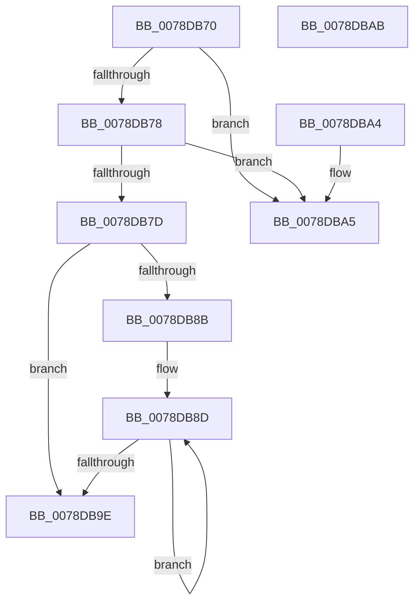

# RtlGetAcesBufferSize

- RVA: `0x0078DB70`–`0x0078DBAC` (길이 `60` bytes)
- VA: `0x000000014078DB70`
- 실행 섹션: `PAGE`
- PDB 이름 있음: `예`; PDB Function 태그: `아니요`
- unwind 정보 RVA: `0x000DB714`
- 디코드: `22`개 명령, `60/60` bytes 표시
- 미해석 바이트: `0` (있으면 어셈블리에 `.byte`로 보존)

> 이 문서는 커널 이미지의 기계어와 PDB 기호를 분석해 생성했습니다. 4번과 5번은 함수 원형과 자료형을 바이너리 사용 방식에서 추정한 C 해석이며 원본 소스 복구 결과는 아닙니다.

## 1. Dependencies

- 직접 호출 지점: **0**; 고유 호출 대상: **0**
- 직접 호출자로 확인된 함수: **1**
- RIP 상대 이미지 참조: **0**

### Outgoing calls
- 직접 디코드된 call 명령이 없습니다.

### Direct callers
- [PiDevCfgGetKeySecurityDescriptor](../99/PiDevCfgGetKeySecurityDescriptor_function_00996240.md) at `0x0099649B`

### Static image references
- 디코드된 RIP-relative 메모리 참조가 없습니다.

## 2. Other-region calls and transfers

- 다른 실행 섹션으로 향하는 call: **0**
- 별도 외부 분기/꼬리 이동을 확인하지 못했습니다.

## 3. Assembly (complete function range)

```asm
0078DB70  45 33 C0                        xor r8d, r8d
0078DB73  48 85 C9                        test rcx, rcx
0078DB76  74 2D                           je 0x14078dba5
0078DB78  48 85 D2                        test rdx, rdx
0078DB7B  74 28                           je 0x14078dba5
0078DB7D  0F B7 41 04                     movzx eax, word ptr [rcx + 4]
0078DB81  4C 8D 49 08                     lea r9, [rcx + 8]
0078DB85  66 44 3B C0                     cmp r8w, ax
0078DB89  73 13                           jae 0x14078db9e
0078DB8B  8B C8                           mov ecx, eax
0078DB8D  41 0F B7 41 02                  movzx eax, word ptr [r9 + 2]
0078DB92  44 03 C0                        add r8d, eax
0078DB95  4C 03 C8                        add r9, rax
0078DB98  48 83 E9 01                     sub rcx, 1
0078DB9C  75 EF                           jne 0x14078db8d
0078DB9E  44 89 02                        mov dword ptr [rdx], r8d
0078DBA1  33 C0                           xor eax, eax
0078DBA3  C3                              ret
0078DBA4  CC                              int3
0078DBA5  B8 0D 00 00 C0                  mov eax, 0xc000000d
0078DBAA  C3                              ret
0078DBAB  CC                              int3
```

## 4. C-style interpretation (structured pseudocode)

```c
__int64 __fastcall RtlGetAcesBufferSize(__int64 a1, __int64 a2, int a3)
{
    __int64 result;

    a3 = 0;
    if (a1 == 0) goto loc_0078DBA5;
    if (a2 == 0) goto loc_0078DBA5;
    if (0 >= ((unsigned __int16)(*(unsigned __int16 *)(a1 + 4)))) goto loc_0078DB9E;
loc_0078DB8D:
    a3 = (unsigned int)((a3) + ((unsigned int)(*(unsigned __int16 *)(a1 + 8 + 2))));
    a4 = (a1 + 8) + (*(unsigned __int16 *)(a1 + 8 + 2));
    a1 = ((unsigned int)((unsigned int)(*(unsigned __int16 *)(a1 + 4)))) - (1);
    if (condition_is_not_equal) goto loc_0078DB8D;
loc_0078DB9E:
    *(unsigned int *)(a2) = a3;
    result = 0;
    return result;
loc_0078DBA5:
    return (unsigned int)(0xC000000DULL);
}
```

## 5. (Beta) C Style

```c
int64_t RtlGetAcesBufferSize(int64_t Arg1, int64_t Arg2, int32_t Arg3)
{
    int64_t result;

    Arg3 = 0;
    if (Arg1 == 0) goto loc_0078DBA5;
    if (Arg2 == 0) goto loc_0078DBA5;
    if (0 >= ((uint16_t)(*(uint16_t *)(Arg1 + 0x4)))) goto loc_0078DB9E;
loc_0078DB8D:
    Arg3 = (uint32_t)((Arg3) + ((uint32_t)(*(uint16_t *)(Arg1 + 0x8 + 0x2))));
    a4 = (Arg1 + 8) + (*(uint16_t *)(Arg1 + 0x8 + 0x2));
    Arg1 = ((uint32_t)((uint32_t)(*(uint16_t *)(Arg1 + 0x4)))) - (1);
    if (condition_is_not_equal) goto loc_0078DB8D;
loc_0078DB9E:
    *(uint32_t *)(Arg2) = Arg3;
    result = 0;
    return result;
loc_0078DBA5:
    return (uint32_t)(0xC000000DULL);
}
```

## 6. Execution-region graph

[열기: 2D/3D 그래프와 함수 탐색 컨트롤 패널](../../../control-panel.html?section=page&rva=0x0078DB70&view=graph)

- 2D 그래프는 위에서 아래로 흐르고, 3D 그래프는 빈 공간을 드래그해 회전합니다. Shift+드래그는 이동, 휠은 확대·축소, 함수 노드 선택은 대상 보고서 이동입니다.

### Static fallback


