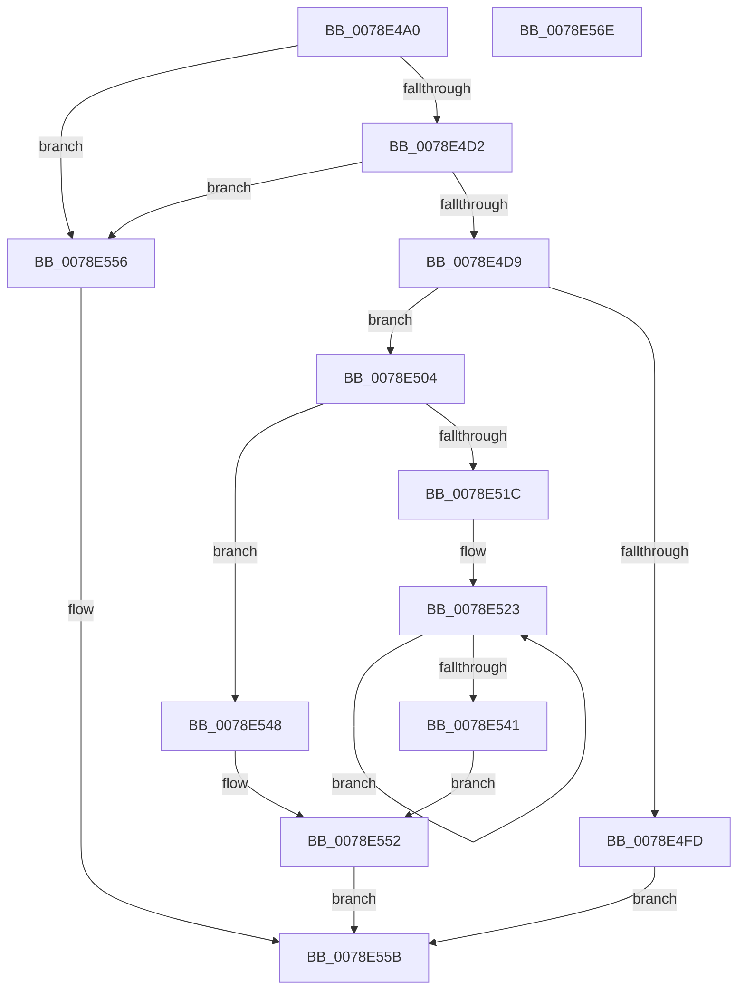

# RtlGetAppContainerParent

- RVA: `0x0078E4A0`–`0x0078E56F` (길이 `207` bytes)
- VA: `0x000000014078E4A0`
- 실행 섹션: `PAGE`
- PDB 이름 있음: `예`; PDB Function 태그: `아니요`
- unwind 정보 RVA: `0x000BD000`
- 디코드: `63`개 명령, `207/207` bytes 표시
- 미해석 바이트: `0` (있으면 어셈블리에 `.byte`로 보존)

> 이 문서는 커널 이미지의 기계어와 PDB 기호를 분석해 생성했습니다. 4번과 5번은 함수 원형과 자료형을 바이너리 사용 방식에서 추정한 C 해석이며 원본 소스 복구 결과는 아닙니다.

## 1. Dependencies

- 직접 호출 지점: **6**; 고유 호출 대상: **6**
- 직접 호출자로 확인된 함수: **2**
- RIP 상대 이미지 참조: **1**

### Outgoing calls
- `0x0078E4C5` → [RtlGetAppContainerSidType](../A7/RtlGetAppContainerSidType_function_00A72160.md) (function, `0x00A72160`)
- `0x0078E4DE` → [RtlLengthRequiredSid](../9C/RtlLengthRequiredSid_function_009CA4D0.md) (function, `0x009CA4D0`)
- `0x0078E4F0` → [ExAllocatePool2](../../poolcode/B8/ExAllocatePool2_function_00B820F0.md) (function, `0x00B820F0`)
- `0x0078E511` → [RtlInitializeSid](../9E/RtlInitializeSid_function_009EB720.md) (function, `0x009EB720`)
- `0x0078E52A` → [RtlSubAuthoritySid](../../text/45/RtlSubAuthoritySid_function_00456D10.md) (function, `0x00456D10`)
- `0x0078E54D` → [ExFreePoolWithTag](../../poolcode/B8/ExFreePoolWithTag_function_00B82870.md) (function, `0x00B82870`)

### Direct callers
- [RtlpGetTokenNamedObjectPath](RtlpGetTokenNamedObjectPath_function_0078ED40.md) at `0x0078F010`
- [sub_00B1E93A](../B1/Unknown_function_00B1E93A.md) at `0x00B1EA4D`

### Static image references
- `0x0078E507` → RVA `0x0001A798` (`.rdata`; read)

## 2. Other-region calls and transfers

- 다른 실행 섹션으로 향하는 call: **3**
  - `0x0078E4F0` → [ExAllocatePool2](../../poolcode/B8/ExAllocatePool2_function_00B820F0.md) (`PAGE` → `POOLCODE`)
  - `0x0078E52A` → [RtlSubAuthoritySid](../../text/45/RtlSubAuthoritySid_function_00456D10.md) (`PAGE` → `.text`)
  - `0x0078E54D` → [ExFreePoolWithTag](../../poolcode/B8/ExFreePoolWithTag_function_00B82870.md) (`PAGE` → `POOLCODE`)
- 별도 외부 분기/꼬리 이동을 확인하지 못했습니다.

## 3. Assembly (complete function range)

```asm
0078E4A0  48 8B C4                        mov rax, rsp
0078E4A3  48 89 58 08                     mov qword ptr [rax + 8], rbx
0078E4A7  48 89 68 18                     mov qword ptr [rax + 0x18], rbp
0078E4AB  56                              push rsi
0078E4AC  57                              push rdi
0078E4AD  41 56                           push r14
0078E4AF  48 83 EC 20                     sub rsp, 0x20
0078E4B3  48 83 22 00                     and qword ptr [rdx], 0
0078E4B7  48 8B F2                        mov rsi, rdx
0078E4BA  83 60 10 00                     and dword ptr [rax + 0x10], 0
0078E4BE  48 8D 50 10                     lea rdx, [rax + 0x10]
0078E4C2  48 8B E9                        mov rbp, rcx
0078E4C5  E8 96 3C 2E 00                  call 0x140a72160
0078E4CA  85 C0                           test eax, eax
0078E4CC  0F 88 84 00 00 00               js 0x14078e556
0078E4D2  83 7C 24 48 01                  cmp dword ptr [rsp + 0x48], 1
0078E4D7  75 7D                           jne 0x14078e556
0078E4D9  B9 08 00 00 00                  mov ecx, 8
0078E4DE  E8 ED BF 23 00                  call 0x1409ca4d0
0078E4E3  8B D0                           mov edx, eax
0078E4E5  B9 41 00 00 00                  mov ecx, 0x41
0078E4EA  41 B8 52 74 50 62               mov r8d, 0x62507452
0078E4F0  E8 FB 3B 3F 00                  call 0x140b820f0
0078E4F5  48 8B D8                        mov rbx, rax
0078E4F8  48 85 C0                        test rax, rax
0078E4FB  75 07                           jne 0x14078e504
0078E4FD  B8 9A 00 00 C0                  mov eax, 0xc000009a
0078E502  EB 57                           jmp 0x14078e55b
0078E504  41 B0 08                        mov r8b, 8
0078E507  48 8D 15 8A C2 88 FF            lea rdx, [rip - 0x773d76]
0078E50E  48 8B CB                        mov rcx, rbx
0078E511  E8 0A D2 25 00                  call 0x1409eb720
0078E516  8B F8                           mov edi, eax
0078E518  85 C0                           test eax, eax
0078E51A  78 2C                           js 0x14078e548
0078E51C  40 32 FF                        xor dil, dil
0078E51F  4C 8D 73 08                     lea r14, [rbx + 8]
0078E523  40 0F B6 D7                     movzx edx, dil
0078E527  48 8B CD                        mov rcx, rbp
0078E52A  E8 E1 87 CC FF                  call 0x140456d10
0078E52F  40 FE C7                        inc dil
0078E532  8B 08                           mov ecx, dword ptr [rax]
0078E534  41 89 0E                        mov dword ptr [r14], ecx
0078E537  4D 8D 76 04                     lea r14, [r14 + 4]
0078E53B  40 80 FF 08                     cmp dil, 8
0078E53F  72 E2                           jb 0x14078e523
0078E541  48 89 1E                        mov qword ptr [rsi], rbx
0078E544  33 FF                           xor edi, edi
0078E546  EB 0A                           jmp 0x14078e552
0078E548  33 D2                           xor edx, edx
0078E54A  48 8B CB                        mov rcx, rbx
0078E54D  E8 1E 43 3F 00                  call 0x140b82870
0078E552  8B C7                           mov eax, edi
0078E554  EB 05                           jmp 0x14078e55b
0078E556  B8 0D 00 00 C0                  mov eax, 0xc000000d
0078E55B  48 8B 5C 24 40                  mov rbx, qword ptr [rsp + 0x40]
0078E560  48 8B 6C 24 50                  mov rbp, qword ptr [rsp + 0x50]
0078E565  48 83 C4 20                     add rsp, 0x20
0078E569  41 5E                           pop r14
0078E56B  5F                              pop rdi
0078E56C  5E                              pop rsi
0078E56D  C3                              ret
0078E56E  CC                              int3
```

## 4. C-style interpretation (structured pseudocode)

```c
__int64 __fastcall RtlGetAppContainerParent(__int64 a1, __int64 a2)
{
    __int64 result;
    __int64 v_rdi;
    __int64 v_rsp;
    unsigned int v_stack_p10;
    unsigned __int64 v_stack_p18;
    unsigned __int64 v_stack_p8;

    *(unsigned __int64 *)(v_rsp + 8) = v_rbx;
    *(unsigned __int64 *)(v_rsp + 24) = v_rbp;
    v_rsp = (v_rsp) - (32);
    result = RtlGetAppContainerSidType(a1, v_rsp + 16, a3, a4);
    if (sign_flag) goto loc_0078E556;
    if (v_stack_p10 != 1) goto loc_0078E556;
    result = RtlLengthRequiredSid(8, v_rsp + 16, a3, a4);
    result = ExAllocatePool2(65, (unsigned int)((unsigned int)(result)), (unsigned int)(0x62507452ULL), a4);
    if (result != 0) goto loc_0078E504;
    goto loc_0078E55B;
loc_0078E504:
    result = RtlInitializeSid(result, v_rip - 7814518, 8, a4);
    if (sign_flag) goto loc_0078E548;
    v_rdi = 0;
loc_0078E523:
    result = RtlSubAuthoritySid(a1, 0, 8, a4);
    v_rdi = (unsigned __int8)((v_rdi) + 1);
    *(unsigned int *)(result + 8) = (unsigned int)((unsigned int)(*(unsigned int *)(result)));
    if (((unsigned __int8)(v_rdi)) < 8) goto loc_0078E523;
    *(unsigned __int64 *)(a2) = result;
    v_rdi = 0;
    goto loc_0078E552;
loc_0078E548:
    a2 = 0;
    result = ExFreePoolWithTag(result, a2, 8, a4);
loc_0078E552:
    goto loc_0078E55B;
loc_0078E556:
loc_0078E55B:
    v_rsp = (v_rsp) + (32);
    return (unsigned int)(0xC000000DULL);
}
```

## 5. (Beta) C Style

```c
int64_t RtlGetAppContainerParent(int64_t Arg1, void *Arg2)
{
    uint8_t *arg2 = (uint8_t *)Arg2;

    int64_t result;
    int64_t local_rdi;
    int64_t local_rsp;
    uint32_t v_stack_p10;
    uint64_t v_stack_p18;
    uint64_t v_stack_p8;

    *(uint64_t *)(local_rsp + 0x8) = local_rbx;
    *(uint64_t *)(local_rsp + 0x18) = local_rbp;
    local_rsp = (local_rsp) - (32);
    result = RtlGetAppContainerSidType(Arg1, local_rsp + 16, a3, a4);
    if (sign_flag) goto loc_0078E556;
    if (v_stack_p10 != 1) goto loc_0078E556;
    result = RtlLengthRequiredSid(8, local_rsp + 16, a3, a4);
    result = ExAllocatePool2(65, (uint32_t)((uint32_t)(result)), (uint32_t)(0x62507452ULL), a4);
    if (result != 0) goto loc_0078E504;
    goto loc_0078E55B;
loc_0078E504:
    result = RtlInitializeSid(result, v_rip - 7814518, 8, a4);
    if (sign_flag) goto loc_0078E548;
    local_rdi = 0;
loc_0078E523:
    result = RtlSubAuthoritySid(Arg1, 0, 8, a4);
    local_rdi = (uint8_t)((local_rdi) + 1);
    *(uint32_t *)(result + 0x8) = (uint32_t)((uint32_t)(*(uint32_t *)(result)));
    if (((uint8_t)(local_rdi)) < 8) goto loc_0078E523;
    *(uint64_t *)(arg2) = result;
    local_rdi = 0;
    goto loc_0078E552;
loc_0078E548:
    Arg2 = 0;
    result = ExFreePoolWithTag(result, Arg2, 8, a4);
loc_0078E552:
    goto loc_0078E55B;
loc_0078E556:
loc_0078E55B:
    local_rsp = (local_rsp) + (32);
    return (uint32_t)(0xC000000DULL);
}
```

### 관측된 메모리 오프셋

구조체 형식이 확인되지 않은 접근은 인자 기준의 오프셋으로만 기록했습니다.

| 기준 인자 | 오프셋 표현 | 폭 (bit) | 접근 |
|---|---:|---:|---|
| `Arg2` | `+ 0x0` | `64` | `R/W` |
| `Arg2` | `+ 0x0` | `64` | `W` |

## 6. Execution-region graph

[열기: 2D/3D 그래프와 함수 탐색 컨트롤 패널](../../../control-panel.html?section=page&rva=0x0078E4A0&view=graph)

- 2D 그래프는 위에서 아래로 흐르고, 3D 그래프는 빈 공간을 드래그해 회전합니다. Shift+드래그는 이동, 휠은 확대·축소, 함수 노드 선택은 대상 보고서 이동입니다.

### Static fallback


