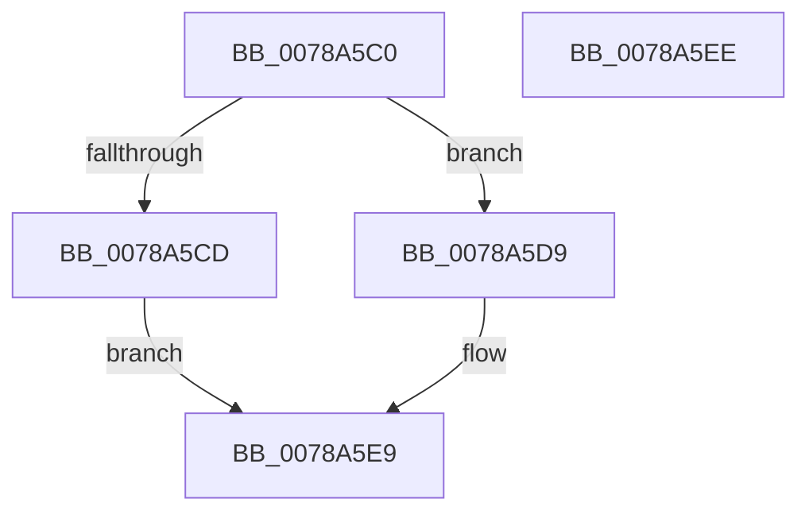

# RtlGetConsoleSessionForegroundProcessId

- RVA: `0x0078A5C0`–`0x0078A5EF` (길이 `47` bytes)
- VA: `0x000000014078A5C0`
- 실행 섹션: `PAGE`
- PDB 이름 있음: `예`; PDB Function 태그: `아니요`
- unwind 정보 RVA: `0x0005C788`
- 디코드: `12`개 명령, `47/47` bytes 표시
- 미해석 바이트: `0` (있으면 어셈블리에 `.byte`로 보존)

> 이 문서는 커널 이미지의 기계어와 PDB 기호를 분석해 생성했습니다. 4번과 5번은 함수 원형과 자료형을 바이너리 사용 방식에서 추정한 C 해석이며 원본 소스 복구 결과는 아닙니다.

## 1. Dependencies

- 직접 호출 지점: **2**; 고유 호출 대상: **2**
- 직접 호출자로 확인된 함수: **0**
- RIP 상대 이미지 참조: **0**

### Outgoing calls
- `0x0078A5C4` → [PsIsCurrentThreadInServerSilo](../../text/43/PsIsCurrentThreadInServerSilo_function_004362E0.md) (function, `0x004362E0`)
- `0x0078A5D9` → [PsGetCurrentServerSiloGlobals](../../text/2F/PsGetCurrentServerSiloGlobals_function_002FE1F0.md) (function, `0x002FE1F0`)

### Direct callers
- 이 함수 시작 RVA로 연결되는 직접 call은 확인되지 않았습니다. 간접 호출은 완전히 역산할 수 없습니다.

### Static image references
- 디코드된 RIP-relative 메모리 참조가 없습니다.

## 2. Other-region calls and transfers

- 다른 실행 섹션으로 향하는 call: **2**
  - `0x0078A5C4` → [PsIsCurrentThreadInServerSilo](../../text/43/PsIsCurrentThreadInServerSilo_function_004362E0.md) (`PAGE` → `.text`)
  - `0x0078A5D9` → [PsGetCurrentServerSiloGlobals](../../text/2F/PsGetCurrentServerSiloGlobals_function_002FE1F0.md) (`PAGE` → `.text`)
- 별도 외부 분기/꼬리 이동을 확인하지 못했습니다.

## 3. Assembly (complete function range)

```asm
0078A5C0  48 83 EC 28                     sub rsp, 0x28
0078A5C4  E8 17 BD CA FF                  call 0x1404362e0
0078A5C9  84 C0                           test al, al
0078A5CB  75 0C                           jne 0x14078a5d9
0078A5CD  48 A1 38 03 00 00 80 F7 FF FF   movabs rax, qword ptr [0xfffff78000000338]
0078A5D7  EB 10                           jmp 0x14078a5e9
0078A5D9  E8 12 3C B7 FF                  call 0x1402fe1f0
0078A5DE  48 8B 80 08 05 00 00            mov rax, qword ptr [rax + 0x508]
0078A5E5  48 8B 40 08                     mov rax, qword ptr [rax + 8]
0078A5E9  48 83 C4 28                     add rsp, 0x28
0078A5ED  C3                              ret
0078A5EE  CC                              int3
```

## 4. C-style interpretation (structured pseudocode)

```c
__int64 __fastcall RtlGetConsoleSessionForegroundProcessId(void)
{
    __int64 result;
    __int64 v_rsp;

    v_rsp = (v_rsp) - (40);
    result = PsIsCurrentThreadInServerSilo(a1, a2, a3, a4);
    if ((unsigned __int8)(result) != 0) goto loc_0078A5D9;
    goto loc_0078A5E9;
loc_0078A5D9:
    result = PsGetCurrentServerSiloGlobals(a1, a2, a3, a4);
loc_0078A5E9:
    v_rsp = (v_rsp) + (40);
    return *(unsigned __int64 *)(*(unsigned __int64 *)(result + 1288) + 8);
}
```

## 5. (Beta) C Style

```c
void RtlGetConsoleSessionForegroundProcessId(void)
{
    int64_t result;
    int64_t local_rsp;

    local_rsp = (local_rsp) - (40);
    result = PsIsCurrentThreadInServerSilo(a1, a2, a3, a4);
    if ((uint8_t)(result) != 0) goto loc_0078A5D9;
    goto loc_0078A5E9;
loc_0078A5D9:
    result = PsGetCurrentServerSiloGlobals(a1, a2, a3, a4);
loc_0078A5E9:
    local_rsp = (local_rsp) + (40);
    return *(uint64_t *)(*(uint64_t *)(result + 0x508) + 0x8);
}
```

## 6. Execution-region graph

[열기: 2D/3D 그래프와 함수 탐색 컨트롤 패널](../../../control-panel.html?section=page&rva=0x0078A5C0&view=graph)

- 2D 그래프는 위에서 아래로 흐르고, 3D 그래프는 빈 공간을 드래그해 회전합니다. Shift+드래그는 이동, 휠은 확대·축소, 함수 노드 선택은 대상 보고서 이동입니다.

### Static fallback


