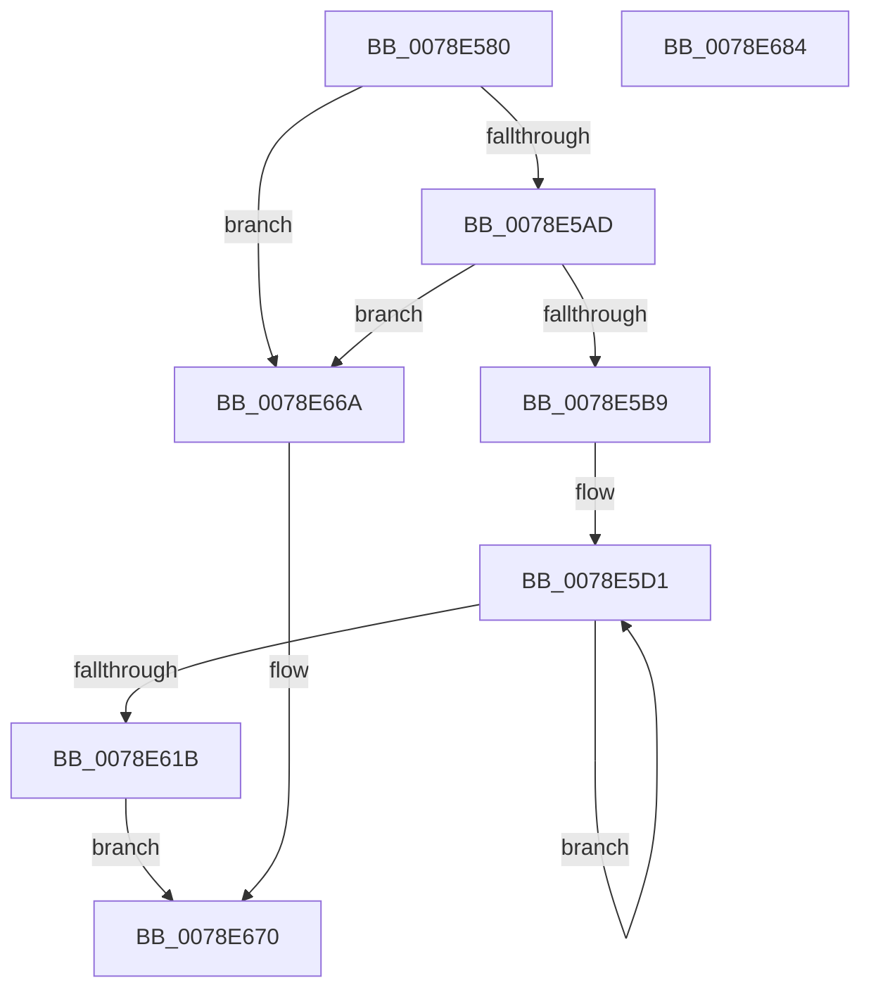

# RtlGetSessionProperties

- RVA: `0x0078E580`–`0x0078E685` (길이 `261` bytes)
- VA: `0x000000014078E580`
- 실행 섹션: `PAGE`
- PDB 이름 있음: `예`; PDB Function 태그: `아니요`
- unwind 정보 RVA: `0x000CF964`
- 디코드: `67`개 명령, `261/261` bytes 표시
- 미해석 바이트: `0` (있으면 어셈블리에 `.byte`로 보존)

> 이 문서는 커널 이미지의 기계어와 PDB 기호를 분석해 생성했습니다. 4번과 5번은 함수 원형과 자료형을 바이너리 사용 방식에서 추정한 C 해석이며 원본 소스 복구 결과는 아닙니다.

## 1. Dependencies

- 직접 호출 지점: **2**; 고유 호출 대상: **2**
- 직접 호출자로 확인된 함수: **0**
- RIP 상대 이미지 참조: **0**

### Outgoing calls
- `0x0078E59F` → [memset](../../text/6C/memset_function_006C6C40.md) (function, `0x006C6C40`)
- `0x0078E651` → [PsGetCurrentServerSiloGlobals](../../text/2F/PsGetCurrentServerSiloGlobals_function_002FE1F0.md) (function, `0x002FE1F0`)

### Direct callers
- 이 함수 시작 RVA로 연결되는 직접 call은 확인되지 않았습니다. 간접 호출은 완전히 역산할 수 없습니다.

### Static image references
- 디코드된 RIP-relative 메모리 참조가 없습니다.

## 2. Other-region calls and transfers

- 다른 실행 섹션으로 향하는 call: **2**
  - `0x0078E59F` → [memset](../../text/6C/memset_function_006C6C40.md) (`PAGE` → `.text`)
  - `0x0078E651` → [PsGetCurrentServerSiloGlobals](../../text/2F/PsGetCurrentServerSiloGlobals_function_002FE1F0.md) (`PAGE` → `.text`)
- 별도 외부 분기/꼬리 이동을 확인하지 못했습니다.

## 3. Assembly (complete function range)

```asm
0078E580  48 89 5C 24 08                  mov qword ptr [rsp + 8], rbx
0078E585  57                              push rdi
0078E586  48 81 EC 00 05 00 00            sub rsp, 0x500
0078E58D  48 8B DA                        mov rbx, rdx
0078E590  8B F9                           mov edi, ecx
0078E592  33 D2                           xor edx, edx
0078E594  48 8D 4C 24 20                  lea rcx, [rsp + 0x20]
0078E599  41 B8 70 02 00 00               mov r8d, 0x270
0078E59F  E8 9C 86 F3 FF                  call 0x1406c6c40
0078E5A4  83 FF FF                        cmp edi, -1
0078E5A7  0F 84 BD 00 00 00               je 0x14078e66a
0078E5AD  45 33 C0                        xor r8d, r8d
0078E5B0  48 85 DB                        test rbx, rbx
0078E5B3  0F 84 B1 00 00 00               je 0x14078e66a
0078E5B9  41 8D 50 04                     lea edx, [r8 + 4]
0078E5BD  44 89 03                        mov dword ptr [rbx], r8d
0078E5C0  44 8D 4A 7C                     lea r9d, [rdx + 0x7c]
0078E5C4  48 8D 84 24 90 02 00 00         lea rax, [rsp + 0x290]
0078E5CC  48 8D 4C 24 20                  lea rcx, [rsp + 0x20]
0078E5D1  0F 10 01                        movups xmm0, xmmword ptr [rcx]
0078E5D4  0F 10 49 10                     movups xmm1, xmmword ptr [rcx + 0x10]
0078E5D8  0F 11 00                        movups xmmword ptr [rax], xmm0
0078E5DB  0F 10 41 20                     movups xmm0, xmmword ptr [rcx + 0x20]
0078E5DF  0F 11 48 10                     movups xmmword ptr [rax + 0x10], xmm1
0078E5E3  0F 10 49 30                     movups xmm1, xmmword ptr [rcx + 0x30]
0078E5E7  0F 11 40 20                     movups xmmword ptr [rax + 0x20], xmm0
0078E5EB  0F 10 41 40                     movups xmm0, xmmword ptr [rcx + 0x40]
0078E5EF  0F 11 48 30                     movups xmmword ptr [rax + 0x30], xmm1
0078E5F3  0F 10 49 50                     movups xmm1, xmmword ptr [rcx + 0x50]
0078E5F7  0F 11 40 40                     movups xmmword ptr [rax + 0x40], xmm0
0078E5FB  0F 10 41 60                     movups xmm0, xmmword ptr [rcx + 0x60]
0078E5FF  0F 11 48 50                     movups xmmword ptr [rax + 0x50], xmm1
0078E603  0F 10 49 70                     movups xmm1, xmmword ptr [rcx + 0x70]
0078E607  49 03 C9                        add rcx, r9
0078E60A  0F 11 40 60                     movups xmmword ptr [rax + 0x60], xmm0
0078E60E  49 03 C1                        add rax, r9
0078E611  0F 11 48 F0                     movups xmmword ptr [rax - 0x10], xmm1
0078E615  48 83 EA 01                     sub rdx, 1
0078E619  75 B6                           jne 0x14078e5d1
0078E61B  0F 10 01                        movups xmm0, xmmword ptr [rcx]
0078E61E  0F 10 49 10                     movups xmm1, xmmword ptr [rcx + 0x10]
0078E622  0F 11 00                        movups xmmword ptr [rax], xmm0
0078E625  0F 10 41 20                     movups xmm0, xmmword ptr [rcx + 0x20]
0078E629  0F 11 48 10                     movups xmmword ptr [rax + 0x10], xmm1
0078E62D  0F 10 49 30                     movups xmm1, xmmword ptr [rcx + 0x30]
0078E631  0F 11 40 20                     movups xmmword ptr [rax + 0x20], xmm0
0078E635  0F 10 41 40                     movups xmm0, xmmword ptr [rcx + 0x40]
0078E639  0F 11 48 30                     movups xmmword ptr [rax + 0x30], xmm1
0078E63D  0F 10 49 50                     movups xmm1, xmmword ptr [rcx + 0x50]
0078E641  0F 11 40 40                     movups xmmword ptr [rax + 0x40], xmm0
0078E645  0F 10 41 60                     movups xmm0, xmmword ptr [rcx + 0x60]
0078E649  0F 11 48 50                     movups xmmword ptr [rax + 0x50], xmm1
0078E64D  0F 11 40 60                     movups xmmword ptr [rax + 0x60], xmm0
0078E651  E8 9A FB B6 FF                  call 0x1402fe1f0
0078E656  48 8B 88 08 05 00 00            mov rcx, qword ptr [rax + 0x508]
0078E65D  41 8B C0                        mov eax, r8d
0078E660  39 79 18                        cmp dword ptr [rcx + 0x18], edi
0078E663  0F 94 C0                        sete al
0078E666  89 03                           mov dword ptr [rbx], eax
0078E668  EB 06                           jmp 0x14078e670
0078E66A  41 B8 0D 00 00 C0               mov r8d, 0xc000000d
0078E670  48 8B 9C 24 10 05 00 00         mov rbx, qword ptr [rsp + 0x510]
0078E678  41 8B C0                        mov eax, r8d
0078E67B  48 81 C4 00 05 00 00            add rsp, 0x500
0078E682  5F                              pop rdi
0078E683  C3                              ret
0078E684  CC                              int3
```

## 4. C-style interpretation (structured pseudocode)

```c
__int64 __fastcall RtlGetSessionProperties(int a1, __int64 a2)
{
    __int64 result;
    __int64 v_rsp;
    unsigned __int64 v_stack_m278;
    unsigned __int64 v_stack_m4E8;
    unsigned __int64 v_stack_p8;

    v_stack_p8 = v_rbx;
    v_rsp = (v_rsp) - (0x500ULL);
    a2 = 0;
    result = memset(v_stack_m4E8, a2, 624, a4);
    if (((unsigned int)((unsigned int)(a1))) == -1) goto loc_0078E66A;
    a3 = 0;
    if (0 == 0) goto loc_0078E66A;
    *(unsigned int *)(a2) = 0;
loc_0078E5D1:
    *(unsigned __int64 *)(v_stack_m278) = v_xmm0;
    *(unsigned __int64 *)(v_stack_m278 + 16) = v_xmm1;
    *(unsigned __int64 *)(v_stack_m278 + 32) = v_xmm0;
    *(unsigned __int64 *)(v_stack_m278 + 48) = v_xmm1;
    *(unsigned __int64 *)(v_stack_m278 + 64) = v_xmm0;
    *(unsigned __int64 *)(v_stack_m278 + 80) = v_xmm1;
    a1 = (v_stack_m4E8) + (a3 + 4 + 124);
    *(unsigned __int64 *)(v_stack_m278 + 96) = v_xmm0;
    result = (v_stack_m278) + (a3 + 4 + 124);
    *(unsigned __int64 *)(result - 16) = v_xmm1;
    a2 = (a3 + 4) - (1);
    if (condition_is_not_equal) goto loc_0078E5D1;
    *(unsigned __int64 *)(result) = v_xmm0;
    *(unsigned __int64 *)(result + 16) = v_xmm1;
    *(unsigned __int64 *)(result + 32) = v_xmm0;
    *(unsigned __int64 *)(result + 48) = v_xmm1;
    *(unsigned __int64 *)(result + 64) = v_xmm0;
    *(unsigned __int64 *)(result + 80) = v_xmm1;
    *(unsigned __int64 *)(result + 96) = v_xmm0;
    result = PsGetCurrentServerSiloGlobals(a1, a2, a3, a3 + 4 + 124);
    result = ((*(unsigned int *)(*(unsigned __int64 *)(result + 1288) + 24)) == ((unsigned int)((unsigned int)(a1)))) ? 1 : 0;
    *(unsigned int *)(a2) = (unsigned int)(result);
    goto loc_0078E670;
loc_0078E66A:
loc_0078E670:
    v_rsp = (v_rsp) + (0x500ULL);
    return (unsigned int)((unsigned int)((unsigned int)(0xC000000DULL)));
}
```

## 5. (Beta) C Style

```c
int64_t RtlGetSessionProperties(int32_t Arg1, int64_t Arg2)
{
    int64_t result;
    int64_t local_rsp;
    uint64_t v_stack_m278;
    uint64_t v_stack_m4E8;
    uint64_t v_stack_p8;

    v_stack_p8 = local_rbx;
    local_rsp = (local_rsp) - (0x500ULL);
    Arg2 = 0;
    result = memset(v_stack_m4E8, Arg2, 624, a4);
    if (((uint32_t)((uint32_t)(Arg1))) == -1) goto loc_0078E66A;
    a3 = 0;
    if (0 == 0) goto loc_0078E66A;
    *(uint32_t *)(Arg2) = 0;
loc_0078E5D1:
    *(uint64_t *)(v_stack_m278) = v_xmm0;
    *(uint64_t *)(v_stack_m278 + 0x10) = v_xmm1;
    *(uint64_t *)(v_stack_m278 + 0x20) = v_xmm0;
    *(uint64_t *)(v_stack_m278 + 0x30) = v_xmm1;
    *(uint64_t *)(v_stack_m278 + 0x40) = v_xmm0;
    *(uint64_t *)(v_stack_m278 + 0x50) = v_xmm1;
    Arg1 = (v_stack_m4E8) + (a3 + 4 + 124);
    *(uint64_t *)(v_stack_m278 + 0x60) = v_xmm0;
    result = (v_stack_m278) + (a3 + 4 + 124);
    *(uint64_t *)(result - 0x10) = v_xmm1;
    Arg2 = (a3 + 4) - (1);
    if (condition_is_not_equal) goto loc_0078E5D1;
    *(uint64_t *)(result) = v_xmm0;
    *(uint64_t *)(result + 0x10) = v_xmm1;
    *(uint64_t *)(result + 0x20) = v_xmm0;
    *(uint64_t *)(result + 0x30) = v_xmm1;
    *(uint64_t *)(result + 0x40) = v_xmm0;
    *(uint64_t *)(result + 0x50) = v_xmm1;
    *(uint64_t *)(result + 0x60) = v_xmm0;
    result = PsGetCurrentServerSiloGlobals(Arg1, Arg2, a3, a3 + 4 + 124);
    result = ((*(uint32_t *)(*(uint64_t *)(result + 0x508) + 0x18)) == ((uint32_t)((uint32_t)(Arg1)))) ? 1 : 0;
    *(uint32_t *)(Arg2) = (uint32_t)(result);
    goto loc_0078E670;
loc_0078E66A:
loc_0078E670:
    local_rsp = (local_rsp) + (0x500ULL);
    return (uint32_t)((uint32_t)((uint32_t)(0xC000000DULL)));
}
```

## 6. Execution-region graph

[열기: 2D/3D 그래프와 함수 탐색 컨트롤 패널](../../../control-panel.html?section=page&rva=0x0078E580&view=graph)

- 2D 그래프는 위에서 아래로 흐르고, 3D 그래프는 빈 공간을 드래그해 회전합니다. Shift+드래그는 이동, 휠은 확대·축소, 함수 노드 선택은 대상 보고서 이동입니다.

### Static fallback


