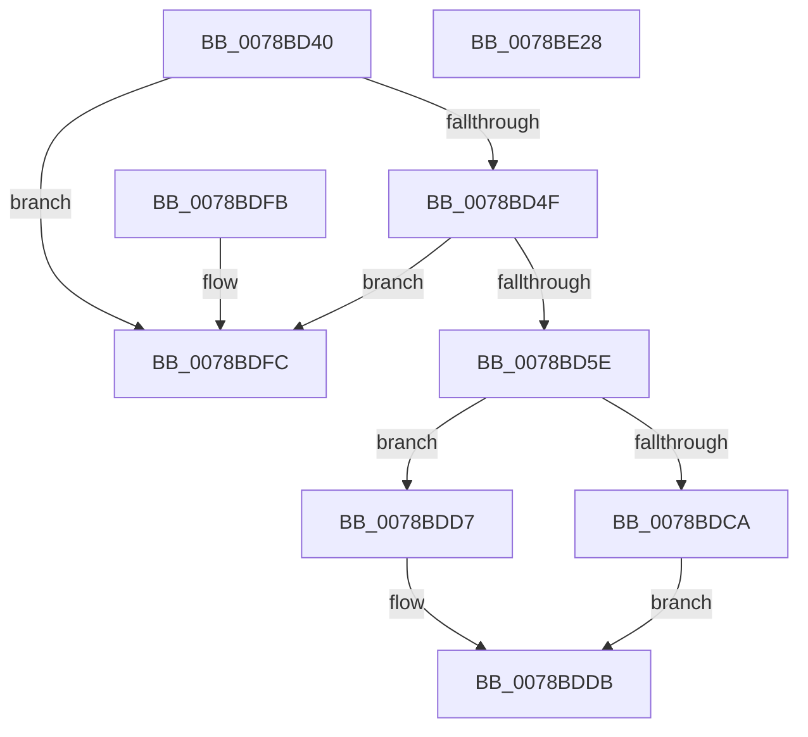

# RtlInitCodePageTable

- RVA: `0x0078BD40`–`0x0078BE29` (길이 `233` bytes)
- VA: `0x000000014078BD40`
- 실행 섹션: `PAGE`
- PDB 이름 있음: `예`; PDB Function 태그: `아니요`
- unwind 정보 RVA: `0x000DB714`
- 디코드: `58`개 명령, `233/233` bytes 표시
- 미해석 바이트: `0` (있으면 어셈블리에 `.byte`로 보존)

> 이 문서는 커널 이미지의 기계어와 PDB 기호를 분석해 생성했습니다. 4번과 5번은 함수 원형과 자료형을 바이너리 사용 방식에서 추정한 C 해석이며 원본 소스 복구 결과는 아닙니다.

## 1. Dependencies

- 직접 호출 지점: **0**; 고유 호출 대상: **0**
- 직접 호출자로 확인된 함수: **1**
- RIP 상대 이미지 참조: **4**

### Outgoing calls
- 직접 디코드된 call 명령이 없습니다.

### Direct callers
- [RtlpInitCodePageTables](RtlpInitCodePageTables_function_0078C0F4.md) at `0x0078C19A`
- [RtlpInitCodePageTables](RtlpInitCodePageTables_function_0078C0F4.md) at `0x0078C1A5`

### Static image references
- `0x0078BDFC` → RVA `0x00FD8720` (`PAGEDATA`; read)
- `0x0078BE06` → RVA `0x00FD8730` (`PAGEDATA`; read)
- `0x0078BE11` → RVA `0x00FD8740` (`PAGEDATA`; read)
- `0x0078BE1C` → RVA `0x00FD8750` (`PAGEDATA`; read)

## 2. Other-region calls and transfers

- 다른 실행 섹션으로 향하는 call: **0**
- 별도 외부 분기/꼬리 이동을 확인하지 못했습니다.

## 3. Assembly (complete function range)

```asm
0078BD40  45 33 D2                        xor r10d, r10d
0078BD43  4C 8B C9                        mov r9, rcx
0078BD46  48 85 C9                        test rcx, rcx
0078BD49  0F 84 AD 00 00 00               je 0x14078bdfc
0078BD4F  B8 E9 FD 00 00                  mov eax, 0xfde9
0078BD54  66 39 41 02                     cmp word ptr [rcx + 2], ax
0078BD58  0F 84 9E 00 00 00               je 0x14078bdfc
0078BD5E  0F B7 41 04                     movzx eax, word ptr [rcx + 4]
0078BD62  44 0F B7 19                     movzx r11d, word ptr [rcx]
0078BD66  4D 8D 43 01                     lea r8, [r11 + 1]
0078BD6A  66 46 03 1C 59                  add r11w, word ptr [rcx + r11*2]
0078BD6F  66 89 42 02                     mov word ptr [rdx + 2], ax
0078BD73  0F B7 41 06                     movzx eax, word ptr [rcx + 6]
0078BD77  66 89 42 04                     mov word ptr [rdx + 4], ax
0078BD7B  0F B7 41 08                     movzx eax, word ptr [rcx + 8]
0078BD7F  66 89 42 06                     mov word ptr [rdx + 6], ax
0078BD83  0F B7 41 0A                     movzx eax, word ptr [rcx + 0xa]
0078BD87  66 89 42 08                     mov word ptr [rdx + 8], ax
0078BD8B  0F B7 41 0C                     movzx eax, word ptr [rcx + 0xc]
0078BD8F  66 89 42 0A                     mov word ptr [rdx + 0xa], ax
0078BD93  F2 0F 10 41 0E                  movsd xmm0, qword ptr [rcx + 0xe]
0078BD98  F2 0F 11 42 0E                  movsd qword ptr [rdx + 0xe], xmm0
0078BD9D  8B 41 16                        mov eax, dword ptr [rcx + 0x16]
0078BDA0  89 42 16                        mov dword ptr [rdx + 0x16], eax
0078BDA3  4A 8D 04 41                     lea rax, [rcx + r8*2]
0078BDA7  48 8D 88 00 02 00 00            lea rcx, [rax + 0x200]
0078BDAE  48 89 42 20                     mov qword ptr [rdx + 0x20], rax
0078BDB2  0F B7 01                        movzx eax, word ptr [rcx]
0078BDB5  66 F7 D8                        neg ax
0078BDB8  4D 1B C0                        sbb r8, r8
0078BDBB  41 81 E0 00 02 00 00            and r8d, 0x200
0078BDC2  66 45 39 54 08 02               cmp word ptr [r8 + rcx + 2], r10w
0078BDC8  76 0D                           jbe 0x14078bdd7
0078BDCA  41 8D 42 01                     lea eax, [r10 + 1]
0078BDCE  4C 8D 51 04                     lea r10, [rcx + 4]
0078BDD2  4D 03 D0                        add r10, r8
0078BDD5  EB 04                           jmp 0x14078bddb
0078BDD7  41 0F B7 C2                     movzx eax, r10w
0078BDDB  4C 89 52 38                     mov qword ptr [rdx + 0x38], r10
0078BDDF  66 89 42 0C                     mov word ptr [rdx + 0xc], ax
0078BDE3  41 0F B7 CB                     movzx ecx, r11w
0078BDE7  48 FF C1                        inc rcx
0078BDEA  49 8D 0C 49                     lea rcx, [r9 + rcx*2]
0078BDEE  48 89 4A 28                     mov qword ptr [rdx + 0x28], rcx
0078BDF2  41 0F B7 41 02                  movzx eax, word ptr [r9 + 2]
0078BDF7  66 87 02                        xchg word ptr [rdx], ax
0078BDFA  C3                              ret
0078BDFB  CC                              int3
0078BDFC  0F 28 05 1D C9 84 00            movaps xmm0, xmmword ptr [rip + 0x84c91d]
0078BE03  0F 11 02                        movups xmmword ptr [rdx], xmm0
0078BE06  0F 28 0D 23 C9 84 00            movaps xmm1, xmmword ptr [rip + 0x84c923]
0078BE0D  0F 11 4A 10                     movups xmmword ptr [rdx + 0x10], xmm1
0078BE11  0F 28 05 28 C9 84 00            movaps xmm0, xmmword ptr [rip + 0x84c928]
0078BE18  0F 11 42 20                     movups xmmword ptr [rdx + 0x20], xmm0
0078BE1C  0F 28 0D 2D C9 84 00            movaps xmm1, xmmword ptr [rip + 0x84c92d]
0078BE23  0F 11 4A 30                     movups xmmword ptr [rdx + 0x30], xmm1
0078BE27  C3                              ret
0078BE28  CC                              int3
```

## 4. C-style interpretation (structured pseudocode)

```c
__int64 __fastcall RtlInitCodePageTable(__int64 a1, __int64 a2)
{
    __int64 result;
    __int64 v_r10;
    __int64 v_r11;

    v_r10 = 0;
    if (a1 == 0) goto loc_0078BDFC;
    if ((*(unsigned __int16 *)(a1 + 2)) == ((unsigned __int16)((unsigned int)(0xFDE9ULL)))) goto loc_0078BDFC;
    v_r11 = (unsigned __int16)((*(unsigned __int16 *)(a1)) + (*(unsigned __int16 *)(a1 + *(unsigned __int16 *)(a1) * 2)));
    *(unsigned __int16 *)(a2 + 2) = (unsigned __int16)(*(unsigned __int16 *)(a1 + 4));
    *(unsigned __int16 *)(a2 + 4) = (unsigned __int16)(*(unsigned __int16 *)(a1 + 6));
    *(unsigned __int16 *)(a2 + 6) = (unsigned __int16)(*(unsigned __int16 *)(a1 + 8));
    *(unsigned __int16 *)(a2 + 8) = (unsigned __int16)(*(unsigned __int16 *)(a1 + 10));
    *(unsigned __int16 *)(a2 + 10) = (unsigned __int16)(*(unsigned __int16 *)(a1 + 12));
    *(unsigned __int64 *)(a2 + 14) = v_xmm0;
    *(unsigned int *)(a2 + 22) = (unsigned int)((unsigned int)(*(unsigned int *)(a1 + 22)));
    *(unsigned __int64 *)(a2 + 32) = a1 + *(unsigned __int16 *)(a1) + 1 * 2;
    result = (unsigned __int16)(-(*(unsigned __int16 *)(a1 + *(unsigned __int16 *)(a1) + 1 * 2 + 512)));
    a3 = (unsigned int)((*(unsigned __int16 *)(a1) + 1) & (512));
    if ((*(unsigned __int16 *)(a3 + a1 + *(unsigned __int16 *)(a1) + 1 * 2 + 512 * 1 + 2)) <= 0) goto loc_0078BDD7;
    v_r10 = (a1 + *(unsigned __int16 *)(a1) + 1 * 2 + 512 + 4) + (a3);
    goto loc_0078BDDB;
loc_0078BDD7:
loc_0078BDDB:
    *(unsigned __int64 *)(a2 + 56) = v_r10;
    *(unsigned __int16 *)(a2 + 12) = (unsigned __int16)((unsigned __int16)(v_r10));
    a1 = ((unsigned __int16)(v_r11)) + 1;
    *(unsigned __int64 *)(a2 + 40) = a1 + a1 * 2;
    return *(unsigned __int16 *)(a1 + 2);
loc_0078BDFC:
    *(unsigned __int64 *)(a2) = v_xmm0;
    *(unsigned __int64 *)(a2 + 16) = v_xmm1;
    *(unsigned __int64 *)(a2 + 32) = v_xmm0;
    *(unsigned __int64 *)(a2 + 48) = v_xmm1;
    return *(unsigned __int16 *)(a1 + 2);
}
```

## 5. (Beta) C Style

```c
int64_t RtlInitCodePageTable(void *Arg1, void *Arg2)
{
    uint8_t *arg1 = (uint8_t *)Arg1;
    uint8_t *arg2 = (uint8_t *)Arg2;

    int64_t result;
    int64_t local_r10;
    int64_t local_r11;

    local_r10 = 0;
    if (Arg1 == NULL) goto loc_0078BDFC;
    if ((*(uint16_t *)(arg1 + 0x2)) == ((uint16_t)((uint32_t)(0xFDE9ULL)))) goto loc_0078BDFC;
    local_r11 = (uint16_t)((*(uint16_t *)(arg1)) + (*(uint16_t *)(arg1 + *(uint16_t *)(arg1) * 2)));
    *(uint16_t *)(arg2 + 0x2) = (uint16_t)(*(uint16_t *)(arg1 + 0x4));
    *(uint16_t *)(arg2 + 0x4) = (uint16_t)(*(uint16_t *)(arg1 + 0x6));
    *(uint16_t *)(arg2 + 0x6) = (uint16_t)(*(uint16_t *)(arg1 + 0x8));
    *(uint16_t *)(arg2 + 0x8) = (uint16_t)(*(uint16_t *)(arg1 + 0xA));
    *(uint16_t *)(arg2 + 0xA) = (uint16_t)(*(uint16_t *)(arg1 + 0xC));
    *(uint64_t *)(arg2 + 0xE) = v_xmm0;
    *(uint32_t *)(arg2 + 0x16) = (uint32_t)((uint32_t)(*(uint32_t *)(arg1 + 0x16)));
    *(void **)(arg2 + 0x20) = Arg1 + *(uint16_t *)(arg1) + 1 * 2;
    result = (uint16_t)(-(*(uint16_t *)(arg1 + *(uint16_t *)(arg1) + 0x1 * 2 + 0x200)));
    a3 = (uint32_t)((*(uint16_t *)(arg1) + 1) & (512));
    if ((*(uint16_t *)(a3 + arg1 + *(uint16_t *)(arg1) + 0x1 * 2 + 0x200 * 1 + 0x2)) <= 0) goto loc_0078BDD7;
    local_r10 = (Arg1 + *(uint16_t *)(arg1) + 1 * 2 + 512 + 4) + (a3);
    goto loc_0078BDDB;
loc_0078BDD7:
loc_0078BDDB:
    *(uint64_t *)(arg2 + 0x38) = local_r10;
    *(uint16_t *)(arg2 + 0xC) = (uint16_t)((uint16_t)(local_r10));
    Arg1 = ((uint16_t)(local_r11)) + 1;
    *(void **)(arg2 + 0x28) = Arg1 + Arg1 * 2;
    return *(uint16_t *)(arg1 + 0x2);
loc_0078BDFC:
    *(uint64_t *)(arg2) = v_xmm0;
    *(uint64_t *)(arg2 + 0x10) = v_xmm1;
    *(uint64_t *)(arg2 + 0x20) = v_xmm0;
    *(uint64_t *)(arg2 + 0x30) = v_xmm1;
    return *(uint16_t *)(arg1 + 0x2);
}
```

### 관측된 메모리 오프셋

구조체 형식이 확인되지 않은 접근은 인자 기준의 오프셋으로만 기록했습니다.

| 기준 인자 | 오프셋 표현 | 폭 (bit) | 접근 |
|---|---:|---:|---|
| `Arg1` | `+ 0x0 + rcx*2` | `64` | `R` |
| `Arg1` | `+ 0x2` | `16` | `R` |
| `Arg2` | `+ 0x0` | `16` | `R/W` |
| `Arg2` | `+ 0x0` | `128` | `R` |
| `Arg2` | `+ 0x2` | `16` | `W` |
| `Arg2` | `+ 0x4` | `16` | `W` |
| `Arg2` | `+ 0x6` | `16` | `W` |
| `Arg2` | `+ 0x8` | `16` | `W` |
| `Arg2` | `+ 0xA` | `16` | `W` |
| `Arg2` | `+ 0xC` | `16` | `W` |
| `Arg2` | `+ 0xE` | `64` | `W` |
| `Arg2` | `+ 0x10` | `128` | `R` |
| `Arg2` | `+ 0x16` | `32` | `W` |
| `Arg2` | `+ 0x20` | `64` | `W` |
| `Arg2` | `+ 0x20` | `128` | `R` |
| `Arg2` | `+ 0x28` | `64` | `W` |
| `Arg2` | `+ 0x30` | `128` | `R` |
| `Arg2` | `+ 0x38` | `64` | `W` |

## 6. Execution-region graph

[열기: 2D/3D 그래프와 함수 탐색 컨트롤 패널](../../../control-panel.html?section=page&rva=0x0078BD40&view=graph)

- 2D 그래프는 위에서 아래로 흐르고, 3D 그래프는 빈 공간을 드래그해 회전합니다. Shift+드래그는 이동, 휠은 확대·축소, 함수 노드 선택은 대상 보고서 이동입니다.

### Static fallback


