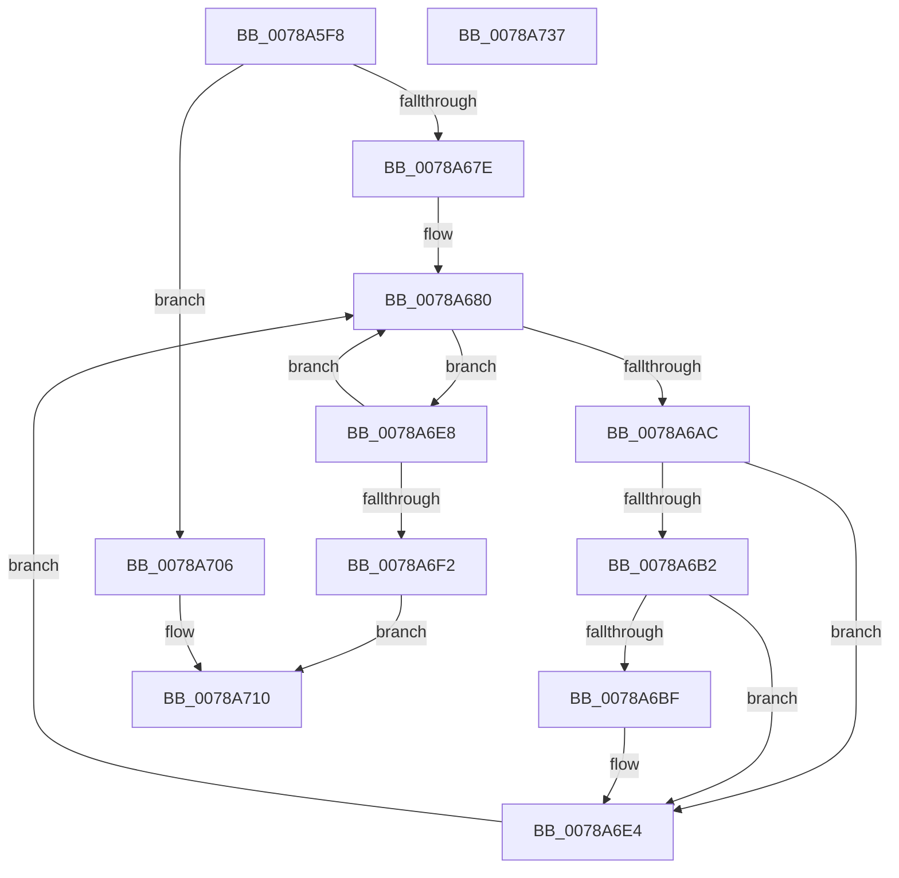

# RtlInitFunctionalityCache

- RVA: `0x0078A5F8`–`0x0078A738` (길이 `320` bytes)
- VA: `0x000000014078A5F8`
- 실행 섹션: `PAGE`
- PDB 이름 있음: `예`; PDB Function 태그: `아니요`
- unwind 정보 RVA: `0x000CC5B0`
- 디코드: `81`개 명령, `320/320` bytes 표시
- 미해석 바이트: `0` (있으면 어셈블리에 `.byte`로 보존)

> 이 문서는 커널 이미지의 기계어와 PDB 기호를 분석해 생성했습니다. 4번과 5번은 함수 원형과 자료형을 바이너리 사용 방식에서 추정한 C 해석이며 원본 소스 복구 결과는 아닙니다.

## 1. Dependencies

- 직접 호출 지점: **5**; 고유 호출 대상: **5**
- 직접 호출자로 확인된 함수: **2**
- RIP 상대 이미지 참조: **2**

### Outgoing calls
- `0x0078A671` → [NtOpenKeyEx](../A4/NtOpenKeyEx_function_00A45CC0.md) (function, `0x00A45CC0`)
- `0x0078A6A1` → [NtEnumerateValueKey](../8B/NtEnumerateValueKey_function_008B3B50.md) (function, `0x008B3B50`)
- `0x0078A6BF` → [PsGetCurrentServerSiloGlobals](../../text/2F/PsGetCurrentServerSiloGlobals_function_002FE1F0.md) (function, `0x002FE1F0`)
- `0x0078A6F6` → [NtClose](../86/NtClose_function_00868870.md) (function, `0x00868870`)
- `0x0078A719` → [_security_check_cookie](../../text/6A/_security_check_cookie_function_006AC640.md) (function, `0x006AC640`)

### Direct callers
- [PspInitializeServerSiloDeferred](../77/PspInitializeServerSiloDeferred_function_0077FEE0.md) at `0x0077FFEC`
- [Phase1InitializationDiscard](../../init/C1/Phase1InitializationDiscard_function_00C1C728.md) at `0x00C1DADF`

### Static image references
- `0x0078A613` → RVA `0x00E0A740` (`.data`; read)
- `0x0078A62B` → RVA `0x00B05100` (` ?? ::NNGAKEGL::`string'`; read)

## 2. Other-region calls and transfers

- 다른 실행 섹션으로 향하는 call: **2**
  - `0x0078A6BF` → [PsGetCurrentServerSiloGlobals](../../text/2F/PsGetCurrentServerSiloGlobals_function_002FE1F0.md) (`PAGE` → `.text`)
  - `0x0078A719` → [_security_check_cookie](../../text/6A/_security_check_cookie_function_006AC640.md) (`PAGE` → `.text`)
- 별도 외부 분기/꼬리 이동을 확인하지 못했습니다.

## 3. Assembly (complete function range)

```asm
0078A5F8  48 8B C4                        mov rax, rsp
0078A5FB  48 89 58 08                     mov qword ptr [rax + 8], rbx
0078A5FF  48 89 70 10                     mov qword ptr [rax + 0x10], rsi
0078A603  48 89 78 18                     mov qword ptr [rax + 0x18], rdi
0078A607  55                              push rbp
0078A608  48 8D 68 A1                     lea rbp, [rax - 0x5f]
0078A60C  48 81 EC A0 00 00 00            sub rsp, 0xa0
0078A613  48 8B 05 26 01 68 00            mov rax, qword ptr [rip + 0x680126]
0078A61A  48 33 C4                        xor rax, rsp
0078A61D  48 89 45 4F                     mov qword ptr [rbp + 0x4f], rax
0078A621  33 DB                           xor ebx, ebx
0078A623  48 C7 45 F7 86 00 88 00         mov qword ptr [rbp - 9], 0x880086
0078A62B  48 8D 05 CE AA 37 00            lea rax, [rip + 0x37aace]
0078A632  48 89 5D EF                     mov qword ptr [rbp - 0x11], rbx
0078A636  48 89 45 FF                     mov qword ptr [rbp - 1], rax
0078A63A  4C 8D 45 07                     lea r8, [rbp + 7]
0078A63E  48 8D 45 F7                     lea rax, [rbp - 9]
0078A642  48 C7 45 07 30 00 00 00         mov qword ptr [rbp + 7], 0x30
0078A64A  0F 57 C0                        xorps xmm0, xmm0
0078A64D  48 89 45 17                     mov qword ptr [rbp + 0x17], rax
0078A651  45 33 C9                        xor r9d, r9d
0078A654  48 C7 45 1F 40 02 00 00         mov qword ptr [rbp + 0x1f], 0x240
0078A65C  BA 19 00 02 00                  mov edx, 0x20019
0078A661  89 5D E7                        mov dword ptr [rbp - 0x19], ebx
0078A664  48 8D 4D EF                     lea rcx, [rbp - 0x11]
0078A668  48 89 5D 0F                     mov qword ptr [rbp + 0xf], rbx
0078A66C  F3 0F 7F 45 27                  movdqu xmmword ptr [rbp + 0x27], xmm0
0078A671  E8 4A B6 2B 00                  call 0x140a45cc0
0078A676  85 C0                           test eax, eax
0078A678  0F 88 88 00 00 00               js 0x14078a706
0078A67E  8B FB                           mov edi, ebx
0078A680  48 8B 4D EF                     mov rcx, qword ptr [rbp - 0x11]
0078A684  48 8D 45 E7                     lea rax, [rbp - 0x19]
0078A688  48 89 44 24 28                  mov qword ptr [rsp + 0x28], rax
0078A68D  4C 8D 4D 37                     lea r9, [rbp + 0x37]
0078A691  41 B8 02 00 00 00               mov r8d, 2
0078A697  C7 44 24 20 14 00 00 00         mov dword ptr [rsp + 0x20], 0x14
0078A69F  8B D7                           mov edx, edi
0078A6A1  E8 AA 94 12 00                  call 0x1408b3b50
0078A6A6  8B F0                           mov esi, eax
0078A6A8  85 C0                           test eax, eax
0078A6AA  78 3C                           js 0x14078a6e8
0078A6AC  83 7D 3B 04                     cmp dword ptr [rbp + 0x3b], 4
0078A6B0  75 32                           jne 0x14078a6e4
0078A6B2  44 8B 4D 43                     mov r9d, dword ptr [rbp + 0x43]
0078A6B6  41 81 F9 80 00 00 00            cmp r9d, 0x80
0078A6BD  73 25                           jae 0x14078a6e4
0078A6BF  E8 2C 3B B7 FF                  call 0x1402fe1f0
0078A6C4  4C 8B C0                        mov r8, rax
0078A6C7  41 8B D1                        mov edx, r9d
0078A6CA  41 83 E1 1F                     and r9d, 0x1f
0078A6CE  48 C1 EA 05                     shr rdx, 5
0078A6D2  41 8A C9                        mov cl, r9b
0078A6D5  B8 01 00 00 00                  mov eax, 1
0078A6DA  D3 E0                           shl eax, cl
0078A6DC  41 09 84 90 88 05 00 00         or dword ptr [r8 + rdx*4 + 0x588], eax
0078A6E4  FF C7                           inc edi
0078A6E6  EB 98                           jmp 0x14078a680
0078A6E8  FF C7                           inc edi
0078A6EA  81 FE 05 00 00 80               cmp esi, 0x80000005
0078A6F0  74 8E                           je 0x14078a680
0078A6F2  48 8B 4D EF                     mov rcx, qword ptr [rbp - 0x11]
0078A6F6  E8 75 E1 0D 00                  call 0x140868870
0078A6FB  81 FE 1A 00 00 80               cmp esi, 0x8000001a
0078A701  0F 45 DE                        cmovne ebx, esi
0078A704  EB 0A                           jmp 0x14078a710
0078A706  3D 34 00 00 C0                  cmp eax, 0xc0000034
0078A70B  0F 44 C3                        cmove eax, ebx
0078A70E  8B D8                           mov ebx, eax
0078A710  8B C3                           mov eax, ebx
0078A712  48 8B 4D 4F                     mov rcx, qword ptr [rbp + 0x4f]
0078A716  48 33 CC                        xor rcx, rsp
0078A719  E8 22 1F F2 FF                  call 0x1406ac640
0078A71E  4C 8D 9C 24 A0 00 00 00         lea r11, [rsp + 0xa0]
0078A726  49 8B 5B 10                     mov rbx, qword ptr [r11 + 0x10]
0078A72A  49 8B 73 18                     mov rsi, qword ptr [r11 + 0x18]
0078A72E  49 8B 7B 20                     mov rdi, qword ptr [r11 + 0x20]
0078A732  49 8B E3                        mov rsp, r11
0078A735  5D                              pop rbp
0078A736  C3                              ret
0078A737  CC                              int3
```

## 4. C-style interpretation (structured pseudocode)

```c
__int64 __fastcall RtlInitFunctionalityCache(__int64 a1, __int64 a2, __int64 a3, int a4)
{
    __int64 result;
    __int64 v_rbx;
    __int64 v_rdi;
    __int64 v_rsp;
    unsigned __int64 v_stack_m8;
    unsigned __int64 v_stack_m80;
    unsigned int v_stack_m88;

    *(unsigned __int64 *)(v_rsp + 8) = v_rbx;
    *(unsigned __int64 *)(v_rsp + 16) = v_rsi;
    *(unsigned __int64 *)(v_rsp + 24) = v_rdi;
    v_rsp = (v_rsp) - (160);
    result = (*(unsigned __int64 *)(v_rip + 6816038)) ^ (v_rsp);
    *(unsigned __int64 *)(v_rsp - 95 + 79) = result;
    v_rbx = 0;
    *(unsigned __int64 *)(v_rsp - 95 - 9) = 0x880086ULL;
    *(unsigned __int64 *)(v_rsp - 95 - 17) = 0;
    *(unsigned __int64 *)(v_rsp - 95 - 1) = v_rip + 3648206;
    *(unsigned __int64 *)(v_rsp - 95 + 7) = 48;
    *(unsigned __int64 *)(v_rsp - 95 + 23) = v_rsp - 95 - 9;
    a4 = 0;
    *(unsigned __int64 *)(v_rsp - 95 + 31) = 576;
    *(unsigned int *)(v_rsp - 95 - 25) = 0;
    *(unsigned __int64 *)(v_rsp - 95 + 15) = 0;
    *(unsigned __int64 *)(v_rsp - 95 + 39) = v_xmm0;
    result = NtOpenKeyEx(v_rsp - 95 - 17, (unsigned int)(0x20019ULL), v_rsp - 95 + 7, a4);
    if (sign_flag) goto loc_0078A706;
loc_0078A680:
    v_stack_m80 = v_rsp - 95 - 25;
    v_stack_m88 = 20;
    result = NtEnumerateValueKey(*(unsigned __int64 *)(v_rsp - 95 - 17), 0, 2, v_rsp - 95 + 55);
    if (sign_flag) goto loc_0078A6E8;
    if ((*(unsigned int *)(v_rsp - 95 + 59)) != 4) goto loc_0078A6E4;
    if (((unsigned int)((unsigned int)(*(unsigned int *)(v_rsp - 95 + 67)))) < 128) {
        result = PsGetCurrentServerSiloGlobals(*(unsigned __int64 *)(v_rsp - 95 - 17), 0, 2, (unsigned int)(*(unsigned int *)(v_rsp - 95 + 67)));
        a3 = result;
        a2 = (unsigned int)((unsigned int)(*(unsigned int *)(v_rsp - 95 + 67)));
        a4 = (unsigned int)(((unsigned int)(*(unsigned int *)(v_rsp - 95 + 67))) & (31));
        a2 = (a2) >> (5);
        a1 = (unsigned __int8)(a4);
        result = 1;
        result = (unsigned int)((result) << ((unsigned __int8)(a1)));
    }
    v_rdi = (unsigned int)((0) + 1);
    goto loc_0078A680;
loc_0078A6E8:
    v_rdi = (unsigned int)((v_rdi) + 1);
    if (((unsigned int)((unsigned int)((unsigned int)(result)))) == 0x80000005ULL) goto loc_0078A680;
    result = NtClose(*(unsigned __int64 *)(v_rsp - 95 - 17), a2, a3, a4);
    if (((unsigned int)((unsigned int)((unsigned int)(result)))) != 0x8000001AULL) { v_rbx = (unsigned int)((unsigned int)((unsigned int)(result))); }
    goto loc_0078A710;
loc_0078A706:
    if (((unsigned int)(result)) == 0xC0000034ULL) { result = (unsigned int)(v_rbx); }
loc_0078A710:
    a1 = (*(unsigned __int64 *)(v_rsp - 95 + 79)) ^ (v_rsp);
    result = _security_check_cookie(a1, a2, a3, a4);
    return result;
}
```

## 5. (Beta) C Style

```c
int64_t RtlInitFunctionalityCache(int64_t Arg1, int64_t Arg2, int64_t Arg3, int32_t Arg4)
{
    int64_t result;
    int64_t local_rbx;
    int64_t local_rdi;
    int64_t local_rsp;
    uint64_t v_stack_m8;
    uint64_t v_stack_m80;
    uint32_t v_stack_m88;

    *(uint64_t *)(local_rsp + 0x8) = local_rbx;
    *(uint64_t *)(local_rsp + 0x10) = local_rsi;
    *(uint64_t *)(local_rsp + 0x18) = local_rdi;
    local_rsp = (local_rsp) - (160);
    result = (*(uint64_t *)(v_rip + 0x680126)) ^ (local_rsp);
    *(uint64_t *)(local_rsp - 0x5F + 0x4F) = result;
    local_rbx = 0;
    *(uint64_t *)(local_rsp - 0x5F - 0x9) = 0x880086ULL;
    *(uint64_t *)(local_rsp - 0x5F - 0x11) = 0;
    *(uint64_t *)(local_rsp - 0x5F - 0x1) = v_rip + 3648206;
    *(uint64_t *)(local_rsp - 0x5F + 0x7) = 48;
    *(uint64_t *)(local_rsp - 0x5F + 0x17) = local_rsp - 95 - 9;
    Arg4 = 0;
    *(uint64_t *)(local_rsp - 0x5F + 0x1F) = 576;
    *(uint32_t *)(local_rsp - 0x5F - 0x19) = 0;
    *(uint64_t *)(local_rsp - 0x5F + 0xF) = 0;
    *(uint64_t *)(local_rsp - 0x5F + 0x27) = v_xmm0;
    result = NtOpenKeyEx(local_rsp - 95 - 17, (uint32_t)(0x20019ULL), local_rsp - 95 + 7, Arg4);
    if (sign_flag) goto loc_0078A706;
loc_0078A680:
    v_stack_m80 = local_rsp - 95 - 25;
    v_stack_m88 = 20;
    result = NtEnumerateValueKey(*(uint64_t *)(local_rsp - 0x5F - 0x11), 0, 2, local_rsp - 95 + 55);
    if (sign_flag) goto loc_0078A6E8;
    if ((*(uint32_t *)(local_rsp - 0x5F + 0x3B)) != 4) goto loc_0078A6E4;
    if (((uint32_t)((uint32_t)(*(uint32_t *)(local_rsp - 0x5F + 0x43)))) < 128) {
        result = PsGetCurrentServerSiloGlobals(*(uint64_t *)(local_rsp - 0x5F - 0x11), 0, 2, (uint32_t)(*(uint32_t *)(local_rsp - 0x5F + 0x43)));
        Arg3 = result;
        Arg2 = (uint32_t)((uint32_t)(*(uint32_t *)(local_rsp - 0x5F + 0x43)));
        Arg4 = (uint32_t)(((uint32_t)(*(uint32_t *)(local_rsp - 0x5F + 0x43))) & (31));
        Arg2 = (Arg2) >> (5);
        Arg1 = (uint8_t)(Arg4);
        result = 1;
        result = (uint32_t)((result) << ((uint8_t)(Arg1)));
    }
    local_rdi = (uint32_t)((0) + 1);
    goto loc_0078A680;
loc_0078A6E8:
    local_rdi = (uint32_t)((local_rdi) + 1);
    if (((uint32_t)((uint32_t)((uint32_t)(result)))) == 0x80000005ULL) goto loc_0078A680;
    result = NtClose(*(uint64_t *)(local_rsp - 0x5F - 0x11), Arg2, Arg3, Arg4);
    if (((uint32_t)((uint32_t)((uint32_t)(result)))) != 0x8000001AULL) { local_rbx = (uint32_t)((uint32_t)((uint32_t)(result))); }
    goto loc_0078A710;
loc_0078A706:
    if (((uint32_t)(result)) == 0xC0000034ULL) { result = (uint32_t)(local_rbx); }
loc_0078A710:
    Arg1 = (*(uint64_t *)(local_rsp - 0x5F + 0x4F)) ^ (local_rsp);
    result = _security_check_cookie(Arg1, Arg2, Arg3, Arg4);
    return result;
}
```

## 6. Execution-region graph

[열기: 2D/3D 그래프와 함수 탐색 컨트롤 패널](../../../control-panel.html?section=page&rva=0x0078A5F8&view=graph)

- 2D 그래프는 위에서 아래로 흐르고, 3D 그래프는 빈 공간을 드래그해 회전합니다. Shift+드래그는 이동, 휠은 확대·축소, 함수 노드 선택은 대상 보고서 이동입니다.

### Static fallback


