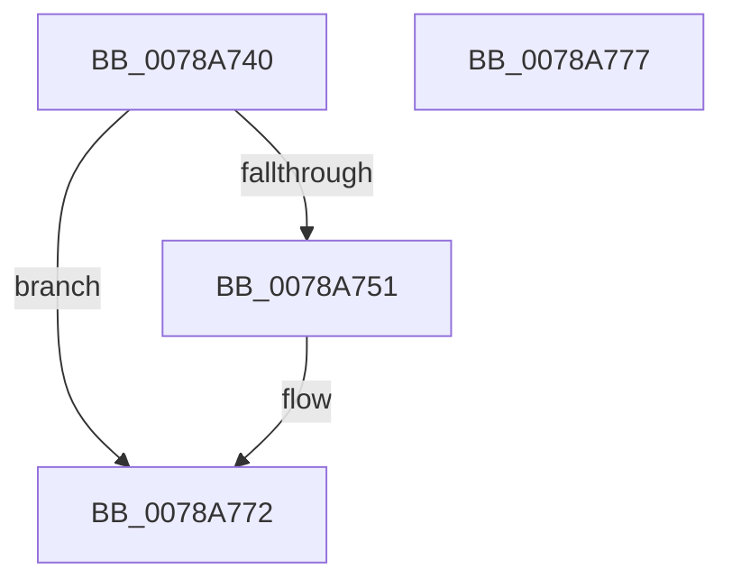

# RtlIsFunctionalityAvailable

- RVA: `0x0078A740`–`0x0078A778` (길이 `56` bytes)
- VA: `0x000000014078A740`
- 실행 섹션: `PAGE`
- PDB 이름 있음: `예`; PDB Function 태그: `아니요`
- unwind 정보 RVA: `0x0005C788`
- 디코드: `16`개 명령, `56/56` bytes 표시
- 미해석 바이트: `0` (있으면 어셈블리에 `.byte`로 보존)

> 이 문서는 커널 이미지의 기계어와 PDB 기호를 분석해 생성했습니다. 4번과 5번은 함수 원형과 자료형을 바이너리 사용 방식에서 추정한 C 해석이며 원본 소스 복구 결과는 아닙니다.

## 1. Dependencies

- 직접 호출 지점: **1**; 고유 호출 대상: **1**
- 직접 호출자로 확인된 함수: **0**
- RIP 상대 이미지 참조: **0**

### Outgoing calls
- `0x0078A751` → [PsGetCurrentServerSiloGlobals](../../text/2F/PsGetCurrentServerSiloGlobals_function_002FE1F0.md) (function, `0x002FE1F0`)

### Direct callers
- 이 함수 시작 RVA로 연결되는 직접 call은 확인되지 않았습니다. 간접 호출은 완전히 역산할 수 없습니다.

### Static image references
- 디코드된 RIP-relative 메모리 참조가 없습니다.

## 2. Other-region calls and transfers

- 다른 실행 섹션으로 향하는 call: **1**
  - `0x0078A751` → [PsGetCurrentServerSiloGlobals](../../text/2F/PsGetCurrentServerSiloGlobals_function_002FE1F0.md) (`PAGE` → `.text`)
- 별도 외부 분기/꼬리 이동을 확인하지 못했습니다.

## 3. Assembly (complete function range)

```asm
0078A740  48 83 EC 28                     sub rsp, 0x28
0078A744  32 C0                           xor al, al
0078A746  44 8B C1                        mov r8d, ecx
0078A749  81 F9 80 00 00 00               cmp ecx, 0x80
0078A74F  73 21                           jae 0x14078a772
0078A751  E8 9A 3A B7 FF                  call 0x1402fe1f0
0078A756  48 8B D0                        mov rdx, rax
0078A759  41 8B C0                        mov eax, r8d
0078A75C  48 C1 E8 05                     shr rax, 5
0078A760  41 83 E0 1F                     and r8d, 0x1f
0078A764  8B 84 82 88 05 00 00            mov eax, dword ptr [rdx + rax*4 + 0x588]
0078A76B  44 0F A3 C0                     bt eax, r8d
0078A76F  0F 92 C0                        setb al
0078A772  48 83 C4 28                     add rsp, 0x28
0078A776  C3                              ret
0078A777  CC                              int3
```

## 4. C-style interpretation (structured pseudocode)

```c
__int64 __fastcall RtlIsFunctionalityAvailable(int a1)
{
    __int64 result;
    __int64 v_rsp;

    v_rsp = (v_rsp) - (40);
    result = 0;
    if (a1 < 128) {
        result = PsGetCurrentServerSiloGlobals(a1, a2, (unsigned int)(a1), a4);
        a2 = result;
        result = (unsigned int)((unsigned int)(a1));
        result = (result) >> (5);
        a3 = (unsigned int)(((unsigned int)(a1)) & (31));
        result = *(unsigned int *)(a2 + result * 4 + 1416);
        result = (condition_is_below) ? 1 : 0;
    }
    v_rsp = (v_rsp) + (40);
    return result;
}
```

## 5. (Beta) C Style

```c
int64_t RtlIsFunctionalityAvailable(int32_t Arg1)
{
    int64_t result;
    int64_t local_rsp;

    local_rsp = (local_rsp) - (40);
    result = 0;
    if (Arg1 < 128) {
        result = PsGetCurrentServerSiloGlobals(Arg1, a2, (uint32_t)(Arg1), a4);
        a2 = result;
        result = (uint32_t)((uint32_t)(Arg1));
        result = (result) >> (5);
        a3 = (uint32_t)(((uint32_t)(Arg1)) & (31));
        result = *(uint32_t *)(a2 + result * 4 + 0x588);
        result = (condition_is_below) ? 1 : 0;
    }
    local_rsp = (local_rsp) + (40);
    return result;
}
```

## 6. Execution-region graph

[열기: 2D/3D 그래프와 함수 탐색 컨트롤 패널](../../../control-panel.html?section=page&rva=0x0078A740&view=graph)

- 2D 그래프는 위에서 아래로 흐르고, 3D 그래프는 빈 공간을 드래그해 회전합니다. Shift+드래그는 이동, 휠은 확대·축소, 함수 노드 선택은 대상 보고서 이동입니다.

### Static fallback


