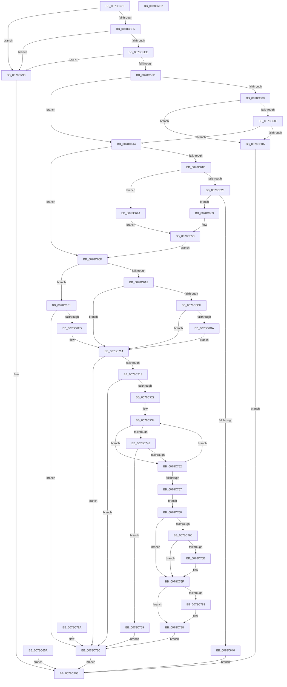

# RtlLoadString

- RVA: `0x0078C570`–`0x0078C7C3` (길이 `595` bytes)
- VA: `0x000000014078C570`
- 실행 섹션: `PAGE`
- PDB 이름 있음: `예`; PDB Function 태그: `아니요`
- unwind 정보 RVA: `0x000CF860`
- 디코드: `157`개 명령, `595/595` bytes 표시
- 미해석 바이트: `0` (있으면 어셈블리에 `.byte`로 보존)

> 이 문서는 커널 이미지의 기계어와 PDB 기호를 분석해 생성했습니다. 4번과 5번은 함수 원형과 자료형을 바이너리 사용 방식에서 추정한 C 해석이며 원본 소스 복구 결과는 아닙니다.

## 1. Dependencies

- 직접 호출 지점: **5**; 고유 호출 대상: **5**
- 직접 호출자로 확인된 함수: **0**
- RIP 상대 이미지 참조: **1**

### Outgoing calls
- `0x0078C62B` → [DownLevelLanguageNameToLangID](../../text/4C/DownLevelLanguageNameToLangID_function_004C3748.md) (function, `0x004C3748`)
- `0x0078C6C1` → [LdrResSearchResource](../98/LdrResSearchResource_function_0098F7A0.md) (function, `0x0098F7A0`)
- `0x0078C6EB` → [LdrpSearchResourceSection_U](../99/LdrpSearchResourceSection_U_function_0099B2DC.md) (function, `0x0099B2DC`)
- `0x0078C70D` → [LdrpAccessResourceData](../99/LdrpAccessResourceData_function_0099BE1C.md) (function, `0x0099BE1C`)
- `0x0078C7A0` → [_security_check_cookie](../../text/6A/_security_check_cookie_function_006AC640.md) (function, `0x006AC640`)

### Direct callers
- 이 함수 시작 RVA로 연결되는 직접 call은 확인되지 않았습니다. 간접 호출은 완전히 역산할 수 없습니다.

### Static image references
- `0x0078C58B` → RVA `0x00E0A740` (`.data`; read)

## 2. Other-region calls and transfers

- 다른 실행 섹션으로 향하는 call: **2**
  - `0x0078C62B` → [DownLevelLanguageNameToLangID](../../text/4C/DownLevelLanguageNameToLangID_function_004C3748.md) (`PAGE` → `.text`)
  - `0x0078C7A0` → [_security_check_cookie](../../text/6A/_security_check_cookie_function_006AC640.md) (`PAGE` → `.text`)
- 별도 외부 분기/꼬리 이동을 확인하지 못했습니다.

## 3. Assembly (complete function range)

```asm
0078C570  4C 8B DC                        mov r11, rsp
0078C573  49 89 5B 10                     mov qword ptr [r11 + 0x10], rbx
0078C577  49 89 73 20                     mov qword ptr [r11 + 0x20], rsi
0078C57B  57                              push rdi
0078C57C  41 54                           push r12
0078C57E  41 55                           push r13
0078C580  41 56                           push r14
0078C582  41 57                           push r15
0078C584  48 81 EC 90 00 00 00            sub rsp, 0x90
0078C58B  48 8B 05 AE E1 67 00            mov rax, qword ptr [rip + 0x67e1ae]
0078C592  48 33 C4                        xor rax, rsp
0078C595  48 89 84 24 88 00 00 00         mov qword ptr [rsp + 0x88], rax
0078C59D  44 0F B7 E2                     movzx r12d, dx
0078C5A1  48 8B F9                        mov rdi, rcx
0078C5A4  48 8B 84 24 E0 00 00 00         mov rax, qword ptr [rsp + 0xe0]
0078C5AC  48 89 44 24 60                  mov qword ptr [rsp + 0x60], rax
0078C5B1  4C 8B AC 24 E8 00 00 00         mov r13, qword ptr [rsp + 0xe8]
0078C5B9  4C 8B B4 24 F0 00 00 00         mov r14, qword ptr [rsp + 0xf0]
0078C5C1  4C 8B BC 24 F8 00 00 00         mov r15, qword ptr [rsp + 0xf8]
0078C5C9  33 C9                           xor ecx, ecx
0078C5CB  49 89 4B A0                     mov qword ptr [r11 - 0x60], rcx
0078C5CF  49 89 4B 98                     mov qword ptr [r11 - 0x68], rcx
0078C5D3  41 8A F1                        mov sil, r9b
0078C5D6  8D 51 01                        lea edx, [rcx + 1]
0078C5D9  40 22 F2                        and sil, dl
0078C5DC  48 85 FF                        test rdi, rdi
0078C5DF  0F 84 AB 01 00 00               je 0x14078c790
0078C5E5  48 85 C0                        test rax, rax
0078C5E8  0F 84 A2 01 00 00               je 0x14078c790
0078C5EE  41 F7 C1 FE FF FF FF            test r9d, 0xfffffffe
0078C5F5  0F 85 95 01 00 00               jne 0x14078c790
0078C5FB  40 84 F6                        test sil, sil
0078C5FE  74 14                           je 0x14078c614
0078C600  4D 85 F6                        test r14, r14
0078C603  75 05                           jne 0x14078c60a
0078C605  4D 85 FF                        test r15, r15
0078C608  74 0A                           je 0x14078c614
0078C60A  B8 BB 00 00 C0                  mov eax, 0xc00000bb
0078C60F  E9 81 01 00 00                  jmp 0x14078c795
0078C614  41 81 F8 FF FF 00 00            cmp r8d, 0xffff
0078C61B  76 42                           jbe 0x14078c65f
0078C61D  66 41 39 08                     cmp word ptr [r8], cx
0078C621  74 27                           je 0x14078c64a
0078C623  BA 02 00 00 00                  mov edx, 2
0078C628  49 8B C8                        mov rcx, r8
0078C62B  E8 18 71 D3 FF                  call 0x1404c3748
0078C630  44 0F B7 C0                     movzx r8d, ax
0078C634  44 89 44 24 48                  mov dword ptr [rsp + 0x48], r8d
0078C639  33 C9                           xor ecx, ecx
0078C63B  45 85 C0                        test r8d, r8d
0078C63E  75 13                           jne 0x14078c653
0078C640  B8 0D 00 00 C0                  mov eax, 0xc000000d
0078C645  E9 4B 01 00 00                  jmp 0x14078c795
0078C64A  44 8B C1                        mov r8d, ecx
0078C64D  89 4C 24 48                     mov dword ptr [rsp + 0x48], ecx
0078C651  EB 05                           jmp 0x14078c658
0078C653  BA 01 00 00 00                  mov edx, 1
0078C658  EB 05                           jmp 0x14078c65f
0078C65A  E9 36 01 00 00                  jmp 0x14078c795
0078C65F  48 C7 44 24 68 06 00 00 00      mov qword ptr [rsp + 0x68], 6
0078C668  41 8B DC                        mov ebx, r12d
0078C66B  41 8B C4                        mov eax, r12d
0078C66E  C1 E8 04                        shr eax, 4
0078C671  03 C2                           add eax, edx
0078C673  48 89 44 24 70                  mov qword ptr [rsp + 0x70], rax
0078C678  41 8B C0                        mov eax, r8d
0078C67B  48 89 44 24 78                  mov qword ptr [rsp + 0x78], rax
0078C680  4C 89 A4 24 80 00 00 00         mov qword ptr [rsp + 0x80], r12
0078C688  48 89 4C 24 40                  mov qword ptr [rsp + 0x40], rcx
0078C68D  44 8B CA                        mov r9d, edx
0078C690  41 B8 04 00 00 00               mov r8d, 4
0078C696  48 8B CF                        mov rcx, rdi
0078C699  48 8D 54 24 68                  lea rdx, [rsp + 0x68]
0078C69E  40 84 F6                        test sil, sil
0078C6A1  75 3E                           jne 0x14078c6e1
0078C6A3  4C 89 7C 24 38                  mov qword ptr [rsp + 0x38], r15
0078C6A8  4C 89 74 24 30                  mov qword ptr [rsp + 0x30], r14
0078C6AD  48 8D 44 24 40                  lea rax, [rsp + 0x40]
0078C6B2  48 89 44 24 28                  mov qword ptr [rsp + 0x28], rax
0078C6B7  48 8D 44 24 50                  lea rax, [rsp + 0x50]
0078C6BC  48 89 44 24 20                  mov qword ptr [rsp + 0x20], rax
0078C6C1  E8 DA 30 20 00                  call 0x14098f7a0
0078C6C6  8B D0                           mov edx, eax
0078C6C8  45 33 F6                        xor r14d, r14d
0078C6CB  85 C0                           test eax, eax
0078C6CD  78 45                           js 0x14078c714
0078C6CF  48 81 7C 24 40 FF FF 00 00      cmp qword ptr [rsp + 0x40], 0xffff
0078C6D8  76 3A                           jbe 0x14078c714
0078C6DA  BA 7B 00 00 C0                  mov edx, 0xc000007b
0078C6DF  EB 33                           jmp 0x14078c714
0078C6E1  48 8D 44 24 58                  lea rax, [rsp + 0x58]
0078C6E6  48 89 44 24 20                  mov qword ptr [rsp + 0x20], rax
0078C6EB  E8 EC EB 20 00                  call 0x14099b2dc
0078C6F0  8B D0                           mov edx, eax
0078C6F2  45 33 F6                        xor r14d, r14d
0078C6F5  85 C0                           test eax, eax
0078C6F7  0F 88 8F 00 00 00               js 0x14078c78c
0078C6FD  45 33 C9                        xor r9d, r9d
0078C700  4C 8D 44 24 50                  lea r8, [rsp + 0x50]
0078C705  48 8B 54 24 58                  mov rdx, qword ptr [rsp + 0x58]
0078C70A  48 8B CF                        mov rcx, rdi
0078C70D  E8 0A F7 20 00                  call 0x14099be1c
0078C712  8B D0                           mov edx, eax
0078C714  85 D2                           test edx, edx
0078C716  78 74                           js 0x14078c78c
0078C718  4C 8B 4C 24 50                  mov r9, qword ptr [rsp + 0x50]
0078C71D  4D 85 C9                        test r9, r9
0078C720  74 6A                           je 0x14078c78c
0078C722  41 0F B7 CE                     movzx ecx, r14w
0078C726  83 E3 0F                        and ebx, 0xf
0078C729  48 D1 6C 24 40                  shr qword ptr [rsp + 0x40], 1
0078C72E  41 BA 01 00 00 00               mov r10d, 1
0078C734  0F B7 C1                        movzx eax, cx
0078C737  45 0F B7 04 41                  movzx r8d, word ptr [r9 + rax*2]
0078C73C  43 8D 04 02                     lea eax, [r10 + r8]
0078C740  66 03 C8                        add cx, ax
0078C743  40 84 F6                        test sil, sil
0078C746  75 0A                           jne 0x14078c752
0078C748  0F B7 C1                        movzx eax, cx
0078C74B  48 3B 44 24 40                  cmp rax, qword ptr [rsp + 0x40]
0078C750  77 07                           ja 0x14078c759
0078C752  41 2B DA                        sub ebx, r10d
0078C755  79 DD                           jns 0x14078c734
0078C757  EB 07                           jmp 0x14078c760
0078C759  BA 7B 00 00 C0                  mov edx, 0xc000007b
0078C75E  EB 2C                           jmp 0x14078c78c
0078C760  66 85 C9                        test cx, cx
0078C763  74 0A                           je 0x14078c76f
0078C765  66 45 85 C0                     test r8w, r8w
0078C769  74 04                           je 0x14078c76f
0078C76B  66 41 2B C8                     sub cx, r8w
0078C76F  0F B7 C1                        movzx eax, cx
0078C772  49 8D 0C 41                     lea rcx, [r9 + rax*2]
0078C776  48 8B 44 24 60                  mov rax, qword ptr [rsp + 0x60]
0078C77B  48 89 08                        mov qword ptr [rax], rcx
0078C77E  4D 85 ED                        test r13, r13
0078C781  74 05                           je 0x14078c788
0078C783  66 45 89 45 00                  mov word ptr [r13], r8w
0078C788  EB 02                           jmp 0x14078c78c
0078C78A  8B D0                           mov edx, eax
0078C78C  8B C2                           mov eax, edx
0078C78E  EB 05                           jmp 0x14078c795
0078C790  B8 0D 00 00 C0                  mov eax, 0xc000000d
0078C795  48 8B 8C 24 88 00 00 00         mov rcx, qword ptr [rsp + 0x88]
0078C79D  48 33 CC                        xor rcx, rsp
0078C7A0  E8 9B FE F1 FF                  call 0x1406ac640
0078C7A5  4C 8D 9C 24 90 00 00 00         lea r11, [rsp + 0x90]
0078C7AD  49 8B 5B 38                     mov rbx, qword ptr [r11 + 0x38]
0078C7B1  49 8B 73 48                     mov rsi, qword ptr [r11 + 0x48]
0078C7B5  49 8B E3                        mov rsp, r11
0078C7B8  41 5F                           pop r15
0078C7BA  41 5E                           pop r14
0078C7BC  41 5D                           pop r13
0078C7BE  41 5C                           pop r12
0078C7C0  5F                              pop rdi
0078C7C1  C3                              ret
0078C7C2  CC                              int3
```

## 4. C-style interpretation (structured pseudocode)

```c
__int64 __fastcall RtlLoadString(__int64 a1, unsigned __int16 a2, __int64 a3, int a4, __int64 a5, __int64 a6, __int64 a7, __int64 a8)
{
    __int64 result;
    __int64 v_r14;
    __int64 v_rbx;
    __int64 v_rsi;
    __int64 v_rsp;
    unsigned __int64 v_stack_m28;
    unsigned __int64 v_stack_m30;
    unsigned __int64 v_stack_m38;
    unsigned __int64 v_stack_m40;
    unsigned __int64 v_stack_m48;
    unsigned __int64 v_stack_m50;
    unsigned __int64 v_stack_m58;
    unsigned __int64 v_stack_m60;
    unsigned __int64 v_stack_m68;
    unsigned int v_stack_m70;
    unsigned __int64 v_stack_m78;
    unsigned __int64 v_stack_m80;
    unsigned __int64 v_stack_m88;
    unsigned __int64 v_stack_m90;
    unsigned __int64 v_stack_m98;

    *(unsigned __int64 *)(v_rsp + 16) = v_rbx;
    *(unsigned __int64 *)(v_rsp + 32) = v_rsi;
    v_rsp = (v_rsp) - (144);
    result = (*(unsigned __int64 *)(v_rip + 6807982)) ^ (v_rsp);
    v_stack_m30 = result;
    v_stack_m58 = a5;
    a1 = 0;
    *(unsigned __int64 *)(v_rsp - 96) = 0;
    *(unsigned __int64 *)(v_rsp - 104) = 0;
    v_rsi = (unsigned __int8)(((unsigned __int8)(a4)) & ((unsigned __int8)(a1 + 1)));
    if (0 == 0) goto loc_0078C790;
    if (a5 == 0) goto loc_0078C790;
    if (((a4) & (0xFFFFFFFEULL)) != 0) goto loc_0078C790;
    if ((unsigned __int8)(v_rsi) == 0) goto loc_0078C614;
    if (a7 != 0) goto loc_0078C60A;
    if (a8 == 0) goto loc_0078C614;
loc_0078C60A:
    goto loc_0078C795;
loc_0078C614:
    if (((unsigned int)(a3)) <= 0xFFFFULL) goto loc_0078C65F;
    if ((*(unsigned __int16 *)(a3)) == 0) goto loc_0078C64A;
    result = DownLevelLanguageNameToLangID(a3, 2, a3, a4);
    v_stack_m70 = (unsigned int)((unsigned __int16)(result));
    a1 = 0;
    if ((unsigned int)((unsigned __int16)(result)) != 0) goto loc_0078C653;
    goto loc_0078C795;
loc_0078C64A:
    v_stack_m70 = 0;
    goto loc_0078C658;
loc_0078C653:
loc_0078C658:
    goto loc_0078C65F;
loc_0078C65F:
    v_stack_m50 = 6;
    result = (unsigned int)(((unsigned int)(a2)) >> (4));
    result = (unsigned int)((result) + (1));
    v_stack_m48 = result;
    v_stack_m40 = 0;
    v_stack_m38 = a2;
    v_stack_m78 = 0;
    if ((unsigned __int8)(v_rsi) != 0) goto loc_0078C6E1;
    v_stack_m80 = a8;
    v_stack_m88 = a7;
    v_stack_m90 = v_stack_m78;
    v_stack_m98 = v_stack_m68;
    result = LdrResSearchResource(0, v_stack_m50, 4, 1);
    v_r14 = 0;
    if (sign_flag) goto loc_0078C714;
    if (v_stack_m78 <= 0xFFFFULL) goto loc_0078C714;
    goto loc_0078C714;
loc_0078C6E1:
    v_stack_m98 = v_stack_m60;
    result = LdrpSearchResourceSection_U(0, (unsigned int)(0xC000007BULL), 4, 1);
    v_r14 = 0;
    if (sign_flag) goto loc_0078C78C;
    a4 = 0;
    result = LdrpAccessResourceData(0, v_stack_m60, v_stack_m68, a4);
loc_0078C714:
    if (sign_flag) goto loc_0078C78C;
    if (v_stack_m68 == 0) goto loc_0078C78C;
    v_rbx = (unsigned int)(((unsigned int)(a2)) & (15));
loc_0078C734:
    a1 = (unsigned __int16)((0) + ((unsigned __int16)(1 + *(unsigned __int16 *)(v_stack_m68 + 0 * 2) * 1)));
    if ((unsigned __int8)(v_rsi) != 0) goto loc_0078C752;
    if (((unsigned __int16)(a1)) > v_stack_m78) goto loc_0078C759;
loc_0078C752:
    v_rbx = (unsigned int)((v_rbx) - (1));
    if (!sign_flag) goto loc_0078C734;
    goto loc_0078C760;
loc_0078C759:
    goto loc_0078C78C;
loc_0078C760:
    if ((unsigned __int16)(a1) == 0) goto loc_0078C76F;
    if ((unsigned __int16)(*(unsigned __int16 *)(v_stack_m68 + 0 * 2)) != 0) {
        a1 = (unsigned __int16)((a1) - ((unsigned __int16)(*(unsigned __int16 *)(v_stack_m68 + 0 * 2))));
    }
    *(unsigned __int64 *)(v_stack_m58) = v_stack_m68 + (unsigned __int16)(a1) * 2;
    if (a6 != 0) {
        *(unsigned __int16 *)(a6) = (unsigned __int16)(*(unsigned __int16 *)(v_stack_m68 + 0 * 2));
    }
    goto loc_0078C78C;
loc_0078C78C:
    goto loc_0078C795;
loc_0078C790:
loc_0078C795:
    a1 = (v_stack_m30) ^ (v_rsp);
    result = _security_check_cookie(a1, (unsigned int)(0xC000007BULL), *(unsigned __int16 *)(v_stack_m68 + 0 * 2), v_stack_m68);
    return result;
}
```

## 5. (Beta) C Style

```c
int64_t RtlLoadString(int64_t Arg1, uint16_t Arg2, int64_t Arg3, int32_t Arg4, int64_t Arg5, int64_t Arg6, int64_t Arg7, int64_t Arg8)
{
    int64_t result;
    int64_t local_r14;
    int64_t local_rbx;
    int64_t local_rsi;
    int64_t local_rsp;
    uint64_t v_stack_m28;
    uint64_t v_stack_m30;
    uint64_t v_stack_m38;
    uint64_t v_stack_m40;
    uint64_t v_stack_m48;
    uint64_t v_stack_m50;
    uint64_t v_stack_m58;
    uint64_t v_stack_m60;
    uint64_t v_stack_m68;
    uint32_t v_stack_m70;
    uint64_t v_stack_m78;
    uint64_t v_stack_m80;
    uint64_t v_stack_m88;
    uint64_t v_stack_m90;
    uint64_t v_stack_m98;

    *(uint64_t *)(local_rsp + 0x10) = local_rbx;
    *(uint64_t *)(local_rsp + 0x20) = local_rsi;
    local_rsp = (local_rsp) - (144);
    result = (*(uint64_t *)(v_rip + 0x67E1AE)) ^ (local_rsp);
    v_stack_m30 = result;
    v_stack_m58 = Arg5;
    Arg1 = 0;
    *(uint64_t *)(local_rsp - 0x60) = 0;
    *(uint64_t *)(local_rsp - 0x68) = 0;
    local_rsi = (uint8_t)(((uint8_t)(Arg4)) & ((uint8_t)(Arg1 + 1)));
    if (0 == 0) goto loc_0078C790;
    if (Arg5 == 0) goto loc_0078C790;
    if (((Arg4) & (0xFFFFFFFEULL)) != 0) goto loc_0078C790;
    if ((uint8_t)(local_rsi) == 0) goto loc_0078C614;
    if (Arg7 != 0) goto loc_0078C60A;
    if (Arg8 == 0) goto loc_0078C614;
loc_0078C60A:
    goto loc_0078C795;
loc_0078C614:
    if (((uint32_t)(Arg3)) <= 0xFFFFULL) goto loc_0078C65F;
    if ((*(uint16_t *)(Arg3)) == 0) goto loc_0078C64A;
    result = DownLevelLanguageNameToLangID(Arg3, 2, Arg3, Arg4);
    v_stack_m70 = (uint32_t)((uint16_t)(result));
    Arg1 = 0;
    if ((uint32_t)((uint16_t)(result)) != 0) goto loc_0078C653;
    goto loc_0078C795;
loc_0078C64A:
    v_stack_m70 = 0;
    goto loc_0078C658;
loc_0078C653:
loc_0078C658:
    goto loc_0078C65F;
loc_0078C65F:
    v_stack_m50 = 6;
    result = (uint32_t)(((uint32_t)(Arg2)) >> (4));
    result = (uint32_t)((result) + (1));
    v_stack_m48 = result;
    v_stack_m40 = 0;
    v_stack_m38 = Arg2;
    v_stack_m78 = 0;
    if ((uint8_t)(local_rsi) != 0) goto loc_0078C6E1;
    v_stack_m80 = Arg8;
    v_stack_m88 = Arg7;
    v_stack_m90 = v_stack_m78;
    v_stack_m98 = v_stack_m68;
    result = LdrResSearchResource(0, v_stack_m50, 4, 1);
    local_r14 = 0;
    if (sign_flag) goto loc_0078C714;
    if (v_stack_m78 <= 0xFFFFULL) goto loc_0078C714;
    goto loc_0078C714;
loc_0078C6E1:
    v_stack_m98 = v_stack_m60;
    result = LdrpSearchResourceSection_U(0, (uint32_t)(0xC000007BULL), 4, 1);
    local_r14 = 0;
    if (sign_flag) goto loc_0078C78C;
    Arg4 = 0;
    result = LdrpAccessResourceData(0, v_stack_m60, v_stack_m68, Arg4);
loc_0078C714:
    if (sign_flag) goto loc_0078C78C;
    if (v_stack_m68 == 0) goto loc_0078C78C;
    local_rbx = (uint32_t)(((uint32_t)(Arg2)) & (15));
loc_0078C734:
    Arg1 = (uint16_t)((0) + ((uint16_t)(1 + *(uint16_t *)(v_stack_m68 + 0x0 * 2) * 1)));
    if ((uint8_t)(local_rsi) != 0) goto loc_0078C752;
    if (((uint16_t)(Arg1)) > v_stack_m78) goto loc_0078C759;
loc_0078C752:
    local_rbx = (uint32_t)((local_rbx) - (1));
    if (!sign_flag) goto loc_0078C734;
    goto loc_0078C760;
loc_0078C759:
    goto loc_0078C78C;
loc_0078C760:
    if ((uint16_t)(Arg1) == 0) goto loc_0078C76F;
    if ((uint16_t)(*(uint16_t *)(v_stack_m68 + 0x0 * 2)) != 0) {
        Arg1 = (uint16_t)((Arg1) - ((uint16_t)(*(uint16_t *)(v_stack_m68 + 0x0 * 2))));
    }
    *(uint64_t *)(v_stack_m58) = v_stack_m68 + (uint16_t)(Arg1) * 2;
    if (Arg6 != 0) {
        *(uint16_t *)(Arg6) = (uint16_t)(*(uint16_t *)(v_stack_m68 + 0x0 * 2));
    }
    goto loc_0078C78C;
loc_0078C78C:
    goto loc_0078C795;
loc_0078C790:
loc_0078C795:
    Arg1 = (v_stack_m30) ^ (local_rsp);
    result = _security_check_cookie(Arg1, (uint32_t)(0xC000007BULL), *(uint16_t *)(v_stack_m68 + 0x0 * 2), v_stack_m68);
    return result;
}
```

## 6. Execution-region graph

[열기: 2D/3D 그래프와 함수 탐색 컨트롤 패널](../../../control-panel.html?section=page&rva=0x0078C570&view=graph)

- 2D 그래프는 위에서 아래로 흐르고, 3D 그래프는 빈 공간을 드래그해 회전합니다. Shift+드래그는 이동, 휠은 확대·축소, 함수 노드 선택은 대상 보고서 이동입니다.

### Static fallback


