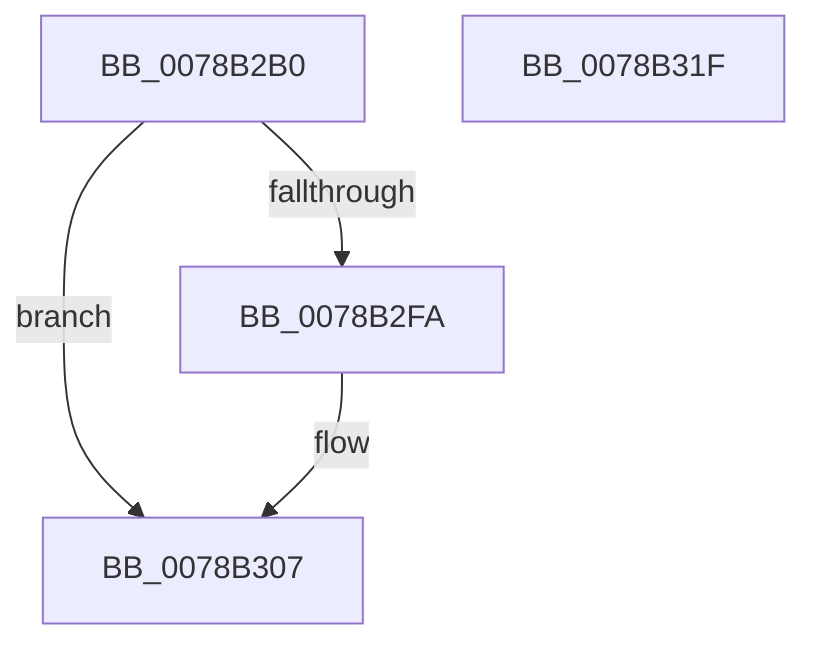

# RtlLocalTimeToSystemTime

- RVA: `0x0078B2B0`–`0x0078B320` (길이 `112` bytes)
- VA: `0x000000014078B2B0`
- 실행 섹션: `PAGE`
- PDB 이름 있음: `예`; PDB Function 태그: `아니요`
- unwind 정보 RVA: `0x000BBED8`
- 디코드: `31`개 명령, `112/112` bytes 표시
- 미해석 바이트: `0` (있으면 어셈블리에 `.byte`로 보존)

> 이 문서는 커널 이미지의 기계어와 PDB 기호를 분석해 생성했습니다. 4번과 5번은 함수 원형과 자료형을 바이너리 사용 방식에서 추정한 C 해석이며 원본 소스 복구 결과는 아닙니다.

## 1. Dependencies

- 직접 호출 지점: **2**; 고유 호출 대상: **2**
- 직접 호출자로 확인된 함수: **0**
- RIP 상대 이미지 참조: **1**

### Outgoing calls
- `0x0078B2F1` → [ZwQuerySystemInformation](../../text/6A/ZwQuerySystemInformation_function_006AD790.md) (function, `0x006AD790`)
- `0x0078B30F` → [_security_check_cookie](../../text/6A/_security_check_cookie_function_006AC640.md) (function, `0x006AC640`)

### Direct callers
- 이 함수 시작 RVA로 연결되는 직접 call은 확인되지 않았습니다. 간접 호출은 완전히 역산할 수 없습니다.

### Static image references
- `0x0078B2BA` → RVA `0x00E0A740` (`.data`; read)

## 2. Other-region calls and transfers

- 다른 실행 섹션으로 향하는 call: **2**
  - `0x0078B2F1` → [ZwQuerySystemInformation](../../text/6A/ZwQuerySystemInformation_function_006AD790.md) (`PAGE` → `.text`)
  - `0x0078B30F` → [_security_check_cookie](../../text/6A/_security_check_cookie_function_006AC640.md) (`PAGE` → `.text`)
- 별도 외부 분기/꼬리 이동을 확인하지 못했습니다.

## 3. Assembly (complete function range)

```asm
0078B2B0  48 89 5C 24 08                  mov qword ptr [rsp + 8], rbx
0078B2B5  57                              push rdi
0078B2B6  48 83 EC 60                     sub rsp, 0x60
0078B2BA  48 8B 05 7F F4 67 00            mov rax, qword ptr [rip + 0x67f47f]
0078B2C1  48 33 C4                        xor rax, rsp
0078B2C4  48 89 44 24 50                  mov qword ptr [rsp + 0x50], rax
0078B2C9  0F 57 C0                        xorps xmm0, xmm0
0078B2CC  45 33 C9                        xor r9d, r9d
0078B2CF  48 8B FA                        mov rdi, rdx
0078B2D2  48 8B D9                        mov rbx, rcx
0078B2D5  48 8D 54 24 20                  lea rdx, [rsp + 0x20]
0078B2DA  0F 11 44 24 20                  movups xmmword ptr [rsp + 0x20], xmm0
0078B2DF  45 8D 41 30                     lea r8d, [r9 + 0x30]
0078B2E3  41 8D 49 03                     lea ecx, [r9 + 3]
0078B2E7  0F 11 44 24 30                  movups xmmword ptr [rsp + 0x30], xmm0
0078B2EC  0F 11 44 24 40                  movups xmmword ptr [rsp + 0x40], xmm0
0078B2F1  E8 9A 24 F2 FF                  call 0x1406ad790
0078B2F6  85 C0                           test eax, eax
0078B2F8  78 0D                           js 0x14078b307
0078B2FA  48 8B 0B                        mov rcx, qword ptr [rbx]
0078B2FD  48 03 4C 24 30                  add rcx, qword ptr [rsp + 0x30]
0078B302  48 89 0F                        mov qword ptr [rdi], rcx
0078B305  33 C0                           xor eax, eax
0078B307  48 8B 4C 24 50                  mov rcx, qword ptr [rsp + 0x50]
0078B30C  48 33 CC                        xor rcx, rsp
0078B30F  E8 2C 13 F2 FF                  call 0x1406ac640
0078B314  48 8B 5C 24 70                  mov rbx, qword ptr [rsp + 0x70]
0078B319  48 83 C4 60                     add rsp, 0x60
0078B31D  5F                              pop rdi
0078B31E  C3                              ret
0078B31F  CC                              int3
```

## 4. C-style interpretation (structured pseudocode)

```c
__int64 __fastcall RtlLocalTimeToSystemTime(__int64 a1, __int64 a2, __int64 a3, int a4)
{
    __int64 result;
    __int64 v_rsp;
    unsigned __int64 v_stack_m18;
    unsigned __int64 v_stack_m28;
    unsigned __int64 v_stack_m38;
    unsigned __int64 v_stack_m48;
    unsigned __int64 v_stack_p8;

    v_stack_p8 = v_rbx;
    v_rsp = (v_rsp) - (96);
    result = (*(unsigned __int64 *)(v_rip + 6812799)) ^ (v_rsp);
    v_stack_m18 = result;
    a4 = 0;
    v_stack_m48 = v_xmm0;
    v_stack_m38 = v_xmm0;
    v_stack_m28 = v_xmm0;
    result = ZwQuerySystemInformation(a4 + 3, v_stack_m48, a4 + 48, a4);
    if (!(sign_flag)) {
        a1 = *(unsigned __int64 *)(a1);
        a1 = (a1) + (v_stack_m38);
        *(unsigned __int64 *)(a2) = a1;
        result = 0;
    }
    a1 = (v_stack_m18) ^ (v_rsp);
    result = _security_check_cookie(a1, v_stack_m48, a4 + 48, a4);
    v_rsp = (v_rsp) + (96);
    return result;
}
```

## 5. (Beta) C Style

```c
int64_t RtlLocalTimeToSystemTime(void *Arg1, void *Arg2, int64_t Arg3, int32_t Arg4)
{
    uint8_t *arg1 = (uint8_t *)Arg1;
    uint8_t *arg2 = (uint8_t *)Arg2;

    int64_t result;
    int64_t local_rsp;
    uint64_t v_stack_m18;
    uint64_t v_stack_m28;
    uint64_t v_stack_m38;
    uint64_t v_stack_m48;
    uint64_t v_stack_p8;

    v_stack_p8 = local_rbx;
    local_rsp = (local_rsp) - (96);
    result = (*(uint64_t *)(v_rip + 0x67F47F)) ^ (local_rsp);
    v_stack_m18 = result;
    Arg4 = 0;
    v_stack_m48 = v_xmm0;
    v_stack_m38 = v_xmm0;
    v_stack_m28 = v_xmm0;
    result = ZwQuerySystemInformation(Arg4 + 3, v_stack_m48, Arg4 + 48, Arg4);
    if (!(sign_flag)) {
        Arg1 = *(uint64_t *)(arg1);
        Arg1 = (Arg1) + (v_stack_m38);
        *(void **)(arg2) = Arg1;
        result = 0;
    }
    Arg1 = (v_stack_m18) ^ (local_rsp);
    result = _security_check_cookie(Arg1, v_stack_m48, Arg4 + 48, Arg4);
    local_rsp = (local_rsp) + (96);
    return result;
}
```

### 관측된 메모리 오프셋

구조체 형식이 확인되지 않은 접근은 인자 기준의 오프셋으로만 기록했습니다.

| 기준 인자 | 오프셋 표현 | 폭 (bit) | 접근 |
|---|---:|---:|---|
| `Arg1` | `+ 0x0` | `64` | `R` |
| `Arg2` | `+ 0x0` | `64` | `W` |

## 6. Execution-region graph

[열기: 2D/3D 그래프와 함수 탐색 컨트롤 패널](../../../control-panel.html?section=page&rva=0x0078B2B0&view=graph)

- 2D 그래프는 위에서 아래로 흐르고, 3D 그래프는 빈 공간을 드래그해 회전합니다. Shift+드래그는 이동, 휠은 확대·축소, 함수 노드 선택은 대상 보고서 이동입니다.

### Static fallback


