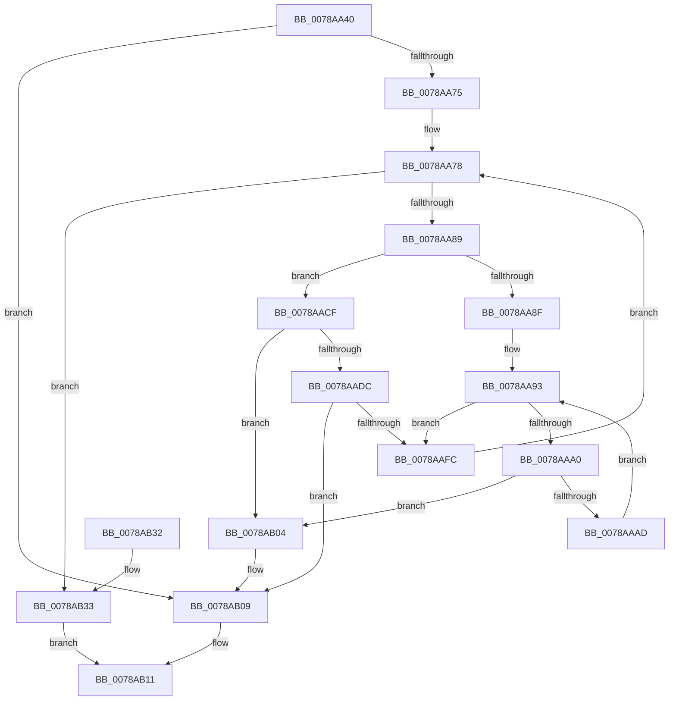

# RtlMergeRangeLists

- RVA: `0x0078AA40`–`0x0078AB43` (길이 `259` bytes)
- VA: `0x000000014078AA40`
- 실행 섹션: `PAGE`
- PDB 이름 있음: `예`; PDB Function 태그: `아니요`
- unwind 정보 RVA: `0x000CF748`
- 디코드: `77`개 명령, `259/259` bytes 표시
- 미해석 바이트: `0` (있으면 어셈블리에 `.byte`로 보존)

> 이 문서는 커널 이미지의 기계어와 PDB 기호를 분석해 생성했습니다. 4번과 5번은 함수 원형과 자료형을 바이너리 사용 방식에서 추정한 C 해석이며 원본 소스 복구 결과는 아닙니다.

## 1. Dependencies

- 직접 호출 지점: **6**; 고유 호출 대상: **4**
- 직접 호출자로 확인된 함수: **0**
- RIP 상대 이미지 참조: **0**

### Outgoing calls
- `0x0078AA66` → [RtlCopyRangeList](../A6/RtlCopyRangeList_function_00A69680.md) (function, `0x00A69680`)
- `0x0078AAA3` → [RtlpCopyRangeListEntry](../A6/RtlpCopyRangeListEntry_function_00A69720.md) (function, `0x00A69720`)
- `0x0078AAC2` → [RtlpAddRange](../70/RtlpAddRange_function_00705A70.md) (function, `0x00705A70`)
- `0x0078AAD2` → [RtlpCopyRangeListEntry](../A6/RtlpCopyRangeListEntry_function_00A69720.md) (function, `0x00A69720`)
- `0x0078AAF1` → [RtlpAddRange](../70/RtlpAddRange_function_00705A70.md) (function, `0x00705A70`)
- `0x0078AB0C` → [RtlFreeRangeList](../A6/RtlFreeRangeList_function_00A69850.md) (function, `0x00A69850`)

### Direct callers
- 이 함수 시작 RVA로 연결되는 직접 call은 확인되지 않았습니다. 간접 호출은 완전히 역산할 수 없습니다.

### Static image references
- 디코드된 RIP-relative 메모리 참조가 없습니다.

## 2. Other-region calls and transfers

- 다른 실행 섹션으로 향하는 call: **0**
- 별도 외부 분기/꼬리 이동을 확인하지 못했습니다.

## 3. Assembly (complete function range)

```asm
0078AA40  48 8B C4                        mov rax, rsp
0078AA43  48 89 58 08                     mov qword ptr [rax + 8], rbx
0078AA47  48 89 68 10                     mov qword ptr [rax + 0x10], rbp
0078AA4B  48 89 70 18                     mov qword ptr [rax + 0x18], rsi
0078AA4F  48 89 78 20                     mov qword ptr [rax + 0x20], rdi
0078AA53  41 54                           push r12
0078AA55  41 56                           push r14
0078AA57  41 57                           push r15
0078AA59  48 83 EC 20                     sub rsp, 0x20
0078AA5D  45 8B E1                        mov r12d, r9d
0078AA60  4D 8B F0                        mov r14, r8
0078AA63  48 8B F1                        mov rsi, rcx
0078AA66  E8 15 EC 2D 00                  call 0x140a69680
0078AA6B  8B D8                           mov ebx, eax
0078AA6D  85 C0                           test eax, eax
0078AA6F  0F 88 94 00 00 00               js 0x14078ab09
0078AA75  49 8B 3E                        mov rdi, qword ptr [r14]
0078AA78  48 83 EF 28                     sub rdi, 0x28
0078AA7C  4C 8D 7F 28                     lea r15, [rdi + 0x28]
0078AA80  4D 3B F7                        cmp r14, r15
0078AA83  0F 84 AA 00 00 00               je 0x14078ab33
0078AA89  F6 47 22 01                     test byte ptr [rdi + 0x22], 1
0078AA8D  74 40                           je 0x14078aacf
0078AA8F  48 8B 6F 10                     mov rbp, qword ptr [rdi + 0x10]
0078AA93  48 83 ED 28                     sub rbp, 0x28
0078AA97  48 8D 45 18                     lea rax, [rbp + 0x18]
0078AA9B  48 3B F8                        cmp rdi, rax
0078AA9E  74 5C                           je 0x14078aafc
0078AAA0  48 8B CD                        mov rcx, rbp
0078AAA3  E8 78 EC 2D 00                  call 0x140a69720
0078AAA8  48 85 C0                        test rax, rax
0078AAAB  74 57                           je 0x14078ab04
0078AAAD  45 8B C4                        mov r8d, r12d
0078AAB0  48 8B D0                        mov rdx, rax
0078AAB3  41 83 C8 01                     or r8d, 1
0078AAB7  48 8B CE                        mov rcx, rsi
0078AABA  F6 45 21 02                     test byte ptr [rbp + 0x21], 2
0078AABE  45 0F 44 C4                     cmove r8d, r12d
0078AAC2  E8 A9 AF F7 FF                  call 0x140705a70
0078AAC7  48 8B 6D 28                     mov rbp, qword ptr [rbp + 0x28]
0078AACB  8B D8                           mov ebx, eax
0078AACD  EB C4                           jmp 0x14078aa93
0078AACF  48 8B CF                        mov rcx, rdi
0078AAD2  E8 49 EC 2D 00                  call 0x140a69720
0078AAD7  48 85 C0                        test rax, rax
0078AADA  74 28                           je 0x14078ab04
0078AADC  45 8B C4                        mov r8d, r12d
0078AADF  48 8B D0                        mov rdx, rax
0078AAE2  41 83 C8 01                     or r8d, 1
0078AAE6  48 8B CE                        mov rcx, rsi
0078AAE9  F6 47 21 02                     test byte ptr [rdi + 0x21], 2
0078AAED  45 0F 44 C4                     cmove r8d, r12d
0078AAF1  E8 7A AF F7 FF                  call 0x140705a70
0078AAF6  8B D8                           mov ebx, eax
0078AAF8  85 C0                           test eax, eax
0078AAFA  78 0D                           js 0x14078ab09
0078AAFC  49 8B 3F                        mov rdi, qword ptr [r15]
0078AAFF  E9 74 FF FF FF                  jmp 0x14078aa78
0078AB04  BB 9A 00 00 C0                  mov ebx, 0xc000009a
0078AB09  48 8B CE                        mov rcx, rsi
0078AB0C  E8 3F ED 2D 00                  call 0x140a69850
0078AB11  48 8B 6C 24 48                  mov rbp, qword ptr [rsp + 0x48]
0078AB16  8B C3                           mov eax, ebx
0078AB18  48 8B 5C 24 40                  mov rbx, qword ptr [rsp + 0x40]
0078AB1D  48 8B 74 24 50                  mov rsi, qword ptr [rsp + 0x50]
0078AB22  48 8B 7C 24 58                  mov rdi, qword ptr [rsp + 0x58]
0078AB27  48 83 C4 20                     add rsp, 0x20
0078AB2B  41 5F                           pop r15
0078AB2D  41 5E                           pop r14
0078AB2F  41 5C                           pop r12
0078AB31  C3                              ret
0078AB32  CC                              int3
0078AB33  41 8B 46 14                     mov eax, dword ptr [r14 + 0x14]
0078AB37  01 46 14                        add dword ptr [rsi + 0x14], eax
0078AB3A  41 8B 46 14                     mov eax, dword ptr [r14 + 0x14]
0078AB3E  01 46 18                        add dword ptr [rsi + 0x18], eax
0078AB41  EB CE                           jmp 0x14078ab11
```

## 4. C-style interpretation (structured pseudocode)

```c
__int64 __fastcall RtlMergeRangeLists(__int64 a1, __int64 a2, __int64 a3, int a4)
{
    __int64 result;
    __int64 v_rbp;
    __int64 v_rdi;
    __int64 v_rsp;
    unsigned __int64 v_stack_p10;
    unsigned __int64 v_stack_p18;
    unsigned __int64 v_stack_p20;
    unsigned __int64 v_stack_p8;

    *(unsigned __int64 *)(v_rsp + 8) = v_rbx;
    *(unsigned __int64 *)(v_rsp + 16) = v_rbp;
    *(unsigned __int64 *)(v_rsp + 24) = v_rsi;
    *(unsigned __int64 *)(v_rsp + 32) = v_rdi;
    v_rsp = (v_rsp) - (32);
    result = RtlCopyRangeList(a1, a2, a3, a4);
    if (sign_flag) goto loc_0078AB09;
loc_0078AA78:
    v_rdi = (*(unsigned __int64 *)(a3)) - (40);
    if (a3 == (v_rdi + 40)) goto loc_0078AB33;
    if (((*(unsigned __int8 *)(v_rdi + 34)) & (1)) == 0) goto loc_0078AACF;
loc_0078AA93:
    v_rbp = (*(unsigned __int64 *)(v_rdi + 16)) - (40);
    if (v_rdi == (v_rbp + 24)) goto loc_0078AAFC;
    result = RtlpCopyRangeListEntry(v_rbp, a2, a3, a4);
    if (result == 0) goto loc_0078AB04;
    a3 = (unsigned int)(((unsigned int)((unsigned int)((unsigned int)(a4)))) | (1));
    if (((*(unsigned __int8 *)(v_rbp + 33)) & (2)) == 0) { a3 = (unsigned int)((unsigned int)(a4)); }
    result = RtlpAddRange(a1, result, a3, a4);
    goto loc_0078AA93;
loc_0078AACF:
    result = RtlpCopyRangeListEntry(v_rdi, result, a3, a4);
    if (result == 0) goto loc_0078AB04;
    a3 = (unsigned int)(((unsigned int)((unsigned int)((unsigned int)(a4)))) | (1));
    if (((*(unsigned __int8 *)(v_rdi + 33)) & (2)) == 0) { a3 = (unsigned int)((unsigned int)(a4)); }
    result = RtlpAddRange(a1, result, a3, a4);
    if (sign_flag) goto loc_0078AB09;
loc_0078AAFC:
    goto loc_0078AA78;
loc_0078AB04:
loc_0078AB09:
    result = RtlFreeRangeList(a1, result, a3, a4);
loc_0078AB11:
    v_rsp = (v_rsp) + (32);
    return (unsigned int)((unsigned int)((unsigned int)(0xC000009AULL)));
loc_0078AB33:
    goto loc_0078AB11;
}
```

## 5. (Beta) C Style

```c
int64_t RtlMergeRangeLists(void *Arg1, int64_t Arg2, void *Arg3, int32_t Arg4)
{
    uint8_t *arg1 = (uint8_t *)Arg1;
    uint8_t *arg3 = (uint8_t *)Arg3;

    int64_t result;
    int64_t local_rbp;
    int64_t local_rdi;
    int64_t local_rsp;
    uint64_t v_stack_p10;
    uint64_t v_stack_p18;
    uint64_t v_stack_p20;
    uint64_t v_stack_p8;

    *(uint64_t *)(local_rsp + 0x8) = local_rbx;
    *(uint64_t *)(local_rsp + 0x10) = local_rbp;
    *(uint64_t *)(local_rsp + 0x18) = local_rsi;
    *(uint64_t *)(local_rsp + 0x20) = local_rdi;
    local_rsp = (local_rsp) - (32);
    result = RtlCopyRangeList(Arg1, Arg2, Arg3, Arg4);
    if (sign_flag) goto loc_0078AB09;
loc_0078AA78:
    local_rdi = (*(uint64_t *)(arg3)) - (40);
    if (Arg3 == (local_rdi + 40)) goto loc_0078AB33;
    if (((*(uint8_t *)(local_rdi + 0x22)) & (1)) == 0) goto loc_0078AACF;
loc_0078AA93:
    local_rbp = (*(uint64_t *)(local_rdi + 0x10)) - (40);
    if (local_rdi == (local_rbp + 24)) goto loc_0078AAFC;
    result = RtlpCopyRangeListEntry(local_rbp, Arg2, Arg3, Arg4);
    if (result == 0) goto loc_0078AB04;
    Arg3 = (uint32_t)(((uint32_t)((uint32_t)((uint32_t)(Arg4)))) | (1));
    if (((*(uint8_t *)(local_rbp + 0x21)) & (2)) == 0) { Arg3 = (uint32_t)((uint32_t)(Arg4)); }
    result = RtlpAddRange(Arg1, result, Arg3, Arg4);
    goto loc_0078AA93;
loc_0078AACF:
    result = RtlpCopyRangeListEntry(local_rdi, result, Arg3, Arg4);
    if (result == 0) goto loc_0078AB04;
    Arg3 = (uint32_t)(((uint32_t)((uint32_t)((uint32_t)(Arg4)))) | (1));
    if (((*(uint8_t *)(local_rdi + 0x21)) & (2)) == 0) { Arg3 = (uint32_t)((uint32_t)(Arg4)); }
    result = RtlpAddRange(Arg1, result, Arg3, Arg4);
    if (sign_flag) goto loc_0078AB09;
loc_0078AAFC:
    goto loc_0078AA78;
loc_0078AB04:
loc_0078AB09:
    result = RtlFreeRangeList(Arg1, result, Arg3, Arg4);
loc_0078AB11:
    local_rsp = (local_rsp) + (32);
    return (uint32_t)((uint32_t)((uint32_t)(0xC000009AULL)));
loc_0078AB33:
    goto loc_0078AB11;
}
```

### 관측된 메모리 오프셋

구조체 형식이 확인되지 않은 접근은 인자 기준의 오프셋으로만 기록했습니다.

| 기준 인자 | 오프셋 표현 | 폭 (bit) | 접근 |
|---|---:|---:|---|
| `Arg1` | `+ 0x14` | `32` | `R/W` |
| `Arg1` | `+ 0x18` | `32` | `R/W` |
| `Arg3` | `+ 0x0` | `64` | `R` |

## 6. Execution-region graph

[열기: 2D/3D 그래프와 함수 탐색 컨트롤 패널](../../../control-panel.html?section=page&rva=0x0078AA40&view=graph)

- 2D 그래프는 위에서 아래로 흐르고, 3D 그래프는 빈 공간을 드래그해 회전합니다. Shift+드래그는 이동, 휠은 확대·축소, 함수 노드 선택은 대상 보고서 이동입니다.

### Static fallback


