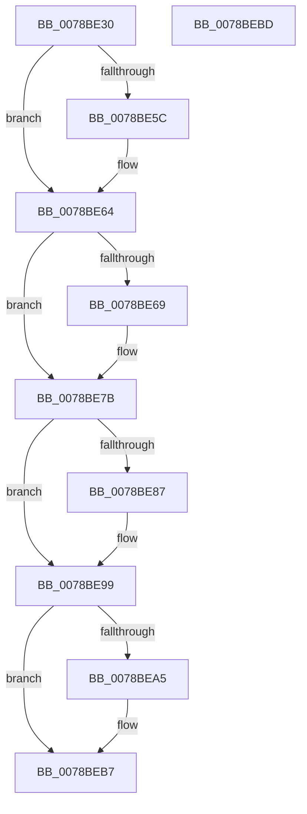

# RtlNlsDeleteState

- RVA: `0x0078BE30`–`0x0078BEBE` (길이 `142` bytes)
- VA: `0x000000014078BE30`
- 실행 섹션: `PAGE`
- PDB 이름 있음: `예`; PDB Function 태그: `아니요`
- unwind 정보 RVA: `0x0005CF00`
- 디코드: `31`개 명령, `142/142` bytes 표시
- 미해석 바이트: `0` (있으면 어셈블리에 `.byte`로 보존)

> 이 문서는 커널 이미지의 기계어와 PDB 기호를 분석해 생성했습니다. 4번과 5번은 함수 원형과 자료형을 바이너리 사용 방식에서 추정한 C 해석이며 원본 소스 복구 결과는 아닙니다.

## 1. Dependencies

- 직접 호출 지점: **3**; 고유 호출 대상: **1**
- 직접 호출자로 확인된 함수: **1**
- RIP 상대 이미지 참조: **0**

### Outgoing calls
- `0x0078BE6E` → [MiRemoveFromSystemSpace](../../text/29/MiRemoveFromSystemSpace_function_002962FC.md) (function, `0x002962FC`)
- `0x0078BE8C` → [MiRemoveFromSystemSpace](../../text/29/MiRemoveFromSystemSpace_function_002962FC.md) (function, `0x002962FC`)
- `0x0078BEAA` → [MiRemoveFromSystemSpace](../../text/29/MiRemoveFromSystemSpace_function_002962FC.md) (function, `0x002962FC`)

### Direct callers
- [PspDeleteExternalServerSiloState](../77/PspDeleteExternalServerSiloState_function_0077FB88.md) at `0x0077FC2E`

### Static image references
- 디코드된 RIP-relative 메모리 참조가 없습니다.

## 2. Other-region calls and transfers

- 다른 실행 섹션으로 향하는 call: **3**
  - `0x0078BE6E` → [MiRemoveFromSystemSpace](../../text/29/MiRemoveFromSystemSpace_function_002962FC.md) (`PAGE` → `.text`)
  - `0x0078BE8C` → [MiRemoveFromSystemSpace](../../text/29/MiRemoveFromSystemSpace_function_002962FC.md) (`PAGE` → `.text`)
  - `0x0078BEAA` → [MiRemoveFromSystemSpace](../../text/29/MiRemoveFromSystemSpace_function_002962FC.md) (`PAGE` → `.text`)
- 별도 외부 분기/꼬리 이동을 확인하지 못했습니다.

## 3. Assembly (complete function range)

```asm
0078BE30  40 53                           push rbx
0078BE32  48 83 EC 20                     sub rsp, 0x20
0078BE36  48 8B D9                        mov rbx, rcx
0078BE39  B8 E9 FD 00 00                  mov eax, 0xfde9
0078BE3E  66 89 81 08 04 00 00            mov word ptr [rcx + 0x408], ax
0078BE45  66 89 81 48 04 00 00            mov word ptr [rcx + 0x448], ax
0078BE4C  48 8B 89 88 04 00 00            mov rcx, qword ptr [rcx + 0x488]
0078BE53  48 3B 8B 90 04 00 00            cmp rcx, qword ptr [rbx + 0x490]
0078BE5A  75 08                           jne 0x14078be64
0078BE5C  48 83 A3 90 04 00 00 00         and qword ptr [rbx + 0x490], 0
0078BE64  48 85 C9                        test rcx, rcx
0078BE67  74 12                           je 0x14078be7b
0078BE69  BA 01 00 00 00                  mov edx, 1
0078BE6E  E8 89 A4 B0 FF                  call 0x1402962fc
0078BE73  48 83 A3 88 04 00 00 00         and qword ptr [rbx + 0x488], 0
0078BE7B  48 8B 8B 90 04 00 00            mov rcx, qword ptr [rbx + 0x490]
0078BE82  48 85 C9                        test rcx, rcx
0078BE85  74 12                           je 0x14078be99
0078BE87  BA 01 00 00 00                  mov edx, 1
0078BE8C  E8 6B A4 B0 FF                  call 0x1402962fc
0078BE91  48 83 A3 90 04 00 00 00         and qword ptr [rbx + 0x490], 0
0078BE99  48 8B 8B A8 04 00 00            mov rcx, qword ptr [rbx + 0x4a8]
0078BEA0  48 85 C9                        test rcx, rcx
0078BEA3  74 12                           je 0x14078beb7
0078BEA5  BA 01 00 00 00                  mov edx, 1
0078BEAA  E8 4D A4 B0 FF                  call 0x1402962fc
0078BEAF  48 83 A3 A8 04 00 00 00         and qword ptr [rbx + 0x4a8], 0
0078BEB7  48 83 C4 20                     add rsp, 0x20
0078BEBB  5B                              pop rbx
0078BEBC  C3                              ret
0078BEBD  CC                              int3
```

## 4. C-style interpretation (structured pseudocode)

```c
__int64 __fastcall RtlNlsDeleteState(__int64 a1)
{
    __int64 result;
    __int64 v_rsp;

    v_rsp = (v_rsp) - (32);
    *(unsigned __int16 *)(a1 + 1032) = (unsigned __int16)((unsigned int)(0xFDE9ULL));
    *(unsigned __int16 *)(a1 + 1096) = (unsigned __int16)((unsigned int)(0xFDE9ULL));
    if ((*(unsigned __int64 *)(a1 + 1160)) == (*(unsigned __int64 *)(a1 + 1168))) {
    }
    result = (unsigned int)(0xFDE9ULL);
    if (*(unsigned __int64 *)(a1 + 1160) != 0) {
        a2 = 1;
        result = MiRemoveFromSystemSpace(*(unsigned __int64 *)(a1 + 1160), a2, a3, a4);
    }
    if (*(unsigned __int64 *)(a1 + 1168) != 0) {
        a2 = 1;
        result = MiRemoveFromSystemSpace(*(unsigned __int64 *)(a1 + 1168), a2, a3, a4);
    }
    if (*(unsigned __int64 *)(a1 + 1192) != 0) {
        a2 = 1;
        result = MiRemoveFromSystemSpace(*(unsigned __int64 *)(a1 + 1192), a2, a3, a4);
    }
    v_rsp = (v_rsp) + (32);
    return result;
}
```

## 5. (Beta) C Style

```c
int64_t RtlNlsDeleteState(void *Arg1)
{
    uint8_t *arg1 = (uint8_t *)Arg1;

    int64_t result;
    int64_t local_rsp;

    local_rsp = (local_rsp) - (32);
    *(uint16_t *)(arg1 + 0x408) = (uint16_t)((uint32_t)(0xFDE9ULL));
    *(uint16_t *)(arg1 + 0x448) = (uint16_t)((uint32_t)(0xFDE9ULL));
    if ((*(uint64_t *)(arg1 + 0x488)) == (*(uint64_t *)(arg1 + 0x490))) {
    }
    result = (uint32_t)(0xFDE9ULL);
    if (*(uint64_t *)(arg1 + 0x488) != 0) {
        a2 = 1;
        result = MiRemoveFromSystemSpace(*(uint64_t *)(arg1 + 0x488), a2, a3, a4);
    }
    if (*(uint64_t *)(arg1 + 0x490) != 0) {
        a2 = 1;
        result = MiRemoveFromSystemSpace(*(uint64_t *)(arg1 + 0x490), a2, a3, a4);
    }
    if (*(uint64_t *)(arg1 + 0x4A8) != 0) {
        a2 = 1;
        result = MiRemoveFromSystemSpace(*(uint64_t *)(arg1 + 0x4A8), a2, a3, a4);
    }
    local_rsp = (local_rsp) + (32);
    return result;
}
```

### 관측된 메모리 오프셋

구조체 형식이 확인되지 않은 접근은 인자 기준의 오프셋으로만 기록했습니다.

| 기준 인자 | 오프셋 표현 | 폭 (bit) | 접근 |
|---|---:|---:|---|
| `Arg1` | `+ 0x408` | `16` | `W` |
| `Arg1` | `+ 0x448` | `16` | `W` |
| `Arg1` | `+ 0x488` | `64` | `R` |
| `Arg1` | `+ 0x488` | `64` | `R/W` |
| `Arg1` | `+ 0x490` | `64` | `R` |
| `Arg1` | `+ 0x490` | `64` | `R/W` |
| `Arg1` | `+ 0x4A8` | `64` | `R` |
| `Arg1` | `+ 0x4A8` | `64` | `R/W` |

## 6. Execution-region graph

[열기: 2D/3D 그래프와 함수 탐색 컨트롤 패널](../../../control-panel.html?section=page&rva=0x0078BE30&view=graph)

- 2D 그래프는 위에서 아래로 흐르고, 3D 그래프는 빈 공간을 드래그해 회전합니다. Shift+드래그는 이동, 휠은 확대·축소, 함수 노드 선택은 대상 보고서 이동입니다.

### Static fallback


