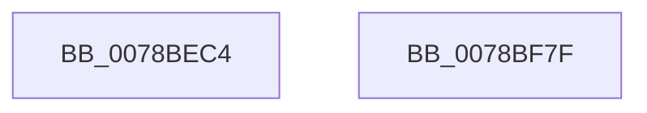

# RtlNlsInitState

- RVA: `0x0078BEC4`–`0x0078BF80` (길이 `188` bytes)
- VA: `0x000000014078BEC4`
- 실행 섹션: `PAGE`
- PDB 이름 있음: `예`; PDB Function 태그: `아니요`
- unwind 정보 RVA: `0x000CF844`
- 디코드: `39`개 명령, `188/188` bytes 표시
- 미해석 바이트: `0` (있으면 어셈블리에 `.byte`로 보존)

> 이 문서는 커널 이미지의 기계어와 PDB 기호를 분석해 생성했습니다. 4번과 5번은 함수 원형과 자료형을 바이너리 사용 방식에서 추정한 C 해석이며 원본 소스 복구 결과는 아닙니다.

## 1. Dependencies

- 직접 호출 지점: **2**; 고유 호출 대상: **1**
- 직접 호출자로 확인된 함수: **2**
- RIP 상대 이미지 참조: **1**

### Outgoing calls
- `0x0078BEF4` → [memset](../../text/6C/memset_function_006C6C40.md) (function, `0x006C6C40`)
- `0x0078BF1F` → [memset](../../text/6C/memset_function_006C6C40.md) (function, `0x006C6C40`)

### Direct callers
- [PspInitializeServerSiloDeferred](../77/PspInitializeServerSiloDeferred_function_0077FEE0.md) at `0x0077FF00`
- [InitBootProcessor](../../init/C1/InitBootProcessor_function_00C1B1C8.md) at `0x00C1B2D4`

### Static image references
- `0x0078BF2C` → RVA `0x00FD8A00` (`PAGEDATA`; read)

## 2. Other-region calls and transfers

- 다른 실행 섹션으로 향하는 call: **2**
  - `0x0078BEF4` → [memset](../../text/6C/memset_function_006C6C40.md) (`PAGE` → `.text`)
  - `0x0078BF1F` → [memset](../../text/6C/memset_function_006C6C40.md) (`PAGE` → `.text`)
- 별도 외부 분기/꼬리 이동을 확인하지 못했습니다.

## 3. Assembly (complete function range)

```asm
0078BEC4  48 89 5C 24 08                  mov qword ptr [rsp + 8], rbx
0078BEC9  48 89 6C 24 10                  mov qword ptr [rsp + 0x10], rbp
0078BECE  48 89 74 24 18                  mov qword ptr [rsp + 0x18], rsi
0078BED3  57                              push rdi
0078BED4  41 54                           push r12
0078BED6  41 57                           push r15
0078BED8  48 83 EC 20                     sub rsp, 0x20
0078BEDC  48 8D B9 08 04 00 00            lea rdi, [rcx + 0x408]
0078BEE3  33 D2                           xor edx, edx
0078BEE5  48 83 A7 80 00 00 00 00         and qword ptr [rdi + 0x80], 0
0078BEED  48 8B CF                        mov rcx, rdi
0078BEF0  44 8D 42 40                     lea r8d, [rdx + 0x40]
0078BEF4  E8 47 AD F3 FF                  call 0x1406c6c40
0078BEF9  48 83 A7 88 00 00 00 00         and qword ptr [rdi + 0x88], 0
0078BF01  48 8D 4F 40                     lea rcx, [rdi + 0x40]
0078BF05  33 D2                           xor edx, edx
0078BF07  C7 07 E9 FD 04 00               mov dword ptr [rdi], 0x4fde9
0078BF0D  C7 47 04 3F 00 FD FF            mov dword ptr [rdi + 4], 0xfffd003f
0078BF14  C7 47 08 3F 00 3F 00            mov dword ptr [rdi + 8], 0x3f003f
0078BF1B  44 8D 42 40                     lea r8d, [rdx + 0x40]
0078BF1F  E8 1C AD F3 FF                  call 0x1406c6c40
0078BF24  48 83 A7 A0 00 00 00 00         and qword ptr [rdi + 0xa0], 0
0078BF2C  48 8D 05 CD CA 84 00            lea rax, [rip + 0x84cacd]
0078BF33  48 83 A7 A8 00 00 00 00         and qword ptr [rdi + 0xa8], 0
0078BF3B  48 83 A7 B0 00 00 00 00         and qword ptr [rdi + 0xb0], 0
0078BF43  48 8B 5C 24 40                  mov rbx, qword ptr [rsp + 0x40]
0078BF48  48 8B 6C 24 48                  mov rbp, qword ptr [rsp + 0x48]
0078BF4D  48 8B 74 24 50                  mov rsi, qword ptr [rsp + 0x50]
0078BF52  48 89 87 90 00 00 00            mov qword ptr [rdi + 0x90], rax
0078BF59  48 89 87 98 00 00 00            mov qword ptr [rdi + 0x98], rax
0078BF60  C7 47 40 E9 FD 04 00            mov dword ptr [rdi + 0x40], 0x4fde9
0078BF67  C7 47 44 3F 00 FD FF            mov dword ptr [rdi + 0x44], 0xfffd003f
0078BF6E  C7 47 48 3F 00 3F 00            mov dword ptr [rdi + 0x48], 0x3f003f
0078BF75  48 83 C4 20                     add rsp, 0x20
0078BF79  41 5F                           pop r15
0078BF7B  41 5C                           pop r12
0078BF7D  5F                              pop rdi
0078BF7E  C3                              ret
0078BF7F  CC                              int3
```

## 4. C-style interpretation (structured pseudocode)

```c
__int64 __fastcall RtlNlsInitState(__int64 a1, int a2)
{
    __int64 result;
    __int64 v_rsp;
    unsigned __int64 v_stack_p10;
    unsigned __int64 v_stack_p18;
    unsigned __int64 v_stack_p8;

    v_stack_p8 = v_rbx;
    v_stack_p10 = v_rbp;
    v_stack_p18 = v_rsi;
    v_rsp = (v_rsp) - (32);
    a2 = 0;
    result = memset(a1 + 1032, a2, a2 + 64, a4);
    a2 = 0;
    *(unsigned int *)(a1 + 1032) = 0x4FDE9ULL;
    *(unsigned int *)(a1 + 1032 + 4) = 0xFFFD003FULL;
    *(unsigned int *)(a1 + 1032 + 8) = 0x3F003FULL;
    result = memset(a1 + 1032 + 64, a2, a2 + 64, a4);
    *(unsigned __int64 *)(a1 + 1032 + 144) = v_rip + 8702669;
    *(unsigned __int64 *)(a1 + 1032 + 152) = v_rip + 8702669;
    *(unsigned int *)(a1 + 1032 + 64) = 0x4FDE9ULL;
    *(unsigned int *)(a1 + 1032 + 68) = 0xFFFD003FULL;
    *(unsigned int *)(a1 + 1032 + 72) = 0x3F003FULL;
    v_rsp = (v_rsp) + (32);
    return v_rip + 8702669;
}
```

## 5. (Beta) C Style

```c
int64_t RtlNlsInitState(void *Arg1, int32_t Arg2)
{
    uint8_t *arg1 = (uint8_t *)Arg1;

    int64_t result;
    int64_t local_rsp;
    uint64_t v_stack_p10;
    uint64_t v_stack_p18;
    uint64_t v_stack_p8;

    v_stack_p8 = local_rbx;
    v_stack_p10 = local_rbp;
    v_stack_p18 = local_rsi;
    local_rsp = (local_rsp) - (32);
    Arg2 = 0;
    result = memset(Arg1 + 1032, Arg2, Arg2 + 64, a4);
    Arg2 = 0;
    *(uint32_t *)(arg1 + 0x408) = 0x4FDE9ULL;
    *(uint32_t *)(arg1 + 0x408 + 0x4) = 0xFFFD003FULL;
    *(uint32_t *)(arg1 + 0x408 + 0x8) = 0x3F003FULL;
    result = memset(Arg1 + 1032 + 64, Arg2, Arg2 + 64, a4);
    *(uint64_t *)(arg1 + 0x408 + 0x90) = v_rip + 8702669;
    *(uint64_t *)(arg1 + 0x408 + 0x98) = v_rip + 8702669;
    *(uint32_t *)(arg1 + 0x408 + 0x40) = 0x4FDE9ULL;
    *(uint32_t *)(arg1 + 0x408 + 0x44) = 0xFFFD003FULL;
    *(uint32_t *)(arg1 + 0x408 + 0x48) = 0x3F003FULL;
    local_rsp = (local_rsp) + (32);
    return v_rip + 8702669;
}
```

### 관측된 메모리 오프셋

구조체 형식이 확인되지 않은 접근은 인자 기준의 오프셋으로만 기록했습니다.

| 기준 인자 | 오프셋 표현 | 폭 (bit) | 접근 |
|---|---:|---:|---|
| `Arg1` | `+ 0x0` | `32` | `W` |
| `Arg1` | `+ 0x4` | `32` | `W` |
| `Arg1` | `+ 0x8` | `32` | `W` |
| `Arg1` | `+ 0x40` | `32` | `W` |
| `Arg1` | `+ 0x40` | `64` | `R` |
| `Arg1` | `+ 0x44` | `32` | `W` |
| `Arg1` | `+ 0x48` | `32` | `W` |
| `Arg1` | `+ 0x80` | `64` | `R/W` |
| `Arg1` | `+ 0x88` | `64` | `R/W` |
| `Arg1` | `+ 0x90` | `64` | `W` |
| `Arg1` | `+ 0x98` | `64` | `W` |
| `Arg1` | `+ 0xA0` | `64` | `R/W` |
| `Arg1` | `+ 0xA8` | `64` | `R/W` |
| `Arg1` | `+ 0xB0` | `64` | `R/W` |
| `Arg1` | `+ 0x408` | `64` | `R` |

## 6. Execution-region graph

[열기: 2D/3D 그래프와 함수 탐색 컨트롤 패널](../../../control-panel.html?section=page&rva=0x0078BEC4&view=graph)

- 2D 그래프는 위에서 아래로 흐르고, 3D 그래프는 빈 공간을 드래그해 회전합니다. Shift+드래그는 이동, 휠은 확대·축소, 함수 노드 선택은 대상 보고서 이동입니다.

### Static fallback


