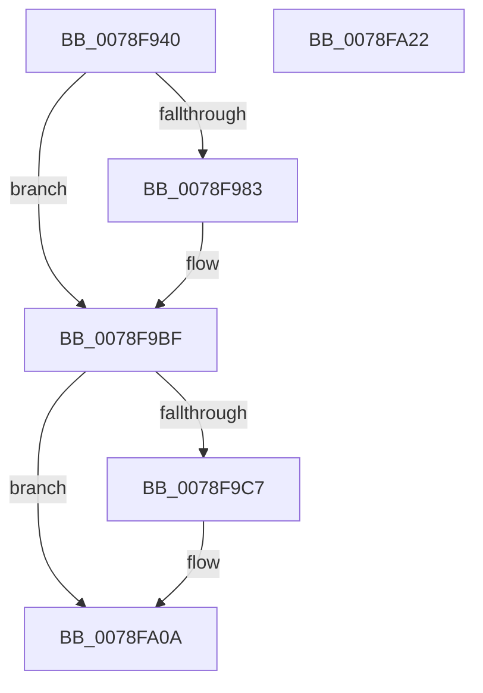

# RtlOpenCurrentUser

- RVA: `0x0078F940`–`0x0078FA23` (길이 `227` bytes)
- VA: `0x000000014078F940`
- 실행 섹션: `PAGE`
- PDB 이름 있음: `예`; PDB Function 태그: `아니요`
- unwind 정보 RVA: `0x000BF5C8`
- 디코드: `60`개 명령, `227/227` bytes 표시
- 미해석 바이트: `0` (있으면 어셈블리에 `.byte`로 보존)

> 이 문서는 커널 이미지의 기계어와 PDB 기호를 분석해 생성했습니다. 4번과 5번은 함수 원형과 자료형을 바이너리 사용 방식에서 추정한 C 해석이며 원본 소스 복구 결과는 아닙니다.

## 1. Dependencies

- 직접 호출 지점: **5**; 고유 호출 대상: **4**
- 직접 호출자로 확인된 함수: **1**
- RIP 상대 이미지 참조: **1**

### Outgoing calls
- `0x0078F978` → [RtlFormatCurrentUserKeyPath](../92/RtlFormatCurrentUserKeyPath_function_00927820.md) (function, `0x00927820`)
- `0x0078F9AF` → [ZwOpenKey](../../text/6A/ZwOpenKey_function_006AD310.md) (function, `0x006AD310`)
- `0x0078F9BA` → [RtlFreeAnsiString](../9C/RtlFreeAnsiString_function_009C0800.md) (function, `0x009C0800`)
- `0x0078F9D2` → [RtlInitUnicodeString](../../text/42/RtlInitUnicodeString_function_0042A780.md) (function, `0x0042A780`)
- `0x0078FA03` → [ZwOpenKey](../../text/6A/ZwOpenKey_function_006AD310.md) (function, `0x006AD310`)

### Direct callers
- [OpenGlobalizationUserSettingsKey](../../text/4D/OpenGlobalizationUserSettingsKey_function_004D5B3C.md) at `0x004D5B97`

### Static image references
- `0x0078F9C7` → RVA `0x00B4C4B8` (`PAGE`; read)

## 2. Other-region calls and transfers

- 다른 실행 섹션으로 향하는 call: **3**
  - `0x0078F9AF` → [ZwOpenKey](../../text/6A/ZwOpenKey_function_006AD310.md) (`PAGE` → `.text`)
  - `0x0078F9D2` → [RtlInitUnicodeString](../../text/42/RtlInitUnicodeString_function_0042A780.md) (`PAGE` → `.text`)
  - `0x0078FA03` → [ZwOpenKey](../../text/6A/ZwOpenKey_function_006AD310.md) (`PAGE` → `.text`)
- 별도 외부 분기/꼬리 이동을 확인하지 못했습니다.

## 3. Assembly (complete function range)

```asm
0078F940  48 89 5C 24 08                  mov qword ptr [rsp + 8], rbx
0078F945  48 89 74 24 10                  mov qword ptr [rsp + 0x10], rsi
0078F94A  48 89 7C 24 18                  mov qword ptr [rsp + 0x18], rdi
0078F94F  55                              push rbp
0078F950  48 8B EC                        mov rbp, rsp
0078F953  48 83 EC 60                     sub rsp, 0x60
0078F957  0F 57 C0                        xorps xmm0, xmm0
0078F95A  33 C0                           xor eax, eax
0078F95C  8B F1                           mov esi, ecx
0078F95E  48 89 45 F0                     mov qword ptr [rbp - 0x10], rax
0078F962  48 8D 4D C0                     lea rcx, [rbp - 0x40]
0078F966  89 45 F8                        mov dword ptr [rbp - 8], eax
0078F969  0F 11 45 C0                     movups xmmword ptr [rbp - 0x40], xmm0
0078F96D  48 8B FA                        mov rdi, rdx
0078F970  0F 11 45 D0                     movups xmmword ptr [rbp - 0x30], xmm0
0078F974  0F 11 45 E0                     movups xmmword ptr [rbp - 0x20], xmm0
0078F978  E8 A3 7E 19 00                  call 0x140927820
0078F97D  8B D8                           mov ebx, eax
0078F97F  85 C0                           test eax, eax
0078F981  78 3C                           js 0x14078f9bf
0078F983  48 83 65 D8 00                  and qword ptr [rbp - 0x28], 0
0078F988  48 8D 45 C0                     lea rax, [rbp - 0x40]
0078F98C  0F 57 C0                        xorps xmm0, xmm0
0078F98F  48 89 45 E0                     mov qword ptr [rbp - 0x20], rax
0078F993  4C 8D 45 D0                     lea r8, [rbp - 0x30]
0078F997  C7 45 D0 30 00 00 00            mov dword ptr [rbp - 0x30], 0x30
0078F99E  8B D6                           mov edx, esi
0078F9A0  C7 45 E8 40 06 00 00            mov dword ptr [rbp - 0x18], 0x640
0078F9A7  48 8B CF                        mov rcx, rdi
0078F9AA  F3 0F 7F 45 F0                  movdqu xmmword ptr [rbp - 0x10], xmm0
0078F9AF  E8 5C D9 F1 FF                  call 0x1406ad310
0078F9B4  48 8D 4D C0                     lea rcx, [rbp - 0x40]
0078F9B8  8B D8                           mov ebx, eax
0078F9BA  E8 41 0E 23 00                  call 0x1409c0800
0078F9BF  81 FB 34 00 00 C0               cmp ebx, 0xc0000034
0078F9C5  75 43                           jne 0x14078fa0a
0078F9C7  48 8B 15 EA CA 3B 00            mov rdx, qword ptr [rip + 0x3bcaea]
0078F9CE  48 8D 4D C0                     lea rcx, [rbp - 0x40]
0078F9D2  E8 A9 AD C9 FF                  call 0x14042a780
0078F9D7  48 83 65 D8 00                  and qword ptr [rbp - 0x28], 0
0078F9DC  48 8D 45 C0                     lea rax, [rbp - 0x40]
0078F9E0  0F 57 C0                        xorps xmm0, xmm0
0078F9E3  48 89 45 E0                     mov qword ptr [rbp - 0x20], rax
0078F9E7  4C 8D 45 D0                     lea r8, [rbp - 0x30]
0078F9EB  C7 45 D0 30 00 00 00            mov dword ptr [rbp - 0x30], 0x30
0078F9F2  8B D6                           mov edx, esi
0078F9F4  C7 45 E8 40 06 00 00            mov dword ptr [rbp - 0x18], 0x640
0078F9FB  48 8B CF                        mov rcx, rdi
0078F9FE  F3 0F 7F 45 F0                  movdqu xmmword ptr [rbp - 0x10], xmm0
0078FA03  E8 08 D9 F1 FF                  call 0x1406ad310
0078FA08  8B D8                           mov ebx, eax
0078FA0A  4C 8D 5C 24 60                  lea r11, [rsp + 0x60]
0078FA0F  8B C3                           mov eax, ebx
0078FA11  49 8B 5B 10                     mov rbx, qword ptr [r11 + 0x10]
0078FA15  49 8B 73 18                     mov rsi, qword ptr [r11 + 0x18]
0078FA19  49 8B 7B 20                     mov rdi, qword ptr [r11 + 0x20]
0078FA1D  49 8B E3                        mov rsp, r11
0078FA20  5D                              pop rbp
0078FA21  C3                              ret
0078FA22  CC                              int3
```

## 4. C-style interpretation (structured pseudocode)

```c
__int64 __fastcall RtlOpenCurrentUser(int a1, __int64 a2)
{
    __int64 result;
    __int64 v_rbx;
    __int64 v_rsp;
    unsigned int v_stack_m10;
    unsigned __int64 v_stack_m18;
    unsigned int v_stack_m20;
    unsigned __int64 v_stack_m28;
    unsigned __int64 v_stack_m30;
    unsigned __int64 v_stack_m38;
    unsigned __int64 v_stack_m48;
    unsigned __int64 v_stack_m8;
    unsigned __int64 v_stack_p10;
    unsigned __int64 v_stack_p18;
    unsigned __int64 v_stack_p8;

    v_stack_p8 = v_rbx;
    v_stack_p10 = v_rsi;
    v_stack_p18 = v_rdi;
    v_rsp = (v_rsp) - (96);
    result = 0;
    v_stack_m18 = 0;
    v_stack_m10 = 0;
    v_stack_m48 = v_xmm0;
    v_stack_m38 = v_xmm0;
    v_stack_m28 = v_xmm0;
    result = RtlFormatCurrentUserKeyPath(v_stack_m48, a2, a3, a4);
    v_rbx = (unsigned int)((unsigned int)(result));
    if (!(sign_flag)) {
        result = v_stack_m48;
        v_stack_m28 = result;
        a3 = v_stack_m38;
        v_stack_m38 = 48;
        a2 = (unsigned int)((unsigned int)(a1));
        v_stack_m20 = 0x640ULL;
        a1 = a2;
        v_stack_m18 = v_xmm0;
        result = ZwOpenKey(a1, a2, a3, a4);
        a1 = v_stack_m48;
        v_rbx = (unsigned int)(result);
        result = RtlFreeAnsiString(a1, a2, a3, a4);
    }
    if (((unsigned int)(v_rbx)) == 0xC0000034ULL) {
        a2 = *(unsigned __int64 *)(v_rip + 3918570);
        a1 = v_stack_m48;
        result = RtlInitUnicodeString(a1, a2, a3, a4);
        result = v_stack_m48;
        v_stack_m28 = result;
        a3 = v_stack_m38;
        v_stack_m38 = 48;
        a2 = (unsigned int)((unsigned int)(a1));
        v_stack_m20 = 0x640ULL;
        a1 = a2;
        v_stack_m18 = v_xmm0;
        result = ZwOpenKey(a1, a2, a3, a4);
        v_rbx = (unsigned int)(result);
    }
    return (unsigned int)((unsigned int)(v_rbx));
}
```

## 5. (Beta) C Style

```c
int64_t RtlOpenCurrentUser(int32_t Arg1, int64_t Arg2)
{
    int64_t result;
    int64_t local_rbx;
    int64_t local_rsp;
    uint32_t v_stack_m10;
    uint64_t v_stack_m18;
    uint32_t v_stack_m20;
    uint64_t v_stack_m28;
    uint64_t v_stack_m30;
    uint64_t v_stack_m38;
    uint64_t v_stack_m48;
    uint64_t v_stack_m8;
    uint64_t v_stack_p10;
    uint64_t v_stack_p18;
    uint64_t v_stack_p8;

    v_stack_p8 = local_rbx;
    v_stack_p10 = local_rsi;
    v_stack_p18 = local_rdi;
    local_rsp = (local_rsp) - (96);
    result = 0;
    v_stack_m18 = 0;
    v_stack_m10 = 0;
    v_stack_m48 = v_xmm0;
    v_stack_m38 = v_xmm0;
    v_stack_m28 = v_xmm0;
    result = RtlFormatCurrentUserKeyPath(v_stack_m48, Arg2, a3, a4);
    local_rbx = (uint32_t)((uint32_t)(result));
    if (!(sign_flag)) {
        result = v_stack_m48;
        v_stack_m28 = result;
        a3 = v_stack_m38;
        v_stack_m38 = 48;
        Arg2 = (uint32_t)((uint32_t)(Arg1));
        v_stack_m20 = 0x640ULL;
        Arg1 = Arg2;
        v_stack_m18 = v_xmm0;
        result = ZwOpenKey(Arg1, Arg2, a3, a4);
        Arg1 = v_stack_m48;
        local_rbx = (uint32_t)(result);
        result = RtlFreeAnsiString(Arg1, Arg2, a3, a4);
    }
    if (((uint32_t)(local_rbx)) == 0xC0000034ULL) {
        Arg2 = *(uint64_t *)(v_rip + 0x3BCAEA);
        Arg1 = v_stack_m48;
        result = RtlInitUnicodeString(Arg1, Arg2, a3, a4);
        result = v_stack_m48;
        v_stack_m28 = result;
        a3 = v_stack_m38;
        v_stack_m38 = 48;
        Arg2 = (uint32_t)((uint32_t)(Arg1));
        v_stack_m20 = 0x640ULL;
        Arg1 = Arg2;
        v_stack_m18 = v_xmm0;
        result = ZwOpenKey(Arg1, Arg2, a3, a4);
        local_rbx = (uint32_t)(result);
    }
    return (uint32_t)((uint32_t)(local_rbx));
}
```

## 6. Execution-region graph

[열기: 2D/3D 그래프와 함수 탐색 컨트롤 패널](../../../control-panel.html?section=page&rva=0x0078F940&view=graph)

- 2D 그래프는 위에서 아래로 흐르고, 3D 그래프는 빈 공간을 드래그해 회전합니다. Shift+드래그는 이동, 휠은 확대·축소, 함수 노드 선택은 대상 보고서 이동입니다.

### Static fallback


