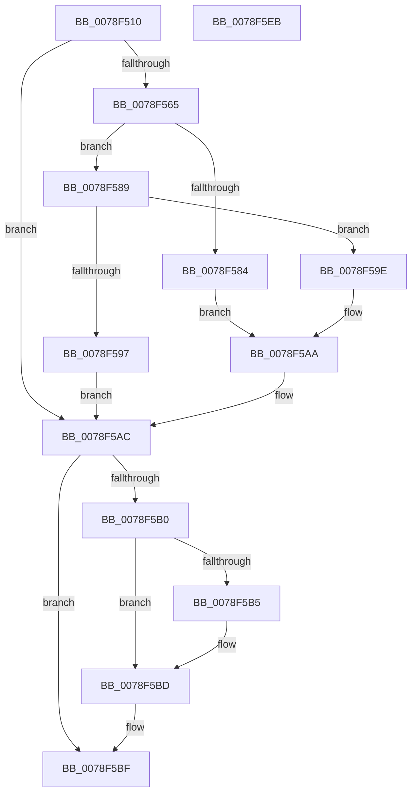

# RtlQueryAllFeatureConfigurations

- RVA: `0x0078F510`–`0x0078F5EC` (길이 `220` bytes)
- VA: `0x000000014078F510`
- 실행 섹션: `PAGE`
- PDB 이름 있음: `예`; PDB Function 태그: `아니요`
- unwind 정보 RVA: `0x0005D7BC`
- 디코드: `62`개 명령, `220/220` bytes 표시
- 미해석 바이트: `0` (있으면 어셈블리에 `.byte`로 보존)

> 이 문서는 커널 이미지의 기계어와 PDB 기호를 분석해 생성했습니다. 4번과 5번은 함수 원형과 자료형을 바이너리 사용 방식에서 추정한 C 해석이며 원본 소스 복구 결과는 아닙니다.

## 1. Dependencies

- 직접 호출 지점: **4**; 고유 호출 대상: **4**
- 직접 호출자로 확인된 함수: **0**
- RIP 상대 이미지 참조: **1**

### Outgoing calls
- `0x0078F54E` → [RtlpFcBufferManagerReferenceBuffers](../../text/4A/RtlpFcBufferManagerReferenceBuffers_function_004A73B8.md) (function, `0x004A73B8`)
- `0x0078F555` → [RtlpFcValidateFeatureConfigurationType](../../text/4C/RtlpFcValidateFeatureConfigurationType_function_004CBF10.md) (function, `0x004CBF10`)
- `0x0078F5A5` → [RtlpFcConvertFeatureConfigurationsInternalToExternal](../../text/4F/RtlpFcConvertFeatureConfigurationsInternalToExternal_function_004FD050.md) (function, `0x004FD050`)
- `0x0078F5C9` → [RtlpFcBufferManagerDereferenceBuffers](../../text/37/RtlpFcBufferManagerDereferenceBuffers_function_00378D84.md) (function, `0x00378D84`)

### Direct callers
- 이 함수 시작 RVA로 연결되는 직접 call은 확인되지 않았습니다. 간접 호출은 완전히 역산할 수 없습니다.

### Static image references
- `0x0078F547` → RVA `0x00EF7368` (`.data`; read)

## 2. Other-region calls and transfers

- 다른 실행 섹션으로 향하는 call: **4**
  - `0x0078F54E` → [RtlpFcBufferManagerReferenceBuffers](../../text/4A/RtlpFcBufferManagerReferenceBuffers_function_004A73B8.md) (`PAGE` → `.text`)
  - `0x0078F555` → [RtlpFcValidateFeatureConfigurationType](../../text/4C/RtlpFcValidateFeatureConfigurationType_function_004CBF10.md) (`PAGE` → `.text`)
  - `0x0078F5A5` → [RtlpFcConvertFeatureConfigurationsInternalToExternal](../../text/4F/RtlpFcConvertFeatureConfigurationsInternalToExternal_function_004FD050.md) (`PAGE` → `.text`)
  - `0x0078F5C9` → [RtlpFcBufferManagerDereferenceBuffers](../../text/37/RtlpFcBufferManagerDereferenceBuffers_function_00378D84.md) (`PAGE` → `.text`)
- 별도 외부 분기/꼬리 이동을 확인하지 못했습니다.

## 3. Assembly (complete function range)

```asm
0078F510  48 8B C4                        mov rax, rsp
0078F513  48 89 58 08                     mov qword ptr [rax + 8], rbx
0078F517  48 89 68 10                     mov qword ptr [rax + 0x10], rbp
0078F51B  48 89 70 18                     mov qword ptr [rax + 0x18], rsi
0078F51F  48 89 78 20                     mov qword ptr [rax + 0x20], rdi
0078F523  41 56                           push r14
0078F525  48 83 EC 30                     sub rsp, 0x30
0078F529  48 83 60 F0 00                  and qword ptr [rax - 0x10], 0
0078F52E  4D 8B F0                        mov r14, r8
0078F531  48 83 60 E8 00                  and qword ptr [rax - 0x18], 0
0078F536  4C 8D 40 E8                     lea r8, [rax - 0x18]
0078F53A  48 8B F2                        mov rsi, rdx
0078F53D  48 63 E9                        movsxd rbp, ecx
0078F540  48 8D 50 F0                     lea rdx, [rax - 0x10]
0078F544  49 8B F9                        mov rdi, r9
0078F547  48 8D 0D 1A 7E 76 00            lea rcx, [rip + 0x767e1a]
0078F54E  E8 65 7E D1 FF                  call 0x1404a73b8
0078F553  8B CD                           mov ecx, ebp
0078F555  E8 B6 C9 D3 FF                  call 0x1404cbf10
0078F55A  4C 8B 4C 24 20                  mov r9, qword ptr [rsp + 0x20]
0078F55F  8B D8                           mov ebx, eax
0078F561  85 C0                           test eax, eax
0078F563  78 47                           js 0x14078f5ac
0078F565  83 64 24 20 00                  and dword ptr [rsp + 0x20], 0
0078F56A  C7 44 24 24 01 00 00 00         mov dword ptr [rsp + 0x24], 1
0078F572  8B 4C AC 20                     mov ecx, dword ptr [rsp + rbp*4 + 0x20]
0078F576  48 8D 04 49                     lea rax, [rcx + rcx*2]
0078F57A  49 8B 4C C1 08                  mov rcx, qword ptr [r9 + rax*8 + 8]
0078F57F  48 85 C9                        test rcx, rcx
0078F582  75 05                           jne 0x14078f589
0078F584  48 21 0F                        and qword ptr [rdi], rcx
0078F587  EB 21                           jmp 0x14078f5aa
0078F589  44 8B 01                        mov r8d, dword ptr [rcx]
0078F58C  48 8B 07                        mov rax, qword ptr [rdi]
0078F58F  4C 89 07                        mov qword ptr [rdi], r8
0078F592  4C 3B C0                        cmp r8, rax
0078F595  76 07                           jbe 0x14078f59e
0078F597  BB 05 00 00 80                  mov ebx, 0x80000005
0078F59C  EB 0E                           jmp 0x14078f5ac
0078F59E  48 83 C1 04                     add rcx, 4
0078F5A2  49 8B D6                        mov rdx, r14
0078F5A5  E8 A6 DA D6 FF                  call 0x1404fd050
0078F5AA  33 DB                           xor ebx, ebx
0078F5AC  85 DB                           test ebx, ebx
0078F5AE  78 0F                           js 0x14078f5bf
0078F5B0  48 85 F6                        test rsi, rsi
0078F5B3  74 08                           je 0x14078f5bd
0078F5B5  48 8B 44 24 28                  mov rax, qword ptr [rsp + 0x28]
0078F5BA  48 89 06                        mov qword ptr [rsi], rax
0078F5BD  33 DB                           xor ebx, ebx
0078F5BF  49 8B D1                        mov rdx, r9
0078F5C2  48 8D 0D 9F 7D 76 00            lea rcx, [rip + 0x767d9f]
0078F5C9  E8 B6 97 BE FF                  call 0x140378d84
0078F5CE  48 8B 6C 24 48                  mov rbp, qword ptr [rsp + 0x48]
0078F5D3  8B C3                           mov eax, ebx
0078F5D5  48 8B 5C 24 40                  mov rbx, qword ptr [rsp + 0x40]
0078F5DA  48 8B 74 24 50                  mov rsi, qword ptr [rsp + 0x50]
0078F5DF  48 8B 7C 24 58                  mov rdi, qword ptr [rsp + 0x58]
0078F5E4  48 83 C4 30                     add rsp, 0x30
0078F5E8  41 5E                           pop r14
0078F5EA  C3                              ret
0078F5EB  CC                              int3
```

## 4. C-style interpretation (structured pseudocode)

```c
__int64 __fastcall RtlQueryAllFeatureConfigurations(int a1, __int64 a2, __int64 a3, __int64 a4)
{
    __int64 result;
    __int64 v_rbx;
    __int64 v_rsp;
    unsigned __int64 v_stack_m10;
    unsigned int v_stack_m14;
    unsigned __int64 v_stack_m18;
    unsigned __int64 v_stack_p10;
    unsigned __int64 v_stack_p18;
    unsigned __int64 v_stack_p20;
    unsigned __int64 v_stack_p8;

    *(unsigned __int64 *)(v_rsp + 8) = v_rbx;
    *(unsigned __int64 *)(v_rsp + 16) = v_rbp;
    *(unsigned __int64 *)(v_rsp + 24) = v_rsi;
    *(unsigned __int64 *)(v_rsp + 32) = v_rdi;
    v_rsp = (v_rsp) - (48);
    result = RtlpFcBufferManagerReferenceBuffers(v_rip + 7765530, v_rsp - 16, v_rsp - 24, a4);
    result = RtlpFcValidateFeatureConfigurationType((unsigned int)((unsigned int)((int)(a1))), v_rsp - 16, v_rsp - 24, a4);
    if (sign_flag) goto loc_0078F5AC;
    v_stack_m14 = 1;
    if (*(unsigned __int64 *)(v_stack_m18 + (unsigned int)(*(unsigned int *)(v_rsp + (int)(a1) * 4 + 32)) + (unsigned int)(*(unsigned int *)(v_rsp + (int)(a1) * 4 + 32)) * 2 * 8 + 8) != 0) goto loc_0078F589;
    goto loc_0078F5AA;
loc_0078F589:
    *(unsigned __int64 *)(a4) = (unsigned int)(*(unsigned int *)(*(unsigned __int64 *)(v_stack_m18 + (unsigned int)(*(unsigned int *)(v_rsp + (int)(a1) * 4 + 32)) + (unsigned int)(*(unsigned int *)(v_rsp + (int)(a1) * 4 + 32)) * 2 * 8 + 8)));
    if (((unsigned int)(*(unsigned int *)(*(unsigned __int64 *)(v_stack_m18 + (unsigned int)(*(unsigned int *)(v_rsp + (int)(a1) * 4 + 32)) + (unsigned int)(*(unsigned int *)(v_rsp + (int)(a1) * 4 + 32)) * 2 * 8 + 8)))) <= (*(unsigned __int64 *)(a4))) goto loc_0078F59E;
    goto loc_0078F5AC;
loc_0078F59E:
    a1 = (*(unsigned __int64 *)(v_stack_m18 + (unsigned int)(*(unsigned int *)(v_rsp + (int)(a1) * 4 + 32)) + (unsigned int)(*(unsigned int *)(v_rsp + (int)(a1) * 4 + 32)) * 2 * 8 + 8)) + (4);
    result = RtlpFcConvertFeatureConfigurationsInternalToExternal(a1, a3, (unsigned int)(*(unsigned int *)(*(unsigned __int64 *)(v_stack_m18 + (unsigned int)(*(unsigned int *)(v_rsp + (int)(a1) * 4 + 32)) + (unsigned int)(*(unsigned int *)(v_rsp + (int)(a1) * 4 + 32)) * 2 * 8 + 8))), v_stack_m18);
loc_0078F5AA:
    v_rbx = 0;
loc_0078F5AC:
    if (sign_flag) goto loc_0078F5BF;
    if (a2 != 0) {
        result = v_stack_m10;
        *(unsigned __int64 *)(a2) = result;
    }
    v_rbx = 0;
loc_0078F5BF:
    result = RtlpFcBufferManagerDereferenceBuffers(v_rip + 7765407, v_stack_m18, (unsigned int)(*(unsigned int *)(*(unsigned __int64 *)(v_stack_m18 + (unsigned int)(*(unsigned int *)(v_rsp + (int)(a1) * 4 + 32)) + (unsigned int)(*(unsigned int *)(v_rsp + (int)(a1) * 4 + 32)) * 2 * 8 + 8))), v_stack_m18);
    v_rsp = (v_rsp) + (48);
    return 0;
}
```

## 5. (Beta) C Style

```c
int64_t RtlQueryAllFeatureConfigurations(int32_t Arg1, int64_t Arg2, int64_t Arg3, void *Arg4)
{
    uint8_t *arg4 = (uint8_t *)Arg4;

    int64_t result;
    int64_t local_rbx;
    int64_t local_rsp;
    uint64_t v_stack_m10;
    uint32_t v_stack_m14;
    uint64_t v_stack_m18;
    uint64_t v_stack_p10;
    uint64_t v_stack_p18;
    uint64_t v_stack_p20;
    uint64_t v_stack_p8;

    *(uint64_t *)(local_rsp + 0x8) = local_rbx;
    *(uint64_t *)(local_rsp + 0x10) = local_rbp;
    *(uint64_t *)(local_rsp + 0x18) = local_rsi;
    *(uint64_t *)(local_rsp + 0x20) = local_rdi;
    local_rsp = (local_rsp) - (48);
    result = RtlpFcBufferManagerReferenceBuffers(v_rip + 7765530, local_rsp - 16, local_rsp - 24, Arg4);
    result = RtlpFcValidateFeatureConfigurationType((uint32_t)((uint32_t)((int32_t)(Arg1))), local_rsp - 16, local_rsp - 24, Arg4);
    if (sign_flag) goto loc_0078F5AC;
    v_stack_m14 = 1;
    if (*(uint64_t *)(v_stack_m18 + (uint32_t)(*(uint32_t *)(local_rsp + (int32_t)(Arg1) * 4 + 0x20)) + (uint32_t)(*(uint32_t *)(local_rsp + (int32_t)(Arg1) * 4 + 0x20)) * 2 * 8 + 0x8) != 0) goto loc_0078F589;
    goto loc_0078F5AA;
loc_0078F589:
    *(uint64_t *)(arg4) = (uint32_t)(*(uint32_t *)(*(uint64_t *)(v_stack_m18 + (uint32_t)(*(uint32_t *)(local_rsp + (int32_t)(Arg1) * 4 + 0x20)) + (uint32_t)(*(uint32_t *)(local_rsp + (int32_t)(Arg1) * 4 + 0x20)) * 2 * 8 + 0x8)));
    if (((uint32_t)(*(uint32_t *)(*(uint64_t *)(v_stack_m18 + (uint32_t)(*(uint32_t *)(local_rsp + (int32_t)(Arg1) * 4 + 0x20)) + (uint32_t)(*(uint32_t *)(local_rsp + (int32_t)(Arg1) * 4 + 0x20)) * 2 * 8 + 0x8)))) <= (*(uint64_t *)(arg4))) goto loc_0078F59E;
    goto loc_0078F5AC;
loc_0078F59E:
    Arg1 = (*(uint64_t *)(v_stack_m18 + (uint32_t)(*(uint32_t *)(local_rsp + (int32_t)(Arg1) * 4 + 0x20)) + (uint32_t)(*(uint32_t *)(local_rsp + (int32_t)(Arg1) * 4 + 0x20)) * 2 * 8 + 0x8)) + (4);
    result = RtlpFcConvertFeatureConfigurationsInternalToExternal(Arg1, Arg3, (uint32_t)(*(uint32_t *)(*(uint64_t *)(v_stack_m18 + (uint32_t)(*(uint32_t *)(local_rsp + (int32_t)(Arg1) * 4 + 0x20)) + (uint32_t)(*(uint32_t *)(local_rsp + (int32_t)(Arg1) * 4 + 0x20)) * 2 * 8 + 0x8))), v_stack_m18);
loc_0078F5AA:
    local_rbx = 0;
loc_0078F5AC:
    if (sign_flag) goto loc_0078F5BF;
    if (Arg2 != 0) {
        result = v_stack_m10;
        *(uint64_t *)(Arg2) = result;
    }
    local_rbx = 0;
loc_0078F5BF:
    result = RtlpFcBufferManagerDereferenceBuffers(v_rip + 7765407, v_stack_m18, (uint32_t)(*(uint32_t *)(*(uint64_t *)(v_stack_m18 + (uint32_t)(*(uint32_t *)(local_rsp + (int32_t)(Arg1) * 4 + 0x20)) + (uint32_t)(*(uint32_t *)(local_rsp + (int32_t)(Arg1) * 4 + 0x20)) * 2 * 8 + 0x8))), v_stack_m18);
    local_rsp = (local_rsp) + (48);
    return 0;
}
```

### 관측된 메모리 오프셋

구조체 형식이 확인되지 않은 접근은 인자 기준의 오프셋으로만 기록했습니다.

| 기준 인자 | 오프셋 표현 | 폭 (bit) | 접근 |
|---|---:|---:|---|
| `Arg4` | `+ 0x0` | `64` | `R` |
| `Arg4` | `+ 0x0` | `64` | `R/W` |
| `Arg4` | `+ 0x0` | `64` | `W` |

## 6. Execution-region graph

[열기: 2D/3D 그래프와 함수 탐색 컨트롤 패널](../../../control-panel.html?section=page&rva=0x0078F510&view=graph)

- 2D 그래프는 위에서 아래로 흐르고, 3D 그래프는 빈 공간을 드래그해 회전합니다. Shift+드래그는 이동, 휠은 확대·축소, 함수 노드 선택은 대상 보고서 이동입니다.

### Static fallback


