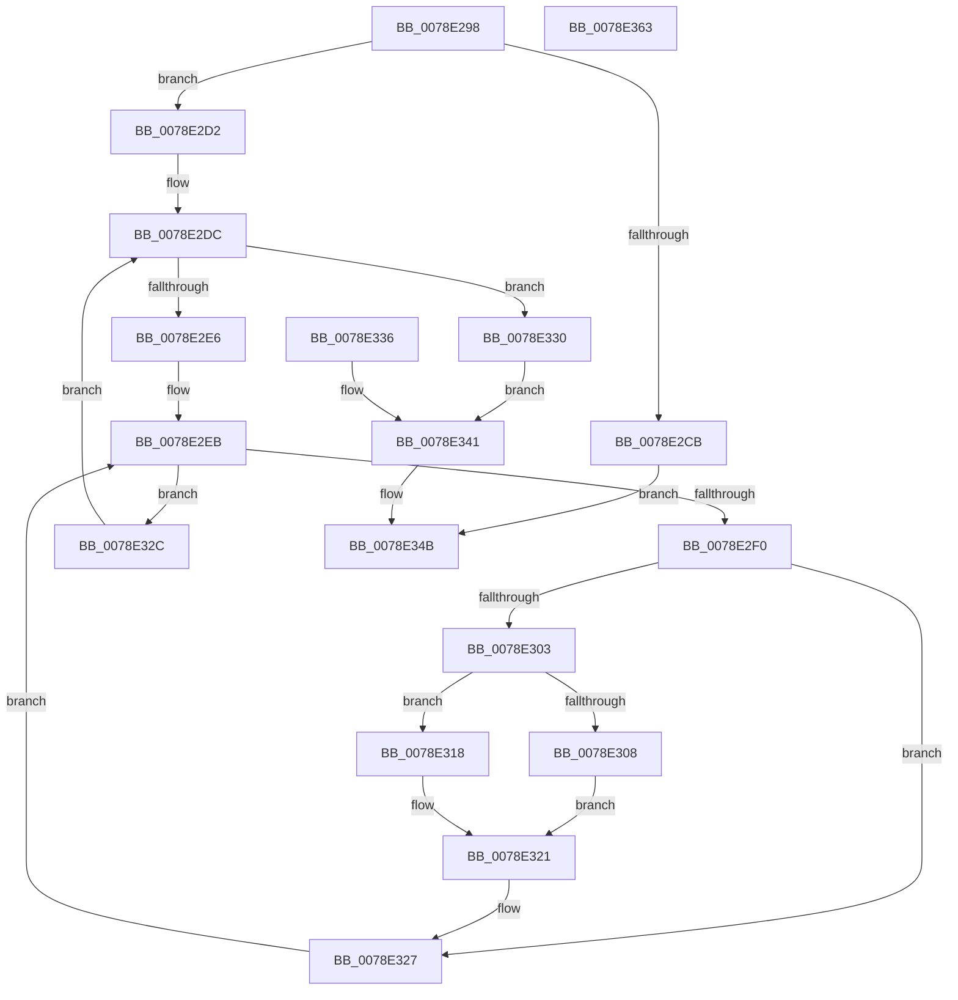

# RtlQueryAtomsInAtomTable

- RVA: `0x0078E298`–`0x0078E364` (길이 `204` bytes)
- VA: `0x000000014078E298`
- 실행 섹션: `PAGE`
- PDB 이름 있음: `예`; PDB Function 태그: `아니요`
- unwind 정보 RVA: `0x000CF930`
- 디코드: `66`개 명령, `204/204` bytes 표시
- 미해석 바이트: `0` (있으면 어셈블리에 `.byte`로 보존)

> 이 문서는 커널 이미지의 기계어와 PDB 기호를 분석해 생성했습니다. 4번과 5번은 함수 원형과 자료형을 바이너리 사용 방식에서 추정한 C 해석이며 원본 소스 복구 결과는 아닙니다.

## 1. Dependencies

- 직접 호출 지점: **3**; 고유 호출 대상: **3**
- 직접 호출자로 확인된 함수: **1**
- RIP 상대 이미지 참조: **0**

### Outgoing calls
- `0x0078E2C2` → [RtlpLockAtomTable](../9C/RtlpLockAtomTable_function_009C4A10.md) (function, `0x009C4A10`)
- `0x0078E2F9` → [RtlpLookupLowBox](../../text/43/RtlpLookupLowBox_function_004388AC.md) (function, `0x004388AC`)
- `0x0078E344` → [RtlpUnlockAtomTable](../9C/RtlpUnlockAtomTable_function_009C4A8C.md) (function, `0x009C4A8C`)

### Direct callers
- [NtQueryInformationAtom](../AF/NtQueryInformationAtom_function_00AF7720.md) at `0x00AF7813`

### Static image references
- 디코드된 RIP-relative 메모리 참조가 없습니다.

## 2. Other-region calls and transfers

- 다른 실행 섹션으로 향하는 call: **1**
  - `0x0078E2F9` → [RtlpLookupLowBox](../../text/43/RtlpLookupLowBox_function_004388AC.md) (`PAGE` → `.text`)
- 별도 외부 분기/꼬리 이동을 확인하지 못했습니다.

## 3. Assembly (complete function range)

```asm
0078E298  48 89 5C 24 10                  mov qword ptr [rsp + 0x10], rbx
0078E29D  48 89 74 24 18                  mov qword ptr [rsp + 0x18], rsi
0078E2A2  4C 89 4C 24 20                  mov qword ptr [rsp + 0x20], r9
0078E2A7  57                              push rdi
0078E2A8  41 54                           push r12
0078E2AA  41 55                           push r13
0078E2AC  41 56                           push r14
0078E2AE  41 57                           push r15
0078E2B0  48 83 EC 30                     sub rsp, 0x30
0078E2B4  4D 8B E0                        mov r12, r8
0078E2B7  44 8B EA                        mov r13d, edx
0078E2BA  4C 8B F1                        mov r14, rcx
0078E2BD  48 89 4C 24 60                  mov qword ptr [rsp + 0x60], rcx
0078E2C2  E8 49 67 23 00                  call 0x1409c4a10
0078E2C7  84 C0                           test al, al
0078E2C9  75 07                           jne 0x14078e2d2
0078E2CB  B8 0D 00 00 C0                  mov eax, 0xc000000d
0078E2D0  EB 79                           jmp 0x14078e34b
0078E2D2  33 FF                           xor edi, edi
0078E2D4  33 DB                           xor ebx, ebx
0078E2D6  89 5C 24 20                     mov dword ptr [rsp + 0x20], ebx
0078E2DA  33 F6                           xor esi, esi
0078E2DC  89 74 24 24                     mov dword ptr [rsp + 0x24], esi
0078E2E0  41 3B 76 1C                     cmp esi, dword ptr [r14 + 0x1c]
0078E2E4  73 4A                           jae 0x14078e330
0078E2E6  4D 8B 7C F6 20                  mov r15, qword ptr [r14 + rsi*8 + 0x20]
0078E2EB  4D 85 FF                        test r15, r15
0078E2EE  74 3C                           je 0x14078e32c
0078E2F0  45 33 C0                        xor r8d, r8d
0078E2F3  49 8B D7                        mov rdx, r15
0078E2F6  49 8B CE                        mov rcx, r14
0078E2F9  E8 AE A5 CA FF                  call 0x1404388ac
0078E2FE  48 85 C0                        test rax, rax
0078E301  74 24                           je 0x14078e327
0078E303  41 3B DD                        cmp ebx, r13d
0078E306  73 10                           jae 0x14078e318
0078E308  41 0F B7 4F 0A                  movzx ecx, word ptr [r15 + 0xa]
0078E30D  48 8B 54 24 78                  mov rdx, qword ptr [rsp + 0x78]
0078E312  66 89 0C 5A                     mov word ptr [rdx + rbx*2], cx
0078E316  EB 09                           jmp 0x14078e321
0078E318  BF 04 00 00 C0                  mov edi, 0xc0000004
0078E31D  89 7C 24 28                     mov dword ptr [rsp + 0x28], edi
0078E321  FF C3                           inc ebx
0078E323  89 5C 24 20                     mov dword ptr [rsp + 0x20], ebx
0078E327  4D 8B 3F                        mov r15, qword ptr [r15]
0078E32A  EB BF                           jmp 0x14078e2eb
0078E32C  FF C6                           inc esi
0078E32E  EB AC                           jmp 0x14078e2dc
0078E330  41 89 1C 24                     mov dword ptr [r12], ebx
0078E334  EB 0B                           jmp 0x14078e341
0078E336  8B F8                           mov edi, eax
0078E338  89 44 24 28                     mov dword ptr [rsp + 0x28], eax
0078E33C  4C 8B 74 24 60                  mov r14, qword ptr [rsp + 0x60]
0078E341  49 8B CE                        mov rcx, r14
0078E344  E8 43 67 23 00                  call 0x1409c4a8c
0078E349  8B C7                           mov eax, edi
0078E34B  48 8B 5C 24 68                  mov rbx, qword ptr [rsp + 0x68]
0078E350  48 8B 74 24 70                  mov rsi, qword ptr [rsp + 0x70]
0078E355  48 83 C4 30                     add rsp, 0x30
0078E359  41 5F                           pop r15
0078E35B  41 5E                           pop r14
0078E35D  41 5D                           pop r13
0078E35F  41 5C                           pop r12
0078E361  5F                              pop rdi
0078E362  C3                              ret
0078E363  CC                              int3
```

## 4. C-style interpretation (structured pseudocode)

```c
__int64 __fastcall RtlQueryAtomsInAtomTable(__int64 a1, int a2, __int64 a3, __int64 a4)
{
    __int64 result;
    __int64 v_rbx;
    __int64 v_rdi;
    __int64 v_rsi;
    __int64 v_rsp;
    unsigned int v_stack_m30;
    unsigned int v_stack_m34;
    unsigned int v_stack_m38;
    unsigned __int64 v_stack_p10;
    unsigned __int64 v_stack_p18;
    unsigned __int64 v_stack_p20;
    unsigned __int64 v_stack_p8;

    v_stack_p10 = v_rbx;
    v_stack_p18 = v_rsi;
    v_stack_p20 = a4;
    v_rsp = (v_rsp) - (48);
    v_stack_p8 = a1;
    result = RtlpLockAtomTable(a1, a2, a3, a4);
    if ((unsigned __int8)(result) != 0) goto loc_0078E2D2;
    goto loc_0078E34B;
loc_0078E2D2:
    v_rdi = 0;
    v_rbx = 0;
    v_stack_m38 = 0;
    v_rsi = 0;
loc_0078E2DC:
    v_stack_m34 = 0;
    if (0 >= (*(unsigned int *)(a1 + 28))) goto loc_0078E330;
loc_0078E2EB:
    if (*(unsigned __int64 *)(a1 + v_rsi * 8 + 32) == 0) goto loc_0078E32C;
    a3 = 0;
    result = RtlpLookupLowBox(a1, *(unsigned __int64 *)(a1 + v_rsi * 8 + 32), a3, a4);
    if (result == 0) goto loc_0078E327;
    if (0 >= ((unsigned int)((unsigned int)(a2)))) goto loc_0078E318;
    *(unsigned __int16 *)(v_stack_p20 + v_rbx * 2) = (unsigned __int16)(*(unsigned __int16 *)(*(unsigned __int64 *)(a1 + v_rsi * 8 + 32) + 10));
    goto loc_0078E321;
loc_0078E318:
    v_stack_m30 = (unsigned int)((unsigned int)(0xC0000004ULL));
loc_0078E321:
    v_rbx = (unsigned int)((v_rbx) + 1);
    v_stack_m38 = (unsigned int)(v_rbx);
loc_0078E327:
    goto loc_0078E2EB;
loc_0078E32C:
    v_rsi = (unsigned int)((v_rsi) + 1);
    goto loc_0078E2DC;
loc_0078E330:
    *(unsigned int *)(a3) = (unsigned int)(v_rbx);
    goto loc_0078E341;
loc_0078E341:
    result = RtlpUnlockAtomTable(a1, v_stack_p20, a3, a4);
loc_0078E34B:
    v_rsp = (v_rsp) + (48);
    return (unsigned int)((unsigned int)((unsigned int)(0xC0000004ULL)));
}
```

## 5. (Beta) C Style

```c
int64_t RtlQueryAtomsInAtomTable(void *Arg1, int32_t Arg2, void *Arg3, int64_t Arg4)
{
    uint8_t *arg1 = (uint8_t *)Arg1;
    uint8_t *arg3 = (uint8_t *)Arg3;

    int64_t result;
    int64_t local_rbx;
    int64_t local_rdi;
    int64_t local_rsi;
    int64_t local_rsp;
    uint32_t v_stack_m30;
    uint32_t v_stack_m34;
    uint32_t v_stack_m38;
    uint64_t v_stack_p10;
    uint64_t v_stack_p18;
    uint64_t v_stack_p20;
    uint64_t v_stack_p8;

    v_stack_p10 = local_rbx;
    v_stack_p18 = local_rsi;
    v_stack_p20 = Arg4;
    local_rsp = (local_rsp) - (48);
    v_stack_p8 = Arg1;
    result = RtlpLockAtomTable(Arg1, Arg2, Arg3, Arg4);
    if ((uint8_t)(result) != 0) goto loc_0078E2D2;
    goto loc_0078E34B;
loc_0078E2D2:
    local_rdi = 0;
    local_rbx = 0;
    v_stack_m38 = 0;
    local_rsi = 0;
loc_0078E2DC:
    v_stack_m34 = 0;
    if (0 >= (*(uint32_t *)(arg1 + 0x1C))) goto loc_0078E330;
loc_0078E2EB:
    if (*(uint64_t *)(arg1 + local_rsi * 8 + 0x20) == 0) goto loc_0078E32C;
    Arg3 = 0;
    result = RtlpLookupLowBox(Arg1, *(uint64_t *)(arg1 + local_rsi * 8 + 0x20), Arg3, Arg4);
    if (result == 0) goto loc_0078E327;
    if (0 >= ((uint32_t)((uint32_t)(Arg2)))) goto loc_0078E318;
    *(uint16_t *)(v_stack_p20 + local_rbx * 2) = (uint16_t)(*(uint16_t *)(*(uint64_t *)(arg1 + local_rsi * 8 + 0x20) + 0xA));
    goto loc_0078E321;
loc_0078E318:
    v_stack_m30 = (uint32_t)((uint32_t)(0xC0000004ULL));
loc_0078E321:
    local_rbx = (uint32_t)((local_rbx) + 1);
    v_stack_m38 = (uint32_t)(local_rbx);
loc_0078E327:
    goto loc_0078E2EB;
loc_0078E32C:
    local_rsi = (uint32_t)((local_rsi) + 1);
    goto loc_0078E2DC;
loc_0078E330:
    *(uint32_t *)(arg3) = (uint32_t)(local_rbx);
    goto loc_0078E341;
loc_0078E341:
    result = RtlpUnlockAtomTable(Arg1, v_stack_p20, Arg3, Arg4);
loc_0078E34B:
    local_rsp = (local_rsp) + (48);
    return (uint32_t)((uint32_t)((uint32_t)(0xC0000004ULL)));
}
```

### 관측된 메모리 오프셋

구조체 형식이 확인되지 않은 접근은 인자 기준의 오프셋으로만 기록했습니다.

| 기준 인자 | 오프셋 표현 | 폭 (bit) | 접근 |
|---|---:|---:|---|
| `Arg1` | `+ 0x1C` | `32` | `R` |
| `Arg1` | `+ 0x20 + rsi*8` | `64` | `R` |
| `Arg3` | `+ 0x0` | `32` | `W` |

## 6. Execution-region graph

[열기: 2D/3D 그래프와 함수 탐색 컨트롤 패널](../../../control-panel.html?section=page&rva=0x0078E298&view=graph)

- 2D 그래프는 위에서 아래로 흐르고, 3D 그래프는 빈 공간을 드래그해 회전합니다. Shift+드래그는 이동, 휠은 확대·축소, 함수 노드 선택은 대상 보고서 이동입니다.

### Static fallback


