# RtlReplaceSidInSd

- RVA: `0x0078E6E0`–`0x0078E9E6` (길이 `774` bytes)
- VA: `0x000000014078E6E0`
- 실행 섹션: `PAGE`
- PDB 이름 있음: `예`; PDB Function 태그: `아니요`
- unwind 정보 RVA: `0x000CF9C4`
- 디코드: `240`개 명령, `774/774` bytes 표시
- 미해석 바이트: `0` (있으면 어셈블리에 `.byte`로 보존)

> 이 문서는 커널 이미지의 기계어와 PDB 기호를 분석해 생성했습니다. 4번과 5번은 함수 원형과 자료형을 바이너리 사용 방식에서 추정한 C 해석이며 원본 소스 복구 결과는 아닙니다.

## 1. Dependencies

- 직접 호출 지점: **15**; 고유 호출 대상: **8**
- 직접 호출자로 확인된 함수: **0**
- RIP 상대 이미지 참조: **0**

### Outgoing calls
- `0x0078E718` → [RtlSubAuthorityCountSid](../../text/46/RtlSubAuthorityCountSid_function_00468F10.md) (function, `0x00468F10`)
- `0x0078E735` → [RtlGetOwnerSecurityDescriptor](../A2/RtlGetOwnerSecurityDescriptor_function_00A22590.md) (function, `0x00A22590`)
- `0x0078E787` → [memcmp](../../text/6C/memcmp_function_006C6B10.md) (function, `0x006C6B10`)
- `0x0078E79B` → [memcpy](../../text/6C/memcpy_function_006C6840.md) (function, `0x006C6840`)
- `0x0078E7B3` → [RtlGetGroupSecurityDescriptor](../A9/RtlGetGroupSecurityDescriptor_function_00A90020.md) (function, `0x00A90020`)
- `0x0078E802` → [memcmp](../../text/6C/memcmp_function_006C6B10.md) (function, `0x006C6B10`)
- `0x0078E816` → [memcpy](../../text/6C/memcpy_function_006C6840.md) (function, `0x006C6840`)
- `0x0078E832` → [RtlGetDaclSecurityDescriptor](../../text/45/RtlGetDaclSecurityDescriptor_function_00459570.md) (function, `0x00459570`)
- `0x0078E880` → [RtlLengthSid](../../text/45/RtlLengthSid_function_0045D270.md) (function, `0x0045D270`)
- `0x0078E8C7` → [memcmp](../../text/6C/memcmp_function_006C6B10.md) (function, `0x006C6B10`)
- `0x0078E8DB` → [memcpy](../../text/6C/memcpy_function_006C6840.md) (function, `0x006C6840`)
- `0x0078E90C` → [RtlGetSaclSecurityDescriptor](../A3/RtlGetSaclSecurityDescriptor_function_00A36710.md) (function, `0x00A36710`)
- `0x0078E956` → [RtlLengthSid](../../text/45/RtlLengthSid_function_0045D270.md) (function, `0x0045D270`)
- `0x0078E99D` → [memcmp](../../text/6C/memcmp_function_006C6B10.md) (function, `0x006C6B10`)
- `0x0078E9B5` → [memcpy](../../text/6C/memcpy_function_006C6840.md) (function, `0x006C6840`)

### Direct callers
- 이 함수 시작 RVA로 연결되는 직접 call은 확인되지 않았습니다. 간접 호출은 완전히 역산할 수 없습니다.

### Static image references
- 디코드된 RIP-relative 메모리 참조가 없습니다.

## 2. Other-region calls and transfers

- 다른 실행 섹션으로 향하는 call: **12**
  - `0x0078E718` → [RtlSubAuthorityCountSid](../../text/46/RtlSubAuthorityCountSid_function_00468F10.md) (`PAGE` → `.text`)
  - `0x0078E787` → [memcmp](../../text/6C/memcmp_function_006C6B10.md) (`PAGE` → `.text`)
  - `0x0078E79B` → [memcpy](../../text/6C/memcpy_function_006C6840.md) (`PAGE` → `.text`)
  - `0x0078E802` → [memcmp](../../text/6C/memcmp_function_006C6B10.md) (`PAGE` → `.text`)
  - `0x0078E816` → [memcpy](../../text/6C/memcpy_function_006C6840.md) (`PAGE` → `.text`)
  - `0x0078E832` → [RtlGetDaclSecurityDescriptor](../../text/45/RtlGetDaclSecurityDescriptor_function_00459570.md) (`PAGE` → `.text`)
  - `0x0078E880` → [RtlLengthSid](../../text/45/RtlLengthSid_function_0045D270.md) (`PAGE` → `.text`)
  - `0x0078E8C7` → [memcmp](../../text/6C/memcmp_function_006C6B10.md) (`PAGE` → `.text`)
  - `0x0078E8DB` → [memcpy](../../text/6C/memcpy_function_006C6840.md) (`PAGE` → `.text`)
  - `0x0078E956` → [RtlLengthSid](../../text/45/RtlLengthSid_function_0045D270.md) (`PAGE` → `.text`)
  - `0x0078E99D` → [memcmp](../../text/6C/memcmp_function_006C6B10.md) (`PAGE` → `.text`)
  - `0x0078E9B5` → [memcpy](../../text/6C/memcpy_function_006C6840.md) (`PAGE` → `.text`)
- 별도 외부 분기/꼬리 이동을 확인하지 못했습니다.

## 3. Assembly (complete function range)

```asm
0078E6E0  48 89 5C 24 10                  mov qword ptr [rsp + 0x10], rbx
0078E6E5  4C 89 44 24 18                  mov qword ptr [rsp + 0x18], r8
0078E6EA  48 89 4C 24 08                  mov qword ptr [rsp + 8], rcx
0078E6EF  55                              push rbp
0078E6F0  56                              push rsi
0078E6F1  57                              push rdi
0078E6F2  41 54                           push r12
0078E6F4  41 55                           push r13
0078E6F6  41 56                           push r14
0078E6F8  41 57                           push r15
0078E6FA  48 8B EC                        mov rbp, rsp
0078E6FD  48 83 EC 30                     sub rsp, 0x30
0078E701  41 83 21 00                     and dword ptr [r9], 0
0078E705  4C 8B E9                        mov r13, rcx
0078E708  48 8B CA                        mov rcx, rdx
0078E70B  C6 45 58 00                     mov byte ptr [rbp + 0x58], 0
0078E70F  4D 8B F9                        mov r15, r9
0078E712  4D 8B F0                        mov r14, r8
0078E715  48 8B DA                        mov rbx, rdx
0078E718  E8 F3 A7 CD FF                  call 0x140468f10
0078E71D  48 83 65 F8 00                  and qword ptr [rbp - 8], 0
0078E722  4C 8D 45 F0                     lea r8, [rbp - 0x10]
0078E726  48 8D 55 F8                     lea rdx, [rbp - 8]
0078E72A  49 8B CD                        mov rcx, r13
0078E72D  44 0F B6 20                     movzx r12d, byte ptr [rax]
0078E731  41 C1 E4 02                     shl r12d, 2
0078E735  E8 56 3E 29 00                  call 0x140a22590
0078E73A  85 C0                           test eax, eax
0078E73C  0F 88 8E 02 00 00               js 0x14078e9d0
0078E742  48 8B 7D F8                     mov rdi, qword ptr [rbp - 8]
0078E746  48 85 FF                        test rdi, rdi
0078E749  74 58                           je 0x14078e7a3
0078E74B  8A 03                           mov al, byte ptr [rbx]
0078E74D  38 07                           cmp byte ptr [rdi], al
0078E74F  75 52                           jne 0x14078e7a3
0078E751  0F B6 47 01                     movzx eax, byte ptr [rdi + 1]
0078E755  0F B6 4B 01                     movzx ecx, byte ptr [rbx + 1]
0078E759  3A C1                           cmp al, cl
0078E75B  74 06                           je 0x14078e763
0078E75D  FF C1                           inc ecx
0078E75F  3B C1                           cmp eax, ecx
0078E761  75 40                           jne 0x14078e7a3
0078E763  8B 4F 02                        mov ecx, dword ptr [rdi + 2]
0078E766  2B 4B 02                        sub ecx, dword ptr [rbx + 2]
0078E769  75 0A                           jne 0x14078e775
0078E76B  0F B7 4F 06                     movzx ecx, word ptr [rdi + 6]
0078E76F  0F B7 43 06                     movzx eax, word ptr [rbx + 6]
0078E773  2B C8                           sub ecx, eax
0078E775  85 C9                           test ecx, ecx
0078E777  75 2A                           jne 0x14078e7a3
0078E779  48 8D 53 08                     lea rdx, [rbx + 8]
0078E77D  45 8B C4                        mov r8d, r12d
0078E780  48 8D 4F 08                     lea rcx, [rdi + 8]
0078E784  41 8B F4                        mov esi, r12d
0078E787  E8 84 83 F3 FF                  call 0x1406c6b10
0078E78C  85 C0                           test eax, eax
0078E78E  75 13                           jne 0x14078e7a3
0078E790  49 8D 56 08                     lea rdx, [r14 + 8]
0078E794  44 8B C6                        mov r8d, esi
0078E797  48 8D 4F 08                     lea rcx, [rdi + 8]
0078E79B  E8 A0 80 F3 FF                  call 0x1406c6840
0078E7A0  41 FF 07                        inc dword ptr [r15]
0078E7A3  48 83 65 F8 00                  and qword ptr [rbp - 8], 0
0078E7A8  4C 8D 45 F0                     lea r8, [rbp - 0x10]
0078E7AC  48 8D 55 F8                     lea rdx, [rbp - 8]
0078E7B0  49 8B CD                        mov rcx, r13
0078E7B3  E8 68 18 30 00                  call 0x140a90020
0078E7B8  85 C0                           test eax, eax
0078E7BA  0F 88 10 02 00 00               js 0x14078e9d0
0078E7C0  48 8B 7D F8                     mov rdi, qword ptr [rbp - 8]
0078E7C4  48 85 FF                        test rdi, rdi
0078E7C7  74 55                           je 0x14078e81e
0078E7C9  8A 03                           mov al, byte ptr [rbx]
0078E7CB  38 07                           cmp byte ptr [rdi], al
0078E7CD  75 4F                           jne 0x14078e81e
0078E7CF  0F B6 47 01                     movzx eax, byte ptr [rdi + 1]
0078E7D3  0F B6 4B 01                     movzx ecx, byte ptr [rbx + 1]
0078E7D7  3A C1                           cmp al, cl
0078E7D9  74 06                           je 0x14078e7e1
0078E7DB  FF C1                           inc ecx
0078E7DD  3B C1                           cmp eax, ecx
0078E7DF  75 3D                           jne 0x14078e81e
0078E7E1  8B 4F 02                        mov ecx, dword ptr [rdi + 2]
0078E7E4  2B 4B 02                        sub ecx, dword ptr [rbx + 2]
0078E7E7  75 0A                           jne 0x14078e7f3
0078E7E9  0F B7 4F 06                     movzx ecx, word ptr [rdi + 6]
0078E7ED  0F B7 43 06                     movzx eax, word ptr [rbx + 6]
0078E7F1  2B C8                           sub ecx, eax
0078E7F3  85 C9                           test ecx, ecx
0078E7F5  75 27                           jne 0x14078e81e
0078E7F7  45 8B C4                        mov r8d, r12d
0078E7FA  48 8D 53 08                     lea rdx, [rbx + 8]
0078E7FE  48 8D 4F 08                     lea rcx, [rdi + 8]
0078E802  E8 09 83 F3 FF                  call 0x1406c6b10
0078E807  85 C0                           test eax, eax
0078E809  75 13                           jne 0x14078e81e
0078E80B  45 8B C4                        mov r8d, r12d
0078E80E  49 8D 56 08                     lea rdx, [r14 + 8]
0078E812  48 8D 4F 08                     lea rcx, [rdi + 8]
0078E816  E8 25 80 F3 FF                  call 0x1406c6840
0078E81B  41 FF 07                        inc dword ptr [r15]
0078E81E  48 83 65 F8 00                  and qword ptr [rbp - 8], 0
0078E823  4C 8D 4D F0                     lea r9, [rbp - 0x10]
0078E827  4C 8D 45 F8                     lea r8, [rbp - 8]
0078E82B  49 8B CD                        mov rcx, r13
0078E82E  48 8D 55 58                     lea rdx, [rbp + 0x58]
0078E832  E8 39 AD CC FF                  call 0x140459570
0078E837  85 C0                           test eax, eax
0078E839  0F 88 91 01 00 00               js 0x14078e9d0
0078E83F  80 7D 58 00                     cmp byte ptr [rbp + 0x58], 0
0078E843  0F 84 AF 00 00 00               je 0x14078e8f8
0078E849  48 8B 45 F8                     mov rax, qword ptr [rbp - 8]
0078E84D  48 85 C0                        test rax, rax
0078E850  0F 84 A2 00 00 00               je 0x14078e8f8
0078E856  44 0F B7 70 04                  movzx r14d, word ptr [rax + 4]
0078E85B  48 8D 78 08                     lea rdi, [rax + 8]
0078E85F  4D 85 F6                        test r14, r14
0078E862  0F 84 90 00 00 00               je 0x14078e8f8
0078E868  4C 8B 6D 50                     mov r13, qword ptr [rbp + 0x50]
0078E86C  8A 07                           mov al, byte ptr [rdi]
0078E86E  3C 03                           cmp al, 3
0078E870  77 06                           ja 0x14078e878
0078E872  48 8D 77 08                     lea rsi, [rdi + 8]
0078E876  EB 16                           jmp 0x14078e88e
0078E878  3C 04                           cmp al, 4
0078E87A  75 67                           jne 0x14078e8e3
0078E87C  48 8D 4F 0C                     lea rcx, [rdi + 0xc]
0078E880  E8 EB E9 CC FF                  call 0x14045d270
0078E885  8B F0                           mov esi, eax
0078E887  48 83 C6 0C                     add rsi, 0xc
0078E88B  48 03 F7                        add rsi, rdi
0078E88E  8A 03                           mov al, byte ptr [rbx]
0078E890  38 06                           cmp byte ptr [rsi], al
0078E892  75 4F                           jne 0x14078e8e3
0078E894  0F B6 46 01                     movzx eax, byte ptr [rsi + 1]
0078E898  0F B6 4B 01                     movzx ecx, byte ptr [rbx + 1]
0078E89C  3A C1                           cmp al, cl
0078E89E  74 06                           je 0x14078e8a6
0078E8A0  FF C1                           inc ecx
0078E8A2  3B C1                           cmp eax, ecx
0078E8A4  75 3D                           jne 0x14078e8e3
0078E8A6  8B 4E 02                        mov ecx, dword ptr [rsi + 2]
0078E8A9  2B 4B 02                        sub ecx, dword ptr [rbx + 2]
0078E8AC  75 0A                           jne 0x14078e8b8
0078E8AE  0F B7 4E 06                     movzx ecx, word ptr [rsi + 6]
0078E8B2  0F B7 43 06                     movzx eax, word ptr [rbx + 6]
0078E8B6  2B C8                           sub ecx, eax
0078E8B8  85 C9                           test ecx, ecx
0078E8BA  75 27                           jne 0x14078e8e3
0078E8BC  45 8B C4                        mov r8d, r12d
0078E8BF  48 8D 53 08                     lea rdx, [rbx + 8]
0078E8C3  48 8D 4E 08                     lea rcx, [rsi + 8]
0078E8C7  E8 44 82 F3 FF                  call 0x1406c6b10
0078E8CC  85 C0                           test eax, eax
0078E8CE  75 13                           jne 0x14078e8e3
0078E8D0  45 8B C4                        mov r8d, r12d
0078E8D3  49 8D 55 08                     lea rdx, [r13 + 8]
0078E8D7  48 8D 4E 08                     lea rcx, [rsi + 8]
0078E8DB  E8 60 7F F3 FF                  call 0x1406c6840
0078E8E0  41 FF 07                        inc dword ptr [r15]
0078E8E3  0F B7 47 02                     movzx eax, word ptr [rdi + 2]
0078E8E7  48 03 F8                        add rdi, rax
0078E8EA  49 83 EE 01                     sub r14, 1
0078E8EE  0F 85 78 FF FF FF               jne 0x14078e86c
0078E8F4  4C 8B 6D 40                     mov r13, qword ptr [rbp + 0x40]
0078E8F8  48 83 65 F8 00                  and qword ptr [rbp - 8], 0
0078E8FD  4C 8D 4D F0                     lea r9, [rbp - 0x10]
0078E901  4C 8D 45 F8                     lea r8, [rbp - 8]
0078E905  49 8B CD                        mov rcx, r13
0078E908  48 8D 55 58                     lea rdx, [rbp + 0x58]
0078E90C  E8 FF 7D 2A 00                  call 0x140a36710
0078E911  85 C0                           test eax, eax
0078E913  0F 88 B7 00 00 00               js 0x14078e9d0
0078E919  80 7D 58 00                     cmp byte ptr [rbp + 0x58], 0
0078E91D  0F 84 AD 00 00 00               je 0x14078e9d0
0078E923  48 8B 4D F8                     mov rcx, qword ptr [rbp - 8]
0078E927  48 85 C9                        test rcx, rcx
0078E92A  0F 84 A0 00 00 00               je 0x14078e9d0
0078E930  44 0F B7 71 04                  movzx r14d, word ptr [rcx + 4]
0078E935  48 8D 79 08                     lea rdi, [rcx + 8]
0078E939  4D 85 F6                        test r14, r14
0078E93C  0F 84 8C 00 00 00               je 0x14078e9ce
0078E942  8A 07                           mov al, byte ptr [rdi]
0078E944  3C 03                           cmp al, 3
0078E946  77 06                           ja 0x14078e94e
0078E948  48 8D 77 08                     lea rsi, [rdi + 8]
0078E94C  EB 16                           jmp 0x14078e964
0078E94E  3C 04                           cmp al, 4
0078E950  75 6B                           jne 0x14078e9bd
0078E952  48 8D 4F 0C                     lea rcx, [rdi + 0xc]
0078E956  E8 15 E9 CC FF                  call 0x14045d270
0078E95B  8B F0                           mov esi, eax
0078E95D  48 83 C6 0C                     add rsi, 0xc
0078E961  48 03 F7                        add rsi, rdi
0078E964  8A 03                           mov al, byte ptr [rbx]
0078E966  38 06                           cmp byte ptr [rsi], al
0078E968  75 53                           jne 0x14078e9bd
0078E96A  0F B6 46 01                     movzx eax, byte ptr [rsi + 1]
0078E96E  0F B6 4B 01                     movzx ecx, byte ptr [rbx + 1]
0078E972  3A C1                           cmp al, cl
0078E974  74 06                           je 0x14078e97c
0078E976  FF C1                           inc ecx
0078E978  3B C1                           cmp eax, ecx
0078E97A  75 41                           jne 0x14078e9bd
0078E97C  8B 4E 02                        mov ecx, dword ptr [rsi + 2]
0078E97F  2B 4B 02                        sub ecx, dword ptr [rbx + 2]
0078E982  75 0A                           jne 0x14078e98e
0078E984  0F B7 4E 06                     movzx ecx, word ptr [rsi + 6]
0078E988  0F B7 43 06                     movzx eax, word ptr [rbx + 6]
0078E98C  2B C8                           sub ecx, eax
0078E98E  85 C9                           test ecx, ecx
0078E990  75 2B                           jne 0x14078e9bd
0078E992  45 8B C4                        mov r8d, r12d
0078E995  48 8D 53 08                     lea rdx, [rbx + 8]
0078E999  48 8D 4E 08                     lea rcx, [rsi + 8]
0078E99D  E8 6E 81 F3 FF                  call 0x1406c6b10
0078E9A2  85 C0                           test eax, eax
0078E9A4  75 17                           jne 0x14078e9bd
0078E9A6  48 8B 55 50                     mov rdx, qword ptr [rbp + 0x50]
0078E9AA  48 8D 4E 08                     lea rcx, [rsi + 8]
0078E9AE  48 83 C2 08                     add rdx, 8
0078E9B2  45 8B C4                        mov r8d, r12d
0078E9B5  E8 86 7E F3 FF                  call 0x1406c6840
0078E9BA  41 FF 07                        inc dword ptr [r15]
0078E9BD  0F B7 47 02                     movzx eax, word ptr [rdi + 2]
0078E9C1  48 03 F8                        add rdi, rax
0078E9C4  49 83 EE 01                     sub r14, 1
0078E9C8  0F 85 74 FF FF FF               jne 0x14078e942
0078E9CE  33 C0                           xor eax, eax
0078E9D0  48 8B 5C 24 78                  mov rbx, qword ptr [rsp + 0x78]
0078E9D5  48 83 C4 30                     add rsp, 0x30
0078E9D9  41 5F                           pop r15
0078E9DB  41 5E                           pop r14
0078E9DD  41 5D                           pop r13
0078E9DF  41 5C                           pop r12
0078E9E1  5F                              pop rdi
0078E9E2  5E                              pop rsi
0078E9E3  5D                              pop rbp
0078E9E4  C3                              ret
0078E9E5  CC                              int3
```

## 4. C-style interpretation (structured pseudocode)

```c
__int64 __fastcall RtlReplaceSidInSd(__int64 a1, __int64 a2, __int64 a3, __int64 a4)
{
    __int64 result;
    __int64 v_r12;
    __int64 v_r14;
    __int64 v_rdi;
    __int64 v_rsi;
    __int64 v_rsp;
    unsigned __int64 v_stack_m40;
    unsigned __int64 v_stack_m48;
    unsigned __int64 v_stack_p10;
    unsigned __int64 v_stack_p18;
    unsigned __int8 v_stack_p20;
    unsigned __int64 v_stack_p8;

    v_stack_p10 = v_rbx;
    v_stack_p18 = a3;
    v_stack_p8 = a1;
    v_rsp = (v_rsp) - (48);
    v_stack_p20 = 0;
    result = RtlSubAuthorityCountSid(a2, a2, a3, a4);
    v_r12 = (unsigned int)((*(unsigned __int8 *)(result)) << (2));
    result = RtlGetOwnerSecurityDescriptor(a1, v_stack_m40, v_stack_m48, a4);
    if (sign_flag) goto loc_0078E9D0;
    if (v_stack_m40 == 0) goto loc_0078E7A3;
    if ((*(unsigned __int8 *)(v_stack_m40)) != ((unsigned __int8)(*(unsigned __int8 *)(a2)))) goto loc_0078E7A3;
    if (((unsigned __int8)(*(unsigned __int8 *)(v_stack_m40 + 1))) == ((unsigned __int8)(*(unsigned __int8 *)(a2 + 1)))) goto loc_0078E763;
    a1 = (unsigned int)((*(unsigned __int8 *)(a2 + 1)) + 1);
    if (((unsigned int)(*(unsigned __int8 *)(v_stack_m40 + 1))) != ((unsigned int)(a1))) goto loc_0078E7A3;
loc_0078E763:
    a1 = (unsigned int)(((unsigned int)(*(unsigned int *)(v_stack_m40 + 2))) - (*(unsigned int *)(a2 + 2)));
    result = *(unsigned __int8 *)(v_stack_m40 + 1);
    if (!(condition_is_not_equal)) {
        a1 = *(unsigned __int16 *)(v_stack_m40 + 6);
        result = *(unsigned __int16 *)(a2 + 6);
        a1 = (unsigned int)((a1) - ((unsigned int)(result)));
    }
    if ((unsigned int)(a1) != 0) goto loc_0078E7A3;
    result = memcmp(v_stack_m40 + 8, a2 + 8, (unsigned int)((unsigned int)(v_r12)), a4);
    if ((unsigned int)(result) == 0) {
        a2 = a3 + 8;
        a3 = (unsigned int)((unsigned int)((unsigned int)(v_r12)));
        a1 = v_stack_m40 + 8;
        result = memcpy(a1, a2, a3, a4);
    }
    result = RtlGetGroupSecurityDescriptor(a1, v_stack_m40, v_stack_m48, a4);
    if (sign_flag) goto loc_0078E9D0;
    if (v_stack_m40 == 0) goto loc_0078E81E;
    if ((*(unsigned __int8 *)(v_stack_m40)) != ((unsigned __int8)(*(unsigned __int8 *)(a2)))) goto loc_0078E81E;
    if (((unsigned __int8)(*(unsigned __int8 *)(v_stack_m40 + 1))) == ((unsigned __int8)(*(unsigned __int8 *)(a2 + 1)))) goto loc_0078E7E1;
    a1 = (unsigned int)((*(unsigned __int8 *)(a2 + 1)) + 1);
    if (((unsigned int)(*(unsigned __int8 *)(v_stack_m40 + 1))) != ((unsigned int)(a1))) goto loc_0078E81E;
loc_0078E7E1:
    a1 = (unsigned int)(((unsigned int)(*(unsigned int *)(v_stack_m40 + 2))) - (*(unsigned int *)(a2 + 2)));
    result = *(unsigned __int8 *)(v_stack_m40 + 1);
    if (!(condition_is_not_equal)) {
        a1 = *(unsigned __int16 *)(v_stack_m40 + 6);
        result = *(unsigned __int16 *)(a2 + 6);
        a1 = (unsigned int)((a1) - ((unsigned int)(result)));
    }
    if ((unsigned int)(a1) != 0) goto loc_0078E81E;
    result = memcmp(v_stack_m40 + 8, a2 + 8, (unsigned int)((unsigned int)(v_r12)), a4);
    if ((unsigned int)(result) == 0) {
        a3 = (unsigned int)(v_r12);
        a2 = a3 + 8;
        a1 = v_stack_m40 + 8;
        result = memcpy(a1, a2, a3, a4);
    }
    result = RtlGetDaclSecurityDescriptor(a1, v_stack_p20, v_stack_m40, v_stack_m48);
    if (sign_flag) goto loc_0078E9D0;
    if (v_stack_p20 == 0) goto loc_0078E8F8;
    if (v_stack_m40 == 0) goto loc_0078E8F8;
    if (*(unsigned __int16 *)(v_stack_m40 + 4) == 0) goto loc_0078E8F8;
loc_0078E86C:
    if (((unsigned __int8)(*(unsigned __int8 *)(v_stack_m40 + 8))) > 3) goto loc_0078E878;
    goto loc_0078E88E;
loc_0078E878:
    if (((unsigned __int8)(*(unsigned __int8 *)(v_stack_m40 + 8))) != 4) goto loc_0078E8E3;
    result = RtlLengthSid(v_stack_m40 + 8 + 12, v_stack_p20, v_stack_m40, v_stack_m48);
    v_rsi = ((unsigned int)((unsigned int)(result))) + (12);
    v_rsi = (v_rsi) + (v_stack_m40 + 8);
loc_0078E88E:
    if ((*(unsigned __int8 *)(v_rsi)) != ((unsigned __int8)(*(unsigned __int8 *)(a2)))) goto loc_0078E8E3;
    if (((unsigned __int8)(*(unsigned __int8 *)(v_rsi + 1))) == ((unsigned __int8)(*(unsigned __int8 *)(a2 + 1)))) goto loc_0078E8A6;
    a1 = (unsigned int)((*(unsigned __int8 *)(a2 + 1)) + 1);
    if (((unsigned int)(*(unsigned __int8 *)(v_rsi + 1))) != ((unsigned int)(a1))) goto loc_0078E8E3;
loc_0078E8A6:
    a1 = (unsigned int)(((unsigned int)(*(unsigned int *)(v_rsi + 2))) - (*(unsigned int *)(a2 + 2)));
    result = *(unsigned __int8 *)(v_rsi + 1);
    if (!(condition_is_not_equal)) {
        a1 = *(unsigned __int16 *)(v_rsi + 6);
        result = *(unsigned __int16 *)(a2 + 6);
        a1 = (unsigned int)((a1) - ((unsigned int)(result)));
    }
    if ((unsigned int)(a1) != 0) goto loc_0078E8E3;
    result = memcmp(v_rsi + 8, a2 + 8, (unsigned int)((unsigned int)(v_r12)), v_stack_m48);
    if ((unsigned int)(result) == 0) {
        a3 = (unsigned int)(v_r12);
        a2 = v_stack_p18 + 8;
        a1 = v_rsi + 8;
        result = memcpy(a1, a2, a3, v_stack_m48);
    }
    v_rdi = (v_stack_m40 + 8) + (*(unsigned __int16 *)(v_stack_m40 + 8 + 2));
    v_r14 = (*(unsigned __int16 *)(v_stack_m40 + 4)) - (1);
    if (condition_is_not_equal) goto loc_0078E86C;
loc_0078E8F8:
    result = RtlGetSaclSecurityDescriptor(v_stack_p8, v_stack_p20, v_stack_m40, v_stack_m48);
    if (sign_flag) goto loc_0078E9D0;
    if (v_stack_p20 == 0) goto loc_0078E9D0;
    if (v_stack_m40 == 0) goto loc_0078E9D0;
    if (*(unsigned __int16 *)(v_stack_m40 + 4) == 0) goto loc_0078E9CE;
loc_0078E942:
    if (((unsigned __int8)(*(unsigned __int8 *)(v_stack_m40 + 8))) > 3) goto loc_0078E94E;
    goto loc_0078E964;
loc_0078E94E:
    if (((unsigned __int8)(*(unsigned __int8 *)(v_stack_m40 + 8))) != 4) goto loc_0078E9BD;
    result = RtlLengthSid(v_stack_m40 + 8 + 12, v_stack_p20, v_stack_m40, v_stack_m48);
    v_rsi = ((unsigned int)((unsigned int)(result))) + (12);
    v_rsi = (v_rsi) + (v_stack_m40 + 8);
loc_0078E964:
    if ((*(unsigned __int8 *)(v_rsi)) != ((unsigned __int8)(*(unsigned __int8 *)(a2)))) goto loc_0078E9BD;
    if (((unsigned __int8)(*(unsigned __int8 *)(v_rsi + 1))) == ((unsigned __int8)(*(unsigned __int8 *)(a2 + 1)))) goto loc_0078E97C;
    a1 = (unsigned int)((*(unsigned __int8 *)(a2 + 1)) + 1);
    if (((unsigned int)(*(unsigned __int8 *)(v_rsi + 1))) != ((unsigned int)(a1))) goto loc_0078E9BD;
loc_0078E97C:
    a1 = (unsigned int)(((unsigned int)(*(unsigned int *)(v_rsi + 2))) - (*(unsigned int *)(a2 + 2)));
    result = *(unsigned __int8 *)(v_rsi + 1);
    if (!(condition_is_not_equal)) {
        a1 = *(unsigned __int16 *)(v_rsi + 6);
        result = *(unsigned __int16 *)(a2 + 6);
        a1 = (unsigned int)((a1) - ((unsigned int)(result)));
    }
    if ((unsigned int)(a1) != 0) goto loc_0078E9BD;
    result = memcmp(v_rsi + 8, a2 + 8, (unsigned int)((unsigned int)(v_r12)), v_stack_m48);
    if ((unsigned int)(result) == 0) {
        a2 = v_stack_p18;
        a1 = v_rsi + 8;
        a2 = (a2) + (8);
        a3 = (unsigned int)(v_r12);
        result = memcpy(a1, a2, a3, v_stack_m48);
    }
    v_rdi = (v_stack_m40 + 8) + (*(unsigned __int16 *)(v_stack_m40 + 8 + 2));
    v_r14 = (*(unsigned __int16 *)(v_stack_m40 + 4)) - (1);
    if (condition_is_not_equal) goto loc_0078E942;
loc_0078E9CE:
    result = 0;
loc_0078E9D0:
    v_rsp = (v_rsp) + (48);
    return result;
}
```

## 5. (Beta) C Style

```c
int64_t RtlReplaceSidInSd(int64_t Arg1, void *Arg2, void *Arg3, void *Arg4)
{
    uint8_t *arg2 = (uint8_t *)Arg2;
    uint8_t *arg3 = (uint8_t *)Arg3;
    uint8_t *arg4 = (uint8_t *)Arg4;

    int64_t result;
    int64_t local_r12;
    int64_t local_r14;
    int64_t local_rdi;
    int64_t local_rsi;
    int64_t local_rsp;
    uint64_t v_stack_m40;
    uint64_t v_stack_m48;
    uint64_t v_stack_p10;
    uint64_t v_stack_p18;
    uint8_t v_stack_p20;
    uint64_t v_stack_p8;

    v_stack_p10 = local_rbx;
    v_stack_p18 = Arg3;
    v_stack_p8 = Arg1;
    local_rsp = (local_rsp) - (48);
    v_stack_p20 = 0;
    result = RtlSubAuthorityCountSid(Arg2, Arg2, Arg3, Arg4);
    local_r12 = (uint32_t)((*(uint8_t *)(result)) << (2));
    result = RtlGetOwnerSecurityDescriptor(Arg1, v_stack_m40, v_stack_m48, Arg4);
    if (sign_flag) goto loc_0078E9D0;
    if (v_stack_m40 == 0) goto loc_0078E7A3;
    if ((*(uint8_t *)(v_stack_m40)) != ((uint8_t)(*(uint8_t *)(arg2)))) goto loc_0078E7A3;
    if (((uint8_t)(*(uint8_t *)(v_stack_m40 + 0x1))) == ((uint8_t)(*(uint8_t *)(arg2 + 0x1)))) goto loc_0078E763;
    Arg1 = (uint32_t)((*(uint8_t *)(arg2 + 0x1)) + 1);
    if (((uint32_t)(*(uint8_t *)(v_stack_m40 + 0x1))) != ((uint32_t)(Arg1))) goto loc_0078E7A3;
loc_0078E763:
    Arg1 = (uint32_t)(((uint32_t)(*(uint32_t *)(v_stack_m40 + 0x2))) - (*(uint32_t *)(arg2 + 0x2)));
    result = *(uint8_t *)(v_stack_m40 + 0x1);
    if (!(condition_is_not_equal)) {
        Arg1 = *(uint16_t *)(v_stack_m40 + 0x6);
        result = *(uint16_t *)(arg2 + 0x6);
        Arg1 = (uint32_t)((Arg1) - ((uint32_t)(result)));
    }
    if ((uint32_t)(Arg1) != 0) goto loc_0078E7A3;
    result = memcmp(v_stack_m40 + 8, Arg2 + 8, (uint32_t)((uint32_t)(local_r12)), Arg4);
    if ((uint32_t)(result) == 0) {
        Arg2 = Arg3 + 8;
        Arg3 = (uint32_t)((uint32_t)((uint32_t)(local_r12)));
        Arg1 = v_stack_m40 + 8;
        result = memcpy(Arg1, Arg2, Arg3, Arg4);
    }
    result = RtlGetGroupSecurityDescriptor(Arg1, v_stack_m40, v_stack_m48, Arg4);
    if (sign_flag) goto loc_0078E9D0;
    if (v_stack_m40 == 0) goto loc_0078E81E;
    if ((*(uint8_t *)(v_stack_m40)) != ((uint8_t)(*(uint8_t *)(arg2)))) goto loc_0078E81E;
    if (((uint8_t)(*(uint8_t *)(v_stack_m40 + 0x1))) == ((uint8_t)(*(uint8_t *)(arg2 + 0x1)))) goto loc_0078E7E1;
    Arg1 = (uint32_t)((*(uint8_t *)(arg2 + 0x1)) + 1);
    if (((uint32_t)(*(uint8_t *)(v_stack_m40 + 0x1))) != ((uint32_t)(Arg1))) goto loc_0078E81E;
loc_0078E7E1:
    Arg1 = (uint32_t)(((uint32_t)(*(uint32_t *)(v_stack_m40 + 0x2))) - (*(uint32_t *)(arg2 + 0x2)));
    result = *(uint8_t *)(v_stack_m40 + 0x1);
    if (!(condition_is_not_equal)) {
        Arg1 = *(uint16_t *)(v_stack_m40 + 0x6);
        result = *(uint16_t *)(arg2 + 0x6);
        Arg1 = (uint32_t)((Arg1) - ((uint32_t)(result)));
    }
    if ((uint32_t)(Arg1) != 0) goto loc_0078E81E;
    result = memcmp(v_stack_m40 + 8, Arg2 + 8, (uint32_t)((uint32_t)(local_r12)), Arg4);
    if ((uint32_t)(result) == 0) {
        Arg3 = (uint32_t)(local_r12);
        Arg2 = Arg3 + 8;
        Arg1 = v_stack_m40 + 8;
        result = memcpy(Arg1, Arg2, Arg3, Arg4);
    }
    result = RtlGetDaclSecurityDescriptor(Arg1, v_stack_p20, v_stack_m40, v_stack_m48);
    if (sign_flag) goto loc_0078E9D0;
    if (v_stack_p20 == 0) goto loc_0078E8F8;
    if (v_stack_m40 == 0) goto loc_0078E8F8;
    if (*(uint16_t *)(v_stack_m40 + 0x4) == 0) goto loc_0078E8F8;
loc_0078E86C:
    if (((uint8_t)(*(uint8_t *)(v_stack_m40 + 0x8))) > 3) goto loc_0078E878;
    goto loc_0078E88E;
loc_0078E878:
    if (((uint8_t)(*(uint8_t *)(v_stack_m40 + 0x8))) != 4) goto loc_0078E8E3;
    result = RtlLengthSid(v_stack_m40 + 8 + 12, v_stack_p20, v_stack_m40, v_stack_m48);
    local_rsi = ((uint32_t)((uint32_t)(result))) + (12);
    local_rsi = (local_rsi) + (v_stack_m40 + 8);
loc_0078E88E:
    if ((*(uint8_t *)(local_rsi)) != ((uint8_t)(*(uint8_t *)(arg2)))) goto loc_0078E8E3;
    if (((uint8_t)(*(uint8_t *)(local_rsi + 0x1))) == ((uint8_t)(*(uint8_t *)(arg2 + 0x1)))) goto loc_0078E8A6;
    Arg1 = (uint32_t)((*(uint8_t *)(arg2 + 0x1)) + 1);
    if (((uint32_t)(*(uint8_t *)(local_rsi + 0x1))) != ((uint32_t)(Arg1))) goto loc_0078E8E3;
loc_0078E8A6:
    Arg1 = (uint32_t)(((uint32_t)(*(uint32_t *)(local_rsi + 0x2))) - (*(uint32_t *)(arg2 + 0x2)));
    result = *(uint8_t *)(local_rsi + 0x1);
    if (!(condition_is_not_equal)) {
        Arg1 = *(uint16_t *)(local_rsi + 0x6);
        result = *(uint16_t *)(arg2 + 0x6);
        Arg1 = (uint32_t)((Arg1) - ((uint32_t)(result)));
    }
    if ((uint32_t)(Arg1) != 0) goto loc_0078E8E3;
    result = memcmp(local_rsi + 8, Arg2 + 8, (uint32_t)((uint32_t)(local_r12)), v_stack_m48);
    if ((uint32_t)(result) == 0) {
        Arg3 = (uint32_t)(local_r12);
        Arg2 = v_stack_p18 + 8;
        Arg1 = local_rsi + 8;
        result = memcpy(Arg1, Arg2, Arg3, v_stack_m48);
    }
    local_rdi = (v_stack_m40 + 8) + (*(uint16_t *)(v_stack_m40 + 0x8 + 0x2));
    local_r14 = (*(uint16_t *)(v_stack_m40 + 0x4)) - (1);
    if (condition_is_not_equal) goto loc_0078E86C;
loc_0078E8F8:
    result = RtlGetSaclSecurityDescriptor(v_stack_p8, v_stack_p20, v_stack_m40, v_stack_m48);
    if (sign_flag) goto loc_0078E9D0;
    if (v_stack_p20 == 0) goto loc_0078E9D0;
    if (v_stack_m40 == 0) goto loc_0078E9D0;
    if (*(uint16_t *)(v_stack_m40 + 0x4) == 0) goto loc_0078E9CE;
loc_0078E942:
    if (((uint8_t)(*(uint8_t *)(v_stack_m40 + 0x8))) > 3) goto loc_0078E94E;
    goto loc_0078E964;
loc_0078E94E:
    if (((uint8_t)(*(uint8_t *)(v_stack_m40 + 0x8))) != 4) goto loc_0078E9BD;
    result = RtlLengthSid(v_stack_m40 + 8 + 12, v_stack_p20, v_stack_m40, v_stack_m48);
    local_rsi = ((uint32_t)((uint32_t)(result))) + (12);
    local_rsi = (local_rsi) + (v_stack_m40 + 8);
loc_0078E964:
    if ((*(uint8_t *)(local_rsi)) != ((uint8_t)(*(uint8_t *)(arg2)))) goto loc_0078E9BD;
    if (((uint8_t)(*(uint8_t *)(local_rsi + 0x1))) == ((uint8_t)(*(uint8_t *)(arg2 + 0x1)))) goto loc_0078E97C;
    Arg1 = (uint32_t)((*(uint8_t *)(arg2 + 0x1)) + 1);
    if (((uint32_t)(*(uint8_t *)(local_rsi + 0x1))) != ((uint32_t)(Arg1))) goto loc_0078E9BD;
loc_0078E97C:
    Arg1 = (uint32_t)(((uint32_t)(*(uint32_t *)(local_rsi + 0x2))) - (*(uint32_t *)(arg2 + 0x2)));
    result = *(uint8_t *)(local_rsi + 0x1);
    if (!(condition_is_not_equal)) {
        Arg1 = *(uint16_t *)(local_rsi + 0x6);
        result = *(uint16_t *)(arg2 + 0x6);
        Arg1 = (uint32_t)((Arg1) - ((uint32_t)(result)));
    }
    if ((uint32_t)(Arg1) != 0) goto loc_0078E9BD;
    result = memcmp(local_rsi + 8, Arg2 + 8, (uint32_t)((uint32_t)(local_r12)), v_stack_m48);
    if ((uint32_t)(result) == 0) {
        Arg2 = v_stack_p18;
        Arg1 = local_rsi + 8;
        Arg2 = (Arg2) + (8);
        Arg3 = (uint32_t)(local_r12);
        result = memcpy(Arg1, Arg2, Arg3, v_stack_m48);
    }
    local_rdi = (v_stack_m40 + 8) + (*(uint16_t *)(v_stack_m40 + 0x8 + 0x2));
    local_r14 = (*(uint16_t *)(v_stack_m40 + 0x4)) - (1);
    if (condition_is_not_equal) goto loc_0078E942;
loc_0078E9CE:
    result = 0;
loc_0078E9D0:
    local_rsp = (local_rsp) + (48);
    return result;
}
```

### 관측된 메모리 오프셋

구조체 형식이 확인되지 않은 접근은 인자 기준의 오프셋으로만 기록했습니다.

| 기준 인자 | 오프셋 표현 | 폭 (bit) | 접근 |
|---|---:|---:|---|
| `Arg2` | `+ 0x0` | `8` | `R` |
| `Arg2` | `+ 0x1` | `8` | `R` |
| `Arg2` | `+ 0x2` | `32` | `R` |
| `Arg2` | `+ 0x6` | `16` | `R` |
| `Arg2` | `+ 0x8` | `64` | `R` |
| `Arg3` | `+ 0x8` | `64` | `R` |
| `Arg4` | `+ 0x0` | `32` | `R/W` |

## 6. Execution-region graph

[열기: 2D/3D 그래프와 함수 탐색 컨트롤 패널](../../../control-panel.html?section=page&rva=0x0078E6E0&view=graph)

- 2D 그래프는 위에서 아래로 흐르고, 3D 그래프는 빈 공간을 드래그해 회전합니다. Shift+드래그는 이동, 휠은 확대·축소, 함수 노드 선택은 대상 보고서 이동입니다.

### Static fallback

```mermaid
flowchart TD
  bb_0078E6E0[BB_0078E6E0]
  bb_0078E742[BB_0078E742]
  bb_0078E74B[BB_0078E74B]
  bb_0078E751[BB_0078E751]
  bb_0078E75D[BB_0078E75D]
  bb_0078E763[BB_0078E763]
  bb_0078E76B[BB_0078E76B]
  bb_0078E775[BB_0078E775]
  bb_0078E779[BB_0078E779]
  bb_0078E790[BB_0078E790]
  bb_0078E7A3[BB_0078E7A3]
  bb_0078E7C0[BB_0078E7C0]
  bb_0078E7C9[BB_0078E7C9]
  bb_0078E7CF[BB_0078E7CF]
  bb_0078E7DB[BB_0078E7DB]
  bb_0078E7E1[BB_0078E7E1]
  bb_0078E7E9[BB_0078E7E9]
  bb_0078E7F3[BB_0078E7F3]
  bb_0078E7F7[BB_0078E7F7]
  bb_0078E80B[BB_0078E80B]
  bb_0078E81E[BB_0078E81E]
  bb_0078E83F[BB_0078E83F]
  bb_0078E849[BB_0078E849]
  bb_0078E856[BB_0078E856]
  bb_0078E868[BB_0078E868]
  bb_0078E86C[BB_0078E86C]
  bb_0078E872[BB_0078E872]
  bb_0078E878[BB_0078E878]
  bb_0078E87C[BB_0078E87C]
  bb_0078E88E[BB_0078E88E]
  bb_0078E894[BB_0078E894]
  bb_0078E8A0[BB_0078E8A0]
  bb_0078E8A6[BB_0078E8A6]
  bb_0078E8AE[BB_0078E8AE]
  bb_0078E8B8[BB_0078E8B8]
  bb_0078E8BC[BB_0078E8BC]
  bb_0078E8D0[BB_0078E8D0]
  bb_0078E8E3[BB_0078E8E3]
  bb_0078E8F4[BB_0078E8F4]
  bb_0078E8F8[BB_0078E8F8]
  bb_0078E919[BB_0078E919]
  bb_0078E923[BB_0078E923]
  bb_0078E930[BB_0078E930]
  bb_0078E942[BB_0078E942]
  bb_0078E948[BB_0078E948]
  bb_0078E94E[BB_0078E94E]
  bb_0078E952[BB_0078E952]
  bb_0078E964[BB_0078E964]
  bb_0078E96A[BB_0078E96A]
  bb_0078E976[BB_0078E976]
  bb_0078E97C[BB_0078E97C]
  bb_0078E984[BB_0078E984]
  bb_0078E98E[BB_0078E98E]
  bb_0078E992[BB_0078E992]
  bb_0078E9A6[BB_0078E9A6]
  bb_0078E9BD[BB_0078E9BD]
  bb_0078E9CE[BB_0078E9CE]
  bb_0078E9D0[BB_0078E9D0]
  bb_0078E9E5[BB_0078E9E5]
  bb_0078E6E0 -->|branch| bb_0078E9D0
  bb_0078E6E0 -->|fallthrough| bb_0078E742
  bb_0078E742 -->|branch| bb_0078E7A3
  bb_0078E742 -->|fallthrough| bb_0078E74B
  bb_0078E74B -->|branch| bb_0078E7A3
  bb_0078E74B -->|fallthrough| bb_0078E751
  bb_0078E751 -->|branch| bb_0078E763
  bb_0078E751 -->|fallthrough| bb_0078E75D
  bb_0078E75D -->|branch| bb_0078E7A3
  bb_0078E75D -->|fallthrough| bb_0078E763
  bb_0078E763 -->|branch| bb_0078E775
  bb_0078E763 -->|fallthrough| bb_0078E76B
  bb_0078E76B -->|flow| bb_0078E775
  bb_0078E775 -->|branch| bb_0078E7A3
  bb_0078E775 -->|fallthrough| bb_0078E779
  bb_0078E779 -->|branch| bb_0078E7A3
  bb_0078E779 -->|fallthrough| bb_0078E790
  bb_0078E790 -->|flow| bb_0078E7A3
  bb_0078E7A3 -->|branch| bb_0078E9D0
  bb_0078E7A3 -->|fallthrough| bb_0078E7C0
  bb_0078E7C0 -->|branch| bb_0078E81E
  bb_0078E7C0 -->|fallthrough| bb_0078E7C9
  bb_0078E7C9 -->|branch| bb_0078E81E
  bb_0078E7C9 -->|fallthrough| bb_0078E7CF
  bb_0078E7CF -->|branch| bb_0078E7E1
  bb_0078E7CF -->|fallthrough| bb_0078E7DB
  bb_0078E7DB -->|branch| bb_0078E81E
  bb_0078E7DB -->|fallthrough| bb_0078E7E1
  bb_0078E7E1 -->|branch| bb_0078E7F3
  bb_0078E7E1 -->|fallthrough| bb_0078E7E9
  bb_0078E7E9 -->|flow| bb_0078E7F3
  bb_0078E7F3 -->|branch| bb_0078E81E
  bb_0078E7F3 -->|fallthrough| bb_0078E7F7
  bb_0078E7F7 -->|branch| bb_0078E81E
  bb_0078E7F7 -->|fallthrough| bb_0078E80B
  bb_0078E80B -->|flow| bb_0078E81E
  bb_0078E81E -->|branch| bb_0078E9D0
  bb_0078E81E -->|fallthrough| bb_0078E83F
  bb_0078E83F -->|branch| bb_0078E8F8
  bb_0078E83F -->|fallthrough| bb_0078E849
  bb_0078E849 -->|branch| bb_0078E8F8
  bb_0078E849 -->|fallthrough| bb_0078E856
  bb_0078E856 -->|branch| bb_0078E8F8
  bb_0078E856 -->|fallthrough| bb_0078E868
  bb_0078E868 -->|flow| bb_0078E86C
  bb_0078E86C -->|branch| bb_0078E878
  bb_0078E86C -->|fallthrough| bb_0078E872
  bb_0078E872 -->|branch| bb_0078E88E
  bb_0078E878 -->|branch| bb_0078E8E3
  bb_0078E878 -->|fallthrough| bb_0078E87C
  bb_0078E87C -->|flow| bb_0078E88E
  bb_0078E88E -->|branch| bb_0078E8E3
  bb_0078E88E -->|fallthrough| bb_0078E894
  bb_0078E894 -->|branch| bb_0078E8A6
  bb_0078E894 -->|fallthrough| bb_0078E8A0
  bb_0078E8A0 -->|branch| bb_0078E8E3
  bb_0078E8A0 -->|fallthrough| bb_0078E8A6
  bb_0078E8A6 -->|branch| bb_0078E8B8
  bb_0078E8A6 -->|fallthrough| bb_0078E8AE
  bb_0078E8AE -->|flow| bb_0078E8B8
  bb_0078E8B8 -->|branch| bb_0078E8E3
  bb_0078E8B8 -->|fallthrough| bb_0078E8BC
  bb_0078E8BC -->|branch| bb_0078E8E3
  bb_0078E8BC -->|fallthrough| bb_0078E8D0
  bb_0078E8D0 -->|flow| bb_0078E8E3
  bb_0078E8E3 -->|branch| bb_0078E86C
  bb_0078E8E3 -->|fallthrough| bb_0078E8F4
  bb_0078E8F4 -->|flow| bb_0078E8F8
  bb_0078E8F8 -->|branch| bb_0078E9D0
  bb_0078E8F8 -->|fallthrough| bb_0078E919
  bb_0078E919 -->|branch| bb_0078E9D0
  bb_0078E919 -->|fallthrough| bb_0078E923
  bb_0078E923 -->|branch| bb_0078E9D0
  bb_0078E923 -->|fallthrough| bb_0078E930
  bb_0078E930 -->|branch| bb_0078E9CE
  bb_0078E930 -->|fallthrough| bb_0078E942
  bb_0078E942 -->|branch| bb_0078E94E
  bb_0078E942 -->|fallthrough| bb_0078E948
  bb_0078E948 -->|branch| bb_0078E964
  bb_0078E94E -->|branch| bb_0078E9BD
  bb_0078E94E -->|fallthrough| bb_0078E952
  bb_0078E952 -->|flow| bb_0078E964
  bb_0078E964 -->|branch| bb_0078E9BD
  bb_0078E964 -->|fallthrough| bb_0078E96A
  bb_0078E96A -->|branch| bb_0078E97C
  bb_0078E96A -->|fallthrough| bb_0078E976
  bb_0078E976 -->|branch| bb_0078E9BD
  bb_0078E976 -->|fallthrough| bb_0078E97C
  bb_0078E97C -->|branch| bb_0078E98E
  bb_0078E97C -->|fallthrough| bb_0078E984
  bb_0078E984 -->|flow| bb_0078E98E
  bb_0078E98E -->|branch| bb_0078E9BD
  bb_0078E98E -->|fallthrough| bb_0078E992
  bb_0078E992 -->|branch| bb_0078E9BD
  bb_0078E992 -->|fallthrough| bb_0078E9A6
  bb_0078E9A6 -->|flow| bb_0078E9BD
  bb_0078E9BD -->|branch| bb_0078E942
  bb_0078E9BD -->|fallthrough| bb_0078E9CE
  bb_0078E9CE -->|flow| bb_0078E9D0
```


