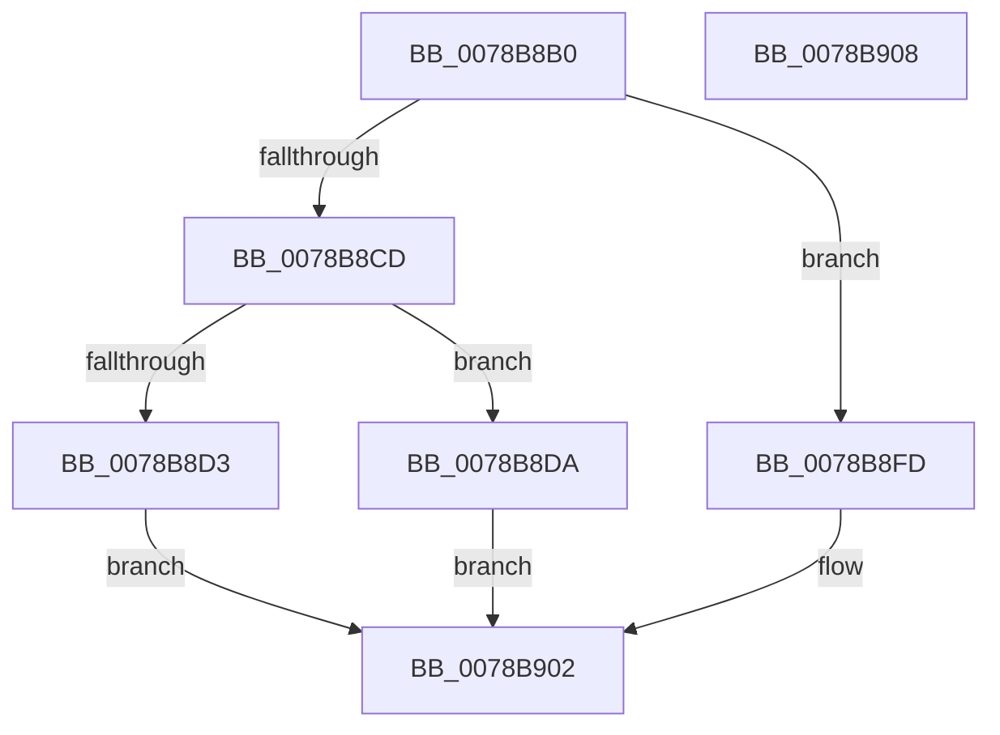

# RtlReserveChunk

- RVA: `0x0078B8B0`–`0x0078B909` (길이 `89` bytes)
- VA: `0x000000014078B8B0`
- 실행 섹션: `PAGE`
- PDB 이름 있음: `예`; PDB Function 태그: `아니요`
- unwind 정보 RVA: `0x00064C80`
- 디코드: `27`개 명령, `89/89` bytes 표시
- 미해석 바이트: `0` (있으면 어셈블리에 `.byte`로 보존)

> 이 문서는 커널 이미지의 기계어와 PDB 기호를 분석해 생성했습니다. 4번과 5번은 함수 원형과 자료형을 바이너리 사용 방식에서 추정한 C 해석이며 원본 소스 복구 결과는 아닙니다.

## 1. Dependencies

- 직접 호출 지점: **1**; 고유 호출 대상: **1**
- 직접 호출자로 확인된 함수: **0**
- RIP 상대 이미지 참조: **1**

### Outgoing calls
- `0x0078B8F6` → [guard_dispatch_icall](../../text/6B/guard_dispatch_icall_function_006BAAD0.md) (function, `0x006BAAD0`)

### Direct callers
- 이 함수 시작 RVA로 연결되는 직접 call은 확인되지 않았습니다. 간접 호출은 완전히 역산할 수 없습니다.

### Static image references
- `0x0078B8E8` → RVA `0x00B4D7A0` (`RtlReserveChunkProcs`; read)

## 2. Other-region calls and transfers

- 다른 실행 섹션으로 향하는 call: **1**
  - `0x0078B8F6` → [guard_dispatch_icall](../../text/6B/guard_dispatch_icall_function_006BAAD0.md) (`PAGE` → `.text`)
- 별도 외부 분기/꼬리 이동을 확인하지 못했습니다.

## 3. Assembly (complete function range)

```asm
0078B8B0  40 53                           push rbx
0078B8B2  48 83 EC 30                     sub rsp, 0x30
0078B8B6  B8 FF 00 00 00                  mov eax, 0xff
0078B8BB  4D 8B D1                        mov r10, r9
0078B8BE  66 23 C8                        and cx, ax
0078B8C1  4D 8B D8                        mov r11, r8
0078B8C4  48 8B DA                        mov rbx, rdx
0078B8C7  66 83 F9 02                     cmp cx, 2
0078B8CB  72 30                           jb 0x14078b8fd
0078B8CD  66 83 F9 08                     cmp cx, 8
0078B8D1  76 07                           jbe 0x14078b8da
0078B8D3  B8 5F 02 00 C0                  mov eax, 0xc000025f
0078B8D8  EB 28                           jmp 0x14078b902
0078B8DA  44 8B 4C 24 60                  mov r9d, dword ptr [rsp + 0x60]
0078B8DF  4D 8B C2                        mov r8, r10
0078B8E2  0F B7 C1                        movzx eax, cx
0078B8E5  49 8B D3                        mov rdx, r11
0078B8E8  48 8D 0D B1 1E 3C 00            lea rcx, [rip + 0x3c1eb1]
0078B8EF  48 8B 04 C1                     mov rax, qword ptr [rcx + rax*8]
0078B8F3  48 8B CB                        mov rcx, rbx
0078B8F6  E8 D5 F1 F2 FF                  call 0x1406baad0
0078B8FB  EB 05                           jmp 0x14078b902
0078B8FD  B8 0D 00 00 C0                  mov eax, 0xc000000d
0078B902  48 83 C4 30                     add rsp, 0x30
0078B906  5B                              pop rbx
0078B907  C3                              ret
0078B908  CC                              int3
```

## 4. C-style interpretation (structured pseudocode)

```c
__int64 __fastcall RtlReserveChunk(unsigned __int16 a1, __int64 a2, __int64 a3, __int64 a4, unsigned int a5)
{
    __int64 result;
    __int64 v_rsp;

    v_rsp = (v_rsp) - (48);
    a1 = (unsigned __int16)((a1) & (255));
    if (a1 < 2) goto loc_0078B8FD;
    if (a1 <= 8) goto loc_0078B8DA;
    goto loc_0078B902;
loc_0078B8DA:
    result = guard_dispatch_icall(a2, a3, a4, (unsigned int)(a5));
    goto loc_0078B902;
loc_0078B8FD:
loc_0078B902:
    v_rsp = (v_rsp) + (48);
    return (unsigned int)(0xC000000DULL);
}
```

## 5. (Beta) C Style

```c
int64_t RtlReserveChunk(uint16_t Arg1, int64_t Arg2, int64_t Arg3, int64_t Arg4, uint32_t Arg5)
{
    int64_t result;
    int64_t local_rsp;

    local_rsp = (local_rsp) - (48);
    Arg1 = (uint16_t)((Arg1) & (255));
    if (Arg1 < 2) goto loc_0078B8FD;
    if (Arg1 <= 8) goto loc_0078B8DA;
    goto loc_0078B902;
loc_0078B8DA:
    result = guard_dispatch_icall(Arg2, Arg3, Arg4, (uint32_t)(Arg5));
    goto loc_0078B902;
loc_0078B8FD:
loc_0078B902:
    local_rsp = (local_rsp) + (48);
    return (uint32_t)(0xC000000DULL);
}
```

## 6. Execution-region graph

[열기: 2D/3D 그래프와 함수 탐색 컨트롤 패널](../../../control-panel.html?section=page&rva=0x0078B8B0&view=graph)

- 2D 그래프는 위에서 아래로 흐르고, 3D 그래프는 빈 공간을 드래그해 회전합니다. Shift+드래그는 이동, 휠은 확대·축소, 함수 노드 선택은 대상 보고서 이동입니다.

### Static fallback


