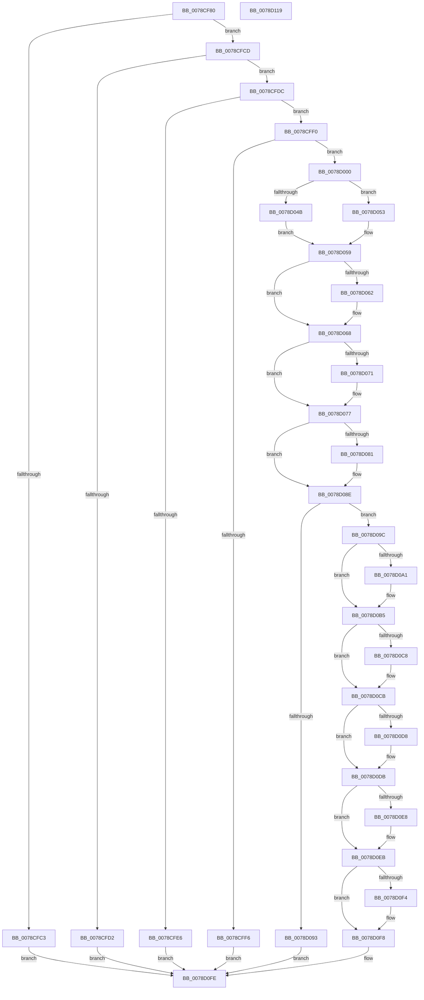

# RtlSelfRelativeToAbsoluteSD2

- RVA: `0x0078CF80`–`0x0078D11A` (길이 `410` bytes)
- VA: `0x000000014078CF80`
- 실행 섹션: `PAGE`
- PDB 이름 있음: `예`; PDB Function 태그: `아니요`
- unwind 정보 RVA: `0x00073494`
- 디코드: `125`개 명령, `410/410` bytes 표시
- 미해석 바이트: `0` (있으면 어셈블리에 `.byte`로 보존)

> 이 문서는 커널 이미지의 기계어와 PDB 기호를 분석해 생성했습니다. 4번과 5번은 함수 원형과 자료형을 바이너리 사용 방식에서 추정한 C 해석이며 원본 소스 복구 결과는 아닙니다.

## 1. Dependencies

- 직접 호출 지점: **2**; 고유 호출 대상: **2**
- 직접 호출자로 확인된 함수: **1**
- RIP 상대 이미지 참조: **0**

### Outgoing calls
- `0x0078D039` → [RtlpQuerySecurityDescriptor](../A1/RtlpQuerySecurityDescriptor_function_00A1E3D0.md) (function, `0x00A1E3D0`)
- `0x0078D0B0` → [memcpy](../../text/6C/memcpy_function_006C6840.md) (function, `0x006C6840`)

### Direct callers
- [RtlpSysVolCheckOwnerAndSecurity](../79/RtlpSysVolCheckOwnerAndSecurity_function_00791324.md) at `0x007914FD`
- [RtlpSysVolCheckOwnerAndSecurity](../79/RtlpSysVolCheckOwnerAndSecurity_function_00791324.md) at `0x00791550`

### Static image references
- 디코드된 RIP-relative 메모리 참조가 없습니다.

## 2. Other-region calls and transfers

- 다른 실행 섹션으로 향하는 call: **1**
  - `0x0078D0B0` → [memcpy](../../text/6C/memcpy_function_006C6840.md) (`PAGE` → `.text`)
- 별도 외부 분기/꼬리 이동을 확인하지 못했습니다.

## 3. Assembly (complete function range)

```asm
0078CF80  48 89 5C 24 10                  mov qword ptr [rsp + 0x10], rbx
0078CF85  55                              push rbp
0078CF86  56                              push rsi
0078CF87  57                              push rdi
0078CF88  41 54                           push r12
0078CF8A  41 55                           push r13
0078CF8C  41 56                           push r14
0078CF8E  41 57                           push r15
0078CF90  48 8B EC                        mov rbp, rsp
0078CF93  48 81 EC 80 00 00 00            sub rsp, 0x80
0078CF9A  33 DB                           xor ebx, ebx
0078CF9C  48 8B F2                        mov rsi, rdx
0078CF9F  48 89 5D D8                     mov qword ptr [rbp - 0x28], rbx
0078CFA3  48 8B F9                        mov rdi, rcx
0078CFA6  48 89 5D E0                     mov qword ptr [rbp - 0x20], rbx
0078CFAA  48 89 5D E8                     mov qword ptr [rbp - 0x18], rbx
0078CFAE  48 89 5D F0                     mov qword ptr [rbp - 0x10], rbx
0078CFB2  89 5D 58                        mov dword ptr [rbp + 0x58], ebx
0078CFB5  89 5D D0                        mov dword ptr [rbp - 0x30], ebx
0078CFB8  89 5D 40                        mov dword ptr [rbp + 0x40], ebx
0078CFBB  89 5D 50                        mov dword ptr [rbp + 0x50], ebx
0078CFBE  48 85 C9                        test rcx, rcx
0078CFC1  75 0A                           jne 0x14078cfcd
0078CFC3  B8 EF 00 00 C0                  mov eax, 0xc00000ef
0078CFC8  E9 31 01 00 00                  jmp 0x14078d0fe
0078CFCD  48 85 F6                        test rsi, rsi
0078CFD0  75 0A                           jne 0x14078cfdc
0078CFD2  B8 F0 00 00 C0                  mov eax, 0xc00000f0
0078CFD7  E9 22 01 00 00                  jmp 0x14078d0fe
0078CFDC  8B 02                           mov eax, dword ptr [rdx]
0078CFDE  89 45 D4                        mov dword ptr [rbp - 0x2c], eax
0078CFE1  83 F8 14                        cmp eax, 0x14
0078CFE4  73 0A                           jae 0x14078cff0
0078CFE6  B8 0D 00 00 C0                  mov eax, 0xc000000d
0078CFEB  E9 0E 01 00 00                  jmp 0x14078d0fe
0078CFF0  66 39 59 02                     cmp word ptr [rcx + 2], bx
0078CFF4  7C 0A                           jl 0x14078d000
0078CFF6  B8 E7 00 00 C0                  mov eax, 0xc00000e7
0078CFFB  E9 FE 00 00 00                  jmp 0x14078d0fe
0078D000  48 8D 45 D0                     lea rax, [rbp - 0x30]
0078D004  48 89 44 24 40                  mov qword ptr [rsp + 0x40], rax
0078D009  4C 8D 4D E0                     lea r9, [rbp - 0x20]
0078D00D  48 8D 45 F0                     lea rax, [rbp - 0x10]
0078D011  48 89 44 24 38                  mov qword ptr [rsp + 0x38], rax
0078D016  4C 8D 45 40                     lea r8, [rbp + 0x40]
0078D01A  48 8D 45 58                     lea rax, [rbp + 0x58]
0078D01E  48 89 44 24 30                  mov qword ptr [rsp + 0x30], rax
0078D023  48 8D 55 D8                     lea rdx, [rbp - 0x28]
0078D027  48 8D 45 E8                     lea rax, [rbp - 0x18]
0078D02B  48 89 44 24 28                  mov qword ptr [rsp + 0x28], rax
0078D030  48 8D 45 50                     lea rax, [rbp + 0x50]
0078D034  48 89 44 24 20                  mov qword ptr [rsp + 0x20], rax
0078D039  E8 92 13 29 00                  call 0x140a1e3d0
0078D03E  4C 8B 65 D8                     mov r12, qword ptr [rbp - 0x28]
0078D042  4C 8B 6D E0                     mov r13, qword ptr [rbp - 0x20]
0078D046  4D 3B E5                        cmp r12, r13
0078D049  76 08                           jbe 0x14078d053
0078D04B  8B 45 40                        mov eax, dword ptr [rbp + 0x40]
0078D04E  49 03 C4                        add rax, r12
0078D051  EB 06                           jmp 0x14078d059
0078D053  8B 45 50                        mov eax, dword ptr [rbp + 0x50]
0078D056  49 03 C5                        add rax, r13
0078D059  4C 8B 75 E8                     mov r14, qword ptr [rbp - 0x18]
0078D05D  49 3B C6                        cmp rax, r14
0078D060  77 06                           ja 0x14078d068
0078D062  8B 45 58                        mov eax, dword ptr [rbp + 0x58]
0078D065  49 03 C6                        add rax, r14
0078D068  4C 8B 7D F0                     mov r15, qword ptr [rbp - 0x10]
0078D06C  49 3B C7                        cmp rax, r15
0078D06F  77 06                           ja 0x14078d077
0078D071  8B 45 D0                        mov eax, dword ptr [rbp - 0x30]
0078D074  49 03 C7                        add rax, r15
0078D077  B9 28 00 00 00                  mov ecx, 0x28
0078D07C  48 85 C0                        test rax, rax
0078D07F  74 0D                           je 0x14078d08e
0078D081  8B C8                           mov ecx, eax
0078D083  2B CF                           sub ecx, edi
0078D085  83 E9 0D                        sub ecx, 0xd
0078D088  83 E1 F8                        and ecx, 0xfffffff8
0078D08B  83 C1 28                        add ecx, 0x28
0078D08E  3B 4D D4                        cmp ecx, dword ptr [rbp - 0x2c]
0078D091  76 09                           jbe 0x14078d09c
0078D093  89 0E                           mov dword ptr [rsi], ecx
0078D095  B8 23 00 00 C0                  mov eax, 0xc0000023
0078D09A  EB 62                           jmp 0x14078d0fe
0078D09C  48 85 C0                        test rax, rax
0078D09F  74 14                           je 0x14078d0b5
0078D0A1  44 8B C1                        mov r8d, ecx
0078D0A4  48 8D 57 14                     lea rdx, [rdi + 0x14]
0078D0A8  49 83 E8 28                     sub r8, 0x28
0078D0AC  48 8D 4F 28                     lea rcx, [rdi + 0x28]
0078D0B0  E8 8B 97 F3 FF                  call 0x1406c6840
0078D0B5  B8 FF 7F 00 00                  mov eax, 0x7fff
0078D0BA  66 21 47 02                     and word ptr [rdi + 2], ax
0078D0BE  49 8D 44 24 14                  lea rax, [r12 + 0x14]
0078D0C3  4D 85 E4                        test r12, r12
0078D0C6  75 03                           jne 0x14078d0cb
0078D0C8  48 8B C3                        mov rax, rbx
0078D0CB  48 89 47 08                     mov qword ptr [rdi + 8], rax
0078D0CF  49 8D 45 14                     lea rax, [r13 + 0x14]
0078D0D3  4D 85 ED                        test r13, r13
0078D0D6  75 03                           jne 0x14078d0db
0078D0D8  48 8B C3                        mov rax, rbx
0078D0DB  48 89 47 10                     mov qword ptr [rdi + 0x10], rax
0078D0DF  49 8D 47 14                     lea rax, [r15 + 0x14]
0078D0E3  4D 85 FF                        test r15, r15
0078D0E6  75 03                           jne 0x14078d0eb
0078D0E8  48 8B C3                        mov rax, rbx
0078D0EB  48 89 47 18                     mov qword ptr [rdi + 0x18], rax
0078D0EF  4D 85 F6                        test r14, r14
0078D0F2  74 04                           je 0x14078d0f8
0078D0F4  49 8D 5E 14                     lea rbx, [r14 + 0x14]
0078D0F8  48 89 5F 20                     mov qword ptr [rdi + 0x20], rbx
0078D0FC  33 C0                           xor eax, eax
0078D0FE  48 8B 9C 24 C8 00 00 00         mov rbx, qword ptr [rsp + 0xc8]
0078D106  48 81 C4 80 00 00 00            add rsp, 0x80
0078D10D  41 5F                           pop r15
0078D10F  41 5E                           pop r14
0078D111  41 5D                           pop r13
0078D113  41 5C                           pop r12
0078D115  5F                              pop rdi
0078D116  5E                              pop rsi
0078D117  5D                              pop rbp
0078D118  C3                              ret
0078D119  CC                              int3
```

## 4. C-style interpretation (structured pseudocode)

```c
__int64 __fastcall RtlSelfRelativeToAbsoluteSD2(__int64 a1, __int64 a2)
{
    __int64 result;
    __int64 v_rbx;
    __int64 v_rsp;
    unsigned __int64 v_stack_m48;
    unsigned __int64 v_stack_m50;
    unsigned __int64 v_stack_m58;
    unsigned __int64 v_stack_m60;
    unsigned int v_stack_m64;
    unsigned int v_stack_m68;
    unsigned __int64 v_stack_m78;
    unsigned __int64 v_stack_m80;
    unsigned __int64 v_stack_m88;
    unsigned __int64 v_stack_m90;
    unsigned __int64 v_stack_m98;
    unsigned __int64 v_stack_p10;
    unsigned int v_stack_p18;
    unsigned int v_stack_p20;
    unsigned int v_stack_p8;

    v_stack_p10 = v_rbx;
    v_rsp = (v_rsp) - (128);
    v_rbx = 0;
    v_stack_m60 = 0;
    v_stack_m58 = 0;
    v_stack_m50 = 0;
    v_stack_m48 = 0;
    v_stack_p20 = 0;
    v_stack_m68 = 0;
    v_stack_p8 = 0;
    v_stack_p18 = 0;
    if (a1 != 0) goto loc_0078CFCD;
    goto loc_0078D0FE;
loc_0078CFCD:
    if (a2 != 0) goto loc_0078CFDC;
    goto loc_0078D0FE;
loc_0078CFDC:
    v_stack_m64 = (unsigned int)((unsigned int)(*(unsigned int *)(a2)));
    if (((unsigned int)((unsigned int)(*(unsigned int *)(a2)))) >= 20) goto loc_0078CFF0;
    goto loc_0078D0FE;
loc_0078CFF0:
    if ((*(unsigned __int16 *)(a1 + 2)) < 0) goto loc_0078D000;
    goto loc_0078D0FE;
loc_0078D000:
    v_stack_m78 = v_stack_m68;
    v_stack_m80 = v_stack_m48;
    v_stack_m88 = v_stack_p20;
    v_stack_m90 = v_stack_m50;
    v_stack_m98 = v_stack_p18;
    result = RtlpQuerySecurityDescriptor(a1, v_stack_m60, v_stack_p8, v_stack_m58);
    if (v_stack_m60 <= v_stack_m58) goto loc_0078D053;
    result = ((unsigned int)(v_stack_p8)) + (v_stack_m60);
    goto loc_0078D059;
loc_0078D053:
    result = ((unsigned int)(v_stack_p18)) + (v_stack_m58);
loc_0078D059:
    if (result <= v_stack_m50) {
        result = v_stack_p20;
        result = (result) + (v_stack_m50);
    }
    if (result <= v_stack_m48) {
        result = v_stack_m68;
        result = (result) + (v_stack_m48);
    }
    if (result != 0) {
        a1 = (unsigned int)(result);
        a1 = (unsigned int)((a1) - ((unsigned int)(a1)));
        a1 = (unsigned int)((a1) - (13));
        a1 = (unsigned int)((a1) & (0xFFFFFFF8ULL));
        a1 = (unsigned int)((a1) + (40));
    }
    if (((unsigned int)(a1)) <= v_stack_m64) goto loc_0078D09C;
    *(unsigned int *)(a2) = (unsigned int)(a1);
    goto loc_0078D0FE;
loc_0078D09C:
    result = (unsigned int)(0xC0000023ULL);
    if ((unsigned int)(0xC0000023ULL) != 0) {
        a3 = (unsigned int)(a1);
        a2 = a1 + 20;
        a3 = (a3) - (40);
        a1 = a1 + 40;
        result = memcpy(a1, a2, a3, v_stack_m58);
    }
    result = v_stack_m60 + 20;
    if (v_stack_m60 == 0) {
        result = 0;
    }
    *(unsigned __int64 *)(a1 + 8) = result;
    result = v_stack_m58 + 20;
    if (v_stack_m58 == 0) {
        result = 0;
    }
    *(unsigned __int64 *)(a1 + 16) = result;
    result = v_stack_m48 + 20;
    if (v_stack_m48 == 0) {
        result = 0;
    }
    *(unsigned __int64 *)(a1 + 24) = result;
    if (v_stack_m50 != 0) {
        v_rbx = v_stack_m50 + 20;
    }
    *(unsigned __int64 *)(a1 + 32) = v_rbx;
    result = 0;
loc_0078D0FE:
    v_rsp = (v_rsp) + (128);
    return result;
}
```

## 5. (Beta) C Style

```c
int64_t RtlSelfRelativeToAbsoluteSD2(void *Arg1, void *Arg2)
{
    uint8_t *arg1 = (uint8_t *)Arg1;
    uint8_t *arg2 = (uint8_t *)Arg2;

    int64_t result;
    int64_t local_rbx;
    int64_t local_rsp;
    uint64_t v_stack_m48;
    uint64_t v_stack_m50;
    uint64_t v_stack_m58;
    uint64_t v_stack_m60;
    uint32_t v_stack_m64;
    uint32_t v_stack_m68;
    uint64_t v_stack_m78;
    uint64_t v_stack_m80;
    uint64_t v_stack_m88;
    uint64_t v_stack_m90;
    uint64_t v_stack_m98;
    uint64_t v_stack_p10;
    uint32_t v_stack_p18;
    uint32_t v_stack_p20;
    uint32_t v_stack_p8;

    v_stack_p10 = local_rbx;
    local_rsp = (local_rsp) - (128);
    local_rbx = 0;
    v_stack_m60 = 0;
    v_stack_m58 = 0;
    v_stack_m50 = 0;
    v_stack_m48 = 0;
    v_stack_p20 = 0;
    v_stack_m68 = 0;
    v_stack_p8 = 0;
    v_stack_p18 = 0;
    if (Arg1 != NULL) goto loc_0078CFCD;
    goto loc_0078D0FE;
loc_0078CFCD:
    if (Arg2 != NULL) goto loc_0078CFDC;
    goto loc_0078D0FE;
loc_0078CFDC:
    v_stack_m64 = (uint32_t)((uint32_t)(*(uint32_t *)(arg2)));
    if (((uint32_t)((uint32_t)(*(uint32_t *)(arg2)))) >= 20) goto loc_0078CFF0;
    goto loc_0078D0FE;
loc_0078CFF0:
    if ((*(uint16_t *)(arg1 + 0x2)) < 0) goto loc_0078D000;
    goto loc_0078D0FE;
loc_0078D000:
    v_stack_m78 = v_stack_m68;
    v_stack_m80 = v_stack_m48;
    v_stack_m88 = v_stack_p20;
    v_stack_m90 = v_stack_m50;
    v_stack_m98 = v_stack_p18;
    result = RtlpQuerySecurityDescriptor(Arg1, v_stack_m60, v_stack_p8, v_stack_m58);
    if (v_stack_m60 <= v_stack_m58) goto loc_0078D053;
    result = ((uint32_t)(v_stack_p8)) + (v_stack_m60);
    goto loc_0078D059;
loc_0078D053:
    result = ((uint32_t)(v_stack_p18)) + (v_stack_m58);
loc_0078D059:
    if (result <= v_stack_m50) {
        result = v_stack_p20;
        result = (result) + (v_stack_m50);
    }
    if (result <= v_stack_m48) {
        result = v_stack_m68;
        result = (result) + (v_stack_m48);
    }
    if (result != 0) {
        Arg1 = (uint32_t)(result);
        Arg1 = (uint32_t)((Arg1) - ((uint32_t)(Arg1)));
        Arg1 = (uint32_t)((Arg1) - (13));
        Arg1 = (uint32_t)((Arg1) & (0xFFFFFFF8ULL));
        Arg1 = (uint32_t)((Arg1) + (40));
    }
    if (((uint32_t)(Arg1)) <= v_stack_m64) goto loc_0078D09C;
    *(uint32_t *)(arg2) = (uint32_t)(Arg1);
    goto loc_0078D0FE;
loc_0078D09C:
    result = (uint32_t)(0xC0000023ULL);
    if ((uint32_t)(0xC0000023ULL) != 0) {
        a3 = (uint32_t)(Arg1);
        Arg2 = Arg1 + 20;
        a3 = (a3) - (40);
        Arg1 = Arg1 + 40;
        result = memcpy(Arg1, Arg2, a3, v_stack_m58);
    }
    result = v_stack_m60 + 20;
    if (v_stack_m60 == 0) {
        result = 0;
    }
    *(uint64_t *)(arg1 + 0x8) = result;
    result = v_stack_m58 + 20;
    if (v_stack_m58 == 0) {
        result = 0;
    }
    *(uint64_t *)(arg1 + 0x10) = result;
    result = v_stack_m48 + 20;
    if (v_stack_m48 == 0) {
        result = 0;
    }
    *(uint64_t *)(arg1 + 0x18) = result;
    if (v_stack_m50 != 0) {
        local_rbx = v_stack_m50 + 20;
    }
    *(uint64_t *)(arg1 + 0x20) = local_rbx;
    result = 0;
loc_0078D0FE:
    local_rsp = (local_rsp) + (128);
    return result;
}
```

### 관측된 메모리 오프셋

구조체 형식이 확인되지 않은 접근은 인자 기준의 오프셋으로만 기록했습니다.

| 기준 인자 | 오프셋 표현 | 폭 (bit) | 접근 |
|---|---:|---:|---|
| `Arg1` | `+ 0x2` | `16` | `R/W` |
| `Arg1` | `+ 0x8` | `64` | `W` |
| `Arg1` | `+ 0x10` | `64` | `W` |
| `Arg1` | `+ 0x14` | `64` | `R` |
| `Arg1` | `+ 0x18` | `64` | `W` |
| `Arg1` | `+ 0x20` | `64` | `W` |
| `Arg1` | `+ 0x28` | `64` | `R` |
| `Arg2` | `+ 0x0` | `32` | `R` |

## 6. Execution-region graph

[열기: 2D/3D 그래프와 함수 탐색 컨트롤 패널](../../../control-panel.html?section=page&rva=0x0078CF80&view=graph)

- 2D 그래프는 위에서 아래로 흐르고, 3D 그래프는 빈 공간을 드래그해 회전합니다. Shift+드래그는 이동, 휠은 확대·축소, 함수 노드 선택은 대상 보고서 이동입니다.

### Static fallback


