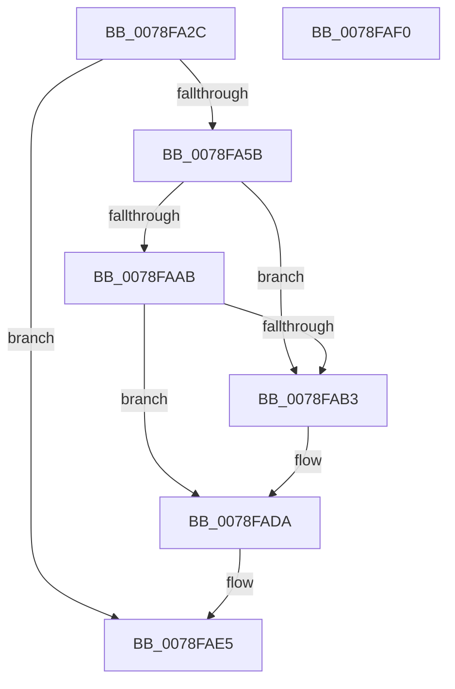

# RtlSetActiveTimeBias

- RVA: `0x0078FA2C`–`0x0078FAF1` (길이 `197` bytes)
- VA: `0x000000014078FA2C`
- 실행 섹션: `PAGE`
- PDB 이름 있음: `예`; PDB Function 태그: `아니요`
- unwind 정보 RVA: `0x000CFA40`
- 디코드: `53`개 명령, `197/197` bytes 표시
- 미해석 바이트: `0` (있으면 어셈블리에 `.byte`로 보존)

> 이 문서는 커널 이미지의 기계어와 PDB 기호를 분석해 생성했습니다. 4번과 5번은 함수 원형과 자료형을 바이너리 사용 방식에서 추정한 C 해석이며 원본 소스 복구 결과는 아닙니다.

## 1. Dependencies

- 직접 호출 지점: **5**; 고유 호출 대상: **5**
- 직접 호출자로 확인된 함수: **1**
- RIP 상대 이미지 참조: **1**

### Outgoing calls
- `0x0078FA4E` → [RtlpGetTimeZoneInfoHandle](../A6/RtlpGetTimeZoneInfoHandle_function_00A6BD8C.md) (function, `0x00A6BD8C`)
- `0x0078FA65` → [memset](../../text/6C/memset_function_006C6C40.md) (function, `0x006C6C40`)
- `0x0078FAA0` → [RtlpQueryRegistryValues](../8C/RtlpQueryRegistryValues_function_008C9050.md) (function, `0x008C9050`)
- `0x0078FAD3` → [RtlWriteRegistryValue](../A6/RtlWriteRegistryValue_function_00A6C620.md) (function, `0x00A6C620`)
- `0x0078FADE` → [ZwClose](../../text/6A/ZwClose_function_006AD2B0.md) (function, `0x006AD2B0`)

### Direct callers
- [ExpRefreshTimeZoneInformation](../A6/ExpRefreshTimeZoneInformation_function_00A6B46C.md) at `0x00A6BAAD`

### Static image references
- `0x0078FA72` → RVA `0x00B058F0` (` ?? ::NNGAKEGL::`string'`; read)

## 2. Other-region calls and transfers

- 다른 실행 섹션으로 향하는 call: **2**
  - `0x0078FA65` → [memset](../../text/6C/memset_function_006C6C40.md) (`PAGE` → `.text`)
  - `0x0078FADE` → [ZwClose](../../text/6A/ZwClose_function_006AD2B0.md) (`PAGE` → `.text`)
- 별도 외부 분기/꼬리 이동을 확인하지 못했습니다.

## 3. Assembly (complete function range)

```asm
0078FA2C  89 4C 24 08                     mov dword ptr [rsp + 8], ecx
0078FA30  55                              push rbp
0078FA31  53                              push rbx
0078FA32  57                              push rdi
0078FA33  48 8D 6C 24 B9                  lea rbp, [rsp - 0x47]
0078FA38  48 81 EC A0 00 00 00            sub rsp, 0xa0
0078FA3F  48 83 65 77 00                  and qword ptr [rbp + 0x77], 0
0078FA44  48 8D 55 77                     lea rdx, [rbp + 0x77]
0078FA48  83 65 6F 00                     and dword ptr [rbp + 0x6f], 0
0078FA4C  B1 01                           mov cl, 1
0078FA4E  E8 39 C3 2D 00                  call 0x140a6bd8c
0078FA53  85 C0                           test eax, eax
0078FA55  0F 88 8A 00 00 00               js 0x14078fae5
0078FA5B  33 D2                           xor edx, edx
0078FA5D  48 8D 4D D7                     lea rcx, [rbp - 0x29]
0078FA61  44 8D 42 70                     lea r8d, [rdx + 0x70]
0078FA65  E8 D6 71 F3 FF                  call 0x1406c6c40
0078FA6A  48 8B 55 77                     mov rdx, qword ptr [rbp + 0x77]
0078FA6E  48 8D 45 6F                     lea rax, [rbp + 0x6f]
0078FA72  48 8D 3D 77 5E 37 00            lea rdi, [rip + 0x375e77]
0078FA79  48 89 45 EF                     mov qword ptr [rbp - 0x11], rax
0078FA7D  45 33 C9                        xor r9d, r9d
0078FA80  C7 45 DF 24 01 00 00            mov dword ptr [rbp - 0x21], 0x124
0078FA87  4C 8D 45 D7                     lea r8, [rbp - 0x29]
0078FA8B  48 89 7D E7                     mov qword ptr [rbp - 0x19], rdi
0078FA8F  B9 00 00 00 40                  mov ecx, 0x40000000
0078FA94  C7 45 F7 00 00 00 04            mov dword ptr [rbp - 9], 0x4000000
0078FA9B  C6 44 24 28 01                  mov byte ptr [rsp + 0x28], 1
0078FAA0  E8 AB 95 13 00                  call 0x1408c9050
0078FAA5  8B D8                           mov ebx, eax
0078FAA7  85 C0                           test eax, eax
0078FAA9  78 08                           js 0x14078fab3
0078FAAB  8B 55 67                        mov edx, dword ptr [rbp + 0x67]
0078FAAE  39 55 6F                        cmp dword ptr [rbp + 0x6f], edx
0078FAB1  74 27                           je 0x14078fada
0078FAB3  48 8B 55 77                     mov rdx, qword ptr [rbp + 0x77]
0078FAB7  48 8D 45 67                     lea rax, [rbp + 0x67]
0078FABB  41 B9 04 00 00 00               mov r9d, 4
0078FAC1  4C 8B C7                        mov r8, rdi
0078FAC4  44 89 4C 24 28                  mov dword ptr [rsp + 0x28], r9d
0078FAC9  B9 00 00 00 40                  mov ecx, 0x40000000
0078FACE  48 89 44 24 20                  mov qword ptr [rsp + 0x20], rax
0078FAD3  E8 48 CB 2D 00                  call 0x140a6c620
0078FAD8  8B D8                           mov ebx, eax
0078FADA  48 8B 4D 77                     mov rcx, qword ptr [rbp + 0x77]
0078FADE  E8 CD D7 F1 FF                  call 0x1406ad2b0
0078FAE3  8B C3                           mov eax, ebx
0078FAE5  48 81 C4 A0 00 00 00            add rsp, 0xa0
0078FAEC  5F                              pop rdi
0078FAED  5B                              pop rbx
0078FAEE  5D                              pop rbp
0078FAEF  C3                              ret
0078FAF0  CC                              int3
```

## 4. C-style interpretation (structured pseudocode)

```c
__int64 __fastcall RtlSetActiveTimeBias(int a1, __int64 a2, __int64 a3, int a4)
{
    __int64 result;
    __int64 v_rbx;
    __int64 v_rsp;
    unsigned __int64 v_stack_m5F;
    unsigned int v_stack_m68;
    unsigned __int64 v_stack_m70;
    unsigned __int64 v_stack_m78;
    unsigned int v_stack_m80;
    unsigned __int64 v_stack_m88;
    unsigned __int8 v_stack_m90;
    unsigned __int64 v_stack_m98;
    unsigned int v_stack_p10;
    unsigned __int64 v_stack_p18;
    unsigned int v_stack_p8;

    v_stack_p8 = a1;
    v_rsp = (v_rsp) - (160);
    result = RtlpGetTimeZoneInfoHandle(1, v_stack_p18, a3, a4);
    if (sign_flag) goto loc_0078FAE5;
    a2 = 0;
    result = memset(v_stack_m88, a2, a2 + 112, a4);
    v_stack_m70 = v_stack_p10;
    a4 = 0;
    v_stack_m80 = 292;
    v_stack_m78 = v_rip + 3628663;
    v_stack_m68 = 0x4000000ULL;
    v_stack_m90 = 1;
    result = RtlpQueryRegistryValues((unsigned int)(0x40000000ULL), v_stack_p18, v_stack_m88, a4);
    if (sign_flag) goto loc_0078FAB3;
    v_rbx = (unsigned int)((unsigned int)(result));
    if (v_stack_p10 != ((unsigned int)((unsigned int)(v_stack_p8)))) {
        a2 = v_stack_p18;
        result = v_stack_p8;
        a4 = 4;
        a3 = v_rip + 3628663;
        v_stack_m90 = a4;
        a1 = 0x40000000ULL;
        v_stack_m98 = result;
        result = RtlWriteRegistryValue(a1, a2, a3, a4);
        v_rbx = (unsigned int)(result);
    }
    result = ZwClose(v_stack_p18, a2, a3, a4);
loc_0078FAE5:
    v_rsp = (v_rsp) + (160);
    return (unsigned int)((unsigned int)(v_rbx));
}
```

## 5. (Beta) C Style

```c
int64_t RtlSetActiveTimeBias(int32_t Arg1, int64_t Arg2, int64_t Arg3, int32_t Arg4)
{
    int64_t result;
    int64_t local_rbx;
    int64_t local_rsp;
    uint64_t v_stack_m5F;
    uint32_t v_stack_m68;
    uint64_t v_stack_m70;
    uint64_t v_stack_m78;
    uint32_t v_stack_m80;
    uint64_t v_stack_m88;
    uint8_t v_stack_m90;
    uint64_t v_stack_m98;
    uint32_t v_stack_p10;
    uint64_t v_stack_p18;
    uint32_t v_stack_p8;

    v_stack_p8 = Arg1;
    local_rsp = (local_rsp) - (160);
    result = RtlpGetTimeZoneInfoHandle(1, v_stack_p18, Arg3, Arg4);
    if (sign_flag) goto loc_0078FAE5;
    Arg2 = 0;
    result = memset(v_stack_m88, Arg2, Arg2 + 112, Arg4);
    v_stack_m70 = v_stack_p10;
    Arg4 = 0;
    v_stack_m80 = 292;
    v_stack_m78 = v_rip + 3628663;
    v_stack_m68 = 0x4000000ULL;
    v_stack_m90 = 1;
    result = RtlpQueryRegistryValues((uint32_t)(0x40000000ULL), v_stack_p18, v_stack_m88, Arg4);
    if (sign_flag) goto loc_0078FAB3;
    local_rbx = (uint32_t)((uint32_t)(result));
    if (v_stack_p10 != ((uint32_t)((uint32_t)(v_stack_p8)))) {
        Arg2 = v_stack_p18;
        result = v_stack_p8;
        Arg4 = 4;
        Arg3 = v_rip + 3628663;
        v_stack_m90 = Arg4;
        Arg1 = 0x40000000ULL;
        v_stack_m98 = result;
        result = RtlWriteRegistryValue(Arg1, Arg2, Arg3, Arg4);
        local_rbx = (uint32_t)(result);
    }
    result = ZwClose(v_stack_p18, Arg2, Arg3, Arg4);
loc_0078FAE5:
    local_rsp = (local_rsp) + (160);
    return (uint32_t)((uint32_t)(local_rbx));
}
```

## 6. Execution-region graph

[열기: 2D/3D 그래프와 함수 탐색 컨트롤 패널](../../../control-panel.html?section=page&rva=0x0078FA2C&view=graph)

- 2D 그래프는 위에서 아래로 흐르고, 3D 그래프는 빈 공간을 드래그해 회전합니다. Shift+드래그는 이동, 휠은 확대·축소, 함수 노드 선택은 대상 보고서 이동입니다.

### Static fallback


