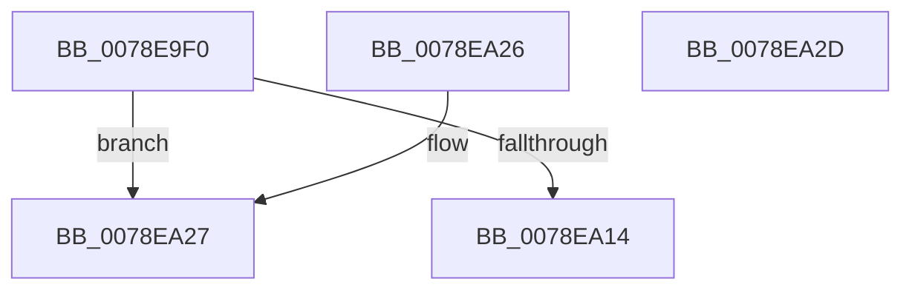

# RtlSetControlSecurityDescriptor

- RVA: `0x0078E9F0`–`0x0078EA2E` (길이 `62` bytes)
- VA: `0x000000014078E9F0`
- 실행 섹션: `PAGE`
- PDB 이름 있음: `예`; PDB Function 태그: `아니요`
- unwind 정보 RVA: `0x000DB714`
- 디코드: `20`개 명령, `62/62` bytes 표시
- 미해석 바이트: `0` (있으면 어셈블리에 `.byte`로 보존)

> 이 문서는 커널 이미지의 기계어와 PDB 기호를 분석해 생성했습니다. 4번과 5번은 함수 원형과 자료형을 바이너리 사용 방식에서 추정한 C 해석이며 원본 소스 복구 결과는 아닙니다.

## 1. Dependencies

- 직접 호출 지점: **0**; 고유 호출 대상: **0**
- 직접 호출자로 확인된 함수: **2**
- RIP 상대 이미지 참조: **0**

### Outgoing calls
- 직접 디코드된 call 명령이 없습니다.

### Direct callers
- [RtlpSysVolCreateSecurityDescriptor](../79/RtlpSysVolCreateSecurityDescriptor_function_00791654.md) at `0x00791770`
- [DrvDbGetRegistrarSecurityDescriptor](../83/DrvDbGetRegistrarSecurityDescriptor_function_00835728.md) at `0x0083579B`

### Static image references
- 디코드된 RIP-relative 메모리 참조가 없습니다.

## 2. Other-region calls and transfers

- 다른 실행 섹션으로 향하는 call: **0**
- 별도 외부 분기/꼬리 이동을 확인하지 못했습니다.

## 3. Assembly (complete function range)

```asm
0078E9F0  44 0F B7 D2                     movzx r10d, dx
0078E9F4  41 0F B7 C0                     movzx eax, r8w
0078E9F8  45 8B CA                        mov r9d, r10d
0078E9FB  41 F7 D1                        not r9d
0078E9FE  44 85 C8                        test eax, r9d
0078EA01  41 0F 94 C1                     sete r9b
0078EA05  41 F7 C2 3F C0 FF FF            test r10d, 0xffffc03f
0078EA0C  0F 94 C0                        sete al
0078EA0F  44 84 C8                        test al, r9b
0078EA12  74 13                           je 0x14078ea27
0078EA14  66 F7 D2                        not dx
0078EA17  66 23 51 02                     and dx, word ptr [rcx + 2]
0078EA1B  66 41 0B D0                     or dx, r8w
0078EA1F  66 89 51 02                     mov word ptr [rcx + 2], dx
0078EA23  33 C0                           xor eax, eax
0078EA25  C3                              ret
0078EA26  CC                              int3
0078EA27  B8 0D 00 00 C0                  mov eax, 0xc000000d
0078EA2C  C3                              ret
0078EA2D  CC                              int3
```

## 4. C-style interpretation (structured pseudocode)

```c
__int64 __fastcall RtlSetControlSecurityDescriptor(__int64 a1, unsigned __int16 a2, unsigned __int16 a3)
{
    __int64 result;

    a4 = (unsigned int)(~((unsigned int)(a2)));
    a4 = (((a3) & ((unsigned int)(a4))) == 0) ? 1 : 0;
    result = (((a2) & (0xFFFFC03FULL)) == 0) ? 1 : 0;
    if ((((unsigned __int8)(result)) & ((unsigned __int8)(a4))) == 0) goto loc_0078EA27;
    a2 = (unsigned __int16)(~(a2));
    a2 = (unsigned __int16)((a2) & (*(unsigned __int16 *)(a1 + 2)));
    a2 = (unsigned __int16)((a2) | (a3));
    *(unsigned __int16 *)(a1 + 2) = a2;
    result = 0;
    return result;
loc_0078EA27:
    return (unsigned int)(0xC000000DULL);
}
```

## 5. (Beta) C Style

```c
int64_t RtlSetControlSecurityDescriptor(void *Arg1, uint16_t Arg2, uint16_t Arg3)
{
    uint8_t *arg1 = (uint8_t *)Arg1;

    int64_t result;

    a4 = (uint32_t)(~((uint32_t)(Arg2)));
    a4 = (((Arg3) & ((uint32_t)(a4))) == 0) ? 1 : 0;
    result = (((Arg2) & (0xFFFFC03FULL)) == 0) ? 1 : 0;
    if ((((uint8_t)(result)) & ((uint8_t)(a4))) == 0) goto loc_0078EA27;
    Arg2 = (uint16_t)(~(Arg2));
    Arg2 = (uint16_t)((Arg2) & (*(uint16_t *)(arg1 + 0x2)));
    Arg2 = (uint16_t)((Arg2) | (Arg3));
    *(uint16_t *)(arg1 + 0x2) = Arg2;
    result = 0;
    return result;
loc_0078EA27:
    return (uint32_t)(0xC000000DULL);
}
```

### 관측된 메모리 오프셋

구조체 형식이 확인되지 않은 접근은 인자 기준의 오프셋으로만 기록했습니다.

| 기준 인자 | 오프셋 표현 | 폭 (bit) | 접근 |
|---|---:|---:|---|
| `Arg1` | `+ 0x2` | `16` | `R` |
| `Arg1` | `+ 0x2` | `16` | `W` |

## 6. Execution-region graph

[열기: 2D/3D 그래프와 함수 탐색 컨트롤 패널](../../../control-panel.html?section=page&rva=0x0078E9F0&view=graph)

- 2D 그래프는 위에서 아래로 흐르고, 3D 그래프는 빈 공간을 드래그해 회전합니다. Shift+드래그는 이동, 휠은 확대·축소, 함수 노드 선택은 대상 보고서 이동입니다.

### Static fallback


