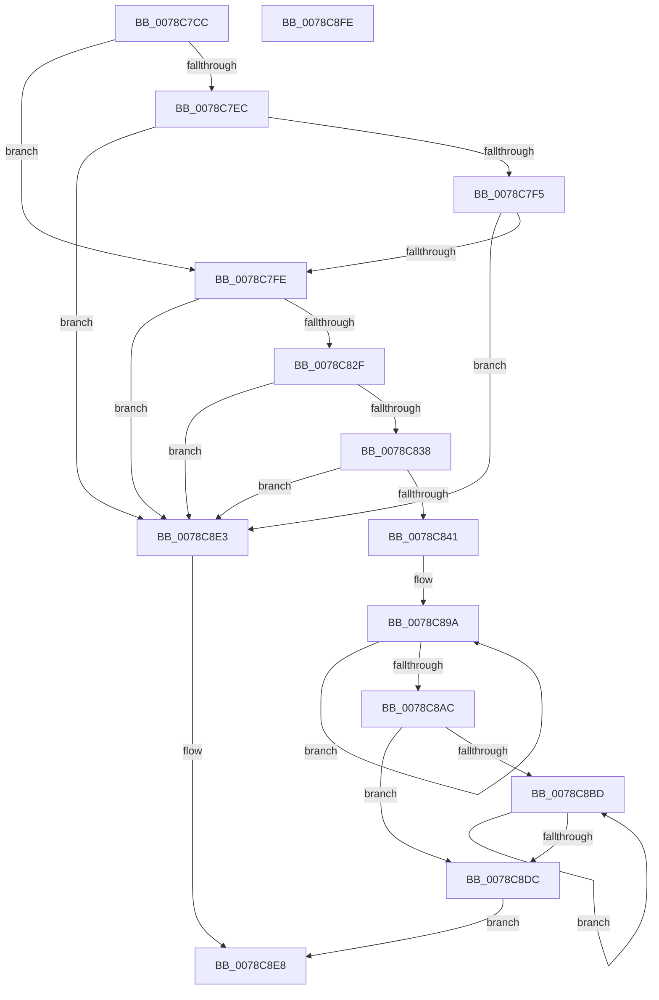

# RtlStdInitializeStackDatabase

- RVA: `0x0078C7CC`–`0x0078C8FF` (길이 `307` bytes)
- VA: `0x000000014078C7CC`
- 실행 섹션: `PAGE`
- PDB 이름 있음: `예`; PDB Function 태그: `아니요`
- unwind 정보 RVA: `0x0006F978`
- 디코드: `71`개 명령, `307/307` bytes 표시
- 미해석 바이트: `0` (있으면 어셈블리에 `.byte`로 보존)

> 이 문서는 커널 이미지의 기계어와 PDB 기호를 분석해 생성했습니다. 4번과 5번은 함수 원형과 자료형을 바이너리 사용 방식에서 추정한 C 해석이며 원본 소스 복구 결과는 아닙니다.

## 1. Dependencies

- 직접 호출 지점: **2**; 고유 호출 대상: **2**
- 직접 호출자로 확인된 함수: **1**
- RIP 상대 이미지 참조: **0**

### Outgoing calls
- `0x0078C873` → [memset](../../text/6C/memset_function_006C6C40.md) (function, `0x006C6C40`)
- `0x0078C89D` → [InitializeSListHead](../../text/46/InitializeSListHead_function_00468A90.md) (function, `0x00468A90`)

### Direct callers
- [RtlpInitializeStackTraceDatabase](RtlpInitializeStackTraceDatabase_function_0078C908.md) at `0x0078C928`

### Static image references
- 디코드된 RIP-relative 메모리 참조가 없습니다.

## 2. Other-region calls and transfers

- 다른 실행 섹션으로 향하는 call: **2**
  - `0x0078C873` → [memset](../../text/6C/memset_function_006C6C40.md) (`PAGE` → `.text`)
  - `0x0078C89D` → [InitializeSListHead](../../text/46/InitializeSListHead_function_00468A90.md) (`PAGE` → `.text`)
- 별도 외부 분기/꼬리 이동을 확인하지 못했습니다.

## 3. Assembly (complete function range)

```asm
0078C7CC  48 89 5C 24 08                  mov qword ptr [rsp + 8], rbx
0078C7D1  48 89 74 24 10                  mov qword ptr [rsp + 0x10], rsi
0078C7D6  48 89 7C 24 18                  mov qword ptr [rsp + 0x18], rdi
0078C7DB  41 56                           push r14
0078C7DD  48 83 EC 20                     sub rsp, 0x20
0078C7E1  4D 8B F1                        mov r14, r9
0078C7E4  48 8B D9                        mov rbx, rcx
0078C7E7  48 85 D2                        test rdx, rdx
0078C7EA  74 12                           je 0x14078c7fe
0078C7EC  49 3B D0                        cmp rdx, r8
0078C7EF  0F 85 EE 00 00 00               jne 0x14078c8e3
0078C7F5  48 85 C9                        test rcx, rcx
0078C7F8  0F 84 E5 00 00 00               je 0x14078c8e3
0078C7FE  49 81 F8 00 00 00 01            cmp r8, 0x1000000
0078C805  1B C0                           sbb eax, eax
0078C807  25 72 F0 FF FF                  and eax, 0xfffff072
0078C80C  05 4F 25 00 00                  add eax, 0x254f
0078C811  8B C8                           mov ecx, eax
0078C813  48 8D 04 40                     lea rax, [rax + rax*2]
0078C817  4C 8D 0C C5 00 00 00 00         lea r9, [rax*8]
0078C81F  49 8D B9 F0 02 00 00            lea rdi, [r9 + 0x2f0]
0078C826  4C 3B C7                        cmp r8, rdi
0078C829  0F 86 B4 00 00 00               jbe 0x14078c8e3
0078C82F  48 85 DB                        test rbx, rbx
0078C832  0F 84 AB 00 00 00               je 0x14078c8e3
0078C838  49 3B D0                        cmp rdx, r8
0078C83B  0F 85 A2 00 00 00               jne 0x14078c8e3
0078C841  4A 8D 04 03                     lea rax, [rbx + r8]
0078C845  89 8B D0 02 00 00               mov dword ptr [rbx + 0x2d0], ecx
0078C84B  48 8D 8B D8 02 00 00            lea rcx, [rbx + 0x2d8]
0078C852  48 89 83 A8 00 00 00            mov qword ptr [rbx + 0xa8], rax
0078C859  4D 8B C1                        mov r8, r9
0078C85C  48 89 83 B8 00 00 00            mov qword ptr [rbx + 0xb8], rax
0078C863  33 D2                           xor edx, edx
0078C865  C6 83 80 00 00 00 01            mov byte ptr [rbx + 0x80], 1
0078C86C  48 89 9B 88 00 00 00            mov qword ptr [rbx + 0x88], rbx
0078C873  E8 C8 A3 F3 FF                  call 0x1406c6c40
0078C878  48 8D 4F 0F                     lea rcx, [rdi + 0xf]
0078C87C  BE 20 00 00 00                  mov esi, 0x20
0078C881  48 83 E1 F0                     and rcx, 0xfffffffffffffff0
0078C885  48 8D BB D0 00 00 00            lea rdi, [rbx + 0xd0]
0078C88C  48 03 CB                        add rcx, rbx
0078C88F  48 89 8B A0 00 00 00            mov qword ptr [rbx + 0xa0], rcx
0078C896  48 89 4B 78                     mov qword ptr [rbx + 0x78], rcx
0078C89A  48 8B CF                        mov rcx, rdi
0078C89D  E8 EE C1 CD FF                  call 0x140468a90
0078C8A2  48 83 C7 10                     add rdi, 0x10
0078C8A6  48 83 EE 01                     sub rsi, 1
0078C8AA  75 EE                           jne 0x14078c89a
0078C8AC  48 21 33                        and qword ptr [rbx], rsi
0078C8AF  33 D2                           xor edx, edx
0078C8B1  40 88 73 08                     mov byte ptr [rbx + 8], sil
0078C8B5  39 93 D0 02 00 00               cmp dword ptr [rbx + 0x2d0], edx
0078C8BB  76 1F                           jbe 0x14078c8dc
0078C8BD  48 8D 0C 52                     lea rcx, [rdx + rdx*2]
0078C8C1  FF C2                           inc edx
0078C8C3  48 83 A4 CB E0 02 00 00 00      and qword ptr [rbx + rcx*8 + 0x2e0], 0
0078C8CC  C6 84 CB E8 02 00 00 00         mov byte ptr [rbx + rcx*8 + 0x2e8], 0
0078C8D4  3B 93 D0 02 00 00               cmp edx, dword ptr [rbx + 0x2d0]
0078C8DA  72 E1                           jb 0x14078c8bd
0078C8DC  49 89 1E                        mov qword ptr [r14], rbx
0078C8DF  33 C0                           xor eax, eax
0078C8E1  EB 05                           jmp 0x14078c8e8
0078C8E3  B8 0D 00 00 C0                  mov eax, 0xc000000d
0078C8E8  48 8B 5C 24 30                  mov rbx, qword ptr [rsp + 0x30]
0078C8ED  48 8B 74 24 38                  mov rsi, qword ptr [rsp + 0x38]
0078C8F2  48 8B 7C 24 40                  mov rdi, qword ptr [rsp + 0x40]
0078C8F7  48 83 C4 20                     add rsp, 0x20
0078C8FB  41 5E                           pop r14
0078C8FD  C3                              ret
0078C8FE  CC                              int3
```

## 4. C-style interpretation (structured pseudocode)

```c
__int64 __fastcall RtlStdInitializeStackDatabase(__int64 a1, __int64 a2, __int64 a3, __int64 a4)
{
    __int64 result;
    __int64 v_rdi;
    __int64 v_rsi;
    __int64 v_rsp;
    unsigned __int64 v_stack_p10;
    unsigned __int64 v_stack_p18;
    unsigned __int64 v_stack_p8;

    v_stack_p8 = v_rbx;
    v_stack_p10 = v_rsi;
    v_stack_p18 = v_rdi;
    v_rsp = (v_rsp) - (32);
    if (a2 == 0) goto loc_0078C7FE;
    if (a2 != a3) goto loc_0078C8E3;
    if (a1 == 0) goto loc_0078C8E3;
loc_0078C7FE:
    result = (unsigned int)((result) & (0xFFFFF072ULL));
    result = (unsigned int)((result) + (0x254FULL));
    if (a3 <= (result + result * 2 * 8 + 752)) goto loc_0078C8E3;
    if (a1 == 0) goto loc_0078C8E3;
    if (a2 != a3) goto loc_0078C8E3;
    *(unsigned int *)(a1 + 720) = (unsigned int)((unsigned int)((unsigned int)(result)));
    *(unsigned __int64 *)(a1 + 168) = a1 + a3 * 1;
    *(unsigned __int64 *)(a1 + 184) = a1 + a3 * 1;
    a2 = 0;
    *(unsigned __int8 *)(a1 + 128) = 1;
    *(unsigned __int64 *)(a1 + 136) = a1;
    result = memset(a1 + 728, a2, result + result * 2 * 8, result + result * 2 * 8);
    a1 = (result + result * 2 * 8 + 752 + 15) & (-16);
    a1 = (a1) + (a1);
    *(unsigned __int64 *)(a1 + 160) = a1;
    *(unsigned __int64 *)(a1 + 120) = a1;
loc_0078C89A:
    result = InitializeSListHead(a1 + 208, a2, result + result * 2 * 8, result + result * 2 * 8);
    v_rdi = (a1 + 208) + (16);
    v_rsi = (32) - (1);
    if (condition_is_not_equal) goto loc_0078C89A;
    a2 = 0;
    *(unsigned __int8 *)(a1 + 8) = (unsigned __int8)(v_rsi);
    if ((*(unsigned int *)(a1 + 720)) <= 0) goto loc_0078C8DC;
loc_0078C8BD:
    a2 = (unsigned int)((a2) + 1);
    *(unsigned __int8 *)(a1 + a2 + a2 * 2 * 8 + 744) = 0;
    if (((unsigned int)(a2)) < (*(unsigned int *)(a1 + 720))) goto loc_0078C8BD;
loc_0078C8DC:
    *(unsigned __int64 *)(a4) = a1;
    result = 0;
    goto loc_0078C8E8;
loc_0078C8E3:
loc_0078C8E8:
    v_rsp = (v_rsp) + (32);
    return (unsigned int)(0xC000000DULL);
}
```

## 5. (Beta) C Style

```c
int64_t RtlStdInitializeStackDatabase(int64_t Arg1, int64_t Arg2, int64_t Arg3, void *Arg4)
{
    uint8_t *arg4 = (uint8_t *)Arg4;

    int64_t result;
    int64_t local_rdi;
    int64_t local_rsi;
    int64_t local_rsp;
    uint64_t v_stack_p10;
    uint64_t v_stack_p18;
    uint64_t v_stack_p8;

    v_stack_p8 = local_rbx;
    v_stack_p10 = local_rsi;
    v_stack_p18 = local_rdi;
    local_rsp = (local_rsp) - (32);
    if (Arg2 == 0) goto loc_0078C7FE;
    if (Arg2 != Arg3) goto loc_0078C8E3;
    if (Arg1 == 0) goto loc_0078C8E3;
loc_0078C7FE:
    result = (uint32_t)((result) & (0xFFFFF072ULL));
    result = (uint32_t)((result) + (0x254FULL));
    if (Arg3 <= (result + result * 2 * 8 + 752)) goto loc_0078C8E3;
    if (Arg1 == 0) goto loc_0078C8E3;
    if (Arg2 != Arg3) goto loc_0078C8E3;
    *(uint32_t *)(Arg1 + 0x2D0) = (uint32_t)((uint32_t)((uint32_t)(result)));
    *(uint64_t *)(Arg1 + 0xA8) = Arg1 + Arg3 * 1;
    *(uint64_t *)(Arg1 + 0xB8) = Arg1 + Arg3 * 1;
    Arg2 = 0;
    *(uint8_t *)(Arg1 + 0x80) = 1;
    *(uint64_t *)(Arg1 + 0x88) = Arg1;
    result = memset(Arg1 + 728, Arg2, result + result * 2 * 8, result + result * 2 * 8);
    Arg1 = (result + result * 2 * 8 + 752 + 15) & (-16);
    Arg1 = (Arg1) + (Arg1);
    *(uint64_t *)(Arg1 + 0xA0) = Arg1;
    *(uint64_t *)(Arg1 + 0x78) = Arg1;
loc_0078C89A:
    result = InitializeSListHead(Arg1 + 208, Arg2, result + result * 2 * 8, result + result * 2 * 8);
    local_rdi = (Arg1 + 208) + (16);
    local_rsi = (32) - (1);
    if (condition_is_not_equal) goto loc_0078C89A;
    Arg2 = 0;
    *(uint8_t *)(Arg1 + 0x8) = (uint8_t)(local_rsi);
    if ((*(uint32_t *)(Arg1 + 0x2D0)) <= 0) goto loc_0078C8DC;
loc_0078C8BD:
    Arg2 = (uint32_t)((Arg2) + 1);
    *(uint8_t *)(Arg1 + Arg2 + Arg2 * 2 * 8 + 0x2E8) = 0;
    if (((uint32_t)(Arg2)) < (*(uint32_t *)(Arg1 + 0x2D0))) goto loc_0078C8BD;
loc_0078C8DC:
    *(uint64_t *)(arg4) = Arg1;
    result = 0;
    goto loc_0078C8E8;
loc_0078C8E3:
loc_0078C8E8:
    local_rsp = (local_rsp) + (32);
    return (uint32_t)(0xC000000DULL);
}
```

### 관측된 메모리 오프셋

구조체 형식이 확인되지 않은 접근은 인자 기준의 오프셋으로만 기록했습니다.

| 기준 인자 | 오프셋 표현 | 폭 (bit) | 접근 |
|---|---:|---:|---|
| `Arg4` | `+ 0x0` | `64` | `W` |

## 6. Execution-region graph

[열기: 2D/3D 그래프와 함수 탐색 컨트롤 패널](../../../control-panel.html?section=page&rva=0x0078C7CC&view=graph)

- 2D 그래프는 위에서 아래로 흐르고, 3D 그래프는 빈 공간을 드래그해 회전합니다. Shift+드래그는 이동, 휠은 확대·축소, 함수 노드 선택은 대상 보고서 이동입니다.

### Static fallback


