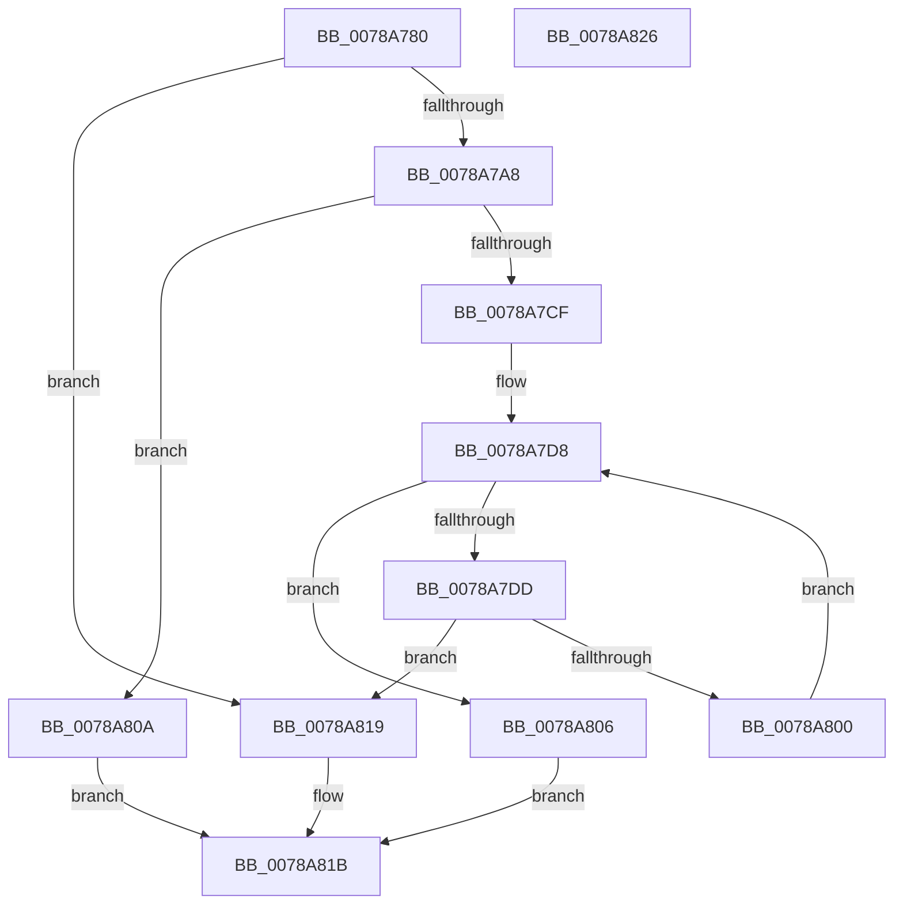

# RtlSuffixUnicodeString

- RVA: `0x0078A780`–`0x0078A827` (길이 `167` bytes)
- VA: `0x000000014078A780`
- 실행 섹션: `PAGE`
- PDB 이름 있음: `예`; PDB Function 태그: `아니요`
- unwind 정보 RVA: `0x0005CAAC`
- 디코드: `52`개 명령, `167/167` bytes 표시
- 미해석 바이트: `0` (있으면 어셈블리에 `.byte`로 보존)

> 이 문서는 커널 이미지의 기계어와 PDB 기호를 분석해 생성했습니다. 4번과 5번은 함수 원형과 자료형을 바이너리 사용 방식에서 추정한 C 해석이며 원본 소스 복구 결과는 아닙니다.

## 1. Dependencies

- 직접 호출 지점: **4**; 고유 호출 대상: **3**
- 직접 호출자로 확인된 함수: **2**
- RIP 상대 이미지 참조: **0**

### Outgoing calls
- `0x0078A790` → [PsGetCurrentServerSiloGlobals](../../text/2F/PsGetCurrentServerSiloGlobals_function_002FE1F0.md) (function, `0x002FE1F0`)
- `0x0078A7E5` → [NLS_UPCASE](../../text/3F/NLS_UPCASE_function_003FF700.md) (function, `0x003FF700`)
- `0x0078A7F5` → [NLS_UPCASE](../../text/3F/NLS_UPCASE_function_003FF700.md) (function, `0x003FF700`)
- `0x0078A80D` → [memcmp](../../text/6C/memcmp_function_006C6B10.md) (function, `0x006C6B10`)

### Direct callers
- [PiDrvDbSetupNodeHive](../74/PiDrvDbSetupNodeHive_function_00743884.md) at `0x00743B40`
- [PiDrvDbSetupNodeHive](../74/PiDrvDbSetupNodeHive_function_00743884.md) at `0x00743B8D`
- [NtQueryInformationToken](../AE/NtQueryInformationToken_function_00AECDD0.md) at `0x00AEE904`

### Static image references
- 디코드된 RIP-relative 메모리 참조가 없습니다.

## 2. Other-region calls and transfers

- 다른 실행 섹션으로 향하는 call: **4**
  - `0x0078A790` → [PsGetCurrentServerSiloGlobals](../../text/2F/PsGetCurrentServerSiloGlobals_function_002FE1F0.md) (`PAGE` → `.text`)
  - `0x0078A7E5` → [NLS_UPCASE](../../text/3F/NLS_UPCASE_function_003FF700.md) (`PAGE` → `.text`)
  - `0x0078A7F5` → [NLS_UPCASE](../../text/3F/NLS_UPCASE_function_003FF700.md) (`PAGE` → `.text`)
  - `0x0078A80D` → [memcmp](../../text/6C/memcmp_function_006C6B10.md) (`PAGE` → `.text`)
- 별도 외부 분기/꼬리 이동을 확인하지 못했습니다.

## 3. Assembly (complete function range)

```asm
0078A780  48 89 5C 24 08                  mov qword ptr [rsp + 8], rbx
0078A785  57                              push rdi
0078A786  48 83 EC 20                     sub rsp, 0x20
0078A78A  45 8A C8                        mov r9b, r8b
0078A78D  4C 8B D1                        mov r10, rcx
0078A790  E8 5B 3A B7 FF                  call 0x1402fe1f0
0078A795  41 0F B7 0A                     movzx ecx, word ptr [r10]
0078A799  48 8B 98 B0 04 00 00            mov rbx, qword ptr [rax + 0x4b0]
0078A7A0  0F B7 02                        movzx eax, word ptr [rdx]
0078A7A3  66 3B C1                        cmp ax, cx
0078A7A6  72 71                           jb 0x14078a819
0078A7A8  4D 8B 52 08                     mov r10, qword ptr [r10 + 8]
0078A7AC  44 8B D8                        mov r11d, eax
0078A7AF  4C 2B D9                        sub r11, rcx
0078A7B2  44 8B C1                        mov r8d, ecx
0078A7B5  48 8B 4A 08                     mov rcx, qword ptr [rdx + 8]
0078A7B9  41 8B C0                        mov eax, r8d
0078A7BC  49 D1 EB                        shr r11, 1
0078A7BF  48 D1 E8                        shr rax, 1
0078A7C2  4A 8D 14 59                     lea rdx, [rcx + r11*2]
0078A7C6  49 8D 3C 42                     lea rdi, [r10 + rax*2]
0078A7CA  45 84 C9                        test r9b, r9b
0078A7CD  74 3B                           je 0x14078a80a
0078A7CF  4D 03 DB                        add r11, r11
0078A7D2  4D 2B DA                        sub r11, r10
0078A7D5  4C 03 D9                        add r11, rcx
0078A7D8  4C 3B D7                        cmp r10, rdi
0078A7DB  73 29                           jae 0x14078a806
0078A7DD  43 0F B7 14 13                  movzx edx, word ptr [r11 + r10]
0078A7E2  48 8B CB                        mov rcx, rbx
0078A7E5  E8 16 4F C7 FF                  call 0x1403ff700
0078A7EA  41 0F B7 12                     movzx edx, word ptr [r10]
0078A7EE  48 8B CB                        mov rcx, rbx
0078A7F1  44 0F B7 C8                     movzx r9d, ax
0078A7F5  E8 06 4F C7 FF                  call 0x1403ff700
0078A7FA  66 41 3B C1                     cmp ax, r9w
0078A7FE  75 19                           jne 0x14078a819
0078A800  49 83 C2 02                     add r10, 2
0078A804  EB D2                           jmp 0x14078a7d8
0078A806  B0 01                           mov al, 1
0078A808  EB 11                           jmp 0x14078a81b
0078A80A  49 8B CA                        mov rcx, r10
0078A80D  E8 FE C2 F3 FF                  call 0x1406c6b10
0078A812  85 C0                           test eax, eax
0078A814  0F 94 C0                        sete al
0078A817  EB 02                           jmp 0x14078a81b
0078A819  32 C0                           xor al, al
0078A81B  48 8B 5C 24 30                  mov rbx, qword ptr [rsp + 0x30]
0078A820  48 83 C4 20                     add rsp, 0x20
0078A824  5F                              pop rdi
0078A825  C3                              ret
0078A826  CC                              int3
```

## 4. C-style interpretation (structured pseudocode)

```c
__int64 __fastcall RtlSuffixUnicodeString(__int64 a1, __int64 a2, unsigned __int8 a3)
{
    __int64 result;
    __int64 v_r10;
    __int64 v_r11;
    __int64 v_rsp;
    unsigned __int64 v_stack_p8;

    v_stack_p8 = v_rbx;
    v_rsp = (v_rsp) - (32);
    result = PsGetCurrentServerSiloGlobals(a1, a2, a3, a3);
    if (((unsigned __int16)(*(unsigned __int16 *)(a2))) < ((unsigned __int16)(*(unsigned __int16 *)(a1)))) goto loc_0078A819;
    v_r11 = ((unsigned int)((unsigned int)(*(unsigned __int16 *)(a2)))) - (*(unsigned __int16 *)(a1));
    v_r11 = (v_r11) >> (1);
    result = ((unsigned int)((unsigned int)((unsigned int)((unsigned int)(*(unsigned __int16 *)(a1)))))) >> (1);
    if (a3 == 0) goto loc_0078A80A;
    v_r11 = (v_r11) + (v_r11);
    v_r11 = (v_r11) - (*(unsigned __int64 *)(a1 + 8));
    v_r11 = (v_r11) + (*(unsigned __int64 *)(a2 + 8));
loc_0078A7D8:
    if ((*(unsigned __int64 *)(a1 + 8)) >= (*(unsigned __int64 *)(a1 + 8) + result * 2)) goto loc_0078A806;
    result = NLS_UPCASE(*(unsigned __int64 *)(result + 1200), *(unsigned __int16 *)(v_r11 + *(unsigned __int64 *)(a1 + 8) * 1), (unsigned int)((unsigned int)(*(unsigned __int16 *)(a1))), a3);
    result = NLS_UPCASE(*(unsigned __int64 *)(result + 1200), *(unsigned __int16 *)(*(unsigned __int64 *)(a1 + 8)), (unsigned int)((unsigned int)(*(unsigned __int16 *)(a1))), (unsigned __int16)(result));
    if (((unsigned __int16)(result)) != ((unsigned __int16)((unsigned __int16)(result)))) goto loc_0078A819;
    v_r10 = (*(unsigned __int64 *)(a1 + 8)) + (2);
    goto loc_0078A7D8;
loc_0078A806:
    goto loc_0078A81B;
loc_0078A80A:
    result = memcmp(v_r10, *(unsigned __int16 *)(*(unsigned __int64 *)(a1 + 8)), (unsigned int)((unsigned int)(*(unsigned __int16 *)(a1))), (unsigned __int16)(result));
    result = ((unsigned int)(result) == 0) ? 1 : 0;
    goto loc_0078A81B;
loc_0078A819:
    result = 0;
loc_0078A81B:
    v_rsp = (v_rsp) + (32);
    return result;
}
```

## 5. (Beta) C Style

```c
int64_t RtlSuffixUnicodeString(int64_t Arg1, int64_t Arg2, uint8_t Arg3)
{
    int64_t result;
    int64_t local_r10;
    int64_t local_r11;
    int64_t local_rsp;
    uint64_t v_stack_p8;

    v_stack_p8 = local_rbx;
    local_rsp = (local_rsp) - (32);
    result = PsGetCurrentServerSiloGlobals(Arg1, Arg2, Arg3, Arg3);
    if (((uint16_t)(*(uint16_t *)(Arg2))) < ((uint16_t)(*(uint16_t *)(Arg1)))) goto loc_0078A819;
    local_r11 = ((uint32_t)((uint32_t)(*(uint16_t *)(Arg2)))) - (*(uint16_t *)(Arg1));
    local_r11 = (local_r11) >> (1);
    result = ((uint32_t)((uint32_t)((uint32_t)((uint32_t)(*(uint16_t *)(Arg1)))))) >> (1);
    if (Arg3 == 0) goto loc_0078A80A;
    local_r11 = (local_r11) + (local_r11);
    local_r11 = (local_r11) - (*(uint64_t *)(Arg1 + 0x8));
    local_r11 = (local_r11) + (*(uint64_t *)(Arg2 + 0x8));
loc_0078A7D8:
    if ((*(uint64_t *)(Arg1 + 0x8)) >= (*(uint64_t *)(Arg1 + 0x8) + result * 2)) goto loc_0078A806;
    result = NLS_UPCASE(*(uint64_t *)(result + 0x4B0), *(uint16_t *)(local_r11 + *(uint64_t *)(Arg1 + 0x8) * 1), (uint32_t)((uint32_t)(*(uint16_t *)(Arg1))), Arg3);
    result = NLS_UPCASE(*(uint64_t *)(result + 0x4B0), *(uint16_t *)(*(uint64_t *)(Arg1 + 0x8)), (uint32_t)((uint32_t)(*(uint16_t *)(Arg1))), (uint16_t)(result));
    if (((uint16_t)(result)) != ((uint16_t)((uint16_t)(result)))) goto loc_0078A819;
    local_r10 = (*(uint64_t *)(Arg1 + 0x8)) + (2);
    goto loc_0078A7D8;
loc_0078A806:
    goto loc_0078A81B;
loc_0078A80A:
    result = memcmp(local_r10, *(uint16_t *)(*(uint64_t *)(Arg1 + 0x8)), (uint32_t)((uint32_t)(*(uint16_t *)(Arg1))), (uint16_t)(result));
    result = ((uint32_t)(result) == 0) ? 1 : 0;
    goto loc_0078A81B;
loc_0078A819:
    result = 0;
loc_0078A81B:
    local_rsp = (local_rsp) + (32);
    return result;
}
```

## 6. Execution-region graph

[열기: 2D/3D 그래프와 함수 탐색 컨트롤 패널](../../../control-panel.html?section=page&rva=0x0078A780&view=graph)

- 2D 그래프는 위에서 아래로 흐르고, 3D 그래프는 빈 공간을 드래그해 회전합니다. Shift+드래그는 이동, 휠은 확대·축소, 함수 노드 선택은 대상 보고서 이동입니다.

### Static fallback


