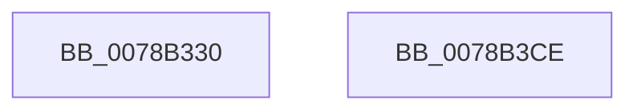

# RtlTimeToElapsedTimeFields

- RVA: `0x0078B330`–`0x0078B3CF` (길이 `159` bytes)
- VA: `0x000000014078B330`
- 실행 섹션: `PAGE`
- PDB 이름 있음: `예`; PDB Function 태그: `아니요`
- unwind 정보 RVA: `0x000A5538`
- 디코드: `45`개 명령, `159/159` bytes 표시
- 미해석 바이트: `0` (있으면 어셈블리에 `.byte`로 보존)

> 이 문서는 커널 이미지의 기계어와 PDB 기호를 분석해 생성했습니다. 4번과 5번은 함수 원형과 자료형을 바이너리 사용 방식에서 추정한 C 해석이며 원본 소스 복구 결과는 아닙니다.

## 1. Dependencies

- 직접 호출 지점: **1**; 고유 호출 대상: **1**
- 직접 호출자로 확인된 함수: **0**
- RIP 상대 이미지 참조: **0**

### Outgoing calls
- `0x0078B34F` → [TimeToDaysAndFraction](../../text/45/TimeToDaysAndFraction_function_00452230.md) (function, `0x00452230`)

### Direct callers
- 이 함수 시작 RVA로 연결되는 직접 call은 확인되지 않았습니다. 간접 호출은 완전히 역산할 수 없습니다.

### Static image references
- 디코드된 RIP-relative 메모리 참조가 없습니다.

## 2. Other-region calls and transfers

- 다른 실행 섹션으로 향하는 call: **1**
  - `0x0078B34F` → [TimeToDaysAndFraction](../../text/45/TimeToDaysAndFraction_function_00452230.md) (`PAGE` → `.text`)
- 별도 외부 분기/꼬리 이동을 확인하지 못했습니다.

## 3. Assembly (complete function range)

```asm
0078B330  48 8B C4                        mov rax, rsp
0078B333  48 89 58 08                     mov qword ptr [rax + 8], rbx
0078B337  57                              push rdi
0078B338  48 83 EC 20                     sub rsp, 0x20
0078B33C  48 8B DA                        mov rbx, rdx
0078B33F  4C 8D 40 10                     lea r8, [rax + 0x10]
0078B343  33 FF                           xor edi, edi
0078B345  48 8D 50 18                     lea rdx, [rax + 0x18]
0078B349  89 78 18                        mov dword ptr [rax + 0x18], edi
0078B34C  89 78 10                        mov dword ptr [rax + 0x10], edi
0078B34F  E8 DC 6E CC FF                  call 0x140452230
0078B354  44 8B 54 24 38                  mov r10d, dword ptr [rsp + 0x38]
0078B359  41 BB 89 88 88 88               mov r11d, 0x88888889
0078B35F  0F B7 4C 24 40                  movzx ecx, word ptr [rsp + 0x40]
0078B364  B8 D3 4D 62 10                  mov eax, 0x10624dd3
0078B369  41 F7 E2                        mul r10d
0078B36C  66 89 4B 04                     mov word ptr [rbx + 4], cx
0078B370  44 8B CA                        mov r9d, edx
0078B373  89 3B                           mov dword ptr [rbx], edi
0078B375  41 C1 E9 06                     shr r9d, 6
0078B379  41 69 C1 18 FC FF FF            imul eax, r9d, 0xfffffc18
0078B380  44 03 D0                        add r10d, eax
0078B383  41 8B C3                        mov eax, r11d
0078B386  41 F7 E1                        mul r9d
0078B389  41 8B C3                        mov eax, r11d
0078B38C  66 44 89 53 0C                  mov word ptr [rbx + 0xc], r10w
0078B391  44 8B C2                        mov r8d, edx
0078B394  41 C1 E8 05                     shr r8d, 5
0078B398  41 F7 E0                        mul r8d
0078B39B  C1 EA 05                        shr edx, 5
0078B39E  0F BF C2                        movsx eax, dx
0078B3A1  6B C8 3C                        imul ecx, eax, 0x3c
0078B3A4  41 0F B7 C0                     movzx eax, r8w
0078B3A8  66 89 53 06                     mov word ptr [rbx + 6], dx
0078B3AC  66 2B C1                        sub ax, cx
0078B3AF  66 89 43 08                     mov word ptr [rbx + 8], ax
0078B3B3  41 0F BF C0                     movsx eax, r8w
0078B3B7  6B C8 3C                        imul ecx, eax, 0x3c
0078B3BA  66 44 2B C9                     sub r9w, cx
0078B3BE  66 44 89 4B 0A                  mov word ptr [rbx + 0xa], r9w
0078B3C3  48 8B 5C 24 30                  mov rbx, qword ptr [rsp + 0x30]
0078B3C8  48 83 C4 20                     add rsp, 0x20
0078B3CC  5F                              pop rdi
0078B3CD  C3                              ret
0078B3CE  CC                              int3
```

## 4. C-style interpretation (structured pseudocode)

```c
__int64 __fastcall RtlTimeToElapsedTimeFields(__int64 a1, __int64 a2)
{
    __int64 result;
    __int64 v_r10;
    __int64 v_rdi;
    __int64 v_rsp;
    unsigned int v_stack_p10;
    unsigned __int16 v_stack_p18;
    unsigned __int64 v_stack_p8;

    *(unsigned __int64 *)(v_rsp + 8) = v_rbx;
    v_rsp = (v_rsp) - (32);
    v_rdi = 0;
    *(unsigned int *)(v_rsp + 24) = 0;
    *(unsigned int *)(v_rsp + 16) = 0;
    result = TimeToDaysAndFraction(a1, v_rsp + 24, v_rsp + 16, a4);
    *(unsigned __int16 *)(a2 + 4) = (unsigned __int16)(v_stack_p18);
    *(unsigned int *)(a2) = 0;
    a4 = (unsigned int)(((unsigned int)((unsigned int)(v_rsp + 24))) >> (6));
    result = (unsigned int)(((unsigned int)(0x10624DD3ULL)) * ((unsigned int)(a4)));
    v_r10 = (unsigned int)(((unsigned int)(v_stack_p10)) + ((unsigned int)(result)));
    *(unsigned __int16 *)(a2 + 12) = (unsigned __int16)(v_r10);
    a3 = (unsigned int)(((unsigned int)((unsigned int)(v_rsp + 24))) >> (5));
    a2 = (unsigned int)((v_rsp + 24) >> (5));
    a1 = (unsigned int)((v_stack_p18) * ((unsigned int)((__int16)((unsigned __int16)(a2)))));
    *(unsigned __int16 *)(a2 + 6) = (unsigned __int16)(a2);
    result = (unsigned __int16)(((unsigned __int16)(a3)) - ((unsigned __int16)(a1)));
    *(unsigned __int16 *)(a2 + 8) = (unsigned __int16)(result);
    a1 = (unsigned int)((a1) * ((unsigned int)((__int16)((unsigned __int16)(a3)))));
    a4 = (unsigned __int16)((a4) - ((unsigned __int16)(a1)));
    *(unsigned __int16 *)(a2 + 10) = (unsigned __int16)(a4);
    v_rsp = (v_rsp) + (32);
    return (__int16)((unsigned __int16)(a3));
}
```

## 5. (Beta) C Style

```c
int64_t RtlTimeToElapsedTimeFields(int64_t Arg1, void *Arg2)
{
    uint8_t *arg2 = (uint8_t *)Arg2;

    int64_t result;
    int64_t local_r10;
    int64_t local_rdi;
    int64_t local_rsp;
    uint32_t v_stack_p10;
    uint16_t v_stack_p18;
    uint64_t v_stack_p8;

    *(uint64_t *)(local_rsp + 0x8) = local_rbx;
    local_rsp = (local_rsp) - (32);
    local_rdi = 0;
    *(uint32_t *)(local_rsp + 0x18) = 0;
    *(uint32_t *)(local_rsp + 0x10) = 0;
    result = TimeToDaysAndFraction(Arg1, local_rsp + 24, local_rsp + 16, a4);
    *(uint16_t *)(arg2 + 0x4) = (uint16_t)(v_stack_p18);
    *(uint32_t *)(arg2) = 0;
    a4 = (uint32_t)(((uint32_t)((uint32_t)(local_rsp + 24))) >> (6));
    result = (uint32_t)(((uint32_t)(0x10624DD3ULL)) * ((uint32_t)(a4)));
    local_r10 = (uint32_t)(((uint32_t)(v_stack_p10)) + ((uint32_t)(result)));
    *(uint16_t *)(arg2 + 0xC) = (uint16_t)(local_r10);
    a3 = (uint32_t)(((uint32_t)((uint32_t)(local_rsp + 24))) >> (5));
    Arg2 = (uint32_t)((local_rsp + 24) >> (5));
    Arg1 = (uint32_t)((v_stack_p18) * ((uint32_t)((int16_t)((uint16_t)(Arg2)))));
    *(uint16_t *)(arg2 + 0x6) = (uint16_t)(Arg2);
    result = (uint16_t)(((uint16_t)(a3)) - ((uint16_t)(Arg1)));
    *(uint16_t *)(arg2 + 0x8) = (uint16_t)(result);
    Arg1 = (uint32_t)((Arg1) * ((uint32_t)((int16_t)((uint16_t)(a3)))));
    a4 = (uint16_t)((a4) - ((uint16_t)(Arg1)));
    *(uint16_t *)(arg2 + 0xA) = (uint16_t)(a4);
    local_rsp = (local_rsp) + (32);
    return (int16_t)((uint16_t)(a3));
}
```

### 관측된 메모리 오프셋

구조체 형식이 확인되지 않은 접근은 인자 기준의 오프셋으로만 기록했습니다.

| 기준 인자 | 오프셋 표현 | 폭 (bit) | 접근 |
|---|---:|---:|---|
| `Arg2` | `+ 0x0` | `32` | `W` |
| `Arg2` | `+ 0x4` | `16` | `W` |
| `Arg2` | `+ 0x6` | `16` | `W` |
| `Arg2` | `+ 0x8` | `16` | `W` |
| `Arg2` | `+ 0xA` | `16` | `W` |
| `Arg2` | `+ 0xC` | `16` | `W` |

## 6. Execution-region graph

[열기: 2D/3D 그래프와 함수 탐색 컨트롤 패널](../../../control-panel.html?section=page&rva=0x0078B330&view=graph)

- 2D 그래프는 위에서 아래로 흐르고, 3D 그래프는 빈 공간을 드래그해 회전합니다. Shift+드래그는 이동, 휠은 확대·축소, 함수 노드 선택은 대상 보고서 이동입니다.

### Static fallback


