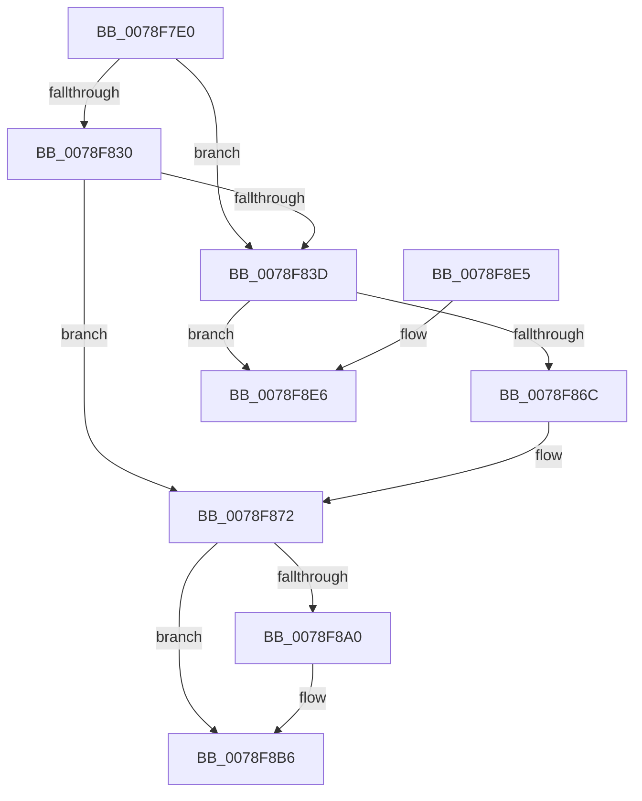

# RtlUnicodeStringToInt64

- RVA: `0x0078F7E0`–`0x0078F8EC` (길이 `268` bytes)
- VA: `0x000000014078F7E0`
- 실행 섹션: `PAGE`
- PDB 이름 있음: `예`; PDB Function 태그: `아니요`
- unwind 정보 RVA: `0x000CFA1C`
- 디코드: `79`개 명령, `268/268` bytes 표시
- 미해석 바이트: `0` (있으면 어셈블리에 `.byte`로 보존)

> 이 문서는 커널 이미지의 기계어와 PDB 기호를 분석해 생성했습니다. 4번과 5번은 함수 원형과 자료형을 바이너리 사용 방식에서 추정한 C 해석이며 원본 소스 복구 결과는 아닙니다.

## 1. Dependencies

- 직접 호출 지점: **4**; 고유 호출 대상: **4**
- 직접 호출자로 확인된 함수: **1**
- RIP 상대 이미지 참조: **1**

### Outgoing calls
- `0x0078F85E` → [memcpy](../../text/6C/memcpy_function_006C6840.md) (function, `0x006C6840`)
- `0x0078F893` → [wcstoxq](../../text/50/wcstoxq_function_00502674.md) (function, `0x00502674`)
- `0x0078F8CE` → [_security_check_cookie](../../text/6A/_security_check_cookie_function_006AC640.md) (function, `0x006AC640`)
- `0x0078F8E6` → [_report_rangecheckfailure](../../text/4F/_report_rangecheckfailure_function_004F5FDC.md) (function, `0x004F5FDC`)

### Direct callers
- [GetFlags](../7A/GetFlags_function_007A56D4.md) at `0x007A571C`

### Static image references
- `0x0078F7F2` → RVA `0x00E0A740` (`.data`; read)

## 2. Other-region calls and transfers

- 다른 실행 섹션으로 향하는 call: **4**
  - `0x0078F85E` → [memcpy](../../text/6C/memcpy_function_006C6840.md) (`PAGE` → `.text`)
  - `0x0078F893` → [wcstoxq](../../text/50/wcstoxq_function_00502674.md) (`PAGE` → `.text`)
  - `0x0078F8CE` → [_security_check_cookie](../../text/6A/_security_check_cookie_function_006AC640.md) (`PAGE` → `.text`)
  - `0x0078F8E6` → [_report_rangecheckfailure](../../text/4F/_report_rangecheckfailure_function_004F5FDC.md) (`PAGE` → `.text`)
- 별도 외부 분기/꼬리 이동을 확인하지 못했습니다.

## 3. Assembly (complete function range)

```asm
0078F7E0  40 53                           push rbx
0078F7E2  55                              push rbp
0078F7E3  56                              push rsi
0078F7E4  57                              push rdi
0078F7E5  41 54                           push r12
0078F7E7  41 56                           push r14
0078F7E9  41 57                           push r15
0078F7EB  48 81 EC E0 00 00 00            sub rsp, 0xe0
0078F7F2  48 8B 05 47 AF 67 00            mov rax, qword ptr [rip + 0x67af47]
0078F7F9  48 33 C4                        xor rax, rsp
0078F7FC  48 89 84 24 D0 00 00 00         mov qword ptr [rsp + 0xd0], rax
0078F804  45 33 E4                        xor r12d, r12d
0078F807  4D 8B F8                        mov r15, r8
0078F80A  44 0F B7 01                     movzx r8d, word ptr [rcx]
0078F80E  44 8B F2                        mov r14d, edx
0078F811  48 8B 51 08                     mov rdx, qword ptr [rcx + 8]
0078F815  48 8B E9                        mov rbp, rcx
0078F818  0F B7 49 02                     movzx ecx, word ptr [rcx + 2]
0078F81C  49 8B F1                        mov rsi, r9
0078F81F  4C 89 64 24 38                  mov qword ptr [rsp + 0x38], r12
0078F824  48 8B FA                        mov rdi, rdx
0078F827  49 8D 40 02                     lea rax, [r8 + 2]
0078F82B  48 3B C8                        cmp rcx, rax
0078F82E  72 0D                           jb 0x14078f83d
0078F830  8B C1                           mov eax, ecx
0078F832  48 D1 E8                        shr rax, 1
0078F835  66 44 39 64 42 FE               cmp word ptr [rdx + rax*2 - 2], r12w
0078F83B  74 35                           je 0x14078f872
0078F83D  41 8B C0                        mov eax, r8d
0078F840  48 8D 7C 24 40                  lea rdi, [rsp + 0x40]
0078F845  D1 E8                           shr eax, 1
0078F847  B9 40 00 00 00                  mov ecx, 0x40
0078F84C  3B C1                           cmp eax, ecx
0078F84E  0F 43 C1                        cmovae eax, ecx
0078F851  48 8D 4C 24 40                  lea rcx, [rsp + 0x40]
0078F856  8B D8                           mov ebx, eax
0078F858  48 03 DB                        add rbx, rbx
0078F85B  4C 8B C3                        mov r8, rbx
0078F85E  E8 DD 6F F3 FF                  call 0x1406c6840
0078F863  48 81 FB 82 00 00 00            cmp rbx, 0x82
0078F86A  73 7A                           jae 0x14078f8e6
0078F86C  66 44 89 64 1C 40               mov word ptr [rsp + rbx + 0x40], r12w
0078F872  48 8D 44 24 30                  lea rax, [rsp + 0x30]
0078F877  44 89 64 24 30                  mov dword ptr [rsp + 0x30], r12d
0078F87C  48 89 44 24 28                  mov qword ptr [rsp + 0x28], rax
0078F881  4C 8D 44 24 38                  lea r8, [rsp + 0x38]
0078F886  45 8B CE                        mov r9d, r14d
0078F889  44 89 64 24 20                  mov dword ptr [rsp + 0x20], r12d
0078F88E  48 8B D7                        mov rdx, rdi
0078F891  33 C9                           xor ecx, ecx
0078F893  E8 DC 2D D7 FF                  call 0x140502674
0078F898  49 89 07                        mov qword ptr [r15], rax
0078F89B  48 85 F6                        test rsi, rsi
0078F89E  74 16                           je 0x14078f8b6
0078F8A0  48 8B 45 08                     mov rax, qword ptr [rbp + 8]
0078F8A4  48 8B 4C 24 38                  mov rcx, qword ptr [rsp + 0x38]
0078F8A9  48 2B CF                        sub rcx, rdi
0078F8AC  48 D1 F9                        sar rcx, 1
0078F8AF  48 8D 0C 48                     lea rcx, [rax + rcx*2]
0078F8B3  48 89 0E                        mov qword ptr [rsi], rcx
0078F8B6  8B 44 24 30                     mov eax, dword ptr [rsp + 0x30]
0078F8BA  F7 D8                           neg eax
0078F8BC  1B C0                           sbb eax, eax
0078F8BE  25 95 00 00 C0                  and eax, 0xc0000095
0078F8C3  48 8B 8C 24 D0 00 00 00         mov rcx, qword ptr [rsp + 0xd0]
0078F8CB  48 33 CC                        xor rcx, rsp
0078F8CE  E8 6D CD F1 FF                  call 0x1406ac640
0078F8D3  48 81 C4 E0 00 00 00            add rsp, 0xe0
0078F8DA  41 5F                           pop r15
0078F8DC  41 5E                           pop r14
0078F8DE  41 5C                           pop r12
0078F8E0  5F                              pop rdi
0078F8E1  5E                              pop rsi
0078F8E2  5D                              pop rbp
0078F8E3  5B                              pop rbx
0078F8E4  C3                              ret
0078F8E5  CC                              int3
0078F8E6  E8 F1 66 D6 FF                  call 0x1404f5fdc
0078F8EB  CC                              int3
```

## 4. C-style interpretation (structured pseudocode)

```c
__int64 __fastcall RtlUnicodeStringToInt64(__int64 a1, int a2, __int64 a3, __int64 a4)
{
    __int64 result;
    __int64 v_r12;
    __int64 v_rbx;
    __int64 v_rsp;
    unsigned __int64 v_stack_m48;
    unsigned __int64 v_stack_mD8;
    unsigned __int64 v_stack_mE0;
    unsigned __int64 v_stack_mE8;
    unsigned __int64 v_stack_mF0;
    unsigned int v_stack_mF8;

    v_rsp = (v_rsp) - (224);
    result = (*(unsigned __int64 *)(v_rip + 6795079)) ^ (v_rsp);
    v_stack_m48 = result;
    v_r12 = 0;
    v_stack_mE0 = 0;
    if ((*(unsigned __int16 *)(a1 + 2)) < (*(unsigned __int16 *)(a1) + 2)) goto loc_0078F83D;
    result = ((unsigned int)((unsigned int)(*(unsigned __int16 *)(a1 + 2)))) >> (1);
    if ((*(unsigned __int16 *)(*(unsigned __int64 *)(a1 + 8) + result * 2 - 2)) == 0) goto loc_0078F872;
loc_0078F83D:
    result = (unsigned int)(((unsigned int)((unsigned int)(*(unsigned __int16 *)(a1)))) >> (1));
    if (((unsigned int)(result)) >= 64) { result = 64; }
    v_rbx = ((unsigned int)((unsigned int)(result))) + ((unsigned int)((unsigned int)(result)));
    result = memcpy(v_stack_mD8, *(unsigned __int64 *)(a1 + 8), v_rbx, a4);
    if (v_rbx >= 130) goto loc_0078F8E6;
    *(unsigned __int16 *)(v_rsp + v_rbx * 1 + 64) = 0;
loc_0078F872:
    v_stack_mE8 = 0;
    v_stack_mF0 = v_stack_mE8;
    v_stack_mF8 = 0;
    a1 = 0;
    result = wcstoxq(a1, v_stack_mD8, v_stack_mE0, (unsigned int)((unsigned int)((unsigned int)(a2))));
    *(unsigned __int64 *)(a3) = result;
    if (a4 != 0) {
        result = *(unsigned __int64 *)(a1 + 8);
        a1 = v_stack_mE0;
        a1 = (a1) - (v_stack_mD8);
        a1 = (a1) >> (1);
        a1 = result + a1 * 2;
        *(unsigned __int64 *)(a4) = a1;
    }
    result = (unsigned int)(-((unsigned int)(v_stack_mE8)));
    result = (unsigned int)((result) & (0xC0000095ULL));
    a1 = (v_stack_m48) ^ (v_rsp);
    result = _security_check_cookie(a1, v_stack_mD8, v_stack_mE0, (unsigned int)((unsigned int)((unsigned int)(a2))));
    v_rsp = (v_rsp) + (224);
    return result;
loc_0078F8E6:
    result = _report_rangecheckfailure(a1, v_stack_mD8, v_stack_mE0, (unsigned int)((unsigned int)((unsigned int)(a2))));
    return result;
}
```

## 5. (Beta) C Style

```c
int64_t RtlUnicodeStringToInt64(void *Arg1, int32_t Arg2, void *Arg3, int64_t Arg4)
{
    uint8_t *arg1 = (uint8_t *)Arg1;
    uint8_t *arg3 = (uint8_t *)Arg3;

    int64_t result;
    int64_t local_r12;
    int64_t local_rbx;
    int64_t local_rsp;
    uint64_t v_stack_m48;
    uint64_t v_stack_mD8;
    uint64_t v_stack_mE0;
    uint64_t v_stack_mE8;
    uint64_t v_stack_mF0;
    uint32_t v_stack_mF8;

    local_rsp = (local_rsp) - (224);
    result = (*(uint64_t *)(v_rip + 0x67AF47)) ^ (local_rsp);
    v_stack_m48 = result;
    local_r12 = 0;
    v_stack_mE0 = 0;
    if ((*(uint16_t *)(arg1 + 0x2)) < (*(uint16_t *)(arg1) + 2)) goto loc_0078F83D;
    result = ((uint32_t)((uint32_t)(*(uint16_t *)(arg1 + 0x2)))) >> (1);
    if ((*(uint16_t *)(*(uint64_t *)(arg1 + 0x8) + result * 2 - 0x2)) == 0) goto loc_0078F872;
loc_0078F83D:
    result = (uint32_t)(((uint32_t)((uint32_t)(*(uint16_t *)(arg1)))) >> (1));
    if (((uint32_t)(result)) >= 64) { result = 64; }
    local_rbx = ((uint32_t)((uint32_t)(result))) + ((uint32_t)((uint32_t)(result)));
    result = memcpy(v_stack_mD8, *(uint64_t *)(arg1 + 0x8), local_rbx, Arg4);
    if (local_rbx >= 130) goto loc_0078F8E6;
    *(uint16_t *)(local_rsp + local_rbx * 1 + 0x40) = 0;
loc_0078F872:
    v_stack_mE8 = 0;
    v_stack_mF0 = v_stack_mE8;
    v_stack_mF8 = 0;
    Arg1 = 0;
    result = wcstoxq(Arg1, v_stack_mD8, v_stack_mE0, (uint32_t)((uint32_t)((uint32_t)(Arg2))));
    *(uint64_t *)(arg3) = result;
    if (Arg4 != 0) {
        result = *(uint64_t *)(arg1 + 0x8);
        Arg1 = v_stack_mE0;
        Arg1 = (Arg1) - (v_stack_mD8);
        Arg1 = (Arg1) >> (1);
        Arg1 = result + Arg1 * 2;
        *(void **)(Arg4) = Arg1;
    }
    result = (uint32_t)(-((uint32_t)(v_stack_mE8)));
    result = (uint32_t)((result) & (0xC0000095ULL));
    Arg1 = (v_stack_m48) ^ (local_rsp);
    result = _security_check_cookie(Arg1, v_stack_mD8, v_stack_mE0, (uint32_t)((uint32_t)((uint32_t)(Arg2))));
    local_rsp = (local_rsp) + (224);
    return result;
loc_0078F8E6:
    result = _report_rangecheckfailure(Arg1, v_stack_mD8, v_stack_mE0, (uint32_t)((uint32_t)((uint32_t)(Arg2))));
    return result;
}
```

### 관측된 메모리 오프셋

구조체 형식이 확인되지 않은 접근은 인자 기준의 오프셋으로만 기록했습니다.

| 기준 인자 | 오프셋 표현 | 폭 (bit) | 접근 |
|---|---:|---:|---|
| `Arg1` | `+ 0x0` | `16` | `R` |
| `Arg1` | `+ 0x2` | `16` | `R` |
| `Arg1` | `+ 0x8` | `64` | `R` |
| `Arg3` | `+ 0x0` | `64` | `W` |

## 6. Execution-region graph

[열기: 2D/3D 그래프와 함수 탐색 컨트롤 패널](../../../control-panel.html?section=page&rva=0x0078F7E0&view=graph)

- 2D 그래프는 위에서 아래로 흐르고, 3D 그래프는 빈 공간을 드래그해 회전합니다. Shift+드래그는 이동, 휠은 확대·축소, 함수 노드 선택은 대상 보고서 이동입니다.

### Static fallback


