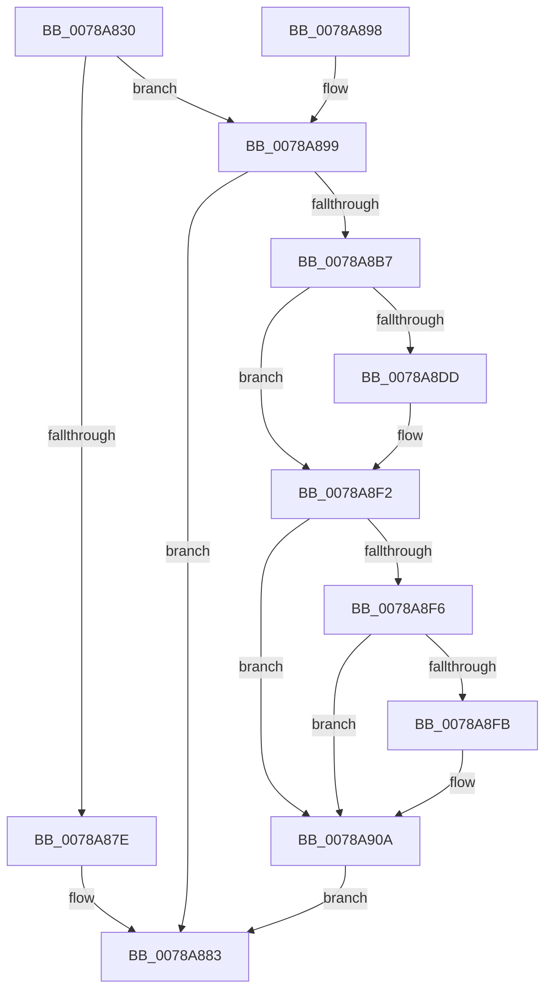

# RtlUpcaseUnicodeStringToAnsiString

- RVA: `0x0078A830`–`0x0078A911` (길이 `225` bytes)
- VA: `0x000000014078A830`
- 실행 섹션: `PAGE`
- PDB 이름 있음: `예`; PDB Function 태그: `아니요`
- unwind 정보 RVA: `0x000CF708`
- 디코드: `70`개 명령, `225/225` bytes 표시
- 미해석 바이트: `0` (있으면 어셈블리에 `.byte`로 보존)

> 이 문서는 커널 이미지의 기계어와 PDB 기호를 분석해 생성했습니다. 4번과 5번은 함수 원형과 자료형을 바이너리 사용 방식에서 추정한 C 해석이며 원본 소스 복구 결과는 아닙니다.

## 1. Dependencies

- 직접 호출 지점: **4**; 고유 호출 대상: **4**
- 직접 호출자로 확인된 함수: **1**
- RIP 상대 이미지 참조: **0**

### Outgoing calls
- `0x0078A867` → [RtlUnicodeToMultiByteSize](../90/RtlUnicodeToMultiByteSize_function_0090D110.md) (function, `0x0090D110`)
- `0x0078A8AA` → [AllocateOrValidateCharStringBuffer](../../text/44/AllocateOrValidateCharStringBuffer_function_00447F60.md) (function, `0x00447F60`)
- `0x0078A8CE` → [RtlUpcaseUnicodeToMultiByteN](../90/RtlUpcaseUnicodeToMultiByteN_function_0090D760.md) (function, `0x0090D760`)
- `0x0078A8FE` → [ExFreePool](../../poolcode/B8/ExFreePool_function_00B82850.md) (function, `0x00B82850`)

### Direct callers
- [DifRtlUpcaseUnicodeStringToAnsiStringWrapper](../../text/63/DifRtlUpcaseUnicodeStringToAnsiStringWrapper_function_0063CA50.md) at `0x0063CB35`

### Static image references
- 디코드된 RIP-relative 메모리 참조가 없습니다.

## 2. Other-region calls and transfers

- 다른 실행 섹션으로 향하는 call: **2**
  - `0x0078A8AA` → [AllocateOrValidateCharStringBuffer](../../text/44/AllocateOrValidateCharStringBuffer_function_00447F60.md) (`PAGE` → `.text`)
  - `0x0078A8FE` → [ExFreePool](../../poolcode/B8/ExFreePool_function_00B82850.md) (`PAGE` → `POOLCODE`)
- 별도 외부 분기/꼬리 이동을 확인하지 못했습니다.

## 3. Assembly (complete function range)

```asm
0078A830  48 8B C4                        mov rax, rsp
0078A833  48 89 58 20                     mov qword ptr [rax + 0x20], rbx
0078A837  44 88 40 18                     mov byte ptr [rax + 0x18], r8b
0078A83B  48 89 48 08                     mov qword ptr [rax + 8], rcx
0078A83F  56                              push rsi
0078A840  57                              push rdi
0078A841  41 54                           push r12
0078A843  41 56                           push r14
0078A845  41 57                           push r15
0078A847  48 83 EC 40                     sub rsp, 0x40
0078A84B  45 8A F0                        mov r14b, r8b
0078A84E  48 8B DA                        mov rbx, rdx
0078A851  48 8B F1                        mov rsi, rcx
0078A854  45 33 E4                        xor r12d, r12d
0078A857  44 89 60 10                     mov dword ptr [rax + 0x10], r12d
0078A85B  44 0F B7 02                     movzx r8d, word ptr [rdx]
0078A85F  48 8B 52 08                     mov rdx, qword ptr [rdx + 8]
0078A863  48 8D 48 10                     lea rcx, [rax + 0x10]
0078A867  E8 A4 28 18 00                  call 0x14090d110
0078A86C  8B 54 24 78                     mov edx, dword ptr [rsp + 0x78]
0078A870  FF C2                           inc edx
0078A872  89 54 24 78                     mov dword ptr [rsp + 0x78], edx
0078A876  81 FA FF FF 00 00               cmp edx, 0xffff
0078A87C  76 1B                           jbe 0x14078a899
0078A87E  B8 F0 00 00 C0                  mov eax, 0xc00000f0
0078A883  48 8B 9C 24 88 00 00 00         mov rbx, qword ptr [rsp + 0x88]
0078A88B  48 83 C4 40                     add rsp, 0x40
0078A88F  41 5F                           pop r15
0078A891  41 5E                           pop r14
0078A893  41 5C                           pop r12
0078A895  5F                              pop rdi
0078A896  5E                              pop rsi
0078A897  C3                              ret
0078A898  CC                              int3
0078A899  4C 8D 7E 02                     lea r15, [rsi + 2]
0078A89D  48 8D 7E 08                     lea rdi, [rsi + 8]
0078A8A1  4D 8B CF                        mov r9, r15
0078A8A4  4C 8B C7                        mov r8, rdi
0078A8A7  41 8A CE                        mov cl, r14b
0078A8AA  E8 B1 D6 CB FF                  call 0x140447f60
0078A8AF  89 44 24 30                     mov dword ptr [rsp + 0x30], eax
0078A8B3  85 C0                           test eax, eax
0078A8B5  78 CC                           js 0x14078a883
0078A8B7  0F B7 03                        movzx eax, word ptr [rbx]
0078A8BA  41 0F B7 17                     movzx edx, word ptr [r15]
0078A8BE  89 44 24 20                     mov dword ptr [rsp + 0x20], eax
0078A8C2  4C 8B 4B 08                     mov r9, qword ptr [rbx + 8]
0078A8C6  4C 8D 44 24 78                  lea r8, [rsp + 0x78]
0078A8CB  48 8B 0F                        mov rcx, qword ptr [rdi]
0078A8CE  E8 8D 2E 18 00                  call 0x14090d760
0078A8D3  8B D8                           mov ebx, eax
0078A8D5  89 44 24 30                     mov dword ptr [rsp + 0x30], eax
0078A8D9  85 C0                           test eax, eax
0078A8DB  78 15                           js 0x14078a8f2
0078A8DD  8B 54 24 78                     mov edx, dword ptr [rsp + 0x78]
0078A8E1  48 8B 07                        mov rax, qword ptr [rdi]
0078A8E4  44 88 24 02                     mov byte ptr [rdx + rax], r12b
0078A8E8  66 89 16                        mov word ptr [rsi], dx
0078A8EB  41 8B DC                        mov ebx, r12d
0078A8EE  89 5C 24 30                     mov dword ptr [rsp + 0x30], ebx
0078A8F2  85 DB                           test ebx, ebx
0078A8F4  79 14                           jns 0x14078a90a
0078A8F6  45 84 F6                        test r14b, r14b
0078A8F9  74 0F                           je 0x14078a90a
0078A8FB  48 8B 0F                        mov rcx, qword ptr [rdi]
0078A8FE  E8 4D 7F 3F 00                  call 0x140b82850
0078A903  4C 89 27                        mov qword ptr [rdi], r12
0078A906  66 45 89 27                     mov word ptr [r15], r12w
0078A90A  8B C3                           mov eax, ebx
0078A90C  E9 72 FF FF FF                  jmp 0x14078a883
```

## 4. C-style interpretation (structured pseudocode)

```c
__int64 __fastcall RtlUpcaseUnicodeStringToAnsiString(__int64 a1, __int64 a2, unsigned __int8 a3)
{
    __int64 result;
    __int64 v_r12;
    __int64 v_rbx;
    __int64 v_rsp;
    unsigned int v_stack_p10;
    unsigned __int64 v_stack_p20;
    unsigned int v_stack_p30;
    unsigned __int64 v_stack_p78;

    *(unsigned __int64 *)(v_rsp + 32) = v_rbx;
    *(unsigned __int8 *)(v_rsp + 24) = a3;
    *(unsigned __int64 *)(v_rsp + 8) = a1;
    v_rsp = (v_rsp) - (64);
    v_r12 = 0;
    *(unsigned int *)(v_rsp + 16) = 0;
    result = RtlUnicodeToMultiByteSize(v_rsp + 16, *(unsigned __int64 *)(a2 + 8), *(unsigned __int16 *)(a2), a4);
    a2 = (unsigned int)(((unsigned int)(v_stack_p10)) + 1);
    v_stack_p10 = (unsigned int)(a2);
    if (((unsigned int)(a2)) <= 0xFFFFULL) goto loc_0078A899;
loc_0078A883:
    v_rsp = (v_rsp) + (64);
    return (unsigned int)(0xC00000F0ULL);
loc_0078A899:
    result = AllocateOrValidateCharStringBuffer(a3, a2, a1 + 8, a1 + 2);
    v_stack_p30 = (unsigned int)(result);
    if (sign_flag) goto loc_0078A883;
    v_stack_p20 = (unsigned int)(*(unsigned __int16 *)(v_stack_p20));
    result = RtlUpcaseUnicodeToMultiByteN(*(unsigned __int64 *)(a1 + 8), *(unsigned __int16 *)(a1 + 2), v_stack_p78, *(unsigned __int64 *)(v_stack_p20 + 8));
    v_stack_p30 = (unsigned int)(result);
    v_rbx = (unsigned int)((unsigned int)(result));
    if (!(sign_flag)) {
        a2 = v_stack_p78;
        result = *(unsigned __int64 *)(a1 + 8);
        *(unsigned __int8 *)(a2 + result * 1) = 0;
        *(unsigned __int16 *)(a1) = (unsigned __int16)(a2);
        v_rbx = 0;
        v_stack_p30 = (unsigned int)(v_rbx);
    }
    if (!sign_flag) goto loc_0078A90A;
    if (a3 != 0) {
        a1 = *(unsigned __int64 *)(a1 + 8);
        result = ExFreePool(a1, a2, v_stack_p78, *(unsigned __int64 *)(v_stack_p20 + 8));
        *(unsigned __int64 *)(a1 + 8) = 0;
        *(unsigned __int16 *)(a1 + 2) = 0;
    }
    goto loc_0078A883;
}
```

## 5. (Beta) C Style

```c
int64_t RtlUpcaseUnicodeStringToAnsiString(void *Arg1, void *Arg2, uint8_t Arg3)
{
    uint8_t *arg1 = (uint8_t *)Arg1;
    uint8_t *arg2 = (uint8_t *)Arg2;

    int64_t result;
    int64_t local_r12;
    int64_t local_rbx;
    int64_t local_rsp;
    uint32_t v_stack_p10;
    uint64_t v_stack_p20;
    uint32_t v_stack_p30;
    uint64_t v_stack_p78;

    *(uint64_t *)(local_rsp + 0x20) = local_rbx;
    *(uint8_t *)(local_rsp + 0x18) = Arg3;
    *(void **)(local_rsp + 0x8) = Arg1;
    local_rsp = (local_rsp) - (64);
    local_r12 = 0;
    *(uint32_t *)(local_rsp + 0x10) = 0;
    result = RtlUnicodeToMultiByteSize(local_rsp + 16, *(uint64_t *)(arg2 + 0x8), *(uint16_t *)(arg2), a4);
    Arg2 = (uint32_t)(((uint32_t)(v_stack_p10)) + 1);
    v_stack_p10 = (uint32_t)(Arg2);
    if (((uint32_t)(Arg2)) <= 0xFFFFULL) goto loc_0078A899;
loc_0078A883:
    local_rsp = (local_rsp) + (64);
    return (uint32_t)(0xC00000F0ULL);
loc_0078A899:
    result = AllocateOrValidateCharStringBuffer(Arg3, Arg2, Arg1 + 8, Arg1 + 2);
    v_stack_p30 = (uint32_t)(result);
    if (sign_flag) goto loc_0078A883;
    v_stack_p20 = (uint32_t)(*(uint16_t *)(v_stack_p20));
    result = RtlUpcaseUnicodeToMultiByteN(*(uint64_t *)(arg1 + 0x8), *(uint16_t *)(arg1 + 0x2), v_stack_p78, *(uint64_t *)(v_stack_p20 + 0x8));
    v_stack_p30 = (uint32_t)(result);
    local_rbx = (uint32_t)((uint32_t)(result));
    if (!(sign_flag)) {
        Arg2 = v_stack_p78;
        result = *(uint64_t *)(arg1 + 0x8);
        *(uint8_t *)(arg2 + result * 1) = 0;
        *(uint16_t *)(arg1) = (uint16_t)(Arg2);
        local_rbx = 0;
        v_stack_p30 = (uint32_t)(local_rbx);
    }
    if (!sign_flag) goto loc_0078A90A;
    if (Arg3 != 0) {
        Arg1 = *(uint64_t *)(arg1 + 0x8);
        result = ExFreePool(Arg1, Arg2, v_stack_p78, *(uint64_t *)(v_stack_p20 + 0x8));
        *(uint64_t *)(arg1 + 0x8) = 0;
        *(uint16_t *)(arg1 + 0x2) = 0;
    }
    goto loc_0078A883;
}
```

### 관측된 메모리 오프셋

구조체 형식이 확인되지 않은 접근은 인자 기준의 오프셋으로만 기록했습니다.

| 기준 인자 | 오프셋 표현 | 폭 (bit) | 접근 |
|---|---:|---:|---|
| `Arg1` | `+ 0x0` | `16` | `R` |
| `Arg1` | `+ 0x0` | `16` | `W` |
| `Arg1` | `+ 0x0` | `64` | `R` |
| `Arg1` | `+ 0x0` | `64` | `W` |
| `Arg1` | `+ 0x2` | `64` | `R` |
| `Arg1` | `+ 0x8` | `64` | `R` |
| `Arg2` | `+ 0x0` | `16` | `R` |
| `Arg2` | `+ 0x8` | `64` | `R` |

## 6. Execution-region graph

[열기: 2D/3D 그래프와 함수 탐색 컨트롤 패널](../../../control-panel.html?section=page&rva=0x0078A830&view=graph)

- 2D 그래프는 위에서 아래로 흐르고, 3D 그래프는 빈 공간을 드래그해 회전합니다. Shift+드래그는 이동, 휠은 확대·축소, 함수 노드 선택은 대상 보고서 이동입니다.

### Static fallback


