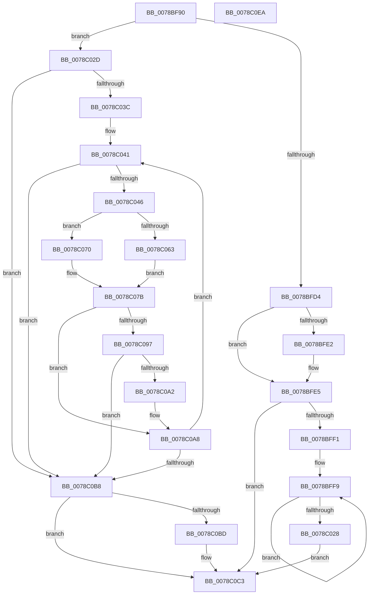

# RtlUpcaseUnicodeToCustomCPN

- RVA: `0x0078BF90`–`0x0078C0EB` (길이 `347` bytes)
- VA: `0x000000014078BF90`
- 실행 섹션: `PAGE`
- PDB 이름 있음: `예`; PDB Function 태그: `아니요`
- unwind 정보 RVA: `0x00075C18`
- 디코드: `106`개 명령, `347/347` bytes 표시
- 미해석 바이트: `0` (있으면 어셈블리에 `.byte`로 보존)

> 이 문서는 커널 이미지의 기계어와 PDB 기호를 분석해 생성했습니다. 4번과 5번은 함수 원형과 자료형을 바이너리 사용 방식에서 추정한 C 해석이며 원본 소스 복구 결과는 아닙니다.

## 1. Dependencies

- 직접 호출 지점: **3**; 고유 호출 대상: **2**
- 직접 호출자로 확인된 함수: **0**
- RIP 상대 이미지 참조: **0**

### Outgoing calls
- `0x0078BFB8` → [PsGetCurrentServerSiloGlobals](../../text/2F/PsGetCurrentServerSiloGlobals_function_002FE1F0.md) (function, `0x002FE1F0`)
- `0x0078C00B` → [NLS_UPCASE](../../text/3F/NLS_UPCASE_function_003FF700.md) (function, `0x003FF700`)
- `0x0078C07E` → [NLS_UPCASE](../../text/3F/NLS_UPCASE_function_003FF700.md) (function, `0x003FF700`)

### Direct callers
- 이 함수 시작 RVA로 연결되는 직접 call은 확인되지 않았습니다. 간접 호출은 완전히 역산할 수 없습니다.

### Static image references
- 디코드된 RIP-relative 메모리 참조가 없습니다.

## 2. Other-region calls and transfers

- 다른 실행 섹션으로 향하는 call: **3**
  - `0x0078BFB8` → [PsGetCurrentServerSiloGlobals](../../text/2F/PsGetCurrentServerSiloGlobals_function_002FE1F0.md) (`PAGE` → `.text`)
  - `0x0078C00B` → [NLS_UPCASE](../../text/3F/NLS_UPCASE_function_003FF700.md) (`PAGE` → `.text`)
  - `0x0078C07E` → [NLS_UPCASE](../../text/3F/NLS_UPCASE_function_003FF700.md) (`PAGE` → `.text`)
- 별도 외부 분기/꼬리 이동을 확인하지 못했습니다.

## 3. Assembly (complete function range)

```asm
0078BF90  48 89 5C 24 08                  mov qword ptr [rsp + 8], rbx
0078BF95  48 89 6C 24 10                  mov qword ptr [rsp + 0x10], rbp
0078BF9A  48 89 74 24 18                  mov qword ptr [rsp + 0x18], rsi
0078BF9F  57                              push rdi
0078BFA0  41 54                           push r12
0078BFA2  41 55                           push r13
0078BFA4  41 56                           push r14
0078BFA6  41 57                           push r15
0078BFA8  48 83 EC 20                     sub rsp, 0x20
0078BFAC  49 8B F1                        mov rsi, r9
0078BFAF  45 8B D8                        mov r11d, r8d
0078BFB2  4C 8B D2                        mov r10, rdx
0078BFB5  48 8B F9                        mov rdi, rcx
0078BFB8  E8 33 22 B7 FF                  call 0x1402fe1f0
0078BFBD  8B 5C 24 78                     mov ebx, dword ptr [rsp + 0x78]
0078BFC1  45 33 C0                        xor r8d, r8d
0078BFC4  D1 EB                           shr ebx, 1
0078BFC6  4C 8B A8 B0 04 00 00            mov r13, qword ptr [rax + 0x4b0]
0078BFCD  66 44 39 47 0C                  cmp word ptr [rdi + 0xc], r8w
0078BFD2  75 59                           jne 0x14078c02d
0078BFD4  41 3B DB                        cmp ebx, r11d
0078BFD7  41 8B C3                        mov eax, r11d
0078BFDA  0F 42 C3                        cmovb eax, ebx
0078BFDD  4D 85 C9                        test r9, r9
0078BFE0  74 03                           je 0x14078bfe5
0078BFE2  41 89 01                        mov dword ptr [r9], eax
0078BFE5  48 8B 6F 28                     mov rbp, qword ptr [rdi + 0x28]
0078BFE9  85 C0                           test eax, eax
0078BFEB  0F 84 D2 00 00 00               je 0x14078c0c3
0078BFF1  48 8B 74 24 70                  mov rsi, qword ptr [rsp + 0x70]
0078BFF6  44 8B F0                        mov r14d, eax
0078BFF9  0F B7 06                        movzx eax, word ptr [rsi]
0078BFFC  48 8B 57 20                     mov rdx, qword ptr [rdi + 0x20]
0078C000  0F B6 0C 28                     movzx ecx, byte ptr [rax + rbp]
0078C004  0F B7 14 4A                     movzx edx, word ptr [rdx + rcx*2]
0078C008  49 8B CD                        mov rcx, r13
0078C00B  E8 F0 36 C7 FF                  call 0x1403ff700
0078C010  44 0F B7 C8                     movzx r9d, ax
0078C014  48 8D 76 02                     lea rsi, [rsi + 2]
0078C018  41 8A 04 29                     mov al, byte ptr [r9 + rbp]
0078C01C  41 88 02                        mov byte ptr [r10], al
0078C01F  49 FF C2                        inc r10
0078C022  49 83 EE 01                     sub r14, 1
0078C026  75 D1                           jne 0x14078bff9
0078C028  E9 96 00 00 00                  jmp 0x14078c0c3
0078C02D  4C 8B 77 38                     mov r14, qword ptr [rdi + 0x38]
0078C031  4C 8B FA                        mov r15, rdx
0078C034  4C 8B 67 28                     mov r12, qword ptr [rdi + 0x28]
0078C038  85 DB                           test ebx, ebx
0078C03A  74 7C                           je 0x14078c0b8
0078C03C  48 8B 6C 24 70                  mov rbp, qword ptr [rsp + 0x70]
0078C041  45 85 DB                        test r11d, r11d
0078C044  74 72                           je 0x14078c0b8
0078C046  0F B7 45 00                     movzx eax, word ptr [rbp]
0078C04A  48 83 C5 02                     add rbp, 2
0078C04E  41 0F B7 14 44                  movzx edx, word ptr [r12 + rax*2]
0078C053  8B C2                           mov eax, edx
0078C055  48 C1 E8 08                     shr rax, 8
0078C059  41 0F B7 0C 46                  movzx ecx, word ptr [r14 + rax*2]
0078C05E  66 85 C9                        test cx, cx
0078C061  74 0D                           je 0x14078c070
0078C063  0F B6 C2                        movzx eax, dl
0078C066  48 03 C8                        add rcx, rax
0078C069  41 0F B7 14 4E                  movzx edx, word ptr [r14 + rcx*2]
0078C06E  EB 0B                           jmp 0x14078c07b
0078C070  48 8B 47 20                     mov rax, qword ptr [rdi + 0x20]
0078C074  0F B6 CA                        movzx ecx, dl
0078C077  0F B7 14 48                     movzx edx, word ptr [rax + rcx*2]
0078C07B  49 8B CD                        mov rcx, r13
0078C07E  E8 7D 36 C7 FF                  call 0x1403ff700
0078C083  44 0F B7 C8                     movzx r9d, ax
0078C087  43 0F B7 14 4C                  movzx edx, word ptr [r12 + r9*2]
0078C08C  0F B7 CA                        movzx ecx, dx
0078C08F  66 C1 E9 08                     shr cx, 8
0078C093  84 C9                           test cl, cl
0078C095  74 11                           je 0x14078c0a8
0078C097  41 8B C3                        mov eax, r11d
0078C09A  41 FF CB                        dec r11d
0078C09D  83 F8 02                        cmp eax, 2
0078C0A0  72 16                           jb 0x14078c0b8
0078C0A2  41 88 0A                        mov byte ptr [r10], cl
0078C0A5  49 FF C2                        inc r10
0078C0A8  83 C8 FF                        or eax, 0xffffffff
0078C0AB  41 88 12                        mov byte ptr [r10], dl
0078C0AE  44 03 D8                        add r11d, eax
0078C0B1  49 FF C2                        inc r10
0078C0B4  03 D8                           add ebx, eax
0078C0B6  75 89                           jne 0x14078c041
0078C0B8  48 85 F6                        test rsi, rsi
0078C0BB  74 06                           je 0x14078c0c3
0078C0BD  45 2B D7                        sub r10d, r15d
0078C0C0  44 89 16                        mov dword ptr [rsi], r10d
0078C0C3  48 8B 6C 24 58                  mov rbp, qword ptr [rsp + 0x58]
0078C0C8  44 3B DB                        cmp r11d, ebx
0078C0CB  48 8B 5C 24 50                  mov rbx, qword ptr [rsp + 0x50]
0078C0D0  48 8B 74 24 60                  mov rsi, qword ptr [rsp + 0x60]
0078C0D5  1B C0                           sbb eax, eax
0078C0D7  25 05 00 00 80                  and eax, 0x80000005
0078C0DC  48 83 C4 20                     add rsp, 0x20
0078C0E0  41 5F                           pop r15
0078C0E2  41 5E                           pop r14
0078C0E4  41 5D                           pop r13
0078C0E6  41 5C                           pop r12
0078C0E8  5F                              pop rdi
0078C0E9  C3                              ret
0078C0EA  CC                              int3
```

## 4. C-style interpretation (structured pseudocode)

```c
__int64 __fastcall RtlUpcaseUnicodeToCustomCPN(__int64 a1, __int64 a2, int a3, __int64 a4, __int64 a5, unsigned int a6)
{
    __int64 result;
    __int64 v_r10;
    __int64 v_r11;
    __int64 v_r14;
    __int64 v_rbp;
    __int64 v_rbx;
    __int64 v_rsp;
    unsigned __int64 v_stack_p10;
    unsigned __int64 v_stack_p18;
    unsigned __int64 v_stack_p8;

    v_stack_p8 = v_rbx;
    v_stack_p10 = v_rbp;
    v_stack_p18 = v_rsi;
    v_rsp = (v_rsp) - (32);
    result = PsGetCurrentServerSiloGlobals(a1, a2, a3, a4);
    a3 = 0;
    v_rbx = (unsigned int)(((unsigned int)(a6)) >> (1));
    if ((*(unsigned __int16 *)(a1 + 12)) != 0) goto loc_0078C02D;
    result = (unsigned int)((unsigned int)((unsigned int)(a3)));
    if (((unsigned int)(v_rbx)) < ((unsigned int)((unsigned int)(a3)))) { result = (unsigned int)(v_rbx); }
    if (a4 != 0) {
        *(unsigned int *)(a4) = (unsigned int)(result);
    }
    if ((unsigned int)(result) == 0) goto loc_0078C0C3;
loc_0078BFF9:
    result = NLS_UPCASE(*(unsigned __int64 *)(result + 1200), *(unsigned __int16 *)(*(unsigned __int64 *)(a1 + 32) + *(unsigned __int8 *)(*(unsigned __int16 *)(a5) + *(unsigned __int64 *)(a1 + 40) * 1) * 2), a3, a4);
    *(unsigned __int8 *)(a2) = (unsigned __int8)(*(unsigned __int8 *)((unsigned __int16)(result) + *(unsigned __int64 *)(a1 + 40) * 1));
    v_r10 = (a2) + 1;
    v_r14 = ((unsigned int)((unsigned int)(result))) - (1);
    if (condition_is_not_equal) goto loc_0078BFF9;
    goto loc_0078C0C3;
loc_0078C02D:
    if ((unsigned int)(v_rbx) == 0) goto loc_0078C0B8;
loc_0078C041:
    if ((unsigned int)((unsigned int)(a3)) == 0) goto loc_0078C0B8;
    v_rbp = (a5) + (2);
    result = ((unsigned int)((unsigned int)(*(unsigned __int16 *)(*(unsigned __int64 *)(a1 + 40) + *(unsigned __int16 *)(a5) * 2)))) >> (8);
    if ((unsigned __int16)(*(unsigned __int16 *)(*(unsigned __int64 *)(a1 + 56) + result * 2)) == 0) goto loc_0078C070;
    a1 = (*(unsigned __int16 *)(*(unsigned __int64 *)(a1 + 56) + result * 2)) + ((unsigned __int8)(*(unsigned __int16 *)(*(unsigned __int64 *)(a1 + 40) + *(unsigned __int16 *)(a5) * 2)));
    goto loc_0078C07B;
loc_0078C070:
loc_0078C07B:
    result = NLS_UPCASE(*(unsigned __int64 *)(result + 1200), *(unsigned __int16 *)(*(unsigned __int64 *)(a1 + 32) + (unsigned __int8)(*(unsigned __int16 *)(*(unsigned __int64 *)(a1 + 56) + a1 * 2)) * 2), a3, (unsigned __int16)(result));
    a1 = (unsigned __int16)(((unsigned __int16)(*(unsigned __int16 *)(*(unsigned __int64 *)(a1 + 40) + (unsigned __int16)(result) * 2))) >> (8));
    if ((unsigned __int8)(a1) == 0) goto loc_0078C0A8;
    v_r11 = (unsigned int)(((unsigned int)(a3)) - 1);
    if (((unsigned int)((unsigned int)((unsigned int)((unsigned int)(a3))))) < 2) goto loc_0078C0B8;
    *(unsigned __int8 *)(v_r10) = (unsigned __int8)(a1);
    v_r10 = (v_r10) + 1;
loc_0078C0A8:
    result = (unsigned int)(((unsigned int)((unsigned int)((unsigned int)(a3)))) | (0xFFFFFFFFULL));
    *(unsigned __int8 *)(v_r10) = (unsigned __int8)(*(unsigned __int16 *)(*(unsigned __int64 *)(a1 + 40) + (unsigned __int16)(result) * 2));
    v_r11 = (unsigned int)((v_r11) + ((unsigned int)(result)));
    v_r10 = (v_r10) + 1;
    v_rbx = (unsigned int)((v_rbx) + ((unsigned int)(result)));
    if (condition_is_not_equal) goto loc_0078C041;
loc_0078C0B8:
    if (a5 + 2 != 0) {
        v_r10 = (unsigned int)((v_r10) - ((unsigned int)(*(unsigned __int16 *)(*(unsigned __int64 *)(a1 + 32) + *(unsigned __int8 *)(*(unsigned __int16 *)(a5) + *(unsigned __int64 *)(a1 + 40) * 1) * 2))));
        *(unsigned int *)(a5 + 2) = (unsigned int)(v_r10);
    }
    result = (unsigned int)((result) & (0x80000005ULL));
    v_rsp = (v_rsp) + (32);
    return result;
}
```

## 5. (Beta) C Style

```c
int64_t RtlUpcaseUnicodeToCustomCPN(void *Arg1, int64_t Arg2, int32_t Arg3, int64_t Arg4, void *Arg5, uint32_t Arg6)
{
    uint8_t *arg1 = (uint8_t *)Arg1;
    uint8_t *arg5 = (uint8_t *)Arg5;

    int64_t result;
    int64_t local_r10;
    int64_t local_r11;
    int64_t local_r14;
    int64_t local_rbp;
    int64_t local_rbx;
    int64_t local_rsp;
    uint64_t v_stack_p10;
    uint64_t v_stack_p18;
    uint64_t v_stack_p8;

    v_stack_p8 = local_rbx;
    v_stack_p10 = local_rbp;
    v_stack_p18 = local_rsi;
    local_rsp = (local_rsp) - (32);
    result = PsGetCurrentServerSiloGlobals(Arg1, Arg2, Arg3, Arg4);
    Arg3 = 0;
    local_rbx = (uint32_t)(((uint32_t)(Arg6)) >> (1));
    if ((*(uint16_t *)(arg1 + 0xC)) != 0) goto loc_0078C02D;
    result = (uint32_t)((uint32_t)((uint32_t)(Arg3)));
    if (((uint32_t)(local_rbx)) < ((uint32_t)((uint32_t)(Arg3)))) { result = (uint32_t)(local_rbx); }
    if (Arg4 != 0) {
        *(uint32_t *)(Arg4) = (uint32_t)(result);
    }
    if ((uint32_t)(result) == 0) goto loc_0078C0C3;
loc_0078BFF9:
    result = NLS_UPCASE(*(uint64_t *)(result + 0x4B0), *(uint16_t *)(*(uint64_t *)(arg1 + 0x20) + *(uint8_t *)(*(uint16_t *)(arg5) + *(uint64_t *)(arg1 + 0x28) * 1) * 2), Arg3, Arg4);
    *(uint8_t *)(Arg2) = (uint8_t)(*(uint8_t *)((uint16_t)(result) + *(uint64_t *)(arg1 + 0x28) * 1));
    local_r10 = (Arg2) + 1;
    local_r14 = ((uint32_t)((uint32_t)(result))) - (1);
    if (condition_is_not_equal) goto loc_0078BFF9;
    goto loc_0078C0C3;
loc_0078C02D:
    if ((uint32_t)(local_rbx) == 0) goto loc_0078C0B8;
loc_0078C041:
    if ((uint32_t)((uint32_t)(Arg3)) == 0) goto loc_0078C0B8;
    local_rbp = (Arg5) + (2);
    result = ((uint32_t)((uint32_t)(*(uint16_t *)(*(uint64_t *)(arg1 + 0x28) + *(uint16_t *)(arg5) * 2)))) >> (8);
    if ((uint16_t)(*(uint16_t *)(*(uint64_t *)(arg1 + 0x38) + result * 2)) == 0) goto loc_0078C070;
    Arg1 = (*(uint16_t *)(*(uint64_t *)(arg1 + 0x38) + result * 2)) + ((uint8_t)(*(uint16_t *)(*(uint64_t *)(arg1 + 0x28) + *(uint16_t *)(arg5) * 2)));
    goto loc_0078C07B;
loc_0078C070:
loc_0078C07B:
    result = NLS_UPCASE(*(uint64_t *)(result + 0x4B0), *(uint16_t *)(*(uint64_t *)(arg1 + 0x20) + (uint8_t)(*(uint16_t *)(*(uint64_t *)(arg1 + 0x38) + arg1 * 2)) * 2), Arg3, (uint16_t)(result));
    Arg1 = (uint16_t)(((uint16_t)(*(uint16_t *)(*(uint64_t *)(arg1 + 0x28) + (uint16_t)(result) * 2))) >> (8));
    if ((uint8_t)(Arg1) == 0) goto loc_0078C0A8;
    local_r11 = (uint32_t)(((uint32_t)(Arg3)) - 1);
    if (((uint32_t)((uint32_t)((uint32_t)((uint32_t)(Arg3))))) < 2) goto loc_0078C0B8;
    *(uint8_t *)(local_r10) = (uint8_t)(Arg1);
    local_r10 = (local_r10) + 1;
loc_0078C0A8:
    result = (uint32_t)(((uint32_t)((uint32_t)((uint32_t)(Arg3)))) | (0xFFFFFFFFULL));
    *(uint8_t *)(local_r10) = (uint8_t)(*(uint16_t *)(*(uint64_t *)(arg1 + 0x28) + (uint16_t)(result) * 2));
    local_r11 = (uint32_t)((local_r11) + ((uint32_t)(result)));
    local_r10 = (local_r10) + 1;
    local_rbx = (uint32_t)((local_rbx) + ((uint32_t)(result)));
    if (condition_is_not_equal) goto loc_0078C041;
loc_0078C0B8:
    if (Arg5 + 2 != 0) {
        local_r10 = (uint32_t)((local_r10) - ((uint32_t)(*(uint16_t *)(*(uint64_t *)(arg1 + 0x20) + *(uint8_t *)(*(uint16_t *)(arg5) + *(uint64_t *)(arg1 + 0x28) * 1) * 2))));
        *(uint32_t *)(arg5 + 0x2) = (uint32_t)(local_r10);
    }
    result = (uint32_t)((result) & (0x80000005ULL));
    local_rsp = (local_rsp) + (32);
    return result;
}
```

### 관측된 메모리 오프셋

구조체 형식이 확인되지 않은 접근은 인자 기준의 오프셋으로만 기록했습니다.

| 기준 인자 | 오프셋 표현 | 폭 (bit) | 접근 |
|---|---:|---:|---|
| `Arg1` | `+ 0xC` | `16` | `R` |
| `Arg1` | `+ 0x20` | `64` | `R` |
| `Arg1` | `+ 0x28` | `64` | `R` |
| `Arg1` | `+ 0x38` | `64` | `R` |
| `Arg5` | `+ 0x0` | `16` | `R` |
| `Arg5` | `+ 0x2` | `64` | `R` |

## 6. Execution-region graph

[열기: 2D/3D 그래프와 함수 탐색 컨트롤 패널](../../../control-panel.html?section=page&rva=0x0078BF90&view=graph)

- 2D 그래프는 위에서 아래로 흐르고, 3D 그래프는 빈 공간을 드래그해 회전합니다. Shift+드래그는 이동, 휠은 확대·축소, 함수 노드 선택은 대상 보고서 이동입니다.

### Static fallback


