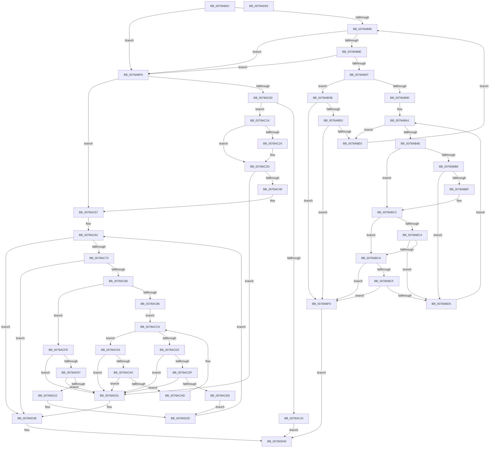

# RtlpAddIntersectingRanges

- RVA: `0x0078AB4C`–`0x0078AD64` (길이 `536` bytes)
- VA: `0x000000014078AB4C`
- 실행 섹션: `PAGE`
- PDB 이름 있음: `예`; PDB Function 태그: `아니요`
- unwind 정보 RVA: `0x00075C18`
- 디코드: `160`개 명령, `536/536` bytes 표시
- 미해석 바이트: `0` (있으면 어셈블리에 `.byte`로 보존)

> 이 문서는 커널 이미지의 기계어와 PDB 기호를 분석해 생성했습니다. 4번과 5번은 함수 원형과 자료형을 바이너리 사용 방식에서 추정한 C 해석이며 원본 소스 복구 결과는 아닙니다.

## 1. Dependencies

- 직접 호출 지점: **5**; 고유 호출 대상: **3**
- 직접 호출자로 확인된 함수: **1**
- RIP 상대 이미지 참조: **0**

### Outgoing calls
- `0x0078AC03` → [RtlpCopyRangeListEntry](../A6/RtlpCopyRangeListEntry_function_00A69720.md) (function, `0x00A69720`)
- `0x0078ACBA` → [RtlpAddToMergedRange](RtlpAddToMergedRange_function_0078AD6C.md) (function, `0x0078AD6C`)
- `0x0078ACF2` → [RtlpFreeRangeListEntry](../A6/RtlpFreeRangeListEntry_function_00A69918.md) (function, `0x00A69918`)
- `0x0078AD20` → [RtlpAddToMergedRange](RtlpAddToMergedRange_function_0078AD6C.md) (function, `0x0078AD6C`)
- `0x0078AD41` → [RtlpAddToMergedRange](RtlpAddToMergedRange_function_0078AD6C.md) (function, `0x0078AD6C`)

### Direct callers
- [RtlpAddRange](../70/RtlpAddRange_function_00705A70.md) at `0x00705AC9`

### Static image references
- 디코드된 RIP-relative 메모리 참조가 없습니다.

## 2. Other-region calls and transfers

- 다른 실행 섹션으로 향하는 call: **0**
- 별도 외부 분기/꼬리 이동을 확인하지 못했습니다.

## 3. Assembly (complete function range)

```asm
0078AB4C  48 89 5C 24 08                  mov qword ptr [rsp + 8], rbx
0078AB51  48 89 6C 24 10                  mov qword ptr [rsp + 0x10], rbp
0078AB56  48 89 74 24 18                  mov qword ptr [rsp + 0x18], rsi
0078AB5B  57                              push rdi
0078AB5C  41 54                           push r12
0078AB5E  41 55                           push r13
0078AB60  41 56                           push r14
0078AB62  41 57                           push r15
0078AB64  48 83 EC 20                     sub rsp, 0x20
0078AB68  45 8A 50 21                     mov r10b, byte ptr [r8 + 0x21]
0078AB6C  BD 01 00 00 00                  mov ebp, 1
0078AB71  44 22 D5                        and r10b, bpl
0078AB74  45 8B E1                        mov r12d, r9d
0078AB77  4D 8B F0                        mov r14, r8
0078AB7A  48 8B DA                        mov rbx, rdx
0078AB7D  4C 8B E9                        mov r13, rcx
0078AB80  44 84 CD                        test bpl, r9b
0078AB83  75 75                           jne 0x14078abfa
0078AB85  48 8D 42 28                     lea rax, [rdx + 0x28]
0078AB89  4C 3B E8                        cmp r13, rax
0078AB8C  74 6C                           je 0x14078abfa
0078AB8E  48 8B 02                        mov rax, qword ptr [rdx]
0078AB91  49 39 46 08                     cmp qword ptr [r14 + 8], rax
0078AB95  72 63                           jb 0x14078abfa
0078AB97  40 84 6A 22                     test byte ptr [rdx + 0x22], bpl
0078AB9B  74 3E                           je 0x14078abdb
0078AB9D  48 8B 4A 10                     mov rcx, qword ptr [rdx + 0x10]
0078ABA1  48 83 E9 28                     sub rcx, 0x28
0078ABA5  48 8D 41 18                     lea rax, [rcx + 0x18]
0078ABA9  48 3B D0                        cmp rdx, rax
0078ABAC  74 38                           je 0x14078abe6
0078ABAE  4C 8B 01                        mov r8, qword ptr [rcx]
0078ABB1  49 8B 06                        mov rax, qword ptr [r14]
0078ABB4  49 3B C0                        cmp rax, r8
0078ABB7  76 09                           jbe 0x14078abc2
0078ABB9  48 39 41 08                     cmp qword ptr [rcx + 8], rax
0078ABBD  72 16                           jb 0x14078abd5
0078ABBF  49 3B C0                        cmp rax, r8
0078ABC2  73 06                           jae 0x14078abca
0078ABC4  4D 39 46 08                     cmp qword ptr [r14 + 8], r8
0078ABC8  72 0B                           jb 0x14078abd5
0078ABCA  45 84 D2                        test r10b, r10b
0078ABCD  74 21                           je 0x14078abf0
0078ABCF  40 84 69 21                     test byte ptr [rcx + 0x21], bpl
0078ABD3  74 1B                           je 0x14078abf0
0078ABD5  48 8B 49 28                     mov rcx, qword ptr [rcx + 0x28]
0078ABD9  EB C6                           jmp 0x14078aba1
0078ABDB  45 84 D2                        test r10b, r10b
0078ABDE  74 10                           je 0x14078abf0
0078ABE0  40 84 6A 21                     test byte ptr [rdx + 0x21], bpl
0078ABE4  74 0A                           je 0x14078abf0
0078ABE6  48 8B 52 28                     mov rdx, qword ptr [rdx + 0x28]
0078ABEA  48 83 EA 28                     sub rdx, 0x28
0078ABEE  EB 95                           jmp 0x14078ab85
0078ABF0  B8 82 02 00 C0                  mov eax, 0xc0000282
0078ABF5  E9 4C 01 00 00                  jmp 0x14078ad46
0078ABFA  40 84 6B 22                     test byte ptr [rbx + 0x22], bpl
0078ABFE  75 57                           jne 0x14078ac57
0078AC00  48 8B CB                        mov rcx, rbx
0078AC03  E8 18 EB 2D 00                  call 0x140a69720
0078AC08  48 8B D0                        mov rdx, rax
0078AC0B  48 85 C0                        test rax, rax
0078AC0E  75 0A                           jne 0x14078ac1a
0078AC10  B8 9A 00 00 C0                  mov eax, 0xc000009a
0078AC15  E9 2C 01 00 00                  jmp 0x14078ad46
0078AC1A  F6 43 21 10                     test byte ptr [rbx + 0x21], 0x10
0078AC1E  48 8D 4B 10                     lea rcx, [rbx + 0x10]
0078AC22  74 09                           je 0x14078ac2d
0078AC24  48 8B 01                        mov rax, qword ptr [rcx]
0078AC27  FF 08                           dec dword ptr [rax]
0078AC29  80 63 21 EF                     and byte ptr [rbx + 0x21], 0xef
0078AC2D  48 89 49 08                     mov qword ptr [rcx + 8], rcx
0078AC31  48 8D 42 28                     lea rax, [rdx + 0x28]
0078AC35  48 89 09                        mov qword ptr [rcx], rcx
0078AC38  66 89 6B 22                     mov word ptr [rbx + 0x22], bp
0078AC3C  48 8B 11                        mov rdx, qword ptr [rcx]
0078AC3F  48 39 4A 08                     cmp qword ptr [rdx + 8], rcx
0078AC43  0F 85 E8 00 00 00               jne 0x14078ad31
0078AC49  48 89 10                        mov qword ptr [rax], rdx
0078AC4C  48 89 48 08                     mov qword ptr [rax + 8], rcx
0078AC50  48 89 42 08                     mov qword ptr [rdx + 8], rax
0078AC54  48 89 01                        mov qword ptr [rcx], rax
0078AC57  48 8B 43 28                     mov rax, qword ptr [rbx + 0x28]
0078AC5B  48 8B 30                        mov rsi, qword ptr [rax]
0078AC5E  48 8D 78 D8                     lea rdi, [rax - 0x28]
0078AC62  48 83 EE 28                     sub rsi, 0x28
0078AC66  48 8D 4F 28                     lea rcx, [rdi + 0x28]
0078AC6A  4C 3B E9                        cmp r13, rcx
0078AC6D  0F 84 C5 00 00 00               je 0x14078ad38
0078AC73  48 8B 07                        mov rax, qword ptr [rdi]
0078AC76  49 39 46 08                     cmp qword ptr [r14 + 8], rax
0078AC7A  0F 82 B8 00 00 00               jb 0x14078ad38
0078AC80  40 84 6F 22                     test byte ptr [rdi + 0x22], bpl
0078AC84  74 78                           je 0x14078acfe
0078AC86  4C 8D 7F 10                     lea r15, [rdi + 0x10]
0078AC8A  49 8B 07                        mov rax, qword ptr [r15]
0078AC8D  48 8D 50 D8                     lea rdx, [rax - 0x28]
0078AC91  EB 33                           jmp 0x14078acc6
0078AC93  4C 8B 00                        mov r8, qword ptr [rax]
0078AC96  49 39 40 08                     cmp qword ptr [r8 + 8], rax
0078AC9A  0F 85 91 00 00 00               jne 0x14078ad31
0078ACA0  48 8B 48 08                     mov rcx, qword ptr [rax + 8]
0078ACA4  48 39 01                        cmp qword ptr [rcx], rax
0078ACA7  0F 85 84 00 00 00               jne 0x14078ad31
0078ACAD  4C 89 01                        mov qword ptr [rcx], r8
0078ACB0  49 89 48 08                     mov qword ptr [r8 + 8], rcx
0078ACB4  45 8B C4                        mov r8d, r12d
0078ACB7  48 8B CB                        mov rcx, rbx
0078ACBA  E8 AD 00 00 00                  call 0x14078ad6c
0078ACBF  48 8D 45 28                     lea rax, [rbp + 0x28]
0078ACC3  48 8B D5                        mov rdx, rbp
0078ACC6  48 8B 28                        mov rbp, qword ptr [rax]
0078ACC9  48 83 ED 28                     sub rbp, 0x28
0078ACCD  4C 3B F8                        cmp r15, rax
0078ACD0  75 C1                           jne 0x14078ac93
0078ACD2  48 8D 47 28                     lea rax, [rdi + 0x28]
0078ACD6  48 8B 10                        mov rdx, qword ptr [rax]
0078ACD9  48 39 42 08                     cmp qword ptr [rdx + 8], rax
0078ACDD  75 52                           jne 0x14078ad31
0078ACDF  48 8B 48 08                     mov rcx, qword ptr [rax + 8]
0078ACE3  48 39 01                        cmp qword ptr [rcx], rax
0078ACE6  75 49                           jne 0x14078ad31
0078ACE8  48 89 11                        mov qword ptr [rcx], rdx
0078ACEB  48 89 4A 08                     mov qword ptr [rdx + 8], rcx
0078ACEF  48 8B CF                        mov rcx, rdi
0078ACF2  E8 21 EC 2D 00                  call 0x140a69918
0078ACF7  BD 01 00 00 00                  mov ebp, 1
0078ACFC  EB 27                           jmp 0x14078ad25
0078ACFE  48 8B 11                        mov rdx, qword ptr [rcx]
0078AD01  48 39 4A 08                     cmp qword ptr [rdx + 8], rcx
0078AD05  75 2A                           jne 0x14078ad31
0078AD07  48 8B 41 08                     mov rax, qword ptr [rcx + 8]
0078AD0B  48 39 08                        cmp qword ptr [rax], rcx
0078AD0E  75 21                           jne 0x14078ad31
0078AD10  48 89 10                        mov qword ptr [rax], rdx
0078AD13  45 8B C4                        mov r8d, r12d
0078AD16  48 89 42 08                     mov qword ptr [rdx + 8], rax
0078AD1A  48 8B CB                        mov rcx, rbx
0078AD1D  48 8B D7                        mov rdx, rdi
0078AD20  E8 47 00 00 00                  call 0x14078ad6c
0078AD25  48 8B FE                        mov rdi, rsi
0078AD28  48 8B 76 28                     mov rsi, qword ptr [rsi + 0x28]
0078AD2C  E9 31 FF FF FF                  jmp 0x14078ac62
0078AD31  B9 03 00 00 00                  mov ecx, 3
0078AD36  CD 29                           int 0x29
0078AD38  45 8B C4                        mov r8d, r12d
0078AD3B  49 8B D6                        mov rdx, r14
0078AD3E  48 8B CB                        mov rcx, rbx
0078AD41  E8 26 00 00 00                  call 0x14078ad6c
0078AD46  48 8B 5C 24 50                  mov rbx, qword ptr [rsp + 0x50]
0078AD4B  48 8B 6C 24 58                  mov rbp, qword ptr [rsp + 0x58]
0078AD50  48 8B 74 24 60                  mov rsi, qword ptr [rsp + 0x60]
0078AD55  48 83 C4 20                     add rsp, 0x20
0078AD59  41 5F                           pop r15
0078AD5B  41 5E                           pop r14
0078AD5D  41 5D                           pop r13
0078AD5F  41 5C                           pop r12
0078AD61  5F                              pop rdi
0078AD62  C3                              ret
0078AD63  CC                              int3
```

## 4. C-style interpretation (structured pseudocode)

```c
__int64 __fastcall RtlpAddIntersectingRanges(__int64 a1, __int64 a2, __int64 a3, int a4)
{
    __int64 result;
    __int64 v_r10;
    __int64 v_rbp;
    __int64 v_rsi;
    __int64 v_rsp;
    unsigned __int64 v_stack_p10;
    unsigned __int64 v_stack_p18;
    unsigned __int64 v_stack_p8;

    v_stack_p8 = v_rbx;
    v_stack_p10 = v_rbp;
    v_stack_p18 = v_rsi;
    v_rsp = (v_rsp) - (32);
    v_r10 = (unsigned __int8)((*(unsigned __int8 *)(a3 + 33)) & (1));
    if (((1) & ((unsigned __int8)(a4))) != 0) goto loc_0078ABFA;
loc_0078AB85:
    if (a1 == (a2 + 40)) goto loc_0078ABFA;
    if ((*(unsigned __int64 *)(a3 + 8)) < (*(unsigned __int64 *)(a2))) goto loc_0078ABFA;
    if (((*(unsigned __int8 *)(a2 + 34)) & (1)) == 0) goto loc_0078ABDB;
loc_0078ABA1:
    a1 = (*(unsigned __int64 *)(a2 + 16)) - (40);
    if (a2 == (a1 + 24)) goto loc_0078ABE6;
    if ((*(unsigned __int64 *)(a3)) <= (*(unsigned __int64 *)(a1))) goto loc_0078ABC2;
    if ((*(unsigned __int64 *)(a1 + 8)) < (*(unsigned __int64 *)(a3))) goto loc_0078ABD5;
loc_0078ABC2:
    if ((*(unsigned __int64 *)(a3)) >= (*(unsigned __int64 *)(a1))) goto loc_0078ABCA;
    if ((*(unsigned __int64 *)(a3 + 8)) < (*(unsigned __int64 *)(a1))) goto loc_0078ABD5;
loc_0078ABCA:
    if ((unsigned __int8)(v_r10) == 0) goto loc_0078ABF0;
    if (((*(unsigned __int8 *)(a1 + 33)) & (1)) == 0) goto loc_0078ABF0;
loc_0078ABD5:
    goto loc_0078ABA1;
loc_0078ABDB:
    if ((unsigned __int8)(v_r10) == 0) goto loc_0078ABF0;
    if (((*(unsigned __int8 *)(a2 + 33)) & (1)) == 0) goto loc_0078ABF0;
loc_0078ABE6:
    a2 = (*(unsigned __int64 *)(a2 + 40)) - (40);
    goto loc_0078AB85;
loc_0078ABF0:
    goto loc_0078AD46;
loc_0078ABFA:
    if (((*(unsigned __int8 *)(a2 + 34)) & (1)) != 0) goto loc_0078AC57;
    result = RtlpCopyRangeListEntry(a2, a2, *(unsigned __int64 *)(a1), a4);
    if (result != 0) goto loc_0078AC1A;
    goto loc_0078AD46;
loc_0078AC1A:
    result = (unsigned int)(0xC000009AULL);
    if (((*(unsigned __int8 *)(a2 + 33)) & (16)) != 0) {
        result = *(unsigned __int64 *)(a2 + 16);
    }
    *(unsigned __int64 *)(a2 + 16 + 8) = a2 + 16;
    *(unsigned __int64 *)(a2 + 16) = a2 + 16;
    *(unsigned __int16 *)(a2 + 34) = 1;
    if ((*(unsigned __int64 *)(*(unsigned __int64 *)(a2 + 16) + 8)) != (a2 + 16)) goto loc_0078AD31;
    *(unsigned __int64 *)(result + 40) = *(unsigned __int64 *)(a2 + 16);
    *(unsigned __int64 *)(result + 40 + 8) = a2 + 16;
    *(unsigned __int64 *)(*(unsigned __int64 *)(a2 + 16) + 8) = result + 40;
    *(unsigned __int64 *)(a2 + 16) = result + 40;
loc_0078AC57:
loc_0078AC62:
    v_rsi = (*(unsigned __int64 *)(*(unsigned __int64 *)(a2 + 40))) - (40);
    if (a1 == (*(unsigned __int64 *)(a2 + 40) - 40 + 40)) goto loc_0078AD38;
    if ((*(unsigned __int64 *)(a3 + 8)) < (*(unsigned __int64 *)(*(unsigned __int64 *)(a2 + 40) - 40))) goto loc_0078AD38;
    if (((*(unsigned __int8 *)(*(unsigned __int64 *)(a2 + 40) - 40 + 34)) & (1)) == 0) goto loc_0078ACFE;
    goto loc_0078ACC6;
loc_0078AC93:
    if ((*(unsigned __int64 *)(*(unsigned __int64 *)(*(unsigned __int64 *)(*(unsigned __int64 *)(a2 + 40) - 40 + 16)) + 8)) != (*(unsigned __int64 *)(*(unsigned __int64 *)(a2 + 40) - 40 + 16))) goto loc_0078AD31;
    if ((*(unsigned __int64 *)(*(unsigned __int64 *)(*(unsigned __int64 *)(*(unsigned __int64 *)(a2 + 40) - 40 + 16) + 8))) != (*(unsigned __int64 *)(*(unsigned __int64 *)(a2 + 40) - 40 + 16))) goto loc_0078AD31;
    *(unsigned __int64 *)(*(unsigned __int64 *)(*(unsigned __int64 *)(*(unsigned __int64 *)(a2 + 40) - 40 + 16) + 8)) = *(unsigned __int64 *)(*(unsigned __int64 *)(*(unsigned __int64 *)(a2 + 40) - 40 + 16));
    *(unsigned __int64 *)(*(unsigned __int64 *)(*(unsigned __int64 *)(*(unsigned __int64 *)(a2 + 40) - 40 + 16)) + 8) = *(unsigned __int64 *)(*(unsigned __int64 *)(*(unsigned __int64 *)(a2 + 40) - 40 + 16) + 8);
    result = RtlpAddToMergedRange(a2, *(unsigned __int64 *)(*(unsigned __int64 *)(a2 + 40) - 40 + 16) - 40, (unsigned int)((unsigned int)((unsigned int)(a4))), a4);
loc_0078ACC6:
    v_rbp = (*(unsigned __int64 *)(1 + 40)) - (40);
    if ((*(unsigned __int64 *)(a2 + 40) - 40 + 16) != (1 + 40)) goto loc_0078AC93;
    if ((*(unsigned __int64 *)(*(unsigned __int64 *)(*(unsigned __int64 *)(a2 + 40) - 40 + 40) + 8)) != (*(unsigned __int64 *)(a2 + 40) - 40 + 40)) goto loc_0078AD31;
    if ((*(unsigned __int64 *)(*(unsigned __int64 *)(*(unsigned __int64 *)(a2 + 40) - 40 + 40 + 8))) != (*(unsigned __int64 *)(a2 + 40) - 40 + 40)) goto loc_0078AD31;
    *(unsigned __int64 *)(*(unsigned __int64 *)(*(unsigned __int64 *)(a2 + 40) - 40 + 40 + 8)) = *(unsigned __int64 *)(*(unsigned __int64 *)(a2 + 40) - 40 + 40);
    *(unsigned __int64 *)(*(unsigned __int64 *)(*(unsigned __int64 *)(a2 + 40) - 40 + 40) + 8) = *(unsigned __int64 *)(*(unsigned __int64 *)(a2 + 40) - 40 + 40 + 8);
    result = RtlpFreeRangeListEntry(*(unsigned __int64 *)(a2 + 40) - 40, *(unsigned __int64 *)(*(unsigned __int64 *)(a2 + 40) - 40 + 40), (unsigned int)((unsigned int)((unsigned int)(a4))), a4);
    goto loc_0078AD25;
loc_0078ACFE:
    if ((*(unsigned __int64 *)(*(unsigned __int64 *)(*(unsigned __int64 *)(a2 + 40) - 40) + 8)) != (*(unsigned __int64 *)(a2 + 40) - 40)) goto loc_0078AD31;
    if ((*(unsigned __int64 *)(*(unsigned __int64 *)(*(unsigned __int64 *)(a2 + 40) - 40 + 8))) != (*(unsigned __int64 *)(a2 + 40) - 40)) goto loc_0078AD31;
    *(unsigned __int64 *)(*(unsigned __int64 *)(*(unsigned __int64 *)(a2 + 40) - 40 + 8)) = *(unsigned __int64 *)(*(unsigned __int64 *)(a2 + 40) - 40);
    *(unsigned __int64 *)(*(unsigned __int64 *)(*(unsigned __int64 *)(a2 + 40) - 40) + 8) = *(unsigned __int64 *)(*(unsigned __int64 *)(a2 + 40) - 40 + 8);
    result = RtlpAddToMergedRange(a2, *(unsigned __int64 *)(a2 + 40) - 40, (unsigned int)((unsigned int)((unsigned int)(a4))), a4);
loc_0078AD25:
    goto loc_0078AC62;
loc_0078AD31:
loc_0078AD38:
    result = RtlpAddToMergedRange(a2, a3, (unsigned int)((unsigned int)((unsigned int)(a4))), a4);
loc_0078AD46:
    v_rsp = (v_rsp) + (32);
    return result;
}
```

## 5. (Beta) C Style

```c
int64_t RtlpAddIntersectingRanges(int64_t Arg1, void *Arg2, void *Arg3, int32_t Arg4)
{
    uint8_t *arg2 = (uint8_t *)Arg2;
    uint8_t *arg3 = (uint8_t *)Arg3;

    int64_t result;
    int64_t local_r10;
    int64_t local_rbp;
    int64_t local_rsi;
    int64_t local_rsp;
    uint64_t v_stack_p10;
    uint64_t v_stack_p18;
    uint64_t v_stack_p8;

    v_stack_p8 = local_rbx;
    v_stack_p10 = local_rbp;
    v_stack_p18 = local_rsi;
    local_rsp = (local_rsp) - (32);
    local_r10 = (uint8_t)((*(uint8_t *)(arg3 + 0x21)) & (1));
    if (((1) & ((uint8_t)(Arg4))) != 0) goto loc_0078ABFA;
loc_0078AB85:
    if (Arg1 == (Arg2 + 40)) goto loc_0078ABFA;
    if ((*(uint64_t *)(arg3 + 0x8)) < (*(uint64_t *)(arg2))) goto loc_0078ABFA;
    if (((*(uint8_t *)(arg2 + 0x22)) & (1)) == 0) goto loc_0078ABDB;
loc_0078ABA1:
    Arg1 = (*(uint64_t *)(arg2 + 0x10)) - (40);
    if (Arg2 == (Arg1 + 24)) goto loc_0078ABE6;
    if ((*(uint64_t *)(arg3)) <= (*(uint64_t *)(Arg1))) goto loc_0078ABC2;
    if ((*(uint64_t *)(Arg1 + 0x8)) < (*(uint64_t *)(arg3))) goto loc_0078ABD5;
loc_0078ABC2:
    if ((*(uint64_t *)(arg3)) >= (*(uint64_t *)(Arg1))) goto loc_0078ABCA;
    if ((*(uint64_t *)(arg3 + 0x8)) < (*(uint64_t *)(Arg1))) goto loc_0078ABD5;
loc_0078ABCA:
    if ((uint8_t)(local_r10) == 0) goto loc_0078ABF0;
    if (((*(uint8_t *)(Arg1 + 0x21)) & (1)) == 0) goto loc_0078ABF0;
loc_0078ABD5:
    goto loc_0078ABA1;
loc_0078ABDB:
    if ((uint8_t)(local_r10) == 0) goto loc_0078ABF0;
    if (((*(uint8_t *)(arg2 + 0x21)) & (1)) == 0) goto loc_0078ABF0;
loc_0078ABE6:
    Arg2 = (*(uint64_t *)(arg2 + 0x28)) - (40);
    goto loc_0078AB85;
loc_0078ABF0:
    goto loc_0078AD46;
loc_0078ABFA:
    if (((*(uint8_t *)(arg2 + 0x22)) & (1)) != 0) goto loc_0078AC57;
    result = RtlpCopyRangeListEntry(Arg2, Arg2, *(uint64_t *)(Arg1), Arg4);
    if (result != 0) goto loc_0078AC1A;
    goto loc_0078AD46;
loc_0078AC1A:
    result = (uint32_t)(0xC000009AULL);
    if (((*(uint8_t *)(arg2 + 0x21)) & (16)) != 0) {
        result = *(uint64_t *)(arg2 + 0x10);
    }
    *(void **)(arg2 + 0x10 + 0x8) = Arg2 + 16;
    *(void **)(arg2 + 0x10) = Arg2 + 16;
    *(uint16_t *)(arg2 + 0x22) = 1;
    if ((*(uint64_t *)(*(uint64_t *)(arg2 + 0x10) + 0x8)) != (Arg2 + 16)) goto loc_0078AD31;
    *(uint64_t *)(result + 0x28) = *(uint64_t *)(arg2 + 0x10);
    *(void **)(result + 0x28 + 0x8) = Arg2 + 16;
    *(uint64_t *)(*(uint64_t *)(arg2 + 0x10) + 0x8) = result + 40;
    *(uint64_t *)(arg2 + 0x10) = result + 40;
loc_0078AC57:
loc_0078AC62:
    local_rsi = (*(uint64_t *)(*(uint64_t *)(arg2 + 0x28))) - (40);
    if (Arg1 == (*(uint64_t *)(arg2 + 0x28) - 40 + 40)) goto loc_0078AD38;
    if ((*(uint64_t *)(arg3 + 0x8)) < (*(uint64_t *)(*(uint64_t *)(arg2 + 0x28) - 0x28))) goto loc_0078AD38;
    if (((*(uint8_t *)(*(uint64_t *)(arg2 + 0x28) - 0x28 + 0x22)) & (1)) == 0) goto loc_0078ACFE;
    goto loc_0078ACC6;
loc_0078AC93:
    if ((*(uint64_t *)(*(uint64_t *)(*(uint64_t *)(*(uint64_t *)(arg2 + 0x28) - 0x28 + 0x10)) + 0x8)) != (*(uint64_t *)(*(uint64_t *)(arg2 + 0x28) - 0x28 + 0x10))) goto loc_0078AD31;
    if ((*(uint64_t *)(*(uint64_t *)(*(uint64_t *)(*(uint64_t *)(arg2 + 0x28) - 0x28 + 0x10) + 0x8))) != (*(uint64_t *)(*(uint64_t *)(arg2 + 0x28) - 0x28 + 0x10))) goto loc_0078AD31;
    *(uint64_t *)(*(uint64_t *)(*(uint64_t *)(*(uint64_t *)(arg2 + 0x28) - 0x28 + 0x10) + 0x8)) = *(uint64_t *)(*(uint64_t *)(*(uint64_t *)(arg2 + 0x28) - 0x28 + 0x10));
    *(uint64_t *)(*(uint64_t *)(*(uint64_t *)(*(uint64_t *)(arg2 + 0x28) - 0x28 + 0x10)) + 0x8) = *(uint64_t *)(*(uint64_t *)(*(uint64_t *)(arg2 + 0x28) - 0x28 + 0x10) + 0x8);
    result = RtlpAddToMergedRange(Arg2, *(uint64_t *)(*(uint64_t *)(arg2 + 0x28) - 0x28 + 0x10) - 40, (uint32_t)((uint32_t)((uint32_t)(Arg4))), Arg4);
loc_0078ACC6:
    local_rbp = (*(uint64_t *)(1 + 0x28)) - (40);
    if ((*(uint64_t *)(arg2 + 0x28) - 40 + 16) != (1 + 40)) goto loc_0078AC93;
    if ((*(uint64_t *)(*(uint64_t *)(*(uint64_t *)(arg2 + 0x28) - 0x28 + 0x28) + 0x8)) != (*(uint64_t *)(arg2 + 0x28) - 40 + 40)) goto loc_0078AD31;
    if ((*(uint64_t *)(*(uint64_t *)(*(uint64_t *)(arg2 + 0x28) - 0x28 + 0x28 + 0x8))) != (*(uint64_t *)(arg2 + 0x28) - 40 + 40)) goto loc_0078AD31;
    *(uint64_t *)(*(uint64_t *)(*(uint64_t *)(arg2 + 0x28) - 0x28 + 0x28 + 0x8)) = *(uint64_t *)(*(uint64_t *)(arg2 + 0x28) - 0x28 + 0x28);
    *(uint64_t *)(*(uint64_t *)(*(uint64_t *)(arg2 + 0x28) - 0x28 + 0x28) + 0x8) = *(uint64_t *)(*(uint64_t *)(arg2 + 0x28) - 0x28 + 0x28 + 0x8);
    result = RtlpFreeRangeListEntry(*(uint64_t *)(arg2 + 0x28) - 40, *(uint64_t *)(*(uint64_t *)(arg2 + 0x28) - 0x28 + 0x28), (uint32_t)((uint32_t)((uint32_t)(Arg4))), Arg4);
    goto loc_0078AD25;
loc_0078ACFE:
    if ((*(uint64_t *)(*(uint64_t *)(*(uint64_t *)(arg2 + 0x28) - 0x28) + 0x8)) != (*(uint64_t *)(arg2 + 0x28) - 40)) goto loc_0078AD31;
    if ((*(uint64_t *)(*(uint64_t *)(*(uint64_t *)(arg2 + 0x28) - 0x28 + 0x8))) != (*(uint64_t *)(arg2 + 0x28) - 40)) goto loc_0078AD31;
    *(uint64_t *)(*(uint64_t *)(*(uint64_t *)(arg2 + 0x28) - 0x28 + 0x8)) = *(uint64_t *)(*(uint64_t *)(arg2 + 0x28) - 0x28);
    *(uint64_t *)(*(uint64_t *)(*(uint64_t *)(arg2 + 0x28) - 0x28) + 0x8) = *(uint64_t *)(*(uint64_t *)(arg2 + 0x28) - 0x28 + 0x8);
    result = RtlpAddToMergedRange(Arg2, *(uint64_t *)(arg2 + 0x28) - 40, (uint32_t)((uint32_t)((uint32_t)(Arg4))), Arg4);
loc_0078AD25:
    goto loc_0078AC62;
loc_0078AD31:
loc_0078AD38:
    result = RtlpAddToMergedRange(Arg2, Arg3, (uint32_t)((uint32_t)((uint32_t)(Arg4))), Arg4);
loc_0078AD46:
    local_rsp = (local_rsp) + (32);
    return result;
}
```

### 관측된 메모리 오프셋

구조체 형식이 확인되지 않은 접근은 인자 기준의 오프셋으로만 기록했습니다.

| 기준 인자 | 오프셋 표현 | 폭 (bit) | 접근 |
|---|---:|---:|---|
| `Arg2` | `+ 0x0` | `64` | `R` |
| `Arg2` | `+ 0x0` | `64` | `W` |
| `Arg2` | `+ 0x8` | `64` | `W` |
| `Arg2` | `+ 0x10` | `64` | `R` |
| `Arg2` | `+ 0x21` | `8` | `R` |
| `Arg2` | `+ 0x21` | `8` | `R/W` |
| `Arg2` | `+ 0x22` | `8` | `R` |
| `Arg2` | `+ 0x22` | `16` | `W` |
| `Arg2` | `+ 0x28` | `64` | `R` |
| `Arg3` | `+ 0x0` | `64` | `R` |
| `Arg3` | `+ 0x8` | `64` | `R` |
| `Arg3` | `+ 0x21` | `8` | `R` |

## 6. Execution-region graph

[열기: 2D/3D 그래프와 함수 탐색 컨트롤 패널](../../../control-panel.html?section=page&rva=0x0078AB4C&view=graph)

- 2D 그래프는 위에서 아래로 흐르고, 3D 그래프는 빈 공간을 드래그해 회전합니다. Shift+드래그는 이동, 휠은 확대·축소, 함수 노드 선택은 대상 보고서 이동입니다.

### Static fallback


