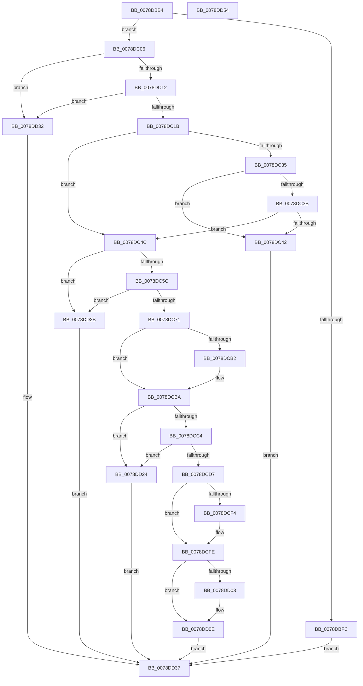

# RtlpAddKnownObjectAce

- RVA: `0x0078DBB4`–`0x0078DD55` (길이 `417` bytes)
- VA: `0x000000014078DBB4`
- 실행 섹션: `PAGE`
- PDB 이름 있음: `예`; PDB Function 태그: `아니요`
- unwind 정보 RVA: `0x0008C20C`
- 디코드: `115`개 명령, `417/417` bytes 표시
- 미해석 바이트: `0` (있으면 어셈블리에 `.byte`로 보존)

> 이 문서는 커널 이미지의 기계어와 PDB 기호를 분석해 생성했습니다. 4번과 5번은 함수 원형과 자료형을 바이너리 사용 방식에서 추정한 C 해석이며 원본 소스 복구 결과는 아닙니다.

## 1. Dependencies

- 직접 호출 지점: **4**; 고유 호출 대상: **4**
- 직접 호출자로 확인된 함수: **3**
- RIP 상대 이미지 참조: **0**

### Outgoing calls
- `0x0078DBF3` → [RtlValidSid](../92/RtlValidSid_function_00929710.md) (function, `0x00929710`)
- `0x0078DC4F` → [RtlValidAcl](../92/RtlValidAcl_function_0092A7A0.md) (function, `0x0092A7A0`)
- `0x0078DC64` → [RtlFirstFreeAce](../9A/RtlFirstFreeAce_function_009A8FF0.md) (function, `0x009A8FF0`)
- `0x0078DD14` → [RtlCopySid](../9A/RtlCopySid_function_009A9A50.md) (function, `0x009A9A50`)

### Direct callers
- [RtlAddAccessAllowedObjectAce](RtlAddAccessAllowedObjectAce_function_0078D120.md) at `0x0078D16D`
- [RtlAddAccessDeniedObjectAce](RtlAddAccessDeniedObjectAce_function_0078D1B0.md) at `0x0078D1FD`
- [RtlAddAuditAccessObjectAce](RtlAddAuditAccessObjectAce_function_0078D4A0.md) at `0x0078D51C`

### Static image references
- 디코드된 RIP-relative 메모리 참조가 없습니다.

## 2. Other-region calls and transfers

- 다른 실행 섹션으로 향하는 call: **0**
- 별도 외부 분기/꼬리 이동을 확인하지 못했습니다.

## 3. Assembly (complete function range)

```asm
0078DBB4  48 8B C4                        mov rax, rsp
0078DBB7  48 89 58 08                     mov qword ptr [rax + 8], rbx
0078DBBB  48 89 68 10                     mov qword ptr [rax + 0x10], rbp
0078DBBF  48 89 70 18                     mov qword ptr [rax + 0x18], rsi
0078DBC3  57                              push rdi
0078DBC4  41 54                           push r12
0078DBC6  41 55                           push r13
0078DBC8  41 56                           push r14
0078DBCA  41 57                           push r15
0078DBCC  48 83 EC 30                     sub rsp, 0x30
0078DBD0  4C 8B B4 24 90 00 00 00         mov r14, qword ptr [rsp + 0x90]
0078DBD8  48 8B D9                        mov rbx, rcx
0078DBDB  48 8B B4 24 80 00 00 00         mov rsi, qword ptr [rsp + 0x80]
0078DBE3  49 8B CE                        mov rcx, r14
0078DBE6  48 83 60 C8 00                  and qword ptr [rax - 0x38], 0
0078DBEB  45 8B E1                        mov r12d, r9d
0078DBEE  45 8B F8                        mov r15d, r8d
0078DBF1  8B FA                           mov edi, edx
0078DBF3  E8 18 BB 19 00                  call 0x140929710
0078DBF8  84 C0                           test al, al
0078DBFA  75 0A                           jne 0x14078dc06
0078DBFC  B8 78 00 00 C0                  mov eax, 0xc0000078
0078DC01  E9 31 01 00 00                  jmp 0x14078dd37
0078DC06  0F B6 0B                        movzx ecx, byte ptr [rbx]
0078DC09  80 F9 04                        cmp cl, 4
0078DC0C  0F 87 20 01 00 00               ja 0x14078dd32
0078DC12  83 FF 04                        cmp edi, 4
0078DC15  0F 85 17 01 00 00               jne 0x14078dd32
0078DC1B  40 8A AC 24 98 00 00 00         mov bpl, byte ptr [rsp + 0x98]
0078DC23  41 8B C7                        mov eax, r15d
0078DC26  40 0F B6 FF                     movzx edi, dil
0078DC2A  40 3A CF                        cmp cl, dil
0078DC2D  0F 47 F9                        cmova edi, ecx
0078DC30  83 E0 E0                        and eax, 0xffffffe0
0078DC33  74 17                           je 0x14078dc4c
0078DC35  40 80 FD 07                     cmp bpl, 7
0078DC39  75 07                           jne 0x14078dc42
0078DC3B  A9 3F FF FF FF                  test eax, 0xffffff3f
0078DC40  74 0A                           je 0x14078dc4c
0078DC42  B8 0D 00 00 C0                  mov eax, 0xc000000d
0078DC47  E9 EB 00 00 00                  jmp 0x14078dd37
0078DC4C  48 8B CB                        mov rcx, rbx
0078DC4F  E8 4C CB 19 00                  call 0x14092a7a0
0078DC54  84 C0                           test al, al
0078DC56  0F 84 CF 00 00 00               je 0x14078dd2b
0078DC5C  48 8D 54 24 20                  lea rdx, [rsp + 0x20]
0078DC61  48 8B CB                        mov rcx, rbx
0078DC64  E8 87 B3 21 00                  call 0x1409a8ff0
0078DC69  84 C0                           test al, al
0078DC6B  0F 84 BA 00 00 00               je 0x14078dd2b
0078DC71  41 0F B6 46 01                  movzx eax, byte ptr [r14 + 1]
0078DC76  45 33 C9                        xor r9d, r9d
0078DC79  4C 8B 94 24 88 00 00 00         mov r10, qword ptr [rsp + 0x88]
0078DC81  48 85 F6                        test rsi, rsi
0078DC84  41 BD 10 00 00 00               mov r13d, 0x10
0078DC8A  41 0F 95 C1                     setne r9b
0078DC8E  44 8D 1C 85 08 00 00 00         lea r11d, [rax*4 + 8]
0078DC96  48 8B C6                        mov rax, rsi
0078DC99  48 F7 D8                        neg rax
0078DC9C  66 45 1B C0                     sbb r8w, r8w
0078DCA0  66 45 23 C5                     and r8w, r13w
0078DCA4  66 41 83 C0 0C                  add r8w, 0xc
0078DCA9  66 45 03 C3                     add r8w, r11w
0078DCAD  4D 85 D2                        test r10, r10
0078DCB0  74 08                           je 0x14078dcba
0078DCB2  41 83 C9 02                     or r9d, 2
0078DCB6  66 45 03 C5                     add r8w, r13w
0078DCBA  48 8B 54 24 20                  mov rdx, qword ptr [rsp + 0x20]
0078DCBF  48 85 D2                        test rdx, rdx
0078DCC2  74 60                           je 0x14078dd24
0078DCC4  0F B7 4B 02                     movzx ecx, word ptr [rbx + 2]
0078DCC8  41 0F B7 C0                     movzx eax, r8w
0078DCCC  48 03 CB                        add rcx, rbx
0078DCCF  48 03 C2                        add rax, rdx
0078DCD2  48 3B C1                        cmp rax, rcx
0078DCD5  77 4D                           ja 0x14078dd24
0078DCD7  44 88 7A 01                     mov byte ptr [rdx + 1], r15b
0078DCDB  40 88 2A                        mov byte ptr [rdx], bpl
0078DCDE  66 44 89 42 02                  mov word ptr [rdx + 2], r8w
0078DCE3  44 89 62 04                     mov dword ptr [rdx + 4], r12d
0078DCE7  44 89 4A 08                     mov dword ptr [rdx + 8], r9d
0078DCEB  48 83 C2 0C                     add rdx, 0xc
0078DCEF  48 85 F6                        test rsi, rsi
0078DCF2  74 0A                           je 0x14078dcfe
0078DCF4  0F 10 06                        movups xmm0, xmmword ptr [rsi]
0078DCF7  F3 0F 7F 02                     movdqu xmmword ptr [rdx], xmm0
0078DCFB  49 03 D5                        add rdx, r13
0078DCFE  4D 85 D2                        test r10, r10
0078DD01  74 0B                           je 0x14078dd0e
0078DD03  41 0F 10 02                     movups xmm0, xmmword ptr [r10]
0078DD07  F3 0F 7F 02                     movdqu xmmword ptr [rdx], xmm0
0078DD0B  49 03 D5                        add rdx, r13
0078DD0E  4D 8B C6                        mov r8, r14
0078DD11  41 8B CB                        mov ecx, r11d
0078DD14  E8 37 BD 21 00                  call 0x1409a9a50
0078DD19  66 FF 43 04                     inc word ptr [rbx + 4]
0078DD1D  33 C0                           xor eax, eax
0078DD1F  40 88 3B                        mov byte ptr [rbx], dil
0078DD22  EB 13                           jmp 0x14078dd37
0078DD24  B8 99 00 00 C0                  mov eax, 0xc0000099
0078DD29  EB 0C                           jmp 0x14078dd37
0078DD2B  B8 77 00 00 C0                  mov eax, 0xc0000077
0078DD30  EB 05                           jmp 0x14078dd37
0078DD32  B8 59 00 00 C0                  mov eax, 0xc0000059
0078DD37  48 8B 5C 24 60                  mov rbx, qword ptr [rsp + 0x60]
0078DD3C  48 8B 6C 24 68                  mov rbp, qword ptr [rsp + 0x68]
0078DD41  48 8B 74 24 70                  mov rsi, qword ptr [rsp + 0x70]
0078DD46  48 83 C4 30                     add rsp, 0x30
0078DD4A  41 5F                           pop r15
0078DD4C  41 5E                           pop r14
0078DD4E  41 5D                           pop r13
0078DD50  41 5C                           pop r12
0078DD52  5F                              pop rdi
0078DD53  C3                              ret
0078DD54  CC                              int3
```

## 4. C-style interpretation (structured pseudocode)

```c
__int64 __fastcall RtlpAddKnownObjectAce(__int64 a1, int a2, int a3, int a4, __int64 a5, __int64 a6, __int64 a7, unsigned __int8 a8)
{
    __int64 result;
    __int64 v_rdi;
    __int64 v_rsp;
    unsigned __int64 v_stack_m38;
    unsigned __int64 v_stack_p10;
    unsigned __int64 v_stack_p18;
    unsigned __int64 v_stack_p8;

    *(unsigned __int64 *)(v_rsp + 8) = v_rbx;
    *(unsigned __int64 *)(v_rsp + 16) = v_rbp;
    *(unsigned __int64 *)(v_rsp + 24) = v_rsi;
    v_rsp = (v_rsp) - (48);
    result = RtlValidSid(a7, a2, a3, a4);
    if ((unsigned __int8)(result) != 0) goto loc_0078DC06;
    goto loc_0078DD37;
loc_0078DC06:
    if (((unsigned __int8)(*(unsigned __int8 *)(a1))) > 4) goto loc_0078DD32;
    if (((unsigned int)((unsigned int)(a2))) != 4) goto loc_0078DD32;
    v_rdi = (unsigned __int8)((unsigned int)(a2));
    if (((unsigned __int8)(*(unsigned __int8 *)(a1))) > ((unsigned __int8)((unsigned __int8)((unsigned int)(a2))))) { v_rdi = (unsigned int)(*(unsigned __int8 *)(a1)); }
    result = (unsigned int)(((unsigned int)((unsigned int)((unsigned int)(a3)))) & (0xFFFFFFE0ULL));
    if (condition_is_equal) goto loc_0078DC4C;
    if (a8 != 7) goto loc_0078DC42;
    if ((((unsigned int)(result)) & (0xFFFFFF3FULL)) == 0) goto loc_0078DC4C;
loc_0078DC42:
    goto loc_0078DD37;
loc_0078DC4C:
    result = RtlValidAcl(a1, a2, a3, a4);
    if ((unsigned __int8)(result) == 0) goto loc_0078DD2B;
    result = RtlFirstFreeAce(a1, v_stack_m38, a3, a4);
    if ((unsigned __int8)(result) == 0) goto loc_0078DD2B;
    a4 = 0;
    a4 = (a5 != 0) ? 1 : 0;
    result = -(a5);
    a3 = (unsigned __int16)((a3) & (16));
    a3 = (unsigned __int16)((a3) + (12));
    a3 = (unsigned __int16)((a3) + ((unsigned __int16)(*(unsigned __int8 *)(a7 + 1) * 4 + 8)));
    if (a6 != 0) {
        a4 = (unsigned int)((a4) | (2));
        a3 = (unsigned __int16)((a3) + (16));
    }
    if (v_stack_m38 == 0) goto loc_0078DD24;
    a1 = (*(unsigned __int16 *)(a1 + 2)) + (a1);
    result = ((unsigned __int16)(a3)) + (v_stack_m38);
    if (result > a1) goto loc_0078DD24;
    *(unsigned __int8 *)(v_stack_m38 + 1) = (unsigned __int8)((unsigned int)(a3));
    *(unsigned __int8 *)(v_stack_m38) = a8;
    *(unsigned __int16 *)(v_stack_m38 + 2) = (unsigned __int16)(a3);
    *(unsigned int *)(v_stack_m38 + 4) = (unsigned int)((unsigned int)(a4));
    *(unsigned int *)(v_stack_m38 + 8) = a4;
    a2 = (v_stack_m38) + (12);
    if (a5 != 0) {
        *(unsigned __int64 *)(a2) = v_xmm0;
        a2 = (a2) + (16);
    }
    if (a6 != 0) {
        *(unsigned __int64 *)(a2) = v_xmm0;
        a2 = (a2) + (16);
    }
    result = RtlCopySid((unsigned int)((unsigned int)(*(unsigned __int8 *)(a7 + 1) * 4 + 8)), a2, a7, a4);
    result = 0;
    *(unsigned __int8 *)(a1) = (unsigned __int8)(v_rdi);
    goto loc_0078DD37;
loc_0078DD24:
    goto loc_0078DD37;
loc_0078DD2B:
    goto loc_0078DD37;
loc_0078DD32:
loc_0078DD37:
    v_rsp = (v_rsp) + (48);
    return (unsigned int)(0xC0000059ULL);
}
```

## 5. (Beta) C Style

```c
int64_t RtlpAddKnownObjectAce(void *Arg1, int32_t Arg2, int32_t Arg3, int32_t Arg4, int64_t Arg5, int64_t Arg6, void *Arg7, uint8_t Arg8)
{
    uint8_t *arg1 = (uint8_t *)Arg1;
    uint8_t *arg7 = (uint8_t *)Arg7;

    int64_t result;
    int64_t local_rdi;
    int64_t local_rsp;
    uint64_t v_stack_m38;
    uint64_t v_stack_p10;
    uint64_t v_stack_p18;
    uint64_t v_stack_p8;

    *(uint64_t *)(local_rsp + 0x8) = local_rbx;
    *(uint64_t *)(local_rsp + 0x10) = local_rbp;
    *(uint64_t *)(local_rsp + 0x18) = local_rsi;
    local_rsp = (local_rsp) - (48);
    result = RtlValidSid(Arg7, Arg2, Arg3, Arg4);
    if ((uint8_t)(result) != 0) goto loc_0078DC06;
    goto loc_0078DD37;
loc_0078DC06:
    if (((uint8_t)(*(uint8_t *)(arg1))) > 4) goto loc_0078DD32;
    if (((uint32_t)((uint32_t)(Arg2))) != 4) goto loc_0078DD32;
    local_rdi = (uint8_t)((uint32_t)(Arg2));
    if (((uint8_t)(*(uint8_t *)(arg1))) > ((uint8_t)((uint8_t)((uint32_t)(Arg2))))) { local_rdi = (uint32_t)(*(uint8_t *)(arg1)); }
    result = (uint32_t)(((uint32_t)((uint32_t)((uint32_t)(Arg3)))) & (0xFFFFFFE0ULL));
    if (condition_is_equal) goto loc_0078DC4C;
    if (Arg8 != 7) goto loc_0078DC42;
    if ((((uint32_t)(result)) & (0xFFFFFF3FULL)) == 0) goto loc_0078DC4C;
loc_0078DC42:
    goto loc_0078DD37;
loc_0078DC4C:
    result = RtlValidAcl(Arg1, Arg2, Arg3, Arg4);
    if ((uint8_t)(result) == 0) goto loc_0078DD2B;
    result = RtlFirstFreeAce(Arg1, v_stack_m38, Arg3, Arg4);
    if ((uint8_t)(result) == 0) goto loc_0078DD2B;
    Arg4 = 0;
    Arg4 = (Arg5 != 0) ? 1 : 0;
    result = -(Arg5);
    Arg3 = (uint16_t)((Arg3) & (16));
    Arg3 = (uint16_t)((Arg3) + (12));
    Arg3 = (uint16_t)((Arg3) + ((uint16_t)(*(uint8_t *)(arg7 + 0x1) * 4 + 8)));
    if (Arg6 != 0) {
        Arg4 = (uint32_t)((Arg4) | (2));
        Arg3 = (uint16_t)((Arg3) + (16));
    }
    if (v_stack_m38 == 0) goto loc_0078DD24;
    Arg1 = (*(uint16_t *)(arg1 + 0x2)) + (Arg1);
    result = ((uint16_t)(Arg3)) + (v_stack_m38);
    if (result > Arg1) goto loc_0078DD24;
    *(uint8_t *)(v_stack_m38 + 0x1) = (uint8_t)((uint32_t)(Arg3));
    *(uint8_t *)(v_stack_m38) = Arg8;
    *(uint16_t *)(v_stack_m38 + 0x2) = (uint16_t)(Arg3);
    *(uint32_t *)(v_stack_m38 + 0x4) = (uint32_t)((uint32_t)(Arg4));
    *(uint32_t *)(v_stack_m38 + 0x8) = Arg4;
    Arg2 = (v_stack_m38) + (12);
    if (Arg5 != 0) {
        *(uint64_t *)(Arg2) = v_xmm0;
        Arg2 = (Arg2) + (16);
    }
    if (Arg6 != 0) {
        *(uint64_t *)(Arg2) = v_xmm0;
        Arg2 = (Arg2) + (16);
    }
    result = RtlCopySid((uint32_t)((uint32_t)(*(uint8_t *)(arg7 + 0x1) * 4 + 8)), Arg2, Arg7, Arg4);
    result = 0;
    *(uint8_t *)(arg1) = (uint8_t)(local_rdi);
    goto loc_0078DD37;
loc_0078DD24:
    goto loc_0078DD37;
loc_0078DD2B:
    goto loc_0078DD37;
loc_0078DD32:
loc_0078DD37:
    local_rsp = (local_rsp) + (48);
    return (uint32_t)(0xC0000059ULL);
}
```

### 관측된 메모리 오프셋

구조체 형식이 확인되지 않은 접근은 인자 기준의 오프셋으로만 기록했습니다.

| 기준 인자 | 오프셋 표현 | 폭 (bit) | 접근 |
|---|---:|---:|---|
| `Arg1` | `+ 0x0` | `8` | `R` |
| `Arg1` | `+ 0x0` | `8` | `W` |
| `Arg1` | `+ 0x2` | `16` | `R` |
| `Arg1` | `+ 0x4` | `16` | `R/W` |
| `Arg7` | `+ 0x1` | `8` | `R` |

## 6. Execution-region graph

[열기: 2D/3D 그래프와 함수 탐색 컨트롤 패널](../../../control-panel.html?section=page&rva=0x0078DBB4&view=graph)

- 2D 그래프는 위에서 아래로 흐르고, 3D 그래프는 빈 공간을 드래그해 회전합니다. Shift+드래그는 이동, 휠은 확대·축소, 함수 노드 선택은 대상 보고서 이동입니다.

### Static fallback


