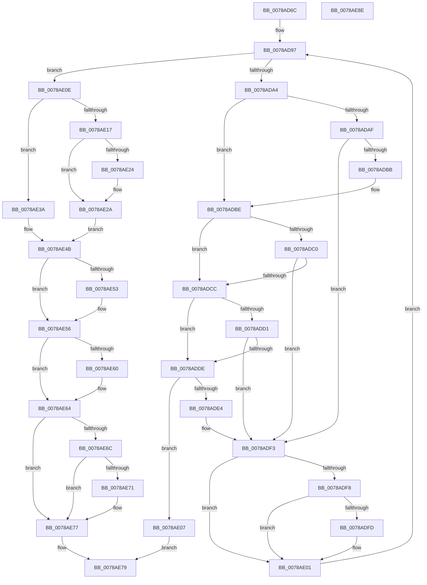

# RtlpAddToMergedRange

- RVA: `0x0078AD6C`–`0x0078AE8F` (길이 `291` bytes)
- VA: `0x000000014078AD6C`
- 실행 섹션: `PAGE`
- PDB 이름 있음: `예`; PDB Function 태그: `아니요`
- unwind 정보 RVA: `0x000A5A38`
- 디코드: `92`개 명령, `291/291` bytes 표시
- 미해석 바이트: `0` (있으면 어셈블리에 `.byte`로 보존)

> 이 문서는 커널 이미지의 기계어와 PDB 기호를 분석해 생성했습니다. 4번과 5번은 함수 원형과 자료형을 바이너리 사용 방식에서 추정한 C 해석이며 원본 소스 복구 결과는 아닙니다.

## 1. Dependencies

- 직접 호출 지점: **0**; 고유 호출 대상: **0**
- 직접 호출자로 확인된 함수: **2**
- RIP 상대 이미지 참조: **0**

### Outgoing calls
- 직접 디코드된 call 명령이 없습니다.

### Direct callers
- [RtlpAddIntersectingRanges](RtlpAddIntersectingRanges_function_0078AB4C.md) at `0x0078ACBA`
- [RtlpAddIntersectingRanges](RtlpAddIntersectingRanges_function_0078AB4C.md) at `0x0078AD20`
- [RtlpAddIntersectingRanges](RtlpAddIntersectingRanges_function_0078AB4C.md) at `0x0078AD41`
- [RtlpDeleteFromMergedRange](RtlpDeleteFromMergedRange_function_0078AE98.md) at `0x0078AF62`
- [RtlpDeleteFromMergedRange](RtlpDeleteFromMergedRange_function_0078AE98.md) at `0x0078AF8A`

### Static image references
- 디코드된 RIP-relative 메모리 참조가 없습니다.

## 2. Other-region calls and transfers

- 다른 실행 섹션으로 향하는 call: **0**
- 별도 외부 분기/꼬리 이동을 확인하지 못했습니다.

## 3. Assembly (complete function range)

```asm
0078AD6C  48 8B C4                        mov rax, rsp
0078AD6F  48 89 58 08                     mov qword ptr [rax + 8], rbx
0078AD73  48 89 68 10                     mov qword ptr [rax + 0x10], rbp
0078AD77  48 89 70 18                     mov qword ptr [rax + 0x18], rsi
0078AD7B  48 89 78 20                     mov qword ptr [rax + 0x20], rdi
0078AD7F  40 8A 7A 21                     mov dil, byte ptr [rdx + 0x21]
0078AD83  48 8D 71 10                     lea rsi, [rcx + 0x10]
0078AD87  4C 8B 0E                        mov r9, qword ptr [rsi]
0078AD8A  45 33 DB                        xor r11d, r11d
0078AD8D  40 80 E7 01                     and dil, 1
0078AD91  41 8B E8                        mov ebp, r8d
0078AD94  4C 8B D1                        mov r10, rcx
0078AD97  49 83 E9 28                     sub r9, 0x28
0078AD9B  49 8D 41 28                     lea rax, [r9 + 0x28]
0078AD9F  48 3B F0                        cmp rsi, rax
0078ADA2  74 6A                           je 0x14078ae0e
0078ADA4  49 8B 09                        mov rcx, qword ptr [r9]
0078ADA7  48 8B 02                        mov rax, qword ptr [rdx]
0078ADAA  48 3B C1                        cmp rax, rcx
0078ADAD  76 0F                           jbe 0x14078adbe
0078ADAF  4C 8B C1                        mov r8, rcx
0078ADB2  48 8B D8                        mov rbx, rax
0078ADB5  49 39 41 08                     cmp qword ptr [r9 + 8], rax
0078ADB9  72 38                           jb 0x14078adf3
0078ADBB  48 3B C1                        cmp rax, rcx
0078ADBE  73 0C                           jae 0x14078adcc
0078ADC0  4C 8B C1                        mov r8, rcx
0078ADC3  48 8B D8                        mov rbx, rax
0078ADC6  48 39 4A 08                     cmp qword ptr [rdx + 8], rcx
0078ADCA  72 27                           jb 0x14078adf3
0078ADCC  40 84 FF                        test dil, dil
0078ADCF  74 0D                           je 0x14078adde
0078ADD1  41 F6 41 21 01                  test byte ptr [r9 + 0x21], 1
0078ADD6  4C 8B C1                        mov r8, rcx
0078ADD9  48 8B D8                        mov rbx, rax
0078ADDC  75 15                           jne 0x14078adf3
0078ADDE  40 F6 C5 01                     test bpl, 1
0078ADE2  74 23                           je 0x14078ae07
0078ADE4  41 80 49 21 02                  or byte ptr [r9 + 0x21], 2
0078ADE9  80 4A 21 02                     or byte ptr [rdx + 0x21], 2
0078ADED  4D 8B 01                        mov r8, qword ptr [r9]
0078ADF0  48 8B 1A                        mov rbx, qword ptr [rdx]
0078ADF3  4D 85 DB                        test r11, r11
0078ADF6  75 09                           jne 0x14078ae01
0078ADF8  4C 3B C3                        cmp r8, rbx
0078ADFB  76 04                           jbe 0x14078ae01
0078ADFD  4D 8B 59 30                     mov r11, qword ptr [r9 + 0x30]
0078AE01  4D 8B 49 28                     mov r9, qword ptr [r9 + 0x28]
0078AE05  EB 90                           jmp 0x14078ad97
0078AE07  B8 82 02 00 C0                  mov eax, 0xc0000282
0078AE0C  EB 6B                           jmp 0x14078ae79
0078AE0E  48 8D 4A 28                     lea rcx, [rdx + 0x28]
0078AE12  4D 85 DB                        test r11, r11
0078AE15  75 23                           jne 0x14078ae3a
0078AE17  49 8D 42 10                     lea rax, [r10 + 0x10]
0078AE1B  4C 8B 40 08                     mov r8, qword ptr [rax + 8]
0078AE1F  49 39 00                        cmp qword ptr [r8], rax
0078AE22  74 06                           je 0x14078ae2a
0078AE24  41 8D 4B 03                     lea ecx, [r11 + 3]
0078AE28  CD 29                           int 0x29
0078AE2A  48 89 01                        mov qword ptr [rcx], rax
0078AE2D  4C 89 41 08                     mov qword ptr [rcx + 8], r8
0078AE31  49 89 08                        mov qword ptr [r8], rcx
0078AE34  48 89 48 08                     mov qword ptr [rax + 8], rcx
0078AE38  EB 11                           jmp 0x14078ae4b
0078AE3A  49 8B 03                        mov rax, qword ptr [r11]
0078AE3D  48 89 01                        mov qword ptr [rcx], rax
0078AE40  4C 89 5A 30                     mov qword ptr [rdx + 0x30], r11
0078AE44  48 89 48 08                     mov qword ptr [rax + 8], rcx
0078AE48  49 89 0B                        mov qword ptr [r11], rcx
0078AE4B  48 8B 02                        mov rax, qword ptr [rdx]
0078AE4E  49 3B 02                        cmp rax, qword ptr [r10]
0078AE51  73 03                           jae 0x14078ae56
0078AE53  49 89 02                        mov qword ptr [r10], rax
0078AE56  48 8B 42 08                     mov rax, qword ptr [rdx + 8]
0078AE5A  49 3B 42 08                     cmp rax, qword ptr [r10 + 8]
0078AE5E  76 04                           jbe 0x14078ae64
0078AE60  49 89 42 08                     mov qword ptr [r10 + 8], rax
0078AE64  41 8A 42 21                     mov al, byte ptr [r10 + 0x21]
0078AE68  A8 01                           test al, 1
0078AE6A  74 0B                           je 0x14078ae77
0078AE6C  40 84 FF                        test dil, dil
0078AE6F  75 06                           jne 0x14078ae77
0078AE71  24 FE                           and al, 0xfe
0078AE73  41 88 42 21                     mov byte ptr [r10 + 0x21], al
0078AE77  33 C0                           xor eax, eax
0078AE79  48 8B 5C 24 08                  mov rbx, qword ptr [rsp + 8]
0078AE7E  48 8B 6C 24 10                  mov rbp, qword ptr [rsp + 0x10]
0078AE83  48 8B 74 24 18                  mov rsi, qword ptr [rsp + 0x18]
0078AE88  48 8B 7C 24 20                  mov rdi, qword ptr [rsp + 0x20]
0078AE8D  C3                              ret
0078AE8E  CC                              int3
```

## 4. C-style interpretation (structured pseudocode)

```c
__int64 __fastcall RtlpAddToMergedRange(__int64 a1, __int64 a2, int a3)
{
    __int64 result;
    __int64 v_r11;
    __int64 v_rdi;
    unsigned __int64 v_stack_p10;
    unsigned __int64 v_stack_p18;
    unsigned __int64 v_stack_p20;
    unsigned __int64 v_stack_p8;

    *(unsigned __int64 *)(v_rsp + 8) = v_rbx;
    *(unsigned __int64 *)(v_rsp + 16) = v_rbp;
    *(unsigned __int64 *)(v_rsp + 24) = v_rsi;
    *(unsigned __int64 *)(v_rsp + 32) = v_rdi;
    v_r11 = 0;
    v_rdi = (unsigned __int8)((*(unsigned __int8 *)(a2 + 33)) & (1));
loc_0078AD97:
    a4 = (*(unsigned __int64 *)(a1 + 16)) - (40);
    if ((a1 + 16) == (a4 + 40)) goto loc_0078AE0E;
    if ((*(unsigned __int64 *)(a2)) <= (*(unsigned __int64 *)(a4))) goto loc_0078ADBE;
    if ((*(unsigned __int64 *)(a4 + 8)) < (*(unsigned __int64 *)(a2))) goto loc_0078ADF3;
loc_0078ADBE:
    if ((*(unsigned __int64 *)(a2)) >= (*(unsigned __int64 *)(a4))) goto loc_0078ADCC;
    if ((*(unsigned __int64 *)(a2 + 8)) < (*(unsigned __int64 *)(a4))) goto loc_0078ADF3;
loc_0078ADCC:
    if ((unsigned __int8)(v_rdi) == 0) goto loc_0078ADDE;
    if (((*(unsigned __int8 *)(a4 + 33)) & (1)) != 0) goto loc_0078ADF3;
loc_0078ADDE:
    if ((((unsigned __int8)((unsigned int)(a3))) & (1)) == 0) goto loc_0078AE07;
loc_0078ADF3:
    if (0 != 0) goto loc_0078AE01;
    if ((*(unsigned __int64 *)(a4)) >= = (*(unsigned __int64 *)(a2))) {
        v_r11 = *(unsigned __int64 *)(a4 + 48);
    }
    goto loc_0078AD97;
loc_0078AE07:
    goto loc_0078AE79;
loc_0078AE0E:
    if (v_r11 != 0) goto loc_0078AE3A;
    if ((*(unsigned __int64 *)(*(unsigned __int64 *)(a1 + 16 + 8))) != (a1 + 16)) {
        a1 = v_r11 + 3;
    }
    *(unsigned __int64 *)(a1) = a1 + 16;
    *(unsigned __int64 *)(a1 + 8) = *(unsigned __int64 *)(a1 + 16 + 8);
    *(unsigned __int64 *)(*(unsigned __int64 *)(a1 + 16 + 8)) = a1;
    *(unsigned __int64 *)(a1 + 16 + 8) = a1;
    goto loc_0078AE4B;
loc_0078AE3A:
    *(unsigned __int64 *)(a1) = *(unsigned __int64 *)(v_r11);
    *(unsigned __int64 *)(a2 + 48) = v_r11;
    *(unsigned __int64 *)(*(unsigned __int64 *)(v_r11) + 8) = a1;
    *(unsigned __int64 *)(v_r11) = a1;
loc_0078AE4B:
    if ((*(unsigned __int64 *)(a2)) < (*(unsigned __int64 *)(a1))) {
        *(unsigned __int64 *)(a1) = *(unsigned __int64 *)(a2);
    }
    if ((*(unsigned __int64 *)(a2 + 8)) >= = (*(unsigned __int64 *)(a1 + 8))) {
        *(unsigned __int64 *)(a1 + 8) = *(unsigned __int64 *)(a2 + 8);
    }
    if ((((unsigned __int8)(*(unsigned __int8 *)(a1 + 33))) & (1)) == 0) goto loc_0078AE77;
    result = *(unsigned __int8 *)(a1 + 33);
    if ((unsigned __int8)(v_rdi) == 0) {
        result = (unsigned __int8)((*(unsigned __int8 *)(a1 + 33)) & (254));
        *(unsigned __int8 *)(a1 + 33) = (unsigned __int8)(result);
    }
    result = 0;
loc_0078AE79:
    return result;
}
```

## 5. (Beta) C Style

```c
int64_t RtlpAddToMergedRange(void *Arg1, void *Arg2, int32_t Arg3)
{
    uint8_t *arg1 = (uint8_t *)Arg1;
    uint8_t *arg2 = (uint8_t *)Arg2;

    int64_t result;
    int64_t local_r11;
    int64_t local_rdi;
    uint64_t v_stack_p10;
    uint64_t v_stack_p18;
    uint64_t v_stack_p20;
    uint64_t v_stack_p8;

    *(uint64_t *)(local_rsp + 0x8) = local_rbx;
    *(uint64_t *)(local_rsp + 0x10) = local_rbp;
    *(uint64_t *)(local_rsp + 0x18) = local_rsi;
    *(uint64_t *)(local_rsp + 0x20) = local_rdi;
    local_r11 = 0;
    local_rdi = (uint8_t)((*(uint8_t *)(arg2 + 0x21)) & (1));
loc_0078AD97:
    a4 = (*(uint64_t *)(arg1 + 0x10)) - (40);
    if ((Arg1 + 16) == (a4 + 40)) goto loc_0078AE0E;
    if ((*(uint64_t *)(arg2)) <= (*(uint64_t *)(a4))) goto loc_0078ADBE;
    if ((*(uint64_t *)(a4 + 0x8)) < (*(uint64_t *)(arg2))) goto loc_0078ADF3;
loc_0078ADBE:
    if ((*(uint64_t *)(arg2)) >= (*(uint64_t *)(a4))) goto loc_0078ADCC;
    if ((*(uint64_t *)(arg2 + 0x8)) < (*(uint64_t *)(a4))) goto loc_0078ADF3;
loc_0078ADCC:
    if ((uint8_t)(local_rdi) == 0) goto loc_0078ADDE;
    if (((*(uint8_t *)(a4 + 0x21)) & (1)) != 0) goto loc_0078ADF3;
loc_0078ADDE:
    if ((((uint8_t)((uint32_t)(Arg3))) & (1)) == 0) goto loc_0078AE07;
loc_0078ADF3:
    if (0 != 0) goto loc_0078AE01;
    if ((*(uint64_t *)(a4)) >= = (*(uint64_t *)(arg2))) {
        local_r11 = *(uint64_t *)(a4 + 0x30);
    }
    goto loc_0078AD97;
loc_0078AE07:
    goto loc_0078AE79;
loc_0078AE0E:
    if (local_r11 != 0) goto loc_0078AE3A;
    if ((*(uint64_t *)(*(uint64_t *)(arg1 + 0x10 + 0x8))) != (Arg1 + 16)) {
        Arg1 = local_r11 + 3;
    }
    *(void **)(arg1) = Arg1 + 16;
    *(uint64_t *)(arg1 + 0x8) = *(uint64_t *)(arg1 + 0x10 + 0x8);
    *(void **)(*(uint64_t *)(arg1 + 0x10 + 0x8)) = Arg1;
    *(void **)(arg1 + 0x10 + 0x8) = Arg1;
    goto loc_0078AE4B;
loc_0078AE3A:
    *(uint64_t *)(arg1) = *(uint64_t *)(local_r11);
    *(uint64_t *)(arg2 + 0x30) = local_r11;
    *(void **)(*(uint64_t *)(local_r11) + 0x8) = Arg1;
    *(void **)(local_r11) = Arg1;
loc_0078AE4B:
    if ((*(uint64_t *)(arg2)) < (*(uint64_t *)(arg1))) {
        *(uint64_t *)(arg1) = *(uint64_t *)(arg2);
    }
    if ((*(uint64_t *)(arg2 + 0x8)) >= = (*(uint64_t *)(arg1 + 0x8))) {
        *(uint64_t *)(arg1 + 0x8) = *(uint64_t *)(arg2 + 0x8);
    }
    if ((((uint8_t)(*(uint8_t *)(arg1 + 0x21))) & (1)) == 0) goto loc_0078AE77;
    result = *(uint8_t *)(arg1 + 0x21);
    if ((uint8_t)(local_rdi) == 0) {
        result = (uint8_t)((*(uint8_t *)(arg1 + 0x21)) & (254));
        *(uint8_t *)(arg1 + 0x21) = (uint8_t)(result);
    }
    result = 0;
loc_0078AE79:
    return result;
}
```

### 관측된 메모리 오프셋

구조체 형식이 확인되지 않은 접근은 인자 기준의 오프셋으로만 기록했습니다.

| 기준 인자 | 오프셋 표현 | 폭 (bit) | 접근 |
|---|---:|---:|---|
| `Arg1` | `+ 0x0` | `64` | `R` |
| `Arg1` | `+ 0x0` | `64` | `W` |
| `Arg1` | `+ 0x8` | `64` | `R` |
| `Arg1` | `+ 0x8` | `64` | `W` |
| `Arg1` | `+ 0x10` | `64` | `R` |
| `Arg1` | `+ 0x21` | `8` | `R` |
| `Arg1` | `+ 0x21` | `8` | `W` |
| `Arg2` | `+ 0x0` | `64` | `R` |
| `Arg2` | `+ 0x0` | `64` | `W` |
| `Arg2` | `+ 0x8` | `64` | `R` |
| `Arg2` | `+ 0x21` | `8` | `R` |
| `Arg2` | `+ 0x21` | `8` | `R/W` |
| `Arg2` | `+ 0x28` | `64` | `R` |
| `Arg2` | `+ 0x30` | `64` | `W` |

## 6. Execution-region graph

[열기: 2D/3D 그래프와 함수 탐색 컨트롤 패널](../../../control-panel.html?section=page&rva=0x0078AD6C&view=graph)

- 2D 그래프는 위에서 아래로 흐르고, 3D 그래프는 빈 공간을 드래그해 회전합니다. Shift+드래그는 이동, 휠은 확대·축소, 함수 노드 선택은 대상 보고서 이동입니다.

### Static fallback


