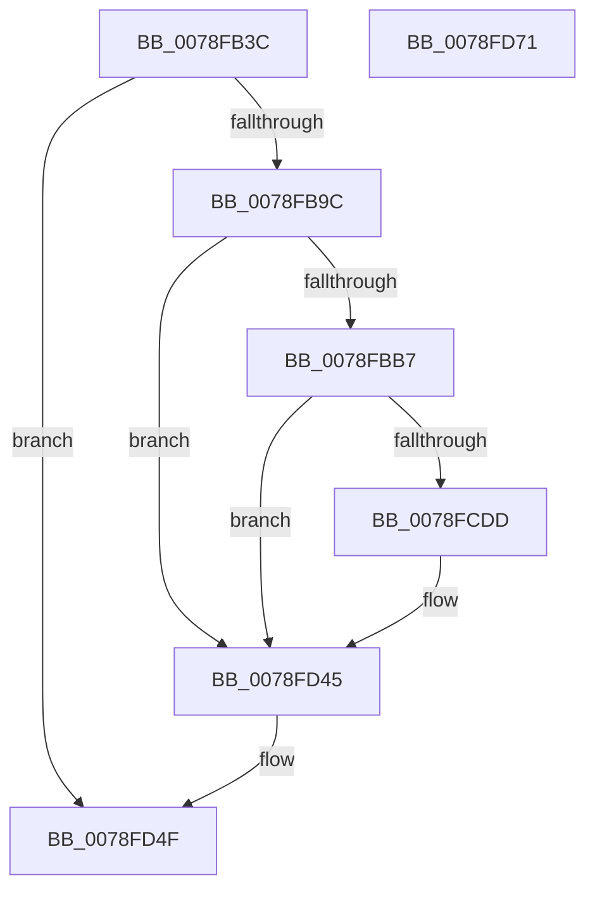

# RtlpCheckDynamicTimeZoneInformation

- RVA: `0x0078FB3C`–`0x0078FD72` (길이 `566` bytes)
- VA: `0x000000014078FB3C`
- 실행 섹션: `PAGE`
- PDB 이름 있음: `예`; PDB Function 태그: `아니요`
- unwind 정보 RVA: `0x000CFA94`
- 디코드: `143`개 명령, `566/566` bytes 표시
- 미해석 바이트: `0` (있으면 어셈블리에 `.byte`로 보존)

> 이 문서는 커널 이미지의 기계어와 PDB 기호를 분석해 생성했습니다. 4번과 5번은 함수 원형과 자료형을 바이너리 사용 방식에서 추정한 C 해석이며 원본 소스 복구 결과는 아닙니다.

## 1. Dependencies

- 직접 호출 지점: **5**; 고유 호출 대상: **5**
- 직접 호출자로 확인된 함수: **1**
- RIP 상대 이미지 참조: **1**

### Outgoing calls
- `0x0078FB8F` → [RtlpGetDynamicTimeZoneInfoHandle](RtlpGetDynamicTimeZoneInfoHandle_function_0078FD78.md) (function, `0x0078FD78`)
- `0x0078FBAA` → [RtlpFindRegTziForCurrentYear](../../text/5E/RtlpFindRegTziForCurrentYear_function_005E7754.md) (function, `0x005E7754`)
- `0x0078FCD4` → [memcmp](../../text/6C/memcmp_function_006C6B10.md) (function, `0x006C6B10`)
- `0x0078FD4A` → [ZwClose](../../text/6A/ZwClose_function_006AD2B0.md) (function, `0x006AD2B0`)
- `0x0078FD59` → [_security_check_cookie](../../text/6A/_security_check_cookie_function_006AC640.md) (function, `0x006AC640`)

### Direct callers
- [ExpRefreshTimeZoneInformation](../A6/ExpRefreshTimeZoneInformation_function_00A6B46C.md) at `0x00A6B65F`

### Static image references
- `0x0078FB50` → RVA `0x00E0A740` (`.data`; read)

## 2. Other-region calls and transfers

- 다른 실행 섹션으로 향하는 call: **4**
  - `0x0078FBAA` → [RtlpFindRegTziForCurrentYear](../../text/5E/RtlpFindRegTziForCurrentYear_function_005E7754.md) (`PAGE` → `.text`)
  - `0x0078FCD4` → [memcmp](../../text/6C/memcmp_function_006C6B10.md) (`PAGE` → `.text`)
  - `0x0078FD4A` → [ZwClose](../../text/6A/ZwClose_function_006AD2B0.md) (`PAGE` → `.text`)
  - `0x0078FD59` → [_security_check_cookie](../../text/6A/_security_check_cookie_function_006AC640.md) (`PAGE` → `.text`)
- 별도 외부 분기/꼬리 이동을 확인하지 못했습니다.

## 3. Assembly (complete function range)

```asm
0078FB3C  48 89 5C 24 18                  mov qword ptr [rsp + 0x18], rbx
0078FB41  55                              push rbp
0078FB42  56                              push rsi
0078FB43  57                              push rdi
0078FB44  48 8D 6C 24 E0                  lea rbp, [rsp - 0x20]
0078FB49  48 81 EC 20 01 00 00            sub rsp, 0x120
0078FB50  48 8B 05 E9 AB 67 00            mov rax, qword ptr [rip + 0x67abe9]
0078FB57  48 33 C4                        xor rax, rsp
0078FB5A  48 89 45 10                     mov qword ptr [rbp + 0x10], rax
0078FB5E  0F 57 C0                        xorps xmm0, xmm0
0078FB61  33 C0                           xor eax, eax
0078FB63  0F B7 F2                        movzx esi, dx
0078FB66  48 89 44 24 48                  mov qword ptr [rsp + 0x48], rax
0078FB6B  48 8B D9                        mov rbx, rcx
0078FB6E  89 44 24 50                     mov dword ptr [rsp + 0x50], eax
0078FB72  33 FF                           xor edi, edi
0078FB74  48 8D 54 24 20                  lea rdx, [rsp + 0x20]
0078FB79  48 81 C1 AC 00 00 00            add rcx, 0xac
0078FB80  48 89 7C 24 20                  mov qword ptr [rsp + 0x20], rdi
0078FB85  0F 11 44 24 28                  movups xmmword ptr [rsp + 0x28], xmm0
0078FB8A  0F 11 44 24 38                  movups xmmword ptr [rsp + 0x38], xmm0
0078FB8F  E8 E4 01 00 00                  call 0x14078fd78
0078FB94  85 C0                           test eax, eax
0078FB96  0F 88 B3 01 00 00               js 0x14078fd4f
0078FB9C  48 8B 54 24 20                  mov rdx, qword ptr [rsp + 0x20]
0078FBA1  48 8D 4C 24 28                  lea rcx, [rsp + 0x28]
0078FBA6  44 0F B7 C6                     movzx r8d, si
0078FBAA  E8 A5 7B E5 FF                  call 0x1405e7754
0078FBAF  85 C0                           test eax, eax
0078FBB1  0F 88 8E 01 00 00               js 0x14078fd45
0078FBB7  0F 10 03                        movups xmm0, xmmword ptr [rbx]
0078FBBA  48 8D 54 24 60                  lea rdx, [rsp + 0x60]
0078FBBF  BE 80 00 00 00                  mov esi, 0x80
0078FBC4  0F 10 4B 10                     movups xmm1, xmmword ptr [rbx + 0x10]
0078FBC8  0F 11 02                        movups xmmword ptr [rdx], xmm0
0078FBCB  48 8D 0C 1E                     lea rcx, [rsi + rbx]
0078FBCF  48 8B 41 20                     mov rax, qword ptr [rcx + 0x20]
0078FBD3  44 8D 46 2C                     lea r8d, [rsi + 0x2c]
0078FBD7  0F 10 43 20                     movups xmm0, xmmword ptr [rbx + 0x20]
0078FBDB  0F 11 4A 10                     movups xmmword ptr [rdx + 0x10], xmm1
0078FBDF  0F 11 42 20                     movups xmmword ptr [rdx + 0x20], xmm0
0078FBE3  0F 10 4B 30                     movups xmm1, xmmword ptr [rbx + 0x30]
0078FBE7  0F 10 43 40                     movups xmm0, xmmword ptr [rbx + 0x40]
0078FBEB  0F 11 4A 30                     movups xmmword ptr [rdx + 0x30], xmm1
0078FBEF  0F 10 4B 50                     movups xmm1, xmmword ptr [rbx + 0x50]
0078FBF3  0F 11 42 40                     movups xmmword ptr [rdx + 0x40], xmm0
0078FBF7  0F 10 43 60                     movups xmm0, xmmword ptr [rbx + 0x60]
0078FBFB  0F 11 4A 50                     movups xmmword ptr [rdx + 0x50], xmm1
0078FBFF  0F 10 09                        movups xmm1, xmmword ptr [rcx]
0078FC02  0F 11 42 60                     movups xmmword ptr [rdx + 0x60], xmm0
0078FC06  48 03 D6                        add rdx, rsi
0078FC09  0F 10 43 70                     movups xmm0, xmmword ptr [rbx + 0x70]
0078FC0D  0F 11 42 F0                     movups xmmword ptr [rdx - 0x10], xmm0
0078FC11  0F 10 41 10                     movups xmm0, xmmword ptr [rcx + 0x10]
0078FC15  0F 11 0A                        movups xmmword ptr [rdx], xmm1
0078FC18  0F 11 42 10                     movups xmmword ptr [rdx + 0x10], xmm0
0078FC1C  48 89 42 20                     mov qword ptr [rdx + 0x20], rax
0078FC20  8B 41 28                        mov eax, dword ptr [rcx + 0x28]
0078FC23  48 8D 4C 24 60                  lea rcx, [rsp + 0x60]
0078FC28  89 42 28                        mov dword ptr [rdx + 0x28], eax
0078FC2B  48 8B D3                        mov rdx, rbx
0078FC2E  8B 44 24 28                     mov eax, dword ptr [rsp + 0x28]
0078FC32  89 44 24 60                     mov dword ptr [rsp + 0x60], eax
0078FC36  8B 44 24 2C                     mov eax, dword ptr [rsp + 0x2c]
0078FC3A  89 45 B4                        mov dword ptr [rbp - 0x4c], eax
0078FC3D  8B 44 24 30                     mov eax, dword ptr [rsp + 0x30]
0078FC41  89 45 08                        mov dword ptr [rbp + 8], eax
0078FC44  0F B7 44 24 34                  movzx eax, word ptr [rsp + 0x34]
0078FC49  66 89 45 A4                     mov word ptr [rbp - 0x5c], ax
0078FC4D  0F B7 44 24 36                  movzx eax, word ptr [rsp + 0x36]
0078FC52  66 89 45 A6                     mov word ptr [rbp - 0x5a], ax
0078FC56  0F B7 44 24 38                  movzx eax, word ptr [rsp + 0x38]
0078FC5B  66 89 45 B2                     mov word ptr [rbp - 0x4e], ax
0078FC5F  0F B7 44 24 3A                  movzx eax, word ptr [rsp + 0x3a]
0078FC64  66 89 45 A8                     mov word ptr [rbp - 0x58], ax
0078FC68  0F B7 44 24 3C                  movzx eax, word ptr [rsp + 0x3c]
0078FC6D  66 89 45 AA                     mov word ptr [rbp - 0x56], ax
0078FC71  0F B7 44 24 3E                  movzx eax, word ptr [rsp + 0x3e]
0078FC76  66 89 45 AC                     mov word ptr [rbp - 0x54], ax
0078FC7A  0F B7 44 24 40                  movzx eax, word ptr [rsp + 0x40]
0078FC7F  66 89 45 AE                     mov word ptr [rbp - 0x52], ax
0078FC83  0F B7 44 24 42                  movzx eax, word ptr [rsp + 0x42]
0078FC88  66 89 45 B0                     mov word ptr [rbp - 0x50], ax
0078FC8C  0F B7 44 24 44                  movzx eax, word ptr [rsp + 0x44]
0078FC91  66 89 45 F8                     mov word ptr [rbp - 8], ax
0078FC95  0F B7 44 24 46                  movzx eax, word ptr [rsp + 0x46]
0078FC9A  66 89 45 FA                     mov word ptr [rbp - 6], ax
0078FC9E  0F B7 44 24 48                  movzx eax, word ptr [rsp + 0x48]
0078FCA3  66 89 45 06                     mov word ptr [rbp + 6], ax
0078FCA7  0F B7 44 24 4A                  movzx eax, word ptr [rsp + 0x4a]
0078FCAC  66 89 45 FC                     mov word ptr [rbp - 4], ax
0078FCB0  0F B7 44 24 4C                  movzx eax, word ptr [rsp + 0x4c]
0078FCB5  66 89 45 FE                     mov word ptr [rbp - 2], ax
0078FCB9  0F B7 44 24 4E                  movzx eax, word ptr [rsp + 0x4e]
0078FCBE  66 89 45 00                     mov word ptr [rbp], ax
0078FCC2  0F B7 44 24 50                  movzx eax, word ptr [rsp + 0x50]
0078FCC7  66 89 45 02                     mov word ptr [rbp + 2], ax
0078FCCB  0F B7 44 24 52                  movzx eax, word ptr [rsp + 0x52]
0078FCD0  66 89 45 04                     mov word ptr [rbp + 4], ax
0078FCD4  E8 37 6E F3 FF                  call 0x1406c6b10
0078FCD9  85 C0                           test eax, eax
0078FCDB  74 68                           je 0x14078fd45
0078FCDD  48 8D 4C 24 60                  lea rcx, [rsp + 0x60]
0078FCE2  40 B7 01                        mov dil, 1
0078FCE5  0F 10 01                        movups xmm0, xmmword ptr [rcx]
0078FCE8  0F 10 49 10                     movups xmm1, xmmword ptr [rcx + 0x10]
0078FCEC  0F 11 03                        movups xmmword ptr [rbx], xmm0
0078FCEF  0F 10 41 20                     movups xmm0, xmmword ptr [rcx + 0x20]
0078FCF3  0F 11 4B 10                     movups xmmword ptr [rbx + 0x10], xmm1
0078FCF7  0F 10 49 30                     movups xmm1, xmmword ptr [rcx + 0x30]
0078FCFB  0F 11 43 20                     movups xmmword ptr [rbx + 0x20], xmm0
0078FCFF  0F 10 41 40                     movups xmm0, xmmword ptr [rcx + 0x40]
0078FD03  0F 11 4B 30                     movups xmmword ptr [rbx + 0x30], xmm1
0078FD07  0F 10 49 50                     movups xmm1, xmmword ptr [rcx + 0x50]
0078FD0B  0F 11 43 40                     movups xmmword ptr [rbx + 0x40], xmm0
0078FD0F  0F 10 41 60                     movups xmm0, xmmword ptr [rcx + 0x60]
0078FD13  0F 11 4B 50                     movups xmmword ptr [rbx + 0x50], xmm1
0078FD17  0F 10 49 70                     movups xmm1, xmmword ptr [rcx + 0x70]
0078FD1B  0F 11 43 60                     movups xmmword ptr [rbx + 0x60], xmm0
0078FD1F  48 03 DE                        add rbx, rsi
0078FD22  48 03 CE                        add rcx, rsi
0078FD25  0F 11 4B F0                     movups xmmword ptr [rbx - 0x10], xmm1
0078FD29  48 8B 41 20                     mov rax, qword ptr [rcx + 0x20]
0078FD2D  0F 10 01                        movups xmm0, xmmword ptr [rcx]
0078FD30  0F 10 49 10                     movups xmm1, xmmword ptr [rcx + 0x10]
0078FD34  0F 11 03                        movups xmmword ptr [rbx], xmm0
0078FD37  0F 11 4B 10                     movups xmmword ptr [rbx + 0x10], xmm1
0078FD3B  48 89 43 20                     mov qword ptr [rbx + 0x20], rax
0078FD3F  8B 41 28                        mov eax, dword ptr [rcx + 0x28]
0078FD42  89 43 28                        mov dword ptr [rbx + 0x28], eax
0078FD45  48 8B 4C 24 20                  mov rcx, qword ptr [rsp + 0x20]
0078FD4A  E8 61 D5 F1 FF                  call 0x1406ad2b0
0078FD4F  40 8A C7                        mov al, dil
0078FD52  48 8B 4D 10                     mov rcx, qword ptr [rbp + 0x10]
0078FD56  48 33 CC                        xor rcx, rsp
0078FD59  E8 E2 C8 F1 FF                  call 0x1406ac640
0078FD5E  48 8B 9C 24 50 01 00 00         mov rbx, qword ptr [rsp + 0x150]
0078FD66  48 81 C4 20 01 00 00            add rsp, 0x120
0078FD6D  5F                              pop rdi
0078FD6E  5E                              pop rsi
0078FD6F  5D                              pop rbp
0078FD70  C3                              ret
0078FD71  CC                              int3
```

## 4. C-style interpretation (structured pseudocode)

```c
__int64 __fastcall RtlpCheckDynamicTimeZoneInformation(__int64 a1, unsigned __int16 a2)
{
    __int64 result;
    __int64 v_rbx;
    __int64 v_rdi;
    __int64 v_rsp;
    unsigned __int64 v_stack_m100;
    unsigned __int16 v_stack_m102;
    unsigned __int16 v_stack_m104;
    unsigned int v_stack_m108;
    unsigned int v_stack_m10C;
    unsigned __int64 v_stack_m110;
    unsigned __int64 v_stack_m118;
    unsigned __int64 v_stack_m28;
    unsigned int v_stack_m30;
    unsigned __int16 v_stack_m32;
    unsigned __int16 v_stack_m34;
    unsigned __int16 v_stack_m36;
    unsigned __int64 v_stack_m38;
    unsigned __int16 v_stack_m3A;
    unsigned __int16 v_stack_m3C;
    unsigned __int16 v_stack_m3E;
    unsigned __int16 v_stack_m40;
    unsigned int v_stack_m84;
    unsigned __int16 v_stack_m86;
    unsigned __int16 v_stack_m88;
    unsigned __int16 v_stack_m8A;
    unsigned __int16 v_stack_m8C;
    unsigned __int16 v_stack_m8E;
    unsigned __int16 v_stack_m90;
    unsigned __int16 v_stack_m92;
    unsigned __int16 v_stack_m94;
    unsigned __int64 v_stack_mD8;
    unsigned __int16 v_stack_mE6;
    unsigned int v_stack_mE8;
    unsigned __int16 v_stack_mEA;
    unsigned __int16 v_stack_mEC;
    unsigned __int16 v_stack_mEE;
    unsigned __int64 v_stack_mF0;
    unsigned __int16 v_stack_mF2;
    unsigned __int16 v_stack_mF4;
    unsigned __int16 v_stack_mF6;
    unsigned __int16 v_stack_mF8;
    unsigned __int16 v_stack_mFA;
    unsigned __int16 v_stack_mFC;
    unsigned __int16 v_stack_mFE;
    unsigned __int64 v_stack_p18;

    v_stack_p18 = v_rbx;
    v_rsp = (v_rsp) - (288);
    result = (*(unsigned __int64 *)(v_rip + 6794217)) ^ (v_rsp);
    v_stack_m28 = result;
    result = 0;
    v_stack_mF0 = 0;
    v_stack_mE8 = 0;
    v_rdi = 0;
    a1 = (a1) + (172);
    v_stack_m118 = 0;
    v_stack_m110 = v_xmm0;
    v_stack_m100 = v_xmm0;
    result = RtlpGetDynamicTimeZoneInfoHandle(a1, v_stack_m118, a3, a4);
    if (sign_flag) goto loc_0078FD4F;
    result = RtlpFindRegTziForCurrentYear(v_stack_m110, v_stack_m118, a2, a4);
    if (sign_flag) goto loc_0078FD45;
    *(unsigned __int64 *)(v_stack_mD8) = v_xmm0;
    *(unsigned __int64 *)(v_stack_mD8 + 16) = v_xmm1;
    *(unsigned __int64 *)(v_stack_mD8 + 32) = v_xmm0;
    *(unsigned __int64 *)(v_stack_mD8 + 48) = v_xmm1;
    *(unsigned __int64 *)(v_stack_mD8 + 64) = v_xmm0;
    *(unsigned __int64 *)(v_stack_mD8 + 80) = v_xmm1;
    *(unsigned __int64 *)(v_stack_mD8 + 96) = v_xmm0;
    a2 = (v_stack_mD8) + (128);
    *(unsigned __int64 *)(a2 - 16) = v_xmm0;
    *(unsigned __int64 *)(a2) = v_xmm1;
    *(unsigned __int64 *)(a2 + 16) = v_xmm0;
    *(unsigned __int64 *)(a2 + 32) = *(unsigned __int64 *)(128 + a1 * 1 + 32);
    *(unsigned int *)(a2 + 40) = (unsigned int)((unsigned int)(*(unsigned int *)(128 + a1 * 1 + 40)));
    v_stack_mD8 = (unsigned int)((unsigned int)(v_stack_m110));
    v_stack_m84 = (unsigned int)((unsigned int)(v_stack_m10C));
    v_stack_m30 = (unsigned int)((unsigned int)(v_stack_m108));
    v_stack_m94 = (unsigned __int16)(v_stack_m104);
    v_stack_m92 = (unsigned __int16)(v_stack_m102);
    v_stack_m86 = (unsigned __int16)(v_stack_m100);
    v_stack_m90 = (unsigned __int16)(v_stack_mFE);
    v_stack_m8E = (unsigned __int16)(v_stack_mFC);
    v_stack_m8C = (unsigned __int16)(v_stack_mFA);
    v_stack_m8A = (unsigned __int16)(v_stack_mF8);
    v_stack_m88 = (unsigned __int16)(v_stack_mF6);
    v_stack_m40 = (unsigned __int16)(v_stack_mF4);
    v_stack_m3E = (unsigned __int16)(v_stack_mF2);
    v_stack_m32 = (unsigned __int16)(v_stack_mF0);
    v_stack_m3C = (unsigned __int16)(v_stack_mEE);
    v_stack_m3A = (unsigned __int16)(v_stack_mEC);
    v_stack_m38 = (unsigned __int16)(v_stack_mEA);
    v_stack_m36 = (unsigned __int16)(v_stack_mE8);
    v_stack_m34 = (unsigned __int16)(v_stack_mE6);
    result = memcmp(v_stack_mD8, a1, 128 + 44, a4);
    v_rbx = a1;
    if ((unsigned int)(result) != 0) {
        a1 = v_stack_mD8;
        v_rdi = 1;
        *(unsigned __int64 *)(a1) = v_xmm0;
        *(unsigned __int64 *)(a1 + 16) = v_xmm1;
        *(unsigned __int64 *)(a1 + 32) = v_xmm0;
        *(unsigned __int64 *)(a1 + 48) = v_xmm1;
        *(unsigned __int64 *)(a1 + 64) = v_xmm0;
        *(unsigned __int64 *)(a1 + 80) = v_xmm1;
        *(unsigned __int64 *)(a1 + 96) = v_xmm0;
        v_rbx = (a1) + (128);
        a1 = (a1) + (128);
        *(unsigned __int64 *)(v_rbx - 16) = v_xmm1;
        result = *(unsigned __int64 *)(a1 + 32);
        *(unsigned __int64 *)(v_rbx) = v_xmm0;
        *(unsigned __int64 *)(v_rbx + 16) = v_xmm1;
        *(unsigned __int64 *)(v_rbx + 32) = result;
        result = *(unsigned int *)(a1 + 40);
        *(unsigned int *)(v_rbx + 40) = (unsigned int)(result);
    }
    result = ZwClose(v_stack_m118, a1, 128 + 44, a4);
loc_0078FD4F:
    a1 = (v_stack_m28) ^ (v_rsp);
    result = _security_check_cookie(a1, a1, 128 + 44, a4);
    v_rsp = (v_rsp) + (288);
    return result;
}
```

## 5. (Beta) C Style

```c
int64_t RtlpCheckDynamicTimeZoneInformation(void *Arg1, uint16_t Arg2)
{
    uint8_t *arg1 = (uint8_t *)Arg1;

    int64_t result;
    int64_t local_rbx;
    int64_t local_rdi;
    int64_t local_rsp;
    uint64_t v_stack_m100;
    uint16_t v_stack_m102;
    uint16_t v_stack_m104;
    uint32_t v_stack_m108;
    uint32_t v_stack_m10C;
    uint64_t v_stack_m110;
    uint64_t v_stack_m118;
    uint64_t v_stack_m28;
    uint32_t v_stack_m30;
    uint16_t v_stack_m32;
    uint16_t v_stack_m34;
    uint16_t v_stack_m36;
    uint64_t v_stack_m38;
    uint16_t v_stack_m3A;
    uint16_t v_stack_m3C;
    uint16_t v_stack_m3E;
    uint16_t v_stack_m40;
    uint32_t v_stack_m84;
    uint16_t v_stack_m86;
    uint16_t v_stack_m88;
    uint16_t v_stack_m8A;
    uint16_t v_stack_m8C;
    uint16_t v_stack_m8E;
    uint16_t v_stack_m90;
    uint16_t v_stack_m92;
    uint16_t v_stack_m94;
    uint64_t v_stack_mD8;
    uint16_t v_stack_mE6;
    uint32_t v_stack_mE8;
    uint16_t v_stack_mEA;
    uint16_t v_stack_mEC;
    uint16_t v_stack_mEE;
    uint64_t v_stack_mF0;
    uint16_t v_stack_mF2;
    uint16_t v_stack_mF4;
    uint16_t v_stack_mF6;
    uint16_t v_stack_mF8;
    uint16_t v_stack_mFA;
    uint16_t v_stack_mFC;
    uint16_t v_stack_mFE;
    uint64_t v_stack_p18;

    v_stack_p18 = local_rbx;
    local_rsp = (local_rsp) - (288);
    result = (*(uint64_t *)(v_rip + 0x67ABE9)) ^ (local_rsp);
    v_stack_m28 = result;
    result = 0;
    v_stack_mF0 = 0;
    v_stack_mE8 = 0;
    local_rdi = 0;
    Arg1 = (Arg1) + (172);
    v_stack_m118 = 0;
    v_stack_m110 = v_xmm0;
    v_stack_m100 = v_xmm0;
    result = RtlpGetDynamicTimeZoneInfoHandle(Arg1, v_stack_m118, a3, a4);
    if (sign_flag) goto loc_0078FD4F;
    result = RtlpFindRegTziForCurrentYear(v_stack_m110, v_stack_m118, Arg2, a4);
    if (sign_flag) goto loc_0078FD45;
    *(uint64_t *)(v_stack_mD8) = v_xmm0;
    *(uint64_t *)(v_stack_mD8 + 0x10) = v_xmm1;
    *(uint64_t *)(v_stack_mD8 + 0x20) = v_xmm0;
    *(uint64_t *)(v_stack_mD8 + 0x30) = v_xmm1;
    *(uint64_t *)(v_stack_mD8 + 0x40) = v_xmm0;
    *(uint64_t *)(v_stack_mD8 + 0x50) = v_xmm1;
    *(uint64_t *)(v_stack_mD8 + 0x60) = v_xmm0;
    Arg2 = (v_stack_mD8) + (128);
    *(uint64_t *)(Arg2 - 0x10) = v_xmm0;
    *(uint64_t *)(Arg2) = v_xmm1;
    *(uint64_t *)(Arg2 + 0x10) = v_xmm0;
    *(uint64_t *)(Arg2 + 0x20) = *(uint64_t *)(128 + arg1 * 1 + 0x20);
    *(uint32_t *)(Arg2 + 0x28) = (uint32_t)((uint32_t)(*(uint32_t *)(128 + arg1 * 1 + 0x28)));
    v_stack_mD8 = (uint32_t)((uint32_t)(v_stack_m110));
    v_stack_m84 = (uint32_t)((uint32_t)(v_stack_m10C));
    v_stack_m30 = (uint32_t)((uint32_t)(v_stack_m108));
    v_stack_m94 = (uint16_t)(v_stack_m104);
    v_stack_m92 = (uint16_t)(v_stack_m102);
    v_stack_m86 = (uint16_t)(v_stack_m100);
    v_stack_m90 = (uint16_t)(v_stack_mFE);
    v_stack_m8E = (uint16_t)(v_stack_mFC);
    v_stack_m8C = (uint16_t)(v_stack_mFA);
    v_stack_m8A = (uint16_t)(v_stack_mF8);
    v_stack_m88 = (uint16_t)(v_stack_mF6);
    v_stack_m40 = (uint16_t)(v_stack_mF4);
    v_stack_m3E = (uint16_t)(v_stack_mF2);
    v_stack_m32 = (uint16_t)(v_stack_mF0);
    v_stack_m3C = (uint16_t)(v_stack_mEE);
    v_stack_m3A = (uint16_t)(v_stack_mEC);
    v_stack_m38 = (uint16_t)(v_stack_mEA);
    v_stack_m36 = (uint16_t)(v_stack_mE8);
    v_stack_m34 = (uint16_t)(v_stack_mE6);
    result = memcmp(v_stack_mD8, Arg1, 128 + 44, a4);
    local_rbx = Arg1;
    if ((uint32_t)(result) != 0) {
        Arg1 = v_stack_mD8;
        local_rdi = 1;
        *(uint64_t *)(arg1) = v_xmm0;
        *(uint64_t *)(arg1 + 0x10) = v_xmm1;
        *(uint64_t *)(arg1 + 0x20) = v_xmm0;
        *(uint64_t *)(arg1 + 0x30) = v_xmm1;
        *(uint64_t *)(arg1 + 0x40) = v_xmm0;
        *(uint64_t *)(arg1 + 0x50) = v_xmm1;
        *(uint64_t *)(arg1 + 0x60) = v_xmm0;
        local_rbx = (Arg1) + (128);
        Arg1 = (Arg1) + (128);
        *(uint64_t *)(local_rbx - 0x10) = v_xmm1;
        result = *(uint64_t *)(arg1 + 0x20);
        *(uint64_t *)(local_rbx) = v_xmm0;
        *(uint64_t *)(local_rbx + 0x10) = v_xmm1;
        *(uint64_t *)(local_rbx + 0x20) = result;
        result = *(uint32_t *)(arg1 + 0x28);
        *(uint32_t *)(local_rbx + 0x28) = (uint32_t)(result);
    }
    result = ZwClose(v_stack_m118, Arg1, 128 + 44, a4);
loc_0078FD4F:
    Arg1 = (v_stack_m28) ^ (local_rsp);
    result = _security_check_cookie(Arg1, Arg1, 128 + 44, a4);
    local_rsp = (local_rsp) + (288);
    return result;
}
```

### 관측된 메모리 오프셋

구조체 형식이 확인되지 않은 접근은 인자 기준의 오프셋으로만 기록했습니다.

| 기준 인자 | 오프셋 표현 | 폭 (bit) | 접근 |
|---|---:|---:|---|
| `Arg1` | `- 0x10` | `128` | `R` |
| `Arg1` | `+ 0x0` | `128` | `R` |
| `Arg1` | `+ 0x10` | `128` | `R` |
| `Arg1` | `+ 0x20` | `64` | `W` |
| `Arg1` | `+ 0x20` | `128` | `R` |
| `Arg1` | `+ 0x28` | `32` | `W` |
| `Arg1` | `+ 0x30` | `128` | `R` |
| `Arg1` | `+ 0x40` | `128` | `R` |
| `Arg1` | `+ 0x50` | `128` | `R` |
| `Arg1` | `+ 0x60` | `128` | `R` |
| `Arg1` | `+ 0x70` | `128` | `R` |

## 6. Execution-region graph

[열기: 2D/3D 그래프와 함수 탐색 컨트롤 패널](../../../control-panel.html?section=page&rva=0x0078FB3C&view=graph)

- 2D 그래프는 위에서 아래로 흐르고, 3D 그래프는 빈 공간을 드래그해 회전합니다. Shift+드래그는 이동, 휠은 확대·축소, 함수 노드 선택은 대상 보고서 이동입니다.

### Static fallback


