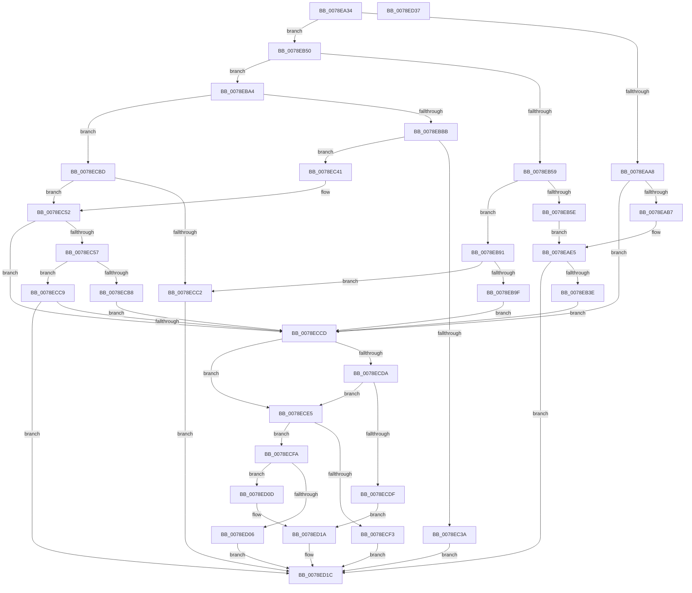

# RtlpComputeMergedAcl2

- RVA: `0x0078EA34`–`0x0078ED38` (길이 `772` bytes)
- VA: `0x000000014078EA34`
- 실행 섹션: `PAGE`
- PDB 이름 있음: `예`; PDB Function 태그: `아니요`
- unwind 정보 RVA: `0x000CF9E0`
- 디코드: `190`개 명령, `772/772` bytes 표시
- 미해석 바이트: `0` (있으면 어셈블리에 `.byte`로 보존)

> 이 문서는 커널 이미지의 기계어와 PDB 기호를 분석해 생성했습니다. 4번과 5번은 함수 원형과 자료형을 바이너리 사용 방식에서 추정한 C 해석이며 원본 소스 복구 결과는 아닙니다.

## 1. Dependencies

- 직접 호출 지점: **4**; 고유 호출 대상: **2**
- 직접 호출자로 확인된 함수: **1**
- RIP 상대 이미지 참조: **0**

### Outgoing calls
- `0x0078EA88` → [RtlCreateAcl](../91/RtlCreateAcl_function_00916F00.md) (function, `0x00916F00`)
- `0x0078EB24` → [RtlpCopyAces](../92/RtlpCopyAces_function_0092E020.md) (function, `0x0092E020`)
- `0x0078EC1F` → [RtlpCopyAces](../92/RtlpCopyAces_function_0092E020.md) (function, `0x0092E020`)
- `0x0078ECAC` → [RtlpCopyAces](../92/RtlpCopyAces_function_0092E020.md) (function, `0x0092E020`)

### Direct callers
- [RtlpComputeMergedAcl](../AC/RtlpComputeMergedAcl_function_00AC9B34.md) at `0x00AC9BF2`

### Static image references
- 디코드된 RIP-relative 메모리 참조가 없습니다.

## 2. Other-region calls and transfers

- 다른 실행 섹션으로 향하는 call: **0**
- 별도 외부 분기/꼬리 이동을 확인하지 못했습니다.

## 3. Assembly (complete function range)

```asm
0078EA34  48 8B C4                        mov rax, rsp
0078EA37  48 89 58 08                     mov qword ptr [rax + 8], rbx
0078EA3B  89 50 10                        mov dword ptr [rax + 0x10], edx
0078EA3E  55                              push rbp
0078EA3F  56                              push rsi
0078EA40  57                              push rdi
0078EA41  41 54                           push r12
0078EA43  41 55                           push r13
0078EA45  41 56                           push r14
0078EA47  41 57                           push r15
0078EA49  48 81 EC 80 00 00 00            sub rsp, 0x80
0078EA50  83 60 20 00                     and dword ptr [rax + 0x20], 0
0078EA54  4D 8B F0                        mov r14, r8
0078EA57  83 60 B8 00                     and dword ptr [rax - 0x48], 0
0078EA5B  4C 8B E9                        mov r13, rcx
0078EA5E  4C 8B A4 24 00 01 00 00         mov r12, qword ptr [rsp + 0x100]
0078EA66  B8 02 00 00 00                  mov eax, 2
0078EA6B  4C 8B BC 24 08 01 00 00         mov r15, qword ptr [rsp + 0x108]
0078EA73  44 8B C0                        mov r8d, eax
0078EA76  49 8B CF                        mov rcx, r15
0078EA79  41 8B D9                        mov ebx, r9d
0078EA7C  40 32 ED                        xor bpl, bpl
0078EA7F  40 B6 01                        mov sil, 1
0078EA82  41 8B 14 24                     mov edx, dword ptr [r12]
0078EA86  8B F8                           mov edi, eax
0078EA88  E8 73 84 18 00                  call 0x140916f00
0078EA8D  48 8B 84 24 10 01 00 00         mov rax, qword ptr [rsp + 0x110]
0078EA95  B9 00 10 00 00                  mov ecx, 0x1000
0078EA9A  C7 00 00 04 00 00               mov dword ptr [rax], 0x400
0078EAA0  85 D9                           test ecx, ebx
0078EAA2  0F 84 A8 00 00 00               je 0x14078eb50
0078EAA8  C7 00 00 14 00 00               mov dword ptr [rax], 0x1400
0078EAAE  4D 85 F6                        test r14, r14
0078EAB1  0F 84 16 02 00 00               je 0x14078eccd
0078EAB7  41 0F B6 06                     movzx eax, byte ptr [r14]
0078EABB  41 B1 10                        mov r9b, 0x10
0078EABE  3B C7                           cmp eax, edi
0078EAC0  4C 89 7C 24 68                  mov qword ptr [rsp + 0x68], r15
0078EAC5  0F 43 F8                        cmovae edi, eax
0078EAC8  48 8D 84 24 D8 00 00 00         lea rax, [rsp + 0xd8]
0078EAD0  48 89 44 24 60                  mov qword ptr [rsp + 0x60], rax
0078EAD5  8B 84 24 F8 00 00 00            mov eax, dword ptr [rsp + 0xf8]
0078EADC  89 44 24 58                     mov dword ptr [rsp + 0x58], eax
0078EAE0  40 88 6C 24 50                  mov byte ptr [rsp + 0x50], bpl
0078EAE5  48 8B 8C 24 E8 00 00 00         mov rcx, qword ptr [rsp + 0xe8]
0078EAED  41 B8 02 00 00 00               mov r8d, 2
0078EAF3  48 8B 84 24 E0 00 00 00         mov rax, qword ptr [rsp + 0xe0]
0078EAFB  48 8B 94 24 F0 00 00 00         mov rdx, qword ptr [rsp + 0xf0]
0078EB03  40 88 74 24 48                  mov byte ptr [rsp + 0x48], sil
0078EB08  48 89 4C 24 40                  mov qword ptr [rsp + 0x40], rcx
0078EB0D  48 89 44 24 38                  mov qword ptr [rsp + 0x38], rax
0078EB12  48 89 4C 24 30                  mov qword ptr [rsp + 0x30], rcx
0078EB17  49 8B CE                        mov rcx, r14
0078EB1A  48 89 44 24 28                  mov qword ptr [rsp + 0x28], rax
0078EB1F  40 88 74 24 20                  mov byte ptr [rsp + 0x20], sil
0078EB24  E8 F7 F4 19 00                  call 0x14092e020
0078EB29  8B C8                           mov ecx, eax
0078EB2B  33 C0                           xor eax, eax
0078EB2D  81 F9 23 00 00 C0               cmp ecx, 0xc0000023
0078EB33  0F 45 C1                        cmovne eax, ecx
0078EB36  85 C0                           test eax, eax
0078EB38  0F 88 DE 01 00 00               js 0x14078ed1c
0078EB3E  40 32 F6                        xor sil, sil
0078EB41  81 F9 23 00 00 C0               cmp ecx, 0xc0000023
0078EB47  40 0F 94 C5                     sete bpl
0078EB4B  E9 7D 01 00 00                  jmp 0x14078eccd
0078EB50  85 8C 24 C8 00 00 00            test dword ptr [rsp + 0xc8], ecx
0078EB57  74 4B                           je 0x14078eba4
0078EB59  4D 85 F6                        test r14, r14
0078EB5C  74 33                           je 0x14078eb91
0078EB5E  41 0F B6 06                     movzx eax, byte ptr [r14]
0078EB62  3B C7                           cmp eax, edi
0078EB64  4C 89 7C 24 68                  mov qword ptr [rsp + 0x68], r15
0078EB69  0F 43 F8                        cmovae edi, eax
0078EB6C  48 8D 84 24 D8 00 00 00         lea rax, [rsp + 0xd8]
0078EB74  48 89 44 24 60                  mov qword ptr [rsp + 0x60], rax
0078EB79  45 33 C9                        xor r9d, r9d
0078EB7C  8B 84 24 F8 00 00 00            mov eax, dword ptr [rsp + 0xf8]
0078EB83  89 44 24 58                     mov dword ptr [rsp + 0x58], eax
0078EB87  40 88 74 24 50                  mov byte ptr [rsp + 0x50], sil
0078EB8C  E9 54 FF FF FF                  jmp 0x14078eae5
0078EB91  83 BC 24 F8 00 00 00 01         cmp dword ptr [rsp + 0xf8], 1
0078EB99  0F 84 23 01 00 00               je 0x14078ecc2
0078EB9F  E9 29 01 00 00                  jmp 0x14078eccd
0078EBA4  8B 9C 24 F8 00 00 00            mov ebx, dword ptr [rsp + 0xf8]
0078EBAB  83 FB 01                        cmp ebx, 1
0078EBAE  40 0F 95 C6                     setne sil
0078EBB2  4D 85 F6                        test r14, r14
0078EBB5  0F 84 02 01 00 00               je 0x14078ecbd
0078EBBB  41 0F B6 06                     movzx eax, byte ptr [r14]
0078EBBF  48 8B 8C 24 E8 00 00 00         mov rcx, qword ptr [rsp + 0xe8]
0078EBC7  3B C7                           cmp eax, edi
0078EBC9  48 8B 94 24 F0 00 00 00         mov rdx, qword ptr [rsp + 0xf0]
0078EBD1  4C 89 7C 24 68                  mov qword ptr [rsp + 0x68], r15
0078EBD6  0F 43 F8                        cmovae edi, eax
0078EBD9  48 8D 84 24 D8 00 00 00         lea rax, [rsp + 0xd8]
0078EBE1  45 33 C9                        xor r9d, r9d
0078EBE4  48 89 44 24 60                  mov qword ptr [rsp + 0x60], rax
0078EBE9  48 8B 84 24 E0 00 00 00         mov rax, qword ptr [rsp + 0xe0]
0078EBF1  89 5C 24 58                     mov dword ptr [rsp + 0x58], ebx
0078EBF5  40 88 6C 24 50                  mov byte ptr [rsp + 0x50], bpl
0078EBFA  45 8D 41 01                     lea r8d, [r9 + 1]
0078EBFE  C6 44 24 48 01                  mov byte ptr [rsp + 0x48], 1
0078EC03  48 89 4C 24 40                  mov qword ptr [rsp + 0x40], rcx
0078EC08  48 89 44 24 38                  mov qword ptr [rsp + 0x38], rax
0078EC0D  48 89 4C 24 30                  mov qword ptr [rsp + 0x30], rcx
0078EC12  49 8B CE                        mov rcx, r14
0078EC15  48 89 44 24 28                  mov qword ptr [rsp + 0x28], rax
0078EC1A  C6 44 24 20 01                  mov byte ptr [rsp + 0x20], 1
0078EC1F  E8 FC F3 19 00                  call 0x14092e020
0078EC24  BA 23 00 00 C0                  mov edx, 0xc0000023
0078EC29  3B C2                           cmp eax, edx
0078EC2B  40 0F 94 C5                     sete bpl
0078EC2F  33 C9                           xor ecx, ecx
0078EC31  3B C2                           cmp eax, edx
0078EC33  0F 45 C8                        cmovne ecx, eax
0078EC36  85 C9                           test ecx, ecx
0078EC38  79 07                           jns 0x14078ec41
0078EC3A  8B C1                           mov eax, ecx
0078EC3C  E9 DB 00 00 00                  jmp 0x14078ed1c
0078EC41  41 0F B7 46 04                  movzx eax, word ptr [r14 + 4]
0078EC46  40 8A CE                        mov cl, sil
0078EC49  66 F7 D8                        neg ax
0078EC4C  40 1A F6                        sbb sil, sil
0078EC4F  40 22 F1                        and sil, cl
0078EC52  4D 85 ED                        test r13, r13
0078EC55  74 76                           je 0x14078eccd
0078EC57  41 0F B6 45 00                  movzx eax, byte ptr [r13]
0078EC5C  49 8B CD                        mov rcx, r13
0078EC5F  48 8B 94 24 F0 00 00 00         mov rdx, qword ptr [rsp + 0xf0]
0078EC67  3B F8                           cmp edi, eax
0078EC69  4C 89 7C 24 68                  mov qword ptr [rsp + 0x68], r15
0078EC6E  0F 46 F8                        cmovbe edi, eax
0078EC71  48 8D 44 24 70                  lea rax, [rsp + 0x70]
0078EC76  48 89 44 24 60                  mov qword ptr [rsp + 0x60], rax
0078EC7B  45 33 C9                        xor r9d, r9d
0078EC7E  89 5C 24 58                     mov dword ptr [rsp + 0x58], ebx
0078EC82  45 33 C0                        xor r8d, r8d
0078EC85  C6 44 24 50 00                  mov byte ptr [rsp + 0x50], 0
0078EC8A  C6 44 24 48 01                  mov byte ptr [rsp + 0x48], 1
0078EC8F  48 83 64 24 40 00               and qword ptr [rsp + 0x40], 0
0078EC95  48 83 64 24 38 00               and qword ptr [rsp + 0x38], 0
0078EC9B  48 83 64 24 30 00               and qword ptr [rsp + 0x30], 0
0078ECA1  48 83 64 24 28 00               and qword ptr [rsp + 0x28], 0
0078ECA7  C6 44 24 20 00                  mov byte ptr [rsp + 0x20], 0
0078ECAC  E8 6F F3 19 00                  call 0x14092e020
0078ECB1  3D 23 00 00 C0                  cmp eax, 0xc0000023
0078ECB6  75 11                           jne 0x14078ecc9
0078ECB8  40 B5 01                        mov bpl, 1
0078ECBB  EB 10                           jmp 0x14078eccd
0078ECBD  83 FB 01                        cmp ebx, 1
0078ECC0  75 90                           jne 0x14078ec52
0078ECC2  B8 77 00 00 C0                  mov eax, 0xc0000077
0078ECC7  EB 53                           jmp 0x14078ed1c
0078ECC9  85 C0                           test eax, eax
0078ECCB  78 4F                           js 0x14078ed1c
0078ECCD  8B 8C 24 D8 00 00 00            mov ecx, dword ptr [rsp + 0xd8]
0078ECD4  03 4C 24 70                     add ecx, dword ptr [rsp + 0x70]
0078ECD8  75 0B                           jne 0x14078ece5
0078ECDA  40 84 F6                        test sil, sil
0078ECDD  74 06                           je 0x14078ece5
0078ECDF  41 21 0C 24                     and dword ptr [r12], ecx
0078ECE3  EB 35                           jmp 0x14078ed1a
0078ECE5  8B C1                           mov eax, ecx
0078ECE7  48 83 C0 08                     add rax, 8
0078ECEB  48 3D FF FF 00 00               cmp rax, 0xffff
0078ECF1  76 07                           jbe 0x14078ecfa
0078ECF3  B8 7D 00 00 C0                  mov eax, 0xc000007d
0078ECF8  EB 22                           jmp 0x14078ed1c
0078ECFA  83 C1 08                        add ecx, 8
0078ECFD  41 89 0C 24                     mov dword ptr [r12], ecx
0078ED01  40 84 ED                        test bpl, bpl
0078ED04  74 07                           je 0x14078ed0d
0078ED06  B8 23 00 00 C0                  mov eax, 0xc0000023
0078ED0B  EB 0F                           jmp 0x14078ed1c
0078ED0D  41 0F B7 04 24                  movzx eax, word ptr [r12]
0078ED12  66 41 89 47 02                  mov word ptr [r15 + 2], ax
0078ED17  41 88 3F                        mov byte ptr [r15], dil
0078ED1A  33 C0                           xor eax, eax
0078ED1C  48 8B 9C 24 C0 00 00 00         mov rbx, qword ptr [rsp + 0xc0]
0078ED24  48 81 C4 80 00 00 00            add rsp, 0x80
0078ED2B  41 5F                           pop r15
0078ED2D  41 5E                           pop r14
0078ED2F  41 5D                           pop r13
0078ED31  41 5C                           pop r12
0078ED33  5F                              pop rdi
0078ED34  5E                              pop rsi
0078ED35  5D                              pop rbp
0078ED36  C3                              ret
0078ED37  CC                              int3
```

## 4. C-style interpretation (structured pseudocode)

```c
__int64 __fastcall RtlpComputeMergedAcl2(__int64 a1, int a2, __int64 a3, int a4, __int64 a5, __int64 a6, __int64 a7, unsigned int a8, __int64 a9, __int64 a10, __int64 a11)
{
    __int64 result;
    __int64 v_rbp;
    __int64 v_rdi;
    __int64 v_rsi;
    __int64 v_rsp;
    unsigned __int64 v_stack_m48;
    unsigned __int64 v_stack_m50;
    unsigned __int64 v_stack_m58;
    unsigned int v_stack_m60;
    unsigned __int8 v_stack_m68;
    unsigned __int8 v_stack_m70;
    unsigned __int64 v_stack_m78;
    unsigned __int64 v_stack_m80;
    unsigned __int64 v_stack_m88;
    unsigned __int64 v_stack_m90;
    unsigned __int8 v_stack_m98;
    unsigned int v_stack_p10;
    unsigned __int64 v_stack_p20;
    unsigned __int64 v_stack_p8;

    *(unsigned __int64 *)(v_rsp + 8) = v_rbx;
    *(unsigned int *)(v_rsp + 16) = a2;
    v_rsp = (v_rsp) - (128);
    v_rbp = 0;
    result = RtlCreateAcl(a10, (unsigned int)(*(unsigned int *)(a9)), 2, a4);
    *(unsigned int *)(a11) = 0x400ULL;
    if ((((unsigned int)((unsigned int)(0x1000ULL))) & ((unsigned int)((unsigned int)(a4)))) == 0) goto loc_0078EB50;
    *(unsigned int *)(a11) = 0x1400ULL;
    if (a3 == 0) goto loc_0078ECCD;
    v_stack_m50 = a10;
    v_rdi = 2;
    if (((unsigned int)(*(unsigned __int8 *)(a3))) >= 2) { v_rdi = (unsigned int)(*(unsigned __int8 *)(a3)); }
    v_stack_m58 = v_stack_p20;
    v_stack_m60 = (unsigned int)((unsigned int)(a8));
    v_stack_m68 = 0;
loc_0078EAE5:
    v_stack_m70 = 1;
    v_stack_m78 = a6;
    v_stack_m80 = a5;
    v_stack_m88 = a6;
    v_stack_m90 = a5;
    v_stack_m98 = 1;
    result = RtlpCopyAces(a3, a7, 2, 16);
    result = 0;
    if (((unsigned int)((unsigned int)((unsigned int)(result)))) != 0xC0000023ULL) { result = (unsigned int)((unsigned int)((unsigned int)(result))); }
    if (sign_flag) goto loc_0078ED1C;
    v_rsi = 0;
    v_rbp = (((unsigned int)((unsigned int)((unsigned int)(result)))) == 0xC0000023ULL) ? 1 : 0;
    goto loc_0078ECCD;
loc_0078EB50:
    if (((v_stack_p10) & ((unsigned int)((unsigned int)((unsigned int)(result))))) == 0) goto loc_0078EBA4;
    if (a3 == 0) goto loc_0078EB91;
    v_stack_m50 = a10;
    if (((unsigned int)(*(unsigned __int8 *)(a3))) >= ((unsigned int)(v_rdi))) { v_rdi = (unsigned int)(*(unsigned __int8 *)(a3)); }
    v_stack_m58 = v_stack_p20;
    a4 = 0;
    v_stack_m60 = (unsigned int)((unsigned int)(a8));
    v_stack_m68 = 0;
    goto loc_0078EAE5;
loc_0078EB91:
    if (a8 == 1) goto loc_0078ECC2;
    goto loc_0078ECCD;
loc_0078EBA4:
    v_rsi = (((unsigned int)((unsigned int)(a8))) != 1) ? 1 : 0;
    if (a3 == 0) goto loc_0078ECBD;
    v_stack_m50 = a10;
    if (((unsigned int)(*(unsigned __int8 *)(a3))) >= ((unsigned int)(v_rdi))) { v_rdi = (unsigned int)(*(unsigned __int8 *)(a3)); }
    a4 = 0;
    v_stack_m58 = v_stack_p20;
    v_stack_m60 = (unsigned int)((unsigned int)(a8));
    v_stack_m68 = (unsigned __int8)(v_rbp);
    v_stack_m70 = 1;
    v_stack_m78 = a6;
    v_stack_m80 = a5;
    v_stack_m88 = a6;
    v_stack_m90 = a5;
    v_stack_m98 = 1;
    result = RtlpCopyAces(a3, a7, a4 + 1, a4);
    v_rbp = (((unsigned int)(result)) == ((unsigned int)((unsigned int)(0xC0000023ULL)))) ? 1 : 0;
    a1 = 0;
    if (((unsigned int)(result)) != ((unsigned int)((unsigned int)(0xC0000023ULL)))) { a1 = (unsigned int)(result); }
    if (!sign_flag) goto loc_0078EC41;
    goto loc_0078ED1C;
loc_0078EC41:
    result = (unsigned __int16)(-(*(unsigned __int16 *)(a3 + 4)));
    v_rsi = (unsigned __int8)((v_rsi) & ((unsigned __int8)((unsigned __int8)(v_rsi))));
loc_0078EC52:
    if (a1 == 0) goto loc_0078ECCD;
    v_stack_m50 = a10;
    if (((unsigned int)(v_rdi)) <= ((unsigned int)(*(unsigned __int8 *)(a1)))) { v_rdi = (unsigned int)(*(unsigned __int8 *)(a1)); }
    v_stack_m58 = v_stack_m48;
    a4 = 0;
    v_stack_m60 = (unsigned int)((unsigned int)(a8));
    a3 = 0;
    v_stack_m68 = 0;
    v_stack_m70 = 1;
    v_stack_m98 = 0;
    result = RtlpCopyAces(a1, a7, a3, a4);
    if (((unsigned int)(result)) != 0xC0000023ULL) goto loc_0078ECC9;
    goto loc_0078ECCD;
loc_0078ECBD:
    if (((unsigned int)((unsigned int)(a8))) != 1) goto loc_0078EC52;
loc_0078ECC2:
    goto loc_0078ED1C;
loc_0078ECC9:
    if (sign_flag) goto loc_0078ED1C;
loc_0078ECCD:
    a1 = (unsigned int)(((unsigned int)(v_stack_p20)) + (v_stack_m48));
    if (condition_is_not_equal) goto loc_0078ECE5;
    if ((unsigned __int8)(v_rsi) == 0) goto loc_0078ECE5;
    goto loc_0078ED1A;
loc_0078ECE5:
    result = ((unsigned int)((unsigned int)(a1))) + (8);
    if (result <= 0xFFFFULL) goto loc_0078ECFA;
    goto loc_0078ED1C;
loc_0078ECFA:
    a1 = (unsigned int)((a1) + (8));
    *(unsigned int *)(a9) = (unsigned int)(a1);
    if (1 == 0) goto loc_0078ED0D;
    goto loc_0078ED1C;
loc_0078ED0D:
    *(unsigned __int16 *)(a10 + 2) = (unsigned __int16)(*(unsigned __int16 *)(a9));
    *(unsigned __int8 *)(a10) = (unsigned __int8)(v_rdi);
loc_0078ED1A:
    result = 0;
loc_0078ED1C:
    v_rsp = (v_rsp) + (128);
    return result;
}
```

## 5. (Beta) C Style

```c
int64_t RtlpComputeMergedAcl2(int64_t Arg1, int32_t Arg2, int64_t Arg3, int32_t Arg4, int64_t Arg5, int64_t Arg6, int64_t Arg7, uint32_t Arg8, void *Arg9, void *Arg10, void *Arg11)
{
    uint8_t *arg9 = (uint8_t *)Arg9;
    uint8_t *arg10 = (uint8_t *)Arg10;
    uint8_t *arg11 = (uint8_t *)Arg11;

    int64_t result;
    int64_t local_rbp;
    int64_t local_rdi;
    int64_t local_rsi;
    int64_t local_rsp;
    uint64_t v_stack_m48;
    uint64_t v_stack_m50;
    uint64_t v_stack_m58;
    uint32_t v_stack_m60;
    uint8_t v_stack_m68;
    uint8_t v_stack_m70;
    uint64_t v_stack_m78;
    uint64_t v_stack_m80;
    uint64_t v_stack_m88;
    uint64_t v_stack_m90;
    uint8_t v_stack_m98;
    uint32_t v_stack_p10;
    uint64_t v_stack_p20;
    uint64_t v_stack_p8;

    *(uint64_t *)(local_rsp + 0x8) = local_rbx;
    *(uint32_t *)(local_rsp + 0x10) = Arg2;
    local_rsp = (local_rsp) - (128);
    local_rbp = 0;
    result = RtlCreateAcl(Arg10, (uint32_t)(*(uint32_t *)(arg9)), 2, Arg4);
    *(uint32_t *)(arg11) = 0x400ULL;
    if ((((uint32_t)((uint32_t)(0x1000ULL))) & ((uint32_t)((uint32_t)(Arg4)))) == 0) goto loc_0078EB50;
    *(uint32_t *)(arg11) = 0x1400ULL;
    if (Arg3 == 0) goto loc_0078ECCD;
    v_stack_m50 = Arg10;
    local_rdi = 2;
    if (((uint32_t)(*(uint8_t *)(Arg3))) >= 2) { local_rdi = (uint32_t)(*(uint8_t *)(Arg3)); }
    v_stack_m58 = v_stack_p20;
    v_stack_m60 = (uint32_t)((uint32_t)(Arg8));
    v_stack_m68 = 0;
loc_0078EAE5:
    v_stack_m70 = 1;
    v_stack_m78 = Arg6;
    v_stack_m80 = Arg5;
    v_stack_m88 = Arg6;
    v_stack_m90 = Arg5;
    v_stack_m98 = 1;
    result = RtlpCopyAces(Arg3, Arg7, 2, 16);
    result = 0;
    if (((uint32_t)((uint32_t)((uint32_t)(result)))) != 0xC0000023ULL) { result = (uint32_t)((uint32_t)((uint32_t)(result))); }
    if (sign_flag) goto loc_0078ED1C;
    local_rsi = 0;
    local_rbp = (((uint32_t)((uint32_t)((uint32_t)(result)))) == 0xC0000023ULL) ? 1 : 0;
    goto loc_0078ECCD;
loc_0078EB50:
    if (((v_stack_p10) & ((uint32_t)((uint32_t)((uint32_t)(result))))) == 0) goto loc_0078EBA4;
    if (Arg3 == 0) goto loc_0078EB91;
    v_stack_m50 = Arg10;
    if (((uint32_t)(*(uint8_t *)(Arg3))) >= ((uint32_t)(local_rdi))) { local_rdi = (uint32_t)(*(uint8_t *)(Arg3)); }
    v_stack_m58 = v_stack_p20;
    Arg4 = 0;
    v_stack_m60 = (uint32_t)((uint32_t)(Arg8));
    v_stack_m68 = 0;
    goto loc_0078EAE5;
loc_0078EB91:
    if (Arg8 == 1) goto loc_0078ECC2;
    goto loc_0078ECCD;
loc_0078EBA4:
    local_rsi = (((uint32_t)((uint32_t)(Arg8))) != 1) ? 1 : 0;
    if (Arg3 == 0) goto loc_0078ECBD;
    v_stack_m50 = Arg10;
    if (((uint32_t)(*(uint8_t *)(Arg3))) >= ((uint32_t)(local_rdi))) { local_rdi = (uint32_t)(*(uint8_t *)(Arg3)); }
    Arg4 = 0;
    v_stack_m58 = v_stack_p20;
    v_stack_m60 = (uint32_t)((uint32_t)(Arg8));
    v_stack_m68 = (uint8_t)(local_rbp);
    v_stack_m70 = 1;
    v_stack_m78 = Arg6;
    v_stack_m80 = Arg5;
    v_stack_m88 = Arg6;
    v_stack_m90 = Arg5;
    v_stack_m98 = 1;
    result = RtlpCopyAces(Arg3, Arg7, Arg4 + 1, Arg4);
    local_rbp = (((uint32_t)(result)) == ((uint32_t)((uint32_t)(0xC0000023ULL)))) ? 1 : 0;
    Arg1 = 0;
    if (((uint32_t)(result)) != ((uint32_t)((uint32_t)(0xC0000023ULL)))) { Arg1 = (uint32_t)(result); }
    if (!sign_flag) goto loc_0078EC41;
    goto loc_0078ED1C;
loc_0078EC41:
    result = (uint16_t)(-(*(uint16_t *)(Arg3 + 0x4)));
    local_rsi = (uint8_t)((local_rsi) & ((uint8_t)((uint8_t)(local_rsi))));
loc_0078EC52:
    if (Arg1 == 0) goto loc_0078ECCD;
    v_stack_m50 = Arg10;
    if (((uint32_t)(local_rdi)) <= ((uint32_t)(*(uint8_t *)(Arg1)))) { local_rdi = (uint32_t)(*(uint8_t *)(Arg1)); }
    v_stack_m58 = v_stack_m48;
    Arg4 = 0;
    v_stack_m60 = (uint32_t)((uint32_t)(Arg8));
    Arg3 = 0;
    v_stack_m68 = 0;
    v_stack_m70 = 1;
    v_stack_m98 = 0;
    result = RtlpCopyAces(Arg1, Arg7, Arg3, Arg4);
    if (((uint32_t)(result)) != 0xC0000023ULL) goto loc_0078ECC9;
    goto loc_0078ECCD;
loc_0078ECBD:
    if (((uint32_t)((uint32_t)(Arg8))) != 1) goto loc_0078EC52;
loc_0078ECC2:
    goto loc_0078ED1C;
loc_0078ECC9:
    if (sign_flag) goto loc_0078ED1C;
loc_0078ECCD:
    Arg1 = (uint32_t)(((uint32_t)(v_stack_p20)) + (v_stack_m48));
    if (condition_is_not_equal) goto loc_0078ECE5;
    if ((uint8_t)(local_rsi) == 0) goto loc_0078ECE5;
    goto loc_0078ED1A;
loc_0078ECE5:
    result = ((uint32_t)((uint32_t)(Arg1))) + (8);
    if (result <= 0xFFFFULL) goto loc_0078ECFA;
    goto loc_0078ED1C;
loc_0078ECFA:
    Arg1 = (uint32_t)((Arg1) + (8));
    *(uint32_t *)(arg9) = (uint32_t)(Arg1);
    if (1 == 0) goto loc_0078ED0D;
    goto loc_0078ED1C;
loc_0078ED0D:
    *(uint16_t *)(arg10 + 0x2) = (uint16_t)(*(uint16_t *)(arg9));
    *(uint8_t *)(arg10) = (uint8_t)(local_rdi);
loc_0078ED1A:
    result = 0;
loc_0078ED1C:
    local_rsp = (local_rsp) + (128);
    return result;
}
```

### 관측된 메모리 오프셋

구조체 형식이 확인되지 않은 접근은 인자 기준의 오프셋으로만 기록했습니다.

| 기준 인자 | 오프셋 표현 | 폭 (bit) | 접근 |
|---|---:|---:|---|
| `Arg9` | `+ 0x0` | `16` | `R` |
| `Arg9` | `+ 0x0` | `32` | `R` |
| `Arg9` | `+ 0x0` | `32` | `R/W` |
| `Arg9` | `+ 0x0` | `32` | `W` |
| `Arg10` | `+ 0x0` | `8` | `W` |
| `Arg10` | `+ 0x2` | `16` | `W` |
| `Arg11` | `+ 0x0` | `32` | `W` |

## 6. Execution-region graph

[열기: 2D/3D 그래프와 함수 탐색 컨트롤 패널](../../../control-panel.html?section=page&rva=0x0078EA34&view=graph)

- 2D 그래프는 위에서 아래로 흐르고, 3D 그래프는 빈 공간을 드래그해 회전합니다. Shift+드래그는 이동, 휠은 확대·축소, 함수 노드 선택은 대상 보고서 이동입니다.

### Static fallback


