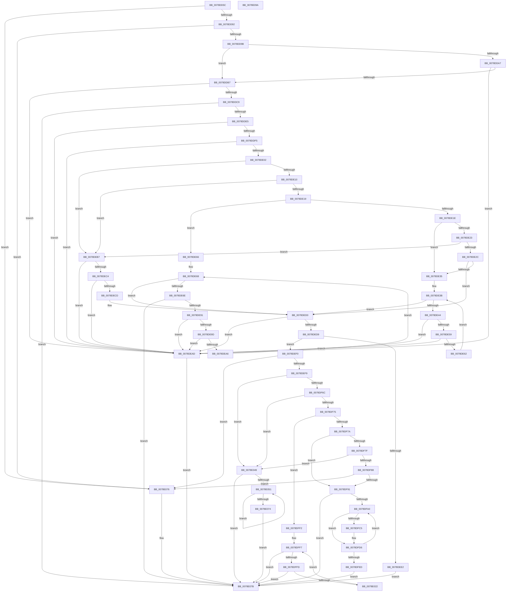

# RtlpConvertAbsoluteToRelativeSecurityAttribute

- RVA: `0x0078DD5C`–`0x0078E09B` (길이 `831` bytes)
- VA: `0x000000014078DD5C`
- 실행 섹션: `PAGE`
- PDB 이름 있음: `예`; PDB Function 태그: `아니요`
- unwind 정보 RVA: `0x0005D79C`
- 디코드: `240`개 명령, `831/831` bytes 표시
- 미해석 바이트: `0` (있으면 어셈블리에 `.byte`로 보존)

> 이 문서는 커널 이미지의 기계어와 PDB 기호를 분석해 생성했습니다. 4번과 5번은 함수 원형과 자료형을 바이너리 사용 방식에서 추정한 C 해석이며 원본 소스 복구 결과는 아닙니다.

## 1. Dependencies

- 직접 호출 지점: **7**; 고유 호출 대상: **3**
- 직접 호출자로 확인된 함수: **1**
- RIP 상대 이미지 참조: **0**

### Outgoing calls
- `0x0078DDD6` → [RtlStringCbLengthW](../../text/45/RtlStringCbLengthW_function_004575EC.md) (function, `0x004575EC`)
- `0x0078DE82` → [RtlStringCbLengthW](../../text/45/RtlStringCbLengthW_function_004575EC.md) (function, `0x004575EC`)
- `0x0078DF05` → [memset](../../text/6C/memset_function_006C6C40.md) (function, `0x006C6C40`)
- `0x0078DF51` → [memcpy](../../text/6C/memcpy_function_006C6840.md) (function, `0x006C6840`)
- `0x0078DFD1` → [memcpy](../../text/6C/memcpy_function_006C6840.md) (function, `0x006C6840`)
- `0x0078E017` → [RtlStringCbLengthW](../../text/45/RtlStringCbLengthW_function_004575EC.md) (function, `0x004575EC`)
- `0x0078E037` → [memcpy](../../text/6C/memcpy_function_006C6840.md) (function, `0x006C6840`)

### Direct callers
- [RtlAddResourceAttributeAce](RtlAddResourceAttributeAce_function_0078D7F0.md) at `0x0078D98B`
- [RtlAddResourceAttributeAce](RtlAddResourceAttributeAce_function_0078D7F0.md) at `0x0078D9CB`

### Static image references
- 디코드된 RIP-relative 메모리 참조가 없습니다.

## 2. Other-region calls and transfers

- 다른 실행 섹션으로 향하는 call: **7**
  - `0x0078DDD6` → [RtlStringCbLengthW](../../text/45/RtlStringCbLengthW_function_004575EC.md) (`PAGE` → `.text`)
  - `0x0078DE82` → [RtlStringCbLengthW](../../text/45/RtlStringCbLengthW_function_004575EC.md) (`PAGE` → `.text`)
  - `0x0078DF05` → [memset](../../text/6C/memset_function_006C6C40.md) (`PAGE` → `.text`)
  - `0x0078DF51` → [memcpy](../../text/6C/memcpy_function_006C6840.md) (`PAGE` → `.text`)
  - `0x0078DFD1` → [memcpy](../../text/6C/memcpy_function_006C6840.md) (`PAGE` → `.text`)
  - `0x0078E017` → [RtlStringCbLengthW](../../text/45/RtlStringCbLengthW_function_004575EC.md) (`PAGE` → `.text`)
  - `0x0078E037` → [memcpy](../../text/6C/memcpy_function_006C6840.md) (`PAGE` → `.text`)
- 별도 외부 분기/꼬리 이동을 확인하지 못했습니다.

## 3. Assembly (complete function range)

```asm
0078DD5C  4C 8B DC                        mov r11, rsp
0078DD5F  49 89 5B 10                     mov qword ptr [r11 + 0x10], rbx
0078DD63  49 89 6B 18                     mov qword ptr [r11 + 0x18], rbp
0078DD67  49 89 73 20                     mov qword ptr [r11 + 0x20], rsi
0078DD6B  57                              push rdi
0078DD6C  41 54                           push r12
0078DD6E  41 55                           push r13
0078DD70  41 56                           push r14
0078DD72  41 57                           push r15
0078DD74  48 83 EC 20                     sub rsp, 0x20
0078DD78  33 F6                           xor esi, esi
0078DD7A  4D 8B E8                        mov r13, r8
0078DD7D  49 89 73 08                     mov qword ptr [r11 + 8], rsi
0078DD81  4C 8B FA                        mov r15, rdx
0078DD84  4C 8B F1                        mov r14, rcx
0078DD87  8B C6                           mov eax, esi
0078DD89  48 85 C9                        test rcx, rcx
0078DD8C  0F 84 E4 02 00 00               je 0x14078e076
0078DD92  4D 85 C0                        test r8, r8
0078DD95  0F 84 DB 02 00 00               je 0x14078e076
0078DD9B  8B 49 10                        mov ecx, dword ptr [rcx + 0x10]
0078DD9E  BD FF FF FF FF                  mov ebp, 0xffffffff
0078DDA3  85 C9                           test ecx, ecx
0078DDA5  74 10                           je 0x14078ddb7
0078DDA7  8D 41 FF                        lea eax, [rcx - 1]
0078DDAA  48 C1 E0 02                     shl rax, 2
0078DDAE  48 3B C5                        cmp rax, rbp
0078DDB1  0F 87 F6 00 00 00               ja 0x14078dead
0078DDB7  44 8D 60 14                     lea r12d, [rax + 0x14]
0078DDBB  B8 14 00 00 00                  mov eax, 0x14
0078DDC0  44 3B E0                        cmp r12d, eax
0078DDC3  0F 82 E4 00 00 00               jb 0x14078dead
0078DDC9  49 8B 0E                        mov rcx, qword ptr [r14]
0078DDCC  4C 8D 44 24 50                  lea r8, [rsp + 0x50]
0078DDD1  BA FF FF 00 00                  mov edx, 0xffff
0078DDD6  E8 11 98 CC FF                  call 0x1404575ec
0078DDDB  8B F8                           mov edi, eax
0078DDDD  85 C0                           test eax, eax
0078DDDF  0F 88 96 02 00 00               js 0x14078e07b
0078DDE5  48 8B 44 24 50                  mov rax, qword ptr [rsp + 0x50]
0078DDEA  8D 58 02                        lea ebx, [rax + 2]
0078DDED  3B D8                           cmp ebx, eax
0078DDEF  0F 82 B8 00 00 00               jb 0x14078dead
0078DDF5  45 8D 1C 1C                     lea r11d, [r12 + rbx]
0078DDF9  45 3B DC                        cmp r11d, r12d
0078DDFC  0F 82 AB 00 00 00               jb 0x14078dead
0078DE02  41 0F B7 4E 08                  movzx ecx, word ptr [r14 + 8]
0078DE07  83 E9 01                        sub ecx, 1
0078DE0A  0F 84 A7 00 00 00               je 0x14078deb7
0078DE10  83 E9 01                        sub ecx, 1
0078DE13  0F 84 9E 00 00 00               je 0x14078deb7
0078DE19  83 E9 01                        sub ecx, 1
0078DE1C  74 48                           je 0x14078de66
0078DE1E  83 E9 02                        sub ecx, 2
0078DE21  74 12                           je 0x14078de35
0078DE23  83 E9 01                        sub ecx, 1
0078DE26  0F 84 8B 00 00 00               je 0x14078deb7
0078DE2C  83 F9 0A                        cmp ecx, 0xa
0078DE2F  0F 85 9B 00 00 00               jne 0x14078ded0
0078DE35  45 8B 46 10                     mov r8d, dword ptr [r14 + 0x10]
0078DE39  8B D6                           mov edx, esi
0078DE3B  41 3B D0                        cmp edx, r8d
0078DE3E  0F 83 8C 00 00 00               jae 0x14078ded0
0078DE44  49 8B 46 18                     mov rax, qword ptr [r14 + 0x18]
0078DE48  8B CA                           mov ecx, edx
0078DE4A  48 03 C9                        add rcx, rcx
0078DE4D  8B 44 C8 08                     mov eax, dword ptr [rax + rcx*8 + 8]
0078DE51  41 03 C3                        add eax, r11d
0078DE54  41 3B C3                        cmp eax, r11d
0078DE57  72 54                           jb 0x14078dead
0078DE59  44 8D 58 04                     lea r11d, [rax + 4]
0078DE5D  44 3B D8                        cmp r11d, eax
0078DE60  72 4B                           jb 0x14078dead
0078DE62  FF C2                           inc edx
0078DE64  EB D5                           jmp 0x14078de3b
0078DE66  8B EE                           mov ebp, esi
0078DE68  41 3B 6E 10                     cmp ebp, dword ptr [r14 + 0x10]
0078DE6C  73 62                           jae 0x14078ded0
0078DE6E  49 8B 4E 18                     mov rcx, qword ptr [r14 + 0x18]
0078DE72  4C 8D 44 24 50                  lea r8, [rsp + 0x50]
0078DE77  8B C5                           mov eax, ebp
0078DE79  BA FF FF 00 00                  mov edx, 0xffff
0078DE7E  48 8B 0C C1                     mov rcx, qword ptr [rcx + rax*8]
0078DE82  E8 65 97 CC FF                  call 0x1404575ec
0078DE87  8B F8                           mov edi, eax
0078DE89  85 C0                           test eax, eax
0078DE8B  0F 88 EA 01 00 00               js 0x14078e07b
0078DE91  48 8B 44 24 50                  mov rax, qword ptr [rsp + 0x50]
0078DE96  8D 48 02                        lea ecx, [rax + 2]
0078DE99  3B C8                           cmp ecx, eax
0078DE9B  72 10                           jb 0x14078dead
0078DE9D  42 8D 04 19                     lea eax, [rcx + r11]
0078DEA1  41 3B C3                        cmp eax, r11d
0078DEA4  72 07                           jb 0x14078dead
0078DEA6  44 8B D8                        mov r11d, eax
0078DEA9  FF C5                           inc ebp
0078DEAB  EB BB                           jmp 0x14078de68
0078DEAD  BF 95 00 00 C0                  mov edi, 0xc0000095
0078DEB2  E9 C4 01 00 00                  jmp 0x14078e07b
0078DEB7  41 8B 46 10                     mov eax, dword ptr [r14 + 0x10]
0078DEBB  48 C1 E0 03                     shl rax, 3
0078DEBF  48 3B C5                        cmp rax, rbp
0078DEC2  77 E9                           ja 0x14078dead
0078DEC4  41 8D 0C 03                     lea ecx, [r11 + rax]
0078DEC8  41 3B CB                        cmp ecx, r11d
0078DECB  72 E0                           jb 0x14078dead
0078DECD  44 8B D9                        mov r11d, ecx
0078DED0  41 8D 43 03                     lea eax, [r11 + 3]
0078DED4  41 3B C3                        cmp eax, r11d
0078DED7  72 D4                           jb 0x14078dead
0078DED9  83 E0 FC                        and eax, 0xfffffffc
0078DEDC  41 39 45 00                     cmp dword ptr [r13], eax
0078DEE0  73 0E                           jae 0x14078def0
0078DEE2  41 89 45 00                     mov dword ptr [r13], eax
0078DEE6  BF 23 00 00 C0                  mov edi, 0xc0000023
0078DEEB  E9 8B 01 00 00                  jmp 0x14078e07b
0078DEF0  4D 85 FF                        test r15, r15
0078DEF3  0F 84 7D 01 00 00               je 0x14078e076
0078DEF9  44 8B C0                        mov r8d, eax
0078DEFC  33 D2                           xor edx, edx
0078DEFE  49 8B CF                        mov rcx, r15
0078DF01  41 89 45 00                     mov dword ptr [r13], eax
0078DF05  E8 36 8D F3 FF                  call 0x1406c6c40
0078DF0A  41 0F B7 46 08                  movzx eax, word ptr [r14 + 8]
0078DF0F  66 41 89 47 04                  mov word ptr [r15 + 4], ax
0078DF14  41 0F B7 46 0A                  movzx eax, word ptr [r14 + 0xa]
0078DF19  66 41 89 47 06                  mov word ptr [r15 + 6], ax
0078DF1E  41 8B 46 0C                     mov eax, dword ptr [r14 + 0xc]
0078DF22  41 89 47 08                     mov dword ptr [r15 + 8], eax
0078DF26  41 8B 46 10                     mov eax, dword ptr [r14 + 0x10]
0078DF2A  41 89 47 0C                     mov dword ptr [r15 + 0xc], eax
0078DF2E  41 8B 46 10                     mov eax, dword ptr [r14 + 0x10]
0078DF32  85 C0                           test eax, eax
0078DF34  44 8B C3                        mov r8d, ebx
0078DF37  8D 2C 85 10 00 00 00            lea ebp, [rax*4 + 0x10]
0078DF3E  B8 14 00 00 00                  mov eax, 0x14
0078DF43  0F 44 E8                        cmove ebp, eax
0078DF46  41 89 2F                        mov dword ptr [r15], ebp
0078DF49  49 8B 16                        mov rdx, qword ptr [r14]
0078DF4C  8B CD                           mov ecx, ebp
0078DF4E  49 03 CF                        add rcx, r15
0078DF51  E8 EA 88 F3 FF                  call 0x1406c6840
0078DF56  41 0F B7 4E 08                  movzx ecx, word ptr [r14 + 8]
0078DF5B  03 EB                           add ebp, ebx
0078DF5D  44 8B DD                        mov r11d, ebp
0078DF60  4D 03 DF                        add r11, r15
0078DF63  83 E9 01                        sub ecx, 1
0078DF66  0F 84 DD 00 00 00               je 0x14078e049
0078DF6C  83 E9 01                        sub ecx, 1
0078DF6F  0F 84 D4 00 00 00               je 0x14078e049
0078DF75  83 E9 01                        sub ecx, 1
0078DF78  74 78                           je 0x14078dff2
0078DF7A  83 E9 02                        sub ecx, 2
0078DF7D  74 12                           je 0x14078df91
0078DF7F  83 E9 01                        sub ecx, 1
0078DF82  0F 84 C1 00 00 00               je 0x14078e049
0078DF88  83 F9 0A                        cmp ecx, 0xa
0078DF8B  0F 85 E5 00 00 00               jne 0x14078e076
0078DF91  44 8B E6                        mov r12d, esi
0078DF94  8B FE                           mov edi, esi
0078DF96  41 39 76 10                     cmp dword ptr [r14 + 0x10], esi
0078DF9A  0F 86 DB 00 00 00               jbe 0x14078e07b
0078DFA0  41 8B DC                        mov ebx, r12d
0078DFA3  41 89 6C 9F 10                  mov dword ptr [r15 + rbx*4 + 0x10], ebp
0078DFA8  48 03 DB                        add rbx, rbx
0078DFAB  49 8B 46 18                     mov rax, qword ptr [r14 + 0x18]
0078DFAF  83 C5 04                        add ebp, 4
0078DFB2  8B 4C D8 08                     mov ecx, dword ptr [rax + rbx*8 + 8]
0078DFB6  41 89 0B                        mov dword ptr [r11], ecx
0078DFB9  49 8B 56 18                     mov rdx, qword ptr [r14 + 0x18]
0078DFBD  8B 44 DA 08                     mov eax, dword ptr [rdx + rbx*8 + 8]
0078DFC1  85 C0                           test eax, eax
0078DFC3  74 11                           je 0x14078dfd6
0078DFC5  48 8B 14 DA                     mov rdx, qword ptr [rdx + rbx*8]
0078DFC9  44 8B C0                        mov r8d, eax
0078DFCC  8B CD                           mov ecx, ebp
0078DFCE  49 03 CF                        add rcx, r15
0078DFD1  E8 6A 88 F3 FF                  call 0x1406c6840
0078DFD6  49 8B 46 18                     mov rax, qword ptr [r14 + 0x18]
0078DFDA  41 FF C4                        inc r12d
0078DFDD  03 6C D8 08                     add ebp, dword ptr [rax + rbx*8 + 8]
0078DFE1  44 8B DD                        mov r11d, ebp
0078DFE4  4D 03 DF                        add r11, r15
0078DFE7  45 3B 66 10                     cmp r12d, dword ptr [r14 + 0x10]
0078DFEB  72 B3                           jb 0x14078dfa0
0078DFED  E9 89 00 00 00                  jmp 0x14078e07b
0078DFF2  44 8B E6                        mov r12d, esi
0078DFF5  8B FE                           mov edi, esi
0078DFF7  45 3B 66 10                     cmp r12d, dword ptr [r14 + 0x10]
0078DFFB  73 7E                           jae 0x14078e07b
0078DFFD  45 8B EC                        mov r13d, r12d
0078E000  4C 8D 44 24 50                  lea r8, [rsp + 0x50]
0078E005  BA FF FF 00 00                  mov edx, 0xffff
0078E00A  43 89 6C AF 10                  mov dword ptr [r15 + r13*4 + 0x10], ebp
0078E00F  49 8B 4E 18                     mov rcx, qword ptr [r14 + 0x18]
0078E013  4A 8B 0C E9                     mov rcx, qword ptr [rcx + r13*8]
0078E017  E8 D0 95 CC FF                  call 0x1404575ec
0078E01C  8B F8                           mov edi, eax
0078E01E  85 C0                           test eax, eax
0078E020  78 59                           js 0x14078e07b
0078E022  49 8B 56 18                     mov rdx, qword ptr [r14 + 0x18]
0078E026  49 8B CB                        mov rcx, r11
0078E029  8B 5C 24 50                     mov ebx, dword ptr [rsp + 0x50]
0078E02D  83 C3 02                        add ebx, 2
0078E030  44 8B C3                        mov r8d, ebx
0078E033  4A 8B 14 EA                     mov rdx, qword ptr [rdx + r13*8]
0078E037  E8 04 88 F3 FF                  call 0x1406c6840
0078E03C  03 EB                           add ebp, ebx
0078E03E  44 8B DD                        mov r11d, ebp
0078E041  4D 03 DF                        add r11, r15
0078E044  41 FF C4                        inc r12d
0078E047  EB AE                           jmp 0x14078dff7
0078E049  8B FE                           mov edi, esi
0078E04B  41 39 76 10                     cmp dword ptr [r14 + 0x10], esi
0078E04F  76 2A                           jbe 0x14078e07b
0078E051  8B CE                           mov ecx, esi
0078E053  FF C6                           inc esi
0078E055  41 89 6C 8F 10                  mov dword ptr [r15 + rcx*4 + 0x10], ebp
0078E05A  83 C5 08                        add ebp, 8
0078E05D  49 8B 46 18                     mov rax, qword ptr [r14 + 0x18]
0078E061  48 8B 0C C8                     mov rcx, qword ptr [rax + rcx*8]
0078E065  49 89 0B                        mov qword ptr [r11], rcx
0078E068  44 8B DD                        mov r11d, ebp
0078E06B  4D 03 DF                        add r11, r15
0078E06E  41 3B 76 10                     cmp esi, dword ptr [r14 + 0x10]
0078E072  72 DD                           jb 0x14078e051
0078E074  EB 05                           jmp 0x14078e07b
0078E076  BF 0D 00 00 C0                  mov edi, 0xc000000d
0078E07B  48 8B 5C 24 58                  mov rbx, qword ptr [rsp + 0x58]
0078E080  8B C7                           mov eax, edi
0078E082  48 8B 6C 24 60                  mov rbp, qword ptr [rsp + 0x60]
0078E087  48 8B 74 24 68                  mov rsi, qword ptr [rsp + 0x68]
0078E08C  48 83 C4 20                     add rsp, 0x20
0078E090  41 5F                           pop r15
0078E092  41 5E                           pop r14
0078E094  41 5D                           pop r13
0078E096  41 5C                           pop r12
0078E098  5F                              pop rdi
0078E099  C3                              ret
0078E09A  CC                              int3
```

## 4. C-style interpretation (structured pseudocode)

```c
__int64 __fastcall RtlpConvertAbsoluteToRelativeSecurityAttribute(__int64 a1, __int64 a2, __int64 a3)
{
    __int64 result;
    __int64 v_r11;
    __int64 v_r12;
    __int64 v_rbp;
    __int64 v_rbx;
    __int64 v_rsi;
    __int64 v_rsp;
    unsigned __int64 v_stack_p10;
    unsigned __int64 v_stack_p18;
    unsigned __int64 v_stack_p20;
    unsigned __int64 v_stack_p8;

    *(unsigned __int64 *)(v_rsp + 16) = v_rbx;
    *(unsigned __int64 *)(v_rsp + 24) = v_rbp;
    *(unsigned __int64 *)(v_rsp + 32) = v_rsi;
    v_rsp = (v_rsp) - (32);
    v_rsi = 0;
    *(unsigned __int64 *)(v_rsp + 8) = 0;
    if (a1 == 0) goto loc_0078E076;
    if (a3 == 0) goto loc_0078E076;
    if ((unsigned int)((unsigned int)(*(unsigned int *)(a1 + 16))) == 0) goto loc_0078DDB7;
    result = ((unsigned int)(*(unsigned int *)(a1 + 16)) - 1) << (2);
    if (result > ((unsigned int)(0xFFFFFFFFULL))) goto loc_0078DEAD;
loc_0078DDB7:
    if (((unsigned int)(result + 20)) < 20) goto loc_0078DEAD;
    result = RtlStringCbLengthW(*(unsigned __int64 *)(a1), (unsigned int)(0xFFFFULL), v_stack_p8, a4);
    if (sign_flag) goto loc_0078E07B;
    if (((unsigned int)(v_stack_p8 + 2)) < ((unsigned int)(v_stack_p8))) goto loc_0078DEAD;
    if (((unsigned int)(result + 20 + v_stack_p8 + 2 * 1)) < ((unsigned int)(result + 20))) goto loc_0078DEAD;
    a1 = (unsigned int)((*(unsigned __int16 *)(a1 + 8)) - (1));
    if (condition_is_equal) goto loc_0078DEB7;
    a1 = (unsigned int)((a1) - (1));
    if (condition_is_equal) goto loc_0078DEB7;
    a1 = (unsigned int)((a1) - (1));
    if (condition_is_equal) goto loc_0078DE66;
    a1 = (unsigned int)((a1) - (2));
    if (condition_is_equal) goto loc_0078DE35;
    a1 = (unsigned int)((a1) - (1));
    if (condition_is_equal) goto loc_0078DEB7;
    if (((unsigned int)(a1)) != 10) goto loc_0078DED0;
loc_0078DE35:
loc_0078DE3B:
    if (0 >= ((unsigned int)((unsigned int)(*(unsigned int *)(a1 + 16))))) goto loc_0078DED0;
    a1 = (0) + (0);
    result = (unsigned int)(((unsigned int)(*(unsigned int *)(*(unsigned __int64 *)(a1 + 24) + a1 * 8 + 8))) + ((unsigned int)(result + 20 + v_stack_p8 + 2 * 1)));
    if (((unsigned int)(result)) < ((unsigned int)(result + 20 + v_stack_p8 + 2 * 1))) goto loc_0078DEAD;
    if (((unsigned int)(result + 4)) < ((unsigned int)(result))) goto loc_0078DEAD;
    a2 = (unsigned int)((0) + 1);
    goto loc_0078DE3B;
loc_0078DE66:
loc_0078DE68:
    if (0 >= (*(unsigned int *)(a1 + 16))) goto loc_0078DED0;
    result = RtlStringCbLengthW(*(unsigned __int64 *)(*(unsigned __int64 *)(a1 + 24) + 0 * 8), (unsigned int)(0xFFFFULL), v_stack_p8, a4);
    if (sign_flag) goto loc_0078E07B;
    if (((unsigned int)(v_stack_p8 + 2)) < ((unsigned int)(v_stack_p8))) goto loc_0078DEAD;
    if (((unsigned int)(v_stack_p8 + 2 + result + 4 * 1)) < ((unsigned int)(result + 4))) goto loc_0078DEAD;
    v_rbp = (unsigned int)((0) + 1);
    goto loc_0078DE68;
loc_0078DEAD:
    goto loc_0078E07B;
loc_0078DEB7:
    result = ((unsigned int)(*(unsigned int *)(a1 + 16))) << (3);
    if (result > v_rbp) goto loc_0078DEAD;
    if (((unsigned int)((unsigned int)((unsigned int)(v_stack_p8 + 2 + result + 4 * 1)) + result * 1)) < ((unsigned int)((unsigned int)((unsigned int)(v_stack_p8 + 2 + result + 4 * 1))))) goto loc_0078DEAD;
loc_0078DED0:
    if (((unsigned int)((unsigned int)((unsigned int)((unsigned int)((unsigned int)(v_stack_p8 + 2 + result + 4 * 1)) + result * 1)) + 3)) < ((unsigned int)((unsigned int)((unsigned int)((unsigned int)((unsigned int)(v_stack_p8 + 2 + result + 4 * 1)) + result * 1))))) goto loc_0078DEAD;
    result = (unsigned int)(((unsigned int)((unsigned int)((unsigned int)((unsigned int)(v_stack_p8 + 2 + result + 4 * 1)) + result * 1)) + 3) & (0xFFFFFFFCULL));
    if ((*(unsigned int *)(a3)) >= ((unsigned int)(result))) goto loc_0078DEF0;
    *(unsigned int *)(a3) = (unsigned int)(result);
    goto loc_0078E07B;
loc_0078DEF0:
    if (a2 == 0) goto loc_0078E076;
    a2 = 0;
    *(unsigned int *)(a3) = (unsigned int)(result);
    result = memset(0, a2, (unsigned int)((unsigned int)(result)), a4);
    *(unsigned __int16 *)(a2 + 4) = (unsigned __int16)(*(unsigned __int16 *)(a1 + 8));
    *(unsigned __int16 *)(a2 + 6) = (unsigned __int16)(*(unsigned __int16 *)(a1 + 10));
    *(unsigned int *)(a2 + 8) = (unsigned int)((unsigned int)(*(unsigned int *)(a1 + 12)));
    *(unsigned int *)(a2 + 12) = (unsigned int)((unsigned int)(*(unsigned int *)(a1 + 16)));
    v_rbp = (unsigned int)(*(unsigned int *)(a1 + 16)) * 4 + 16;
    if ((unsigned int)((unsigned int)(*(unsigned int *)(a1 + 16))) == 0) { v_rbp = 20; }
    *(unsigned int *)(a2) = (unsigned int)(v_rbp);
    a1 = ((unsigned int)((unsigned int)(v_rbp))) + (0);
    result = memcpy(a1, *(unsigned __int64 *)(a1), (unsigned int)((unsigned int)(v_stack_p8 + 2)), a4);
    v_rbp = (unsigned int)((v_rbp) + ((unsigned int)(v_stack_p8 + 2)));
    v_r11 = ((unsigned int)((unsigned int)(v_rbp))) + (0);
    a1 = (unsigned int)((*(unsigned __int16 *)(a1 + 8)) - (1));
    if (condition_is_equal) goto loc_0078E049;
    a1 = (unsigned int)((a1) - (1));
    if (condition_is_equal) goto loc_0078E049;
    a1 = (unsigned int)((a1) - (1));
    if (condition_is_equal) goto loc_0078DFF2;
    a1 = (unsigned int)((a1) - (2));
    if (condition_is_equal) goto loc_0078DF91;
    a1 = (unsigned int)((a1) - (1));
    if (condition_is_equal) goto loc_0078E049;
    if (((unsigned int)(a1)) != 10) goto loc_0078E076;
loc_0078DF91:
    if ((*(unsigned int *)(a1 + 16)) <= 0) goto loc_0078E07B;
loc_0078DFA0:
    *(unsigned int *)(a2 + 0 * 4 + 16) = (unsigned int)(v_rbp);
    v_rbx = (0) + (0);
    v_rbp = (unsigned int)((v_rbp) + (4));
    *(unsigned int *)(v_r11) = (unsigned int)((unsigned int)(*(unsigned int *)(*(unsigned __int64 *)(a1 + 24) + v_rbx * 8 + 8)));
    result = (unsigned int)(*(unsigned int *)(*(unsigned __int64 *)(a1 + 24) + v_rbx * 8 + 8));
    if ((unsigned int)((unsigned int)(*(unsigned int *)(*(unsigned __int64 *)(a1 + 24) + v_rbx * 8 + 8))) != 0) {
        a2 = *(unsigned __int64 *)(*(unsigned __int64 *)(a1 + 24) + v_rbx * 8);
        a3 = (unsigned int)((unsigned int)(*(unsigned int *)(*(unsigned __int64 *)(a1 + 24) + v_rbx * 8 + 8)));
        a1 = (unsigned int)(v_rbp);
        a1 = (a1) + (a2);
        result = memcpy(a1, a2, a3, a4);
    }
    v_r12 = (unsigned int)((0) + 1);
    v_rbp = (unsigned int)((v_rbp) + (*(unsigned int *)(*(unsigned __int64 *)(a1 + 24) + v_rbx * 8 + 8)));
    v_r11 = ((unsigned int)((unsigned int)(v_rbp))) + (a2);
    if (((unsigned int)(v_r12)) < (*(unsigned int *)(a1 + 16))) goto loc_0078DFA0;
    goto loc_0078E07B;
loc_0078DFF2:
loc_0078DFF7:
    if (0 >= (*(unsigned int *)(a1 + 16))) goto loc_0078E07B;
    *(unsigned int *)(a2 + 0 * 4 + 16) = (unsigned int)(v_rbp);
    result = RtlStringCbLengthW(*(unsigned __int64 *)(*(unsigned __int64 *)(a1 + 24) + 0 * 8), (unsigned int)(0xFFFFULL), v_stack_p8, a4);
    if (sign_flag) goto loc_0078E07B;
    v_rbx = (unsigned int)(((unsigned int)(v_stack_p8)) + (2));
    result = memcpy(v_r11, *(unsigned __int64 *)(*(unsigned __int64 *)(a1 + 24) + 0 * 8), (unsigned int)((unsigned int)(v_rbx)), a4);
    v_rbp = (unsigned int)((v_rbp) + ((unsigned int)(v_rbx)));
    v_r11 = ((unsigned int)((unsigned int)(v_rbp))) + (a2);
    v_r12 = (unsigned int)((0) + 1);
    goto loc_0078DFF7;
loc_0078E049:
    if ((*(unsigned int *)(a1 + 16)) <= 0) goto loc_0078E07B;
loc_0078E051:
    v_rsi = (unsigned int)((v_rsi) + 1);
    *(unsigned int *)(a2 + 0 * 4 + 16) = (unsigned int)(v_rbp);
    v_rbp = (unsigned int)((v_rbp) + (8));
    *(unsigned __int64 *)(v_r11) = *(unsigned __int64 *)(*(unsigned __int64 *)(a1 + 24) + 0 * 8);
    v_r11 = ((unsigned int)((unsigned int)(v_rbp))) + (a2);
    if (((unsigned int)(v_rsi)) < (*(unsigned int *)(a1 + 16))) goto loc_0078E051;
    goto loc_0078E07B;
loc_0078E076:
loc_0078E07B:
    v_rsp = (v_rsp) + (32);
    return (unsigned int)((unsigned int)((unsigned int)(0xC000000DULL)));
}
```

## 5. (Beta) C Style

```c
int64_t RtlpConvertAbsoluteToRelativeSecurityAttribute(void *Arg1, int64_t Arg2, void *Arg3)
{
    uint8_t *arg1 = (uint8_t *)Arg1;
    uint8_t *arg3 = (uint8_t *)Arg3;

    int64_t result;
    int64_t local_r11;
    int64_t local_r12;
    int64_t local_rbp;
    int64_t local_rbx;
    int64_t local_rsi;
    int64_t local_rsp;
    uint64_t v_stack_p10;
    uint64_t v_stack_p18;
    uint64_t v_stack_p20;
    uint64_t v_stack_p8;

    *(uint64_t *)(local_rsp + 0x10) = local_rbx;
    *(uint64_t *)(local_rsp + 0x18) = local_rbp;
    *(uint64_t *)(local_rsp + 0x20) = local_rsi;
    local_rsp = (local_rsp) - (32);
    local_rsi = 0;
    *(uint64_t *)(local_rsp + 0x8) = 0;
    if (Arg1 == NULL) goto loc_0078E076;
    if (Arg3 == NULL) goto loc_0078E076;
    if ((uint32_t)((uint32_t)(*(uint32_t *)(arg1 + 0x10))) == 0) goto loc_0078DDB7;
    result = ((uint32_t)(*(uint32_t *)(arg1 + 0x10)) - 1) << (2);
    if (result > ((uint32_t)(0xFFFFFFFFULL))) goto loc_0078DEAD;
loc_0078DDB7:
    if (((uint32_t)(result + 20)) < 20) goto loc_0078DEAD;
    result = RtlStringCbLengthW(*(uint64_t *)(arg1), (uint32_t)(0xFFFFULL), v_stack_p8, a4);
    if (sign_flag) goto loc_0078E07B;
    if (((uint32_t)(v_stack_p8 + 2)) < ((uint32_t)(v_stack_p8))) goto loc_0078DEAD;
    if (((uint32_t)(result + 20 + v_stack_p8 + 2 * 1)) < ((uint32_t)(result + 20))) goto loc_0078DEAD;
    Arg1 = (uint32_t)((*(uint16_t *)(arg1 + 0x8)) - (1));
    if (condition_is_equal) goto loc_0078DEB7;
    Arg1 = (uint32_t)((Arg1) - (1));
    if (condition_is_equal) goto loc_0078DEB7;
    Arg1 = (uint32_t)((Arg1) - (1));
    if (condition_is_equal) goto loc_0078DE66;
    Arg1 = (uint32_t)((Arg1) - (2));
    if (condition_is_equal) goto loc_0078DE35;
    Arg1 = (uint32_t)((Arg1) - (1));
    if (condition_is_equal) goto loc_0078DEB7;
    if (((uint32_t)(Arg1)) != 10) goto loc_0078DED0;
loc_0078DE35:
loc_0078DE3B:
    if (0 >= ((uint32_t)((uint32_t)(*(uint32_t *)(arg1 + 0x10))))) goto loc_0078DED0;
    Arg1 = (0) + (0);
    result = (uint32_t)(((uint32_t)(*(uint32_t *)(*(uint64_t *)(arg1 + 0x18) + arg1 * 8 + 0x8))) + ((uint32_t)(result + 20 + v_stack_p8 + 2 * 1)));
    if (((uint32_t)(result)) < ((uint32_t)(result + 20 + v_stack_p8 + 2 * 1))) goto loc_0078DEAD;
    if (((uint32_t)(result + 4)) < ((uint32_t)(result))) goto loc_0078DEAD;
    Arg2 = (uint32_t)((0) + 1);
    goto loc_0078DE3B;
loc_0078DE66:
loc_0078DE68:
    if (0 >= (*(uint32_t *)(arg1 + 0x10))) goto loc_0078DED0;
    result = RtlStringCbLengthW(*(uint64_t *)(*(uint64_t *)(arg1 + 0x18) + 0x0 * 8), (uint32_t)(0xFFFFULL), v_stack_p8, a4);
    if (sign_flag) goto loc_0078E07B;
    if (((uint32_t)(v_stack_p8 + 2)) < ((uint32_t)(v_stack_p8))) goto loc_0078DEAD;
    if (((uint32_t)(v_stack_p8 + 2 + result + 4 * 1)) < ((uint32_t)(result + 4))) goto loc_0078DEAD;
    local_rbp = (uint32_t)((0) + 1);
    goto loc_0078DE68;
loc_0078DEAD:
    goto loc_0078E07B;
loc_0078DEB7:
    result = ((uint32_t)(*(uint32_t *)(arg1 + 0x10))) << (3);
    if (result > local_rbp) goto loc_0078DEAD;
    if (((uint32_t)((uint32_t)((uint32_t)(v_stack_p8 + 2 + result + 4 * 1)) + result * 1)) < ((uint32_t)((uint32_t)((uint32_t)(v_stack_p8 + 2 + result + 4 * 1))))) goto loc_0078DEAD;
loc_0078DED0:
    if (((uint32_t)((uint32_t)((uint32_t)((uint32_t)((uint32_t)(v_stack_p8 + 2 + result + 4 * 1)) + result * 1)) + 3)) < ((uint32_t)((uint32_t)((uint32_t)((uint32_t)((uint32_t)(v_stack_p8 + 2 + result + 4 * 1)) + result * 1))))) goto loc_0078DEAD;
    result = (uint32_t)(((uint32_t)((uint32_t)((uint32_t)((uint32_t)(v_stack_p8 + 2 + result + 4 * 1)) + result * 1)) + 3) & (0xFFFFFFFCULL));
    if ((*(uint32_t *)(arg3)) >= ((uint32_t)(result))) goto loc_0078DEF0;
    *(uint32_t *)(arg3) = (uint32_t)(result);
    goto loc_0078E07B;
loc_0078DEF0:
    if (Arg2 == 0) goto loc_0078E076;
    Arg2 = 0;
    *(uint32_t *)(arg3) = (uint32_t)(result);
    result = memset(0, Arg2, (uint32_t)((uint32_t)(result)), a4);
    *(uint16_t *)(Arg2 + 0x4) = (uint16_t)(*(uint16_t *)(arg1 + 0x8));
    *(uint16_t *)(Arg2 + 0x6) = (uint16_t)(*(uint16_t *)(arg1 + 0xA));
    *(uint32_t *)(Arg2 + 0x8) = (uint32_t)((uint32_t)(*(uint32_t *)(arg1 + 0xC)));
    *(uint32_t *)(Arg2 + 0xC) = (uint32_t)((uint32_t)(*(uint32_t *)(arg1 + 0x10)));
    local_rbp = (uint32_t)(*(uint32_t *)(arg1 + 0x10)) * 4 + 16;
    if ((uint32_t)((uint32_t)(*(uint32_t *)(arg1 + 0x10))) == 0) { local_rbp = 20; }
    *(uint32_t *)(Arg2) = (uint32_t)(local_rbp);
    Arg1 = ((uint32_t)((uint32_t)(local_rbp))) + (0);
    result = memcpy(Arg1, *(uint64_t *)(arg1), (uint32_t)((uint32_t)(v_stack_p8 + 2)), a4);
    local_rbp = (uint32_t)((local_rbp) + ((uint32_t)(v_stack_p8 + 2)));
    local_r11 = ((uint32_t)((uint32_t)(local_rbp))) + (0);
    Arg1 = (uint32_t)((*(uint16_t *)(arg1 + 0x8)) - (1));
    if (condition_is_equal) goto loc_0078E049;
    Arg1 = (uint32_t)((Arg1) - (1));
    if (condition_is_equal) goto loc_0078E049;
    Arg1 = (uint32_t)((Arg1) - (1));
    if (condition_is_equal) goto loc_0078DFF2;
    Arg1 = (uint32_t)((Arg1) - (2));
    if (condition_is_equal) goto loc_0078DF91;
    Arg1 = (uint32_t)((Arg1) - (1));
    if (condition_is_equal) goto loc_0078E049;
    if (((uint32_t)(Arg1)) != 10) goto loc_0078E076;
loc_0078DF91:
    if ((*(uint32_t *)(arg1 + 0x10)) <= 0) goto loc_0078E07B;
loc_0078DFA0:
    *(uint32_t *)(Arg2 + 0x0 * 4 + 0x10) = (uint32_t)(local_rbp);
    local_rbx = (0) + (0);
    local_rbp = (uint32_t)((local_rbp) + (4));
    *(uint32_t *)(local_r11) = (uint32_t)((uint32_t)(*(uint32_t *)(*(uint64_t *)(arg1 + 0x18) + local_rbx * 8 + 0x8)));
    result = (uint32_t)(*(uint32_t *)(*(uint64_t *)(arg1 + 0x18) + local_rbx * 8 + 0x8));
    if ((uint32_t)((uint32_t)(*(uint32_t *)(*(uint64_t *)(arg1 + 0x18) + local_rbx * 8 + 0x8))) != 0) {
        Arg2 = *(uint64_t *)(*(uint64_t *)(arg1 + 0x18) + local_rbx * 8);
        Arg3 = (uint32_t)((uint32_t)(*(uint32_t *)(*(uint64_t *)(arg1 + 0x18) + local_rbx * 8 + 0x8)));
        Arg1 = (uint32_t)(local_rbp);
        Arg1 = (Arg1) + (Arg2);
        result = memcpy(Arg1, Arg2, Arg3, a4);
    }
    local_r12 = (uint32_t)((0) + 1);
    local_rbp = (uint32_t)((local_rbp) + (*(uint32_t *)(*(uint64_t *)(arg1 + 0x18) + local_rbx * 8 + 0x8)));
    local_r11 = ((uint32_t)((uint32_t)(local_rbp))) + (Arg2);
    if (((uint32_t)(local_r12)) < (*(uint32_t *)(arg1 + 0x10))) goto loc_0078DFA0;
    goto loc_0078E07B;
loc_0078DFF2:
loc_0078DFF7:
    if (0 >= (*(uint32_t *)(arg1 + 0x10))) goto loc_0078E07B;
    *(uint32_t *)(Arg2 + 0x0 * 4 + 0x10) = (uint32_t)(local_rbp);
    result = RtlStringCbLengthW(*(uint64_t *)(*(uint64_t *)(arg1 + 0x18) + 0x0 * 8), (uint32_t)(0xFFFFULL), v_stack_p8, a4);
    if (sign_flag) goto loc_0078E07B;
    local_rbx = (uint32_t)(((uint32_t)(v_stack_p8)) + (2));
    result = memcpy(local_r11, *(uint64_t *)(*(uint64_t *)(arg1 + 0x18) + 0x0 * 8), (uint32_t)((uint32_t)(local_rbx)), a4);
    local_rbp = (uint32_t)((local_rbp) + ((uint32_t)(local_rbx)));
    local_r11 = ((uint32_t)((uint32_t)(local_rbp))) + (Arg2);
    local_r12 = (uint32_t)((0) + 1);
    goto loc_0078DFF7;
loc_0078E049:
    if ((*(uint32_t *)(arg1 + 0x10)) <= 0) goto loc_0078E07B;
loc_0078E051:
    local_rsi = (uint32_t)((local_rsi) + 1);
    *(uint32_t *)(Arg2 + 0x0 * 4 + 0x10) = (uint32_t)(local_rbp);
    local_rbp = (uint32_t)((local_rbp) + (8));
    *(uint64_t *)(local_r11) = *(uint64_t *)(*(uint64_t *)(arg1 + 0x18) + 0x0 * 8);
    local_r11 = ((uint32_t)((uint32_t)(local_rbp))) + (Arg2);
    if (((uint32_t)(local_rsi)) < (*(uint32_t *)(arg1 + 0x10))) goto loc_0078E051;
    goto loc_0078E07B;
loc_0078E076:
loc_0078E07B:
    local_rsp = (local_rsp) + (32);
    return (uint32_t)((uint32_t)((uint32_t)(0xC000000DULL)));
}
```

### 관측된 메모리 오프셋

구조체 형식이 확인되지 않은 접근은 인자 기준의 오프셋으로만 기록했습니다.

| 기준 인자 | 오프셋 표현 | 폭 (bit) | 접근 |
|---|---:|---:|---|
| `Arg1` | `+ 0x0` | `64` | `R` |
| `Arg1` | `+ 0x8` | `16` | `R` |
| `Arg1` | `+ 0xA` | `16` | `R` |
| `Arg1` | `+ 0xC` | `32` | `R` |
| `Arg1` | `+ 0x10` | `32` | `R` |
| `Arg1` | `+ 0x18` | `64` | `R` |
| `Arg3` | `+ 0x0` | `32` | `R` |
| `Arg3` | `+ 0x0` | `32` | `W` |

## 6. Execution-region graph

[열기: 2D/3D 그래프와 함수 탐색 컨트롤 패널](../../../control-panel.html?section=page&rva=0x0078DD5C&view=graph)

- 2D 그래프는 위에서 아래로 흐르고, 3D 그래프는 빈 공간을 드래그해 회전합니다. Shift+드래그는 이동, 휠은 확대·축소, 함수 노드 선택은 대상 보고서 이동입니다.

### Static fallback


