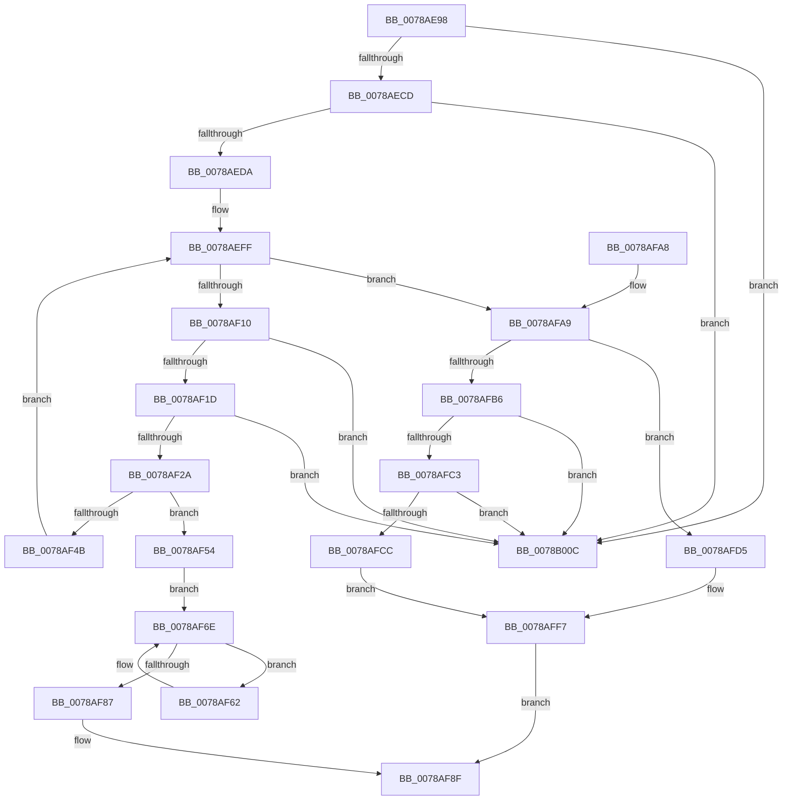

# RtlpDeleteFromMergedRange

- RVA: `0x0078AE98`–`0x0078B013` (길이 `379` bytes)
- VA: `0x000000014078AE98`
- 실행 섹션: `PAGE`
- PDB 이름 있음: `예`; PDB Function 태그: `아니요`
- unwind 정보 RVA: `0x000CF768`
- 디코드: `106`개 명령, `379/379` bytes 표시
- 미해석 바이트: `0` (있으면 어셈블리에 `.byte`로 보존)

> 이 문서는 커널 이미지의 기계어와 PDB 기호를 분석해 생성했습니다. 4번과 5번은 함수 원형과 자료형을 바이너리 사용 방식에서 추정한 C 해석이며 원본 소스 복구 결과는 아닙니다.

## 1. Dependencies

- 직접 호출 지점: **5**; 고유 호출 대상: **3**
- 직접 호출자로 확인된 함수: **2**
- RIP 상대 이미지 참조: **0**

### Outgoing calls
- `0x0078AF3F` → [RtlpAddRange](../70/RtlpAddRange_function_00705A70.md) (function, `0x00705A70`)
- `0x0078AF62` → [RtlpAddToMergedRange](RtlpAddToMergedRange_function_0078AD6C.md) (function, `0x0078AD6C`)
- `0x0078AF8A` → [RtlpAddToMergedRange](RtlpAddToMergedRange_function_0078AD6C.md) (function, `0x0078AD6C`)
- `0x0078AFFA` → [RtlpFreeRangeListEntry](../A6/RtlpFreeRangeListEntry_function_00A69918.md) (function, `0x00A69918`)
- `0x0078B002` → [RtlpFreeRangeListEntry](../A6/RtlpFreeRangeListEntry_function_00A69918.md) (function, `0x00A69918`)

### Direct callers
- [RtlDeleteRange](RtlDeleteRange_function_0078A920.md) at `0x0078A9BF`
- [sub_00B43A50](../B4/Unknown_function_00B43A50.md) at `0x00B43A72`

### Static image references
- 디코드된 RIP-relative 메모리 참조가 없습니다.

## 2. Other-region calls and transfers

- 다른 실행 섹션으로 향하는 call: **0**
- 별도 외부 분기/꼬리 이동을 확인하지 못했습니다.

## 3. Assembly (complete function range)

```asm
0078AE98  48 89 5C 24 08                  mov qword ptr [rsp + 8], rbx
0078AE9D  48 89 74 24 10                  mov qword ptr [rsp + 0x10], rsi
0078AEA2  48 89 7C 24 18                  mov qword ptr [rsp + 0x18], rdi
0078AEA7  55                              push rbp
0078AEA8  41 56                           push r14
0078AEAA  41 57                           push r15
0078AEAC  48 8B EC                        mov rbp, rsp
0078AEAF  48 83 EC 30                     sub rsp, 0x30
0078AEB3  48 8D 41 28                     lea rax, [rcx + 0x28]
0078AEB7  48 8B F1                        mov rsi, rcx
0078AEBA  48 8B 08                        mov rcx, qword ptr [rax]
0078AEBD  45 33 F6                        xor r14d, r14d
0078AEC0  48 8B DA                        mov rbx, rdx
0078AEC3  48 39 41 08                     cmp qword ptr [rcx + 8], rax
0078AEC7  0F 85 3F 01 00 00               jne 0x14078b00c
0078AECD  48 8B 50 08                     mov rdx, qword ptr [rax + 8]
0078AED1  48 39 02                        cmp qword ptr [rdx], rax
0078AED4  0F 85 32 01 00 00               jne 0x14078b00c
0078AEDA  48 89 0A                        mov qword ptr [rdx], rcx
0078AEDD  48 8D 45 F0                     lea rax, [rbp - 0x10]
0078AEE1  48 89 51 08                     mov qword ptr [rcx + 8], rdx
0078AEE5  4C 8D 7B 10                     lea r15, [rbx + 0x10]
0078AEE9  48 89 45 F8                     mov qword ptr [rbp - 8], rax
0078AEED  48 8D 45 F0                     lea rax, [rbp - 0x10]
0078AEF1  48 89 45 F0                     mov qword ptr [rbp - 0x10], rax
0078AEF5  49 8B 07                        mov rax, qword ptr [r15]
0078AEF8  48 8B 38                        mov rdi, qword ptr [rax]
0078AEFB  48 8D 50 D8                     lea rdx, [rax - 0x28]
0078AEFF  48 83 EF 28                     sub rdi, 0x28
0078AF03  48 8D 42 28                     lea rax, [rdx + 0x28]
0078AF07  4C 3B F8                        cmp r15, rax
0078AF0A  0F 84 99 00 00 00               je 0x14078afa9
0078AF10  4C 8B 00                        mov r8, qword ptr [rax]
0078AF13  49 39 40 08                     cmp qword ptr [r8 + 8], rax
0078AF17  0F 85 EF 00 00 00               jne 0x14078b00c
0078AF1D  48 8B 48 08                     mov rcx, qword ptr [rax + 8]
0078AF21  48 39 01                        cmp qword ptr [rcx], rax
0078AF24  0F 85 E2 00 00 00               jne 0x14078b00c
0078AF2A  4C 89 01                        mov qword ptr [rcx], r8
0078AF2D  49 89 48 08                     mov qword ptr [r8 + 8], rcx
0078AF31  41 B8 01 00 00 00               mov r8d, 1
0078AF37  80 62 21 FD                     and byte ptr [rdx + 0x21], 0xfd
0078AF3B  48 8D 4D F0                     lea rcx, [rbp - 0x10]
0078AF3F  E8 2C AB F7 FF                  call 0x140705a70
0078AF44  44 8B F0                        mov r14d, eax
0078AF47  85 C0                           test eax, eax
0078AF49  78 09                           js 0x14078af54
0078AF4B  48 8B D7                        mov rdx, rdi
0078AF4E  48 8B 7F 28                     mov rdi, qword ptr [rdi + 0x28]
0078AF52  EB AB                           jmp 0x14078aeff
0078AF54  48 8B 55 F0                     mov rdx, qword ptr [rbp - 0x10]
0078AF58  48 83 C2 D8                     add rdx, -0x28
0078AF5C  48 8D 42 28                     lea rax, [rdx + 0x28]
0078AF60  EB 0C                           jmp 0x14078af6e
0078AF62  E8 05 FE FF FF                  call 0x14078ad6c
0078AF67  48 8D 47 28                     lea rax, [rdi + 0x28]
0078AF6B  48 8B D7                        mov rdx, rdi
0078AF6E  48 8B 38                        mov rdi, qword ptr [rax]
0078AF71  48 8D 4D F0                     lea rcx, [rbp - 0x10]
0078AF75  48 83 EF 28                     sub rdi, 0x28
0078AF79  41 B8 01 00 00 00               mov r8d, 1
0078AF7F  48 3B C8                        cmp rcx, rax
0078AF82  48 8B CB                        mov rcx, rbx
0078AF85  75 DB                           jne 0x14078af62
0078AF87  48 8B D6                        mov rdx, rsi
0078AF8A  E8 DD FD FF FF                  call 0x14078ad6c
0078AF8F  48 8B 5C 24 50                  mov rbx, qword ptr [rsp + 0x50]
0078AF94  48 8B 74 24 58                  mov rsi, qword ptr [rsp + 0x58]
0078AF99  48 8B 7C 24 60                  mov rdi, qword ptr [rsp + 0x60]
0078AF9E  48 83 C4 30                     add rsp, 0x30
0078AFA2  41 5F                           pop r15
0078AFA4  41 5E                           pop r14
0078AFA6  5D                              pop rbp
0078AFA7  C3                              ret
0078AFA8  CC                              int3
0078AFA9  48 8B 45 F0                     mov rax, qword ptr [rbp - 0x10]
0078AFAD  48 8D 4D F0                     lea rcx, [rbp - 0x10]
0078AFB1  48 3B C1                        cmp rax, rcx
0078AFB4  75 1F                           jne 0x14078afd5
0078AFB6  48 8D 43 28                     lea rax, [rbx + 0x28]
0078AFBA  48 8B 10                        mov rdx, qword ptr [rax]
0078AFBD  48 39 42 08                     cmp qword ptr [rdx + 8], rax
0078AFC1  75 49                           jne 0x14078b00c
0078AFC3  48 8B 48 08                     mov rcx, qword ptr [rax + 8]
0078AFC7  48 39 01                        cmp qword ptr [rcx], rax
0078AFCA  75 40                           jne 0x14078b00c
0078AFCC  48 89 11                        mov qword ptr [rcx], rdx
0078AFCF  48 89 4A 08                     mov qword ptr [rdx + 8], rcx
0078AFD3  EB 22                           jmp 0x14078aff7
0078AFD5  48 8B 4B 30                     mov rcx, qword ptr [rbx + 0x30]
0078AFD9  48 8B 53 28                     mov rdx, qword ptr [rbx + 0x28]
0078AFDD  48 89 01                        mov qword ptr [rcx], rax
0078AFE0  48 8B 45 F0                     mov rax, qword ptr [rbp - 0x10]
0078AFE4  48 89 48 08                     mov qword ptr [rax + 8], rcx
0078AFE8  48 8B 45 F8                     mov rax, qword ptr [rbp - 8]
0078AFEC  48 89 42 08                     mov qword ptr [rdx + 8], rax
0078AFF0  48 8B 45 F8                     mov rax, qword ptr [rbp - 8]
0078AFF4  48 89 10                        mov qword ptr [rax], rdx
0078AFF7  48 8B CE                        mov rcx, rsi
0078AFFA  E8 19 E9 2D 00                  call 0x140a69918
0078AFFF  48 8B CB                        mov rcx, rbx
0078B002  E8 11 E9 2D 00                  call 0x140a69918
0078B007  41 8B C6                        mov eax, r14d
0078B00A  EB 83                           jmp 0x14078af8f
0078B00C  B9 03 00 00 00                  mov ecx, 3
0078B011  CD 29                           int 0x29
```

## 4. C-style interpretation (structured pseudocode)

```c
__int64 __fastcall RtlpDeleteFromMergedRange(__int64 a1, __int64 a2)
{
    __int64 result;
    __int64 v_r14;
    __int64 v_rdi;
    __int64 v_rsp;
    unsigned __int64 v_stack_m20;
    unsigned __int64 v_stack_m28;
    unsigned __int64 v_stack_p10;
    unsigned __int64 v_stack_p18;
    unsigned __int64 v_stack_p8;

    v_stack_p8 = v_rbx;
    v_stack_p10 = v_rsi;
    v_stack_p18 = v_rdi;
    v_rsp = (v_rsp) - (48);
    v_r14 = 0;
    if ((*(unsigned __int64 *)(*(unsigned __int64 *)(a1 + 40) + 8)) != (a1 + 40)) goto loc_0078B00C;
    if ((*(unsigned __int64 *)(*(unsigned __int64 *)(a1 + 40 + 8))) != (a1 + 40)) goto loc_0078B00C;
    *(unsigned __int64 *)(*(unsigned __int64 *)(a1 + 40 + 8)) = *(unsigned __int64 *)(a1 + 40);
    *(unsigned __int64 *)(*(unsigned __int64 *)(a1 + 40) + 8) = *(unsigned __int64 *)(a1 + 40 + 8);
    v_stack_m20 = v_stack_m28;
    v_stack_m28 = v_stack_m28;
loc_0078AEFF:
    v_rdi = (*(unsigned __int64 *)(*(unsigned __int64 *)(a2 + 16))) - (40);
    if ((a2 + 16) == (*(unsigned __int64 *)(a2 + 16) - 40 + 40)) goto loc_0078AFA9;
    if ((*(unsigned __int64 *)(*(unsigned __int64 *)(*(unsigned __int64 *)(a2 + 16) - 40 + 40) + 8)) != (*(unsigned __int64 *)(a2 + 16) - 40 + 40)) goto loc_0078B00C;
    if ((*(unsigned __int64 *)(*(unsigned __int64 *)(*(unsigned __int64 *)(a2 + 16) - 40 + 40 + 8))) != (*(unsigned __int64 *)(a2 + 16) - 40 + 40)) goto loc_0078B00C;
    *(unsigned __int64 *)(*(unsigned __int64 *)(*(unsigned __int64 *)(a2 + 16) - 40 + 40 + 8)) = *(unsigned __int64 *)(*(unsigned __int64 *)(a2 + 16) - 40 + 40);
    *(unsigned __int64 *)(*(unsigned __int64 *)(*(unsigned __int64 *)(a2 + 16) - 40 + 40) + 8) = *(unsigned __int64 *)(*(unsigned __int64 *)(a2 + 16) - 40 + 40 + 8);
    result = RtlpAddRange(v_stack_m28, *(unsigned __int64 *)(a2 + 16) - 40, 1, a4);
    if (sign_flag) goto loc_0078AF54;
    goto loc_0078AEFF;
loc_0078AF54:
    a2 = (v_stack_m28) + (-40);
    goto loc_0078AF6E;
loc_0078AF62:
    result = RtlpAddToMergedRange(v_stack_m28, a2, 1, a4);
loc_0078AF6E:
    v_rdi = (*(unsigned __int64 *)(*(unsigned __int64 *)(v_rdi + 40) + 40)) - (40);
    if (v_stack_m28 != (*(unsigned __int64 *)(v_rdi + 40) + 40)) goto loc_0078AF62;
    result = RtlpAddToMergedRange(a2, a1, 1, a4);
loc_0078AF8F:
    v_rsp = (v_rsp) + (48);
    return result;
loc_0078AFA9:
    if (v_stack_m28 != v_stack_m28) goto loc_0078AFD5;
    if ((*(unsigned __int64 *)(*(unsigned __int64 *)(v_stack_p8 + 40) + 8)) != (v_stack_p8 + 40)) goto loc_0078B00C;
    if ((*(unsigned __int64 *)(*(unsigned __int64 *)(v_stack_p8 + 40 + 8))) != (v_stack_p8 + 40)) goto loc_0078B00C;
    *(unsigned __int64 *)(*(unsigned __int64 *)(v_stack_p8 + 40 + 8)) = *(unsigned __int64 *)(v_stack_p8 + 40);
    *(unsigned __int64 *)(*(unsigned __int64 *)(v_stack_p8 + 40) + 8) = *(unsigned __int64 *)(v_stack_p8 + 40 + 8);
    goto loc_0078AFF7;
loc_0078AFD5:
    *(unsigned __int64 *)(*(unsigned __int64 *)(v_stack_p8 + 48)) = v_stack_p8 + 40;
    *(unsigned __int64 *)(v_stack_m28 + 8) = *(unsigned __int64 *)(v_stack_p8 + 48);
    *(unsigned __int64 *)(*(unsigned __int64 *)(v_stack_p8 + 40) + 8) = v_stack_m20;
    *(unsigned __int64 *)(v_stack_m20) = *(unsigned __int64 *)(v_stack_p8 + 40);
loc_0078AFF7:
    result = RtlpFreeRangeListEntry(v_stack_p10, *(unsigned __int64 *)(v_stack_p8 + 40), 1, a4);
    result = RtlpFreeRangeListEntry(v_stack_p8, *(unsigned __int64 *)(v_stack_p8 + 40), 1, a4);
    goto loc_0078AF8F;
loc_0078B00C:
    return (unsigned int)((unsigned int)((unsigned int)((unsigned int)(result))));
}
```

## 5. (Beta) C Style

```c
int64_t RtlpDeleteFromMergedRange(void *Arg1, void *Arg2)
{
    uint8_t *arg1 = (uint8_t *)Arg1;
    uint8_t *arg2 = (uint8_t *)Arg2;

    int64_t result;
    int64_t local_r14;
    int64_t local_rdi;
    int64_t local_rsp;
    uint64_t v_stack_m20;
    uint64_t v_stack_m28;
    uint64_t v_stack_p10;
    uint64_t v_stack_p18;
    uint64_t v_stack_p8;

    v_stack_p8 = local_rbx;
    v_stack_p10 = local_rsi;
    v_stack_p18 = local_rdi;
    local_rsp = (local_rsp) - (48);
    local_r14 = 0;
    if ((*(uint64_t *)(*(uint64_t *)(arg1 + 0x28) + 0x8)) != (Arg1 + 40)) goto loc_0078B00C;
    if ((*(uint64_t *)(*(uint64_t *)(arg1 + 0x28 + 0x8))) != (Arg1 + 40)) goto loc_0078B00C;
    *(uint64_t *)(*(uint64_t *)(arg1 + 0x28 + 0x8)) = *(uint64_t *)(arg1 + 0x28);
    *(uint64_t *)(*(uint64_t *)(arg1 + 0x28) + 0x8) = *(uint64_t *)(arg1 + 0x28 + 0x8);
    v_stack_m20 = v_stack_m28;
    v_stack_m28 = v_stack_m28;
loc_0078AEFF:
    local_rdi = (*(uint64_t *)(*(uint64_t *)(arg2 + 0x10))) - (40);
    if ((Arg2 + 16) == (*(uint64_t *)(arg2 + 0x10) - 40 + 40)) goto loc_0078AFA9;
    if ((*(uint64_t *)(*(uint64_t *)(*(uint64_t *)(arg2 + 0x10) - 0x28 + 0x28) + 0x8)) != (*(uint64_t *)(arg2 + 0x10) - 40 + 40)) goto loc_0078B00C;
    if ((*(uint64_t *)(*(uint64_t *)(*(uint64_t *)(arg2 + 0x10) - 0x28 + 0x28 + 0x8))) != (*(uint64_t *)(arg2 + 0x10) - 40 + 40)) goto loc_0078B00C;
    *(uint64_t *)(*(uint64_t *)(*(uint64_t *)(arg2 + 0x10) - 0x28 + 0x28 + 0x8)) = *(uint64_t *)(*(uint64_t *)(arg2 + 0x10) - 0x28 + 0x28);
    *(uint64_t *)(*(uint64_t *)(*(uint64_t *)(arg2 + 0x10) - 0x28 + 0x28) + 0x8) = *(uint64_t *)(*(uint64_t *)(arg2 + 0x10) - 0x28 + 0x28 + 0x8);
    result = RtlpAddRange(v_stack_m28, *(uint64_t *)(arg2 + 0x10) - 40, 1, a4);
    if (sign_flag) goto loc_0078AF54;
    goto loc_0078AEFF;
loc_0078AF54:
    Arg2 = (v_stack_m28) + (-40);
    goto loc_0078AF6E;
loc_0078AF62:
    result = RtlpAddToMergedRange(v_stack_m28, Arg2, 1, a4);
loc_0078AF6E:
    local_rdi = (*(uint64_t *)(*(uint64_t *)(local_rdi + 0x28) + 0x28)) - (40);
    if (v_stack_m28 != (*(uint64_t *)(local_rdi + 0x28) + 40)) goto loc_0078AF62;
    result = RtlpAddToMergedRange(Arg2, Arg1, 1, a4);
loc_0078AF8F:
    local_rsp = (local_rsp) + (48);
    return result;
loc_0078AFA9:
    if (v_stack_m28 != v_stack_m28) goto loc_0078AFD5;
    if ((*(uint64_t *)(*(uint64_t *)(v_stack_p8 + 0x28) + 0x8)) != (v_stack_p8 + 40)) goto loc_0078B00C;
    if ((*(uint64_t *)(*(uint64_t *)(v_stack_p8 + 0x28 + 0x8))) != (v_stack_p8 + 40)) goto loc_0078B00C;
    *(uint64_t *)(*(uint64_t *)(v_stack_p8 + 0x28 + 0x8)) = *(uint64_t *)(v_stack_p8 + 0x28);
    *(uint64_t *)(*(uint64_t *)(v_stack_p8 + 0x28) + 0x8) = *(uint64_t *)(v_stack_p8 + 0x28 + 0x8);
    goto loc_0078AFF7;
loc_0078AFD5:
    *(uint64_t *)(*(uint64_t *)(v_stack_p8 + 0x30)) = v_stack_p8 + 40;
    *(uint64_t *)(v_stack_m28 + 0x8) = *(uint64_t *)(v_stack_p8 + 0x30);
    *(uint64_t *)(*(uint64_t *)(v_stack_p8 + 0x28) + 0x8) = v_stack_m20;
    *(uint64_t *)(v_stack_m20) = *(uint64_t *)(v_stack_p8 + 0x28);
loc_0078AFF7:
    result = RtlpFreeRangeListEntry(v_stack_p10, *(uint64_t *)(v_stack_p8 + 0x28), 1, a4);
    result = RtlpFreeRangeListEntry(v_stack_p8, *(uint64_t *)(v_stack_p8 + 0x28), 1, a4);
    goto loc_0078AF8F;
loc_0078B00C:
    return (uint32_t)((uint32_t)((uint32_t)((uint32_t)(result))));
}
```

### 관측된 메모리 오프셋

구조체 형식이 확인되지 않은 접근은 인자 기준의 오프셋으로만 기록했습니다.

| 기준 인자 | 오프셋 표현 | 폭 (bit) | 접근 |
|---|---:|---:|---|
| `Arg1` | `+ 0x0` | `64` | `R` |
| `Arg1` | `+ 0x8` | `64` | `R` |
| `Arg1` | `+ 0x28` | `64` | `R` |
| `Arg2` | `+ 0x0` | `64` | `R` |
| `Arg2` | `+ 0x8` | `64` | `R` |
| `Arg2` | `+ 0x10` | `64` | `R` |
| `Arg2` | `+ 0x28` | `64` | `R` |
| `Arg2` | `+ 0x30` | `64` | `R` |

## 6. Execution-region graph

[열기: 2D/3D 그래프와 함수 탐색 컨트롤 패널](../../../control-panel.html?section=page&rva=0x0078AE98&view=graph)

- 2D 그래프는 위에서 아래로 흐르고, 3D 그래프는 빈 공간을 드래그해 회전합니다. Shift+드래그는 이동, 휠은 확대·축소, 함수 노드 선택은 대상 보고서 이동입니다.

### Static fallback


