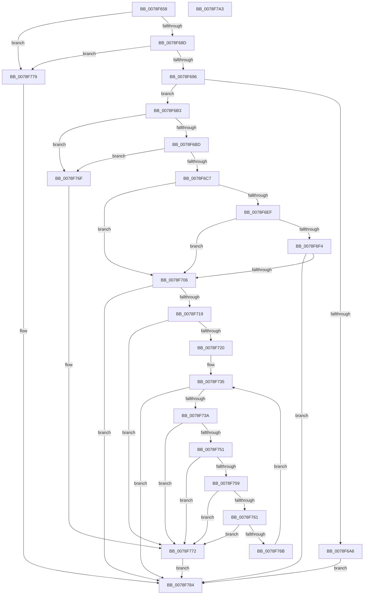

# RtlpFcUpdateGovernedFeaturesEffectiveStates

- RVA: `0x0078F658`–`0x0078F7A4` (길이 `332` bytes)
- VA: `0x000000014078F658`
- 실행 섹션: `PAGE`
- PDB 이름 있음: `예`; PDB Function 태그: `아니요`
- unwind 정보 RVA: `0x00075C18`
- 디코드: `104`개 명령, `332/332` bytes 표시
- 미해석 바이트: `0` (있으면 어셈블리에 `.byte`로 보존)

> 이 문서는 커널 이미지의 기계어와 PDB 기호를 분석해 생성했습니다. 4번과 5번은 함수 원형과 자료형을 바이너리 사용 방식에서 추정한 C 해석이며 원본 소스 복구 결과는 아닙니다.

## 1. Dependencies

- 직접 호출 지점: **4**; 고유 호출 대상: **4**
- 직접 호출자로 확인된 함수: **2**
- RIP 상대 이미지 참조: **0**

### Outgoing calls
- `0x0078F6D7` → [memset](../../text/6C/memset_function_006C6C40.md) (function, `0x006C6C40`)
- `0x0078F6E5` → [memcpy](../../text/6C/memcpy_function_006C6840.md) (function, `0x006C6840`)
- `0x0078F6FD` → [RtlpFcIsGovernedFeatureTableUpdateNeeded](../79/RtlpFcIsGovernedFeatureTableUpdateNeeded_function_0079A8C0.md) (function, `0x0079A8C0`)
- `0x0078F70E` → [FseInitializeGovernedFeaturesEffectiveStates](../AC/FseInitializeGovernedFeaturesEffectiveStates_function_00AC0DAC.md) (function, `0x00AC0DAC`)

### Direct callers
- [CmFcManagerOverwriteFeatureConfigurationSection](../7F/CmFcManagerOverwriteFeatureConfigurationSection_function_007F4450.md) at `0x007F4766`
- [CmFcManagerUpdateFeatureConfigurations](../7F/CmFcManagerUpdateFeatureConfigurations_function_007F4CF4.md) at `0x007F4FD7`
- [CmFcManagerUpdateFeatureConfigurations](../7F/CmFcManagerUpdateFeatureConfigurations_function_007F4CF4.md) at `0x007F5058`

### Static image references
- 디코드된 RIP-relative 메모리 참조가 없습니다.

## 2. Other-region calls and transfers

- 다른 실행 섹션으로 향하는 call: **2**
  - `0x0078F6D7` → [memset](../../text/6C/memset_function_006C6C40.md) (`PAGE` → `.text`)
  - `0x0078F6E5` → [memcpy](../../text/6C/memcpy_function_006C6840.md) (`PAGE` → `.text`)
- 별도 외부 분기/꼬리 이동을 확인하지 못했습니다.

## 3. Assembly (complete function range)

```asm
0078F658  48 89 5C 24 08                  mov qword ptr [rsp + 8], rbx
0078F65D  48 89 6C 24 10                  mov qword ptr [rsp + 0x10], rbp
0078F662  48 89 74 24 18                  mov qword ptr [rsp + 0x18], rsi
0078F667  57                              push rdi
0078F668  41 54                           push r12
0078F66A  41 55                           push r13
0078F66C  41 56                           push r14
0078F66E  41 57                           push r15
0078F670  48 83 EC 20                     sub rsp, 0x20
0078F674  33 FF                           xor edi, edi
0078F676  4D 8B E1                        mov r12, r9
0078F679  4D 8B E8                        mov r13, r8
0078F67C  48 8B F2                        mov rsi, rdx
0078F67F  4C 8B F9                        mov r15, rcx
0078F682  8B DF                           mov ebx, edi
0078F684  48 85 D2                        test rdx, rdx
0078F687  0F 84 EC 00 00 00               je 0x14078f779
0078F68D  48 85 C9                        test rcx, rcx
0078F690  0F 84 E3 00 00 00               je 0x14078f779
0078F696  4C 8B B4 24 88 00 00 00         mov r14, qword ptr [rsp + 0x88]
0078F69E  49 8B 06                        mov rax, qword ptr [r14]
0078F6A1  48 3B D0                        cmp rdx, rax
0078F6A4  76 0D                           jbe 0x14078f6b3
0078F6A6  49 89 16                        mov qword ptr [r14], rdx
0078F6A9  BB 05 00 00 80                  mov ebx, 0x80000005
0078F6AE  E9 D1 00 00 00                  jmp 0x14078f784
0078F6B3  48 83 F8 18                     cmp rax, 0x18
0078F6B7  0F 82 B2 00 00 00               jb 0x14078f76f
0078F6BD  48 83 FE 18                     cmp rsi, 0x18
0078F6C1  0F 82 A8 00 00 00               jb 0x14078f76f
0078F6C7  48 8B AC 24 80 00 00 00         mov rbp, qword ptr [rsp + 0x80]
0078F6CF  4C 8B C6                        mov r8, rsi
0078F6D2  48 8B CD                        mov rcx, rbp
0078F6D5  33 D2                           xor edx, edx
0078F6D7  E8 64 75 F3 FF                  call 0x1406c6c40
0078F6DC  4C 8B C6                        mov r8, rsi
0078F6DF  49 8B D7                        mov rdx, r15
0078F6E2  48 8B CD                        mov rcx, rbp
0078F6E5  E8 56 71 F3 FF                  call 0x1406c6840
0078F6EA  4D 85 ED                        test r13, r13
0078F6ED  74 17                           je 0x14078f706
0078F6EF  4D 85 E4                        test r12, r12
0078F6F2  74 12                           je 0x14078f706
0078F6F4  4D 8B CC                        mov r9, r12
0078F6F7  4D 8B C5                        mov r8, r13
0078F6FA  49 8B CF                        mov rcx, r15
0078F6FD  E8 BE B1 00 00                  call 0x14079a8c0
0078F702  84 C0                           test al, al
0078F704  74 7E                           je 0x14078f784
0078F706  48 8B 4C 24 70                  mov rcx, qword ptr [rsp + 0x70]
0078F70B  4C 8B C5                        mov r8, rbp
0078F70E  E8 99 16 33 00                  call 0x140ac0dac
0078F713  8B D8                           mov ebx, eax
0078F715  85 C0                           test eax, eax
0078F717  78 6B                           js 0x14078f784
0078F719  8B DF                           mov ebx, edi
0078F71B  49 3B 36                        cmp rsi, qword ptr [r14]
0078F71E  75 52                           jne 0x14078f772
0078F720  4D 8B 4F 08                     mov r9, qword ptr [r15 + 8]
0078F724  4C 8B 55 08                     mov r10, qword ptr [rbp + 8]
0078F728  4D 03 CF                        add r9, r15
0078F72B  45 8B 07                        mov r8d, dword ptr [r15]
0078F72E  4C 03 D5                        add r10, rbp
0078F731  45 0F B7 C0                     movzx r8d, r8w
0078F735  41 3B F8                        cmp edi, r8d
0078F738  73 4A                           jae 0x14078f784
0078F73A  8B C7                           mov eax, edi
0078F73C  48 03 C0                        add rax, rax
0078F73F  41 8B 54 C2 08                  mov edx, dword ptr [r10 + rax*8 + 8]
0078F744  41 8B 4C C1 08                  mov ecx, dword ptr [r9 + rax*8 + 8]
0078F749  8B C1                           mov eax, ecx
0078F74B  33 C2                           xor eax, edx
0078F74D  A8 01                           test al, 1
0078F74F  75 21                           jne 0x14078f772
0078F751  8B C1                           mov eax, ecx
0078F753  33 C2                           xor eax, edx
0078F755  A8 78                           test al, 0x78
0078F757  75 19                           jne 0x14078f772
0078F759  8B C1                           mov eax, ecx
0078F75B  33 C2                           xor eax, edx
0078F75D  A8 06                           test al, 6
0078F75F  75 11                           jne 0x14078f772
0078F761  33 CA                           xor ecx, edx
0078F763  F7 C1 80 FF 7F 00               test ecx, 0x7fff80
0078F769  75 07                           jne 0x14078f772
0078F76B  FF C7                           inc edi
0078F76D  EB C6                           jmp 0x14078f735
0078F76F  49 89 36                        mov qword ptr [r14], rsi
0078F772  BB 0D 00 00 C0                  mov ebx, 0xc000000d
0078F777  EB 0B                           jmp 0x14078f784
0078F779  48 8B 84 24 88 00 00 00         mov rax, qword ptr [rsp + 0x88]
0078F781  48 89 38                        mov qword ptr [rax], rdi
0078F784  48 8B 6C 24 58                  mov rbp, qword ptr [rsp + 0x58]
0078F789  8B C3                           mov eax, ebx
0078F78B  48 8B 5C 24 50                  mov rbx, qword ptr [rsp + 0x50]
0078F790  48 8B 74 24 60                  mov rsi, qword ptr [rsp + 0x60]
0078F795  48 83 C4 20                     add rsp, 0x20
0078F799  41 5F                           pop r15
0078F79B  41 5E                           pop r14
0078F79D  41 5D                           pop r13
0078F79F  41 5C                           pop r12
0078F7A1  5F                              pop rdi
0078F7A2  C3                              ret
0078F7A3  CC                              int3
```

## 4. C-style interpretation (structured pseudocode)

```c
__int64 __fastcall RtlpFcUpdateGovernedFeaturesEffectiveStates(__int64 a1, __int64 a2, __int64 a3, __int64 a4, __int64 a5, __int64 a6, __int64 a7, __int64 a8)
{
    __int64 result;
    __int64 v_r10;
    __int64 v_rdi;
    __int64 v_rsp;
    unsigned __int64 v_stack_p10;
    unsigned __int64 v_stack_p18;
    unsigned __int64 v_stack_p8;

    v_stack_p8 = v_rbx;
    v_stack_p10 = v_rbp;
    v_stack_p18 = v_rsi;
    v_rsp = (v_rsp) - (32);
    v_rdi = 0;
    if (a2 == 0) goto loc_0078F779;
    if (a1 == 0) goto loc_0078F779;
    if (a2 <= (*(unsigned __int64 *)(a8))) goto loc_0078F6B3;
    *(unsigned __int64 *)(a8) = a2;
    goto loc_0078F784;
loc_0078F6B3:
    if ((*(unsigned __int64 *)(a8)) < 24) goto loc_0078F76F;
    if (a2 < 24) goto loc_0078F76F;
    a2 = 0;
    result = memset(a7, a2, a2, a4);
    result = memcpy(a7, a1, 0, a4);
    if (a3 == 0) goto loc_0078F706;
    if (a4 == 0) goto loc_0078F706;
    result = RtlpFcIsGovernedFeatureTableUpdateNeeded(a1, a1, a3, a4);
    if ((unsigned __int8)(result) == 0) goto loc_0078F784;
loc_0078F706:
    result = FseInitializeGovernedFeaturesEffectiveStates(a5, a1, a7, a4);
    if (sign_flag) goto loc_0078F784;
    if (0 != (*(unsigned __int64 *)(a8))) goto loc_0078F772;
    a4 = (*(unsigned __int64 *)(a1 + 8)) + (a1);
    v_r10 = (*(unsigned __int64 *)(a7 + 8)) + (a7);
loc_0078F735:
    if (0 >= ((unsigned int)((unsigned __int16)((unsigned int)(*(unsigned int *)(a1)))))) goto loc_0078F784;
    result = (0) + (0);
    result = (unsigned int)(((unsigned int)((unsigned int)((unsigned int)(*(unsigned int *)(a4 + result * 8 + 8))))) ^ ((unsigned int)((unsigned int)(*(unsigned int *)(v_r10 + result * 8 + 8)))));
    if ((((unsigned __int8)(result)) & (1)) != 0) goto loc_0078F772;
    result = (unsigned int)(((unsigned int)((unsigned int)((unsigned int)(*(unsigned int *)(a4 + result * 8 + 8))))) ^ ((unsigned int)((unsigned int)(*(unsigned int *)(v_r10 + result * 8 + 8)))));
    if ((((unsigned __int8)(result)) & (120)) != 0) goto loc_0078F772;
    result = (unsigned int)(((unsigned int)((unsigned int)((unsigned int)(*(unsigned int *)(a4 + result * 8 + 8))))) ^ ((unsigned int)((unsigned int)(*(unsigned int *)(v_r10 + result * 8 + 8)))));
    if ((((unsigned __int8)(result)) & (6)) != 0) goto loc_0078F772;
    a1 = (unsigned int)(((unsigned int)(*(unsigned int *)(a4 + result * 8 + 8))) ^ ((unsigned int)((unsigned int)(*(unsigned int *)(v_r10 + result * 8 + 8)))));
    if ((((unsigned int)(a1)) & (0x7FFF80ULL)) != 0) goto loc_0078F772;
    v_rdi = (unsigned int)((v_rdi) + 1);
    goto loc_0078F735;
loc_0078F76F:
    *(unsigned __int64 *)(a8) = 0;
loc_0078F772:
    goto loc_0078F784;
loc_0078F779:
    *(unsigned __int64 *)(a8) = v_rdi;
loc_0078F784:
    v_rsp = (v_rsp) + (32);
    return (unsigned int)((unsigned int)((unsigned int)(0xC000000DULL)));
}
```

## 5. (Beta) C Style

```c
int64_t RtlpFcUpdateGovernedFeaturesEffectiveStates(void *Arg1, int64_t Arg2, int64_t Arg3, int64_t Arg4, int64_t Arg5, uint64_t Arg6, void *Arg7, void *Arg8)
{
    uint8_t *arg1 = (uint8_t *)Arg1;
    uint8_t *arg7 = (uint8_t *)Arg7;
    uint8_t *arg8 = (uint8_t *)Arg8;

    int64_t result;
    int64_t local_r10;
    int64_t local_rdi;
    int64_t local_rsp;
    uint64_t v_stack_p10;
    uint64_t v_stack_p18;
    uint64_t v_stack_p8;

    v_stack_p8 = local_rbx;
    v_stack_p10 = local_rbp;
    v_stack_p18 = local_rsi;
    local_rsp = (local_rsp) - (32);
    local_rdi = 0;
    if (Arg2 == 0) goto loc_0078F779;
    if (Arg1 == NULL) goto loc_0078F779;
    if (Arg2 <= (*(uint64_t *)(arg8))) goto loc_0078F6B3;
    *(uint64_t *)(arg8) = Arg2;
    goto loc_0078F784;
loc_0078F6B3:
    if ((*(uint64_t *)(arg8)) < 24) goto loc_0078F76F;
    if (Arg2 < 24) goto loc_0078F76F;
    Arg2 = 0;
    result = memset(Arg7, Arg2, Arg2, Arg4);
    result = memcpy(Arg7, Arg1, 0, Arg4);
    if (Arg3 == 0) goto loc_0078F706;
    if (Arg4 == 0) goto loc_0078F706;
    result = RtlpFcIsGovernedFeatureTableUpdateNeeded(Arg1, Arg1, Arg3, Arg4);
    if ((uint8_t)(result) == 0) goto loc_0078F784;
loc_0078F706:
    result = FseInitializeGovernedFeaturesEffectiveStates(Arg5, Arg1, Arg7, Arg4);
    if (sign_flag) goto loc_0078F784;
    if (0 != (*(uint64_t *)(arg8))) goto loc_0078F772;
    Arg4 = (*(uint64_t *)(arg1 + 0x8)) + (Arg1);
    local_r10 = (*(uint64_t *)(arg7 + 0x8)) + (Arg7);
loc_0078F735:
    if (0 >= ((uint32_t)((uint16_t)((uint32_t)(*(uint32_t *)(arg1)))))) goto loc_0078F784;
    result = (0) + (0);
    result = (uint32_t)(((uint32_t)((uint32_t)((uint32_t)(*(uint32_t *)(Arg4 + result * 8 + 0x8))))) ^ ((uint32_t)((uint32_t)(*(uint32_t *)(local_r10 + result * 8 + 0x8)))));
    if ((((uint8_t)(result)) & (1)) != 0) goto loc_0078F772;
    result = (uint32_t)(((uint32_t)((uint32_t)((uint32_t)(*(uint32_t *)(Arg4 + result * 8 + 0x8))))) ^ ((uint32_t)((uint32_t)(*(uint32_t *)(local_r10 + result * 8 + 0x8)))));
    if ((((uint8_t)(result)) & (120)) != 0) goto loc_0078F772;
    result = (uint32_t)(((uint32_t)((uint32_t)((uint32_t)(*(uint32_t *)(Arg4 + result * 8 + 0x8))))) ^ ((uint32_t)((uint32_t)(*(uint32_t *)(local_r10 + result * 8 + 0x8)))));
    if ((((uint8_t)(result)) & (6)) != 0) goto loc_0078F772;
    Arg1 = (uint32_t)(((uint32_t)(*(uint32_t *)(Arg4 + result * 8 + 0x8))) ^ ((uint32_t)((uint32_t)(*(uint32_t *)(local_r10 + result * 8 + 0x8)))));
    if ((((uint32_t)(Arg1)) & (0x7FFF80ULL)) != 0) goto loc_0078F772;
    local_rdi = (uint32_t)((local_rdi) + 1);
    goto loc_0078F735;
loc_0078F76F:
    *(uint64_t *)(arg8) = 0;
loc_0078F772:
    goto loc_0078F784;
loc_0078F779:
    *(uint64_t *)(arg8) = local_rdi;
loc_0078F784:
    local_rsp = (local_rsp) + (32);
    return (uint32_t)((uint32_t)((uint32_t)(0xC000000DULL)));
}
```

### 관측된 메모리 오프셋

구조체 형식이 확인되지 않은 접근은 인자 기준의 오프셋으로만 기록했습니다.

| 기준 인자 | 오프셋 표현 | 폭 (bit) | 접근 |
|---|---:|---:|---|
| `Arg1` | `+ 0x0` | `32` | `R` |
| `Arg1` | `+ 0x8` | `64` | `R` |
| `Arg7` | `+ 0x8` | `64` | `R` |
| `Arg8` | `+ 0x0` | `64` | `R` |
| `Arg8` | `+ 0x0` | `64` | `W` |

## 6. Execution-region graph

[열기: 2D/3D 그래프와 함수 탐색 컨트롤 패널](../../../control-panel.html?section=page&rva=0x0078F658&view=graph)

- 2D 그래프는 위에서 아래로 흐르고, 3D 그래프는 빈 공간을 드래그해 회전합니다. Shift+드래그는 이동, 휠은 확대·축소, 함수 노드 선택은 대상 보고서 이동입니다.

### Static fallback


