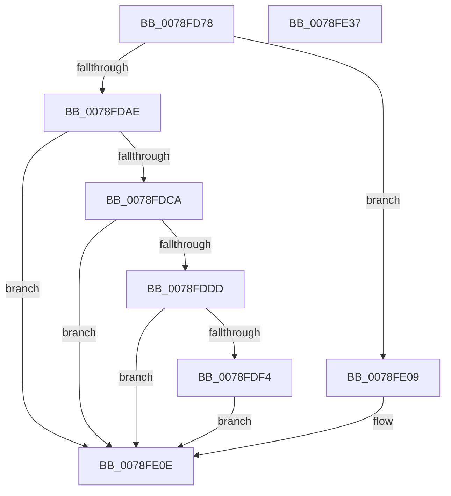

# RtlpGetDynamicTimeZoneInfoHandle

- RVA: `0x0078FD78`–`0x0078FE38` (길이 `192` bytes)
- VA: `0x000000014078FD78`
- 실행 섹션: `PAGE`
- PDB 이름 있음: `예`; PDB Function 태그: `아니요`
- unwind 정보 RVA: `0x000CFAB4`
- 디코드: `50`개 명령, `192/192` bytes 표시
- 미해석 바이트: `0` (있으면 어셈블리에 `.byte`로 보존)

> 이 문서는 커널 이미지의 기계어와 PDB 기호를 분석해 생성했습니다. 4번과 5번은 함수 원형과 자료형을 바이너리 사용 방식에서 추정한 C 해석이며 원본 소스 복구 결과는 아닙니다.

## 1. Dependencies

- 직접 호출 지점: **5**; 고유 호출 대상: **4**
- 직접 호출자로 확인된 함수: **1**
- RIP 상대 이미지 참조: **3**

### Outgoing calls
- `0x0078FDC1` → [RtlStringCbCopyW](../../text/43/RtlStringCbCopyW_function_0043B910.md) (function, `0x0043B910`)
- `0x0078FDD4` → [RtlStringCbCatW](../../text/45/RtlStringCbCatW_function_00453E24.md) (function, `0x00453E24`)
- `0x0078FDEB` → [RtlStringCbCatW](../../text/45/RtlStringCbCatW_function_00453E24.md) (function, `0x00453E24`)
- `0x0078FE02` → [RtlpGetRegistryHandle](../8C/RtlpGetRegistryHandle_function_008C955C.md) (function, `0x008C955C`)
- `0x0078FE19` → [_security_check_cookie](../../text/6A/_security_check_cookie_function_006AC640.md) (function, `0x006AC640`)

### Direct callers
- [RtlpCheckDynamicTimeZoneInformation](RtlpCheckDynamicTimeZoneInformation_function_0078FB3C.md) at `0x0078FB8F`

### Static image references
- `0x0078FD8F` → RVA `0x00E0A740` (`.data`; read)
- `0x0078FDB3` → RVA `0x00B4C400` (`szTimeZonesSlash`; read)
- `0x0078FDDD` → RVA `0x00B4C6A0` (`szSlashDynamicDst`; read)

## 2. Other-region calls and transfers

- 다른 실행 섹션으로 향하는 call: **4**
  - `0x0078FDC1` → [RtlStringCbCopyW](../../text/43/RtlStringCbCopyW_function_0043B910.md) (`PAGE` → `.text`)
  - `0x0078FDD4` → [RtlStringCbCatW](../../text/45/RtlStringCbCatW_function_00453E24.md) (`PAGE` → `.text`)
  - `0x0078FDEB` → [RtlStringCbCatW](../../text/45/RtlStringCbCatW_function_00453E24.md) (`PAGE` → `.text`)
  - `0x0078FE19` → [_security_check_cookie](../../text/6A/_security_check_cookie_function_006AC640.md) (`PAGE` → `.text`)
- 별도 외부 분기/꼬리 이동을 확인하지 못했습니다.

## 3. Assembly (complete function range)

```asm
0078FD78  48 89 5C 24 08                  mov qword ptr [rsp + 8], rbx
0078FD7D  48 89 6C 24 18                  mov qword ptr [rsp + 0x18], rbp
0078FD82  48 89 74 24 20                  mov qword ptr [rsp + 0x20], rsi
0078FD87  57                              push rdi
0078FD88  48 81 EC 30 02 00 00            sub rsp, 0x230
0078FD8F  48 8B 05 AA A9 67 00            mov rax, qword ptr [rip + 0x67a9aa]
0078FD96  48 33 C4                        xor rax, rsp
0078FD99  48 89 84 24 20 02 00 00         mov qword ptr [rsp + 0x220], rax
0078FDA1  33 F6                           xor esi, esi
0078FDA3  48 8B FA                        mov rdi, rdx
0078FDA6  48 8B D9                        mov rbx, rcx
0078FDA9  66 3B 31                        cmp si, word ptr [rcx]
0078FDAC  74 5B                           je 0x14078fe09
0078FDAE  BD 00 02 00 00                  mov ebp, 0x200
0078FDB3  4C 8D 05 46 C6 3B 00            lea r8, [rip + 0x3bc646]
0078FDBA  8B D5                           mov edx, ebp
0078FDBC  48 8D 4C 24 20                  lea rcx, [rsp + 0x20]
0078FDC1  E8 4A BB CA FF                  call 0x14043b910
0078FDC6  85 C0                           test eax, eax
0078FDC8  78 44                           js 0x14078fe0e
0078FDCA  4C 8B C3                        mov r8, rbx
0078FDCD  48 8D 4C 24 20                  lea rcx, [rsp + 0x20]
0078FDD2  8B D5                           mov edx, ebp
0078FDD4  E8 4B 40 CC FF                  call 0x140453e24
0078FDD9  85 C0                           test eax, eax
0078FDDB  78 31                           js 0x14078fe0e
0078FDDD  4C 8D 05 BC C8 3B 00            lea r8, [rip + 0x3bc8bc]
0078FDE4  8B D5                           mov edx, ebp
0078FDE6  48 8D 4C 24 20                  lea rcx, [rsp + 0x20]
0078FDEB  E8 34 40 CC FF                  call 0x140453e24
0078FDF0  85 C0                           test eax, eax
0078FDF2  78 1A                           js 0x14078fe0e
0078FDF4  4C 8B CF                        mov r9, rdi
0078FDF7  48 8D 54 24 20                  lea rdx, [rsp + 0x20]
0078FDFC  45 33 C0                        xor r8d, r8d
0078FDFF  8D 4E 03                        lea ecx, [rsi + 3]
0078FE02  E8 55 97 13 00                  call 0x1408c955c
0078FE07  EB 05                           jmp 0x14078fe0e
0078FE09  B8 0D 00 00 C0                  mov eax, 0xc000000d
0078FE0E  48 8B 8C 24 20 02 00 00         mov rcx, qword ptr [rsp + 0x220]
0078FE16  48 33 CC                        xor rcx, rsp
0078FE19  E8 22 C8 F1 FF                  call 0x1406ac640
0078FE1E  4C 8D 9C 24 30 02 00 00         lea r11, [rsp + 0x230]
0078FE26  49 8B 5B 10                     mov rbx, qword ptr [r11 + 0x10]
0078FE2A  49 8B 6B 20                     mov rbp, qword ptr [r11 + 0x20]
0078FE2E  49 8B 73 28                     mov rsi, qword ptr [r11 + 0x28]
0078FE32  49 8B E3                        mov rsp, r11
0078FE35  5F                              pop rdi
0078FE36  C3                              ret
0078FE37  CC                              int3
```

## 4. C-style interpretation (structured pseudocode)

```c
__int64 __fastcall RtlpGetDynamicTimeZoneInfoHandle(__int64 a1, __int64 a2)
{
    __int64 result;
    __int64 v_rsi;
    __int64 v_rsp;
    unsigned __int64 v_stack_m18;
    unsigned __int64 v_stack_m218;
    unsigned __int64 v_stack_m8;
    unsigned __int64 v_stack_p18;
    unsigned __int64 v_stack_p20;
    unsigned __int64 v_stack_p8;

    v_stack_p8 = v_rbx;
    v_stack_p18 = v_rbp;
    v_stack_p20 = v_rsi;
    v_rsp = (v_rsp) - (560);
    result = (*(unsigned __int64 *)(v_rip + 6793642)) ^ (v_rsp);
    v_stack_m18 = result;
    v_rsi = 0;
    if (0 == (*(unsigned __int16 *)(a1))) goto loc_0078FE09;
    result = RtlStringCbCopyW(v_stack_m218, 512, v_rip + 3917382, a4);
    if (sign_flag) goto loc_0078FE0E;
    result = RtlStringCbCatW(v_stack_m218, 512, a1, a4);
    if (sign_flag) goto loc_0078FE0E;
    result = RtlStringCbCatW(v_stack_m218, 512, v_rip + 3918012, a4);
    if (sign_flag) goto loc_0078FE0E;
    a3 = 0;
    result = RtlpGetRegistryHandle(v_rsi + 3, v_stack_m218, a3, a2);
    goto loc_0078FE0E;
loc_0078FE09:
loc_0078FE0E:
    a1 = (v_stack_m18) ^ (v_rsp);
    result = _security_check_cookie(a1, v_stack_m218, a3, a2);
    return result;
}
```

## 5. (Beta) C Style

```c
int64_t RtlpGetDynamicTimeZoneInfoHandle(void *Arg1, int64_t Arg2)
{
    uint8_t *arg1 = (uint8_t *)Arg1;

    int64_t result;
    int64_t local_rsi;
    int64_t local_rsp;
    uint64_t v_stack_m18;
    uint64_t v_stack_m218;
    uint64_t v_stack_m8;
    uint64_t v_stack_p18;
    uint64_t v_stack_p20;
    uint64_t v_stack_p8;

    v_stack_p8 = local_rbx;
    v_stack_p18 = local_rbp;
    v_stack_p20 = local_rsi;
    local_rsp = (local_rsp) - (560);
    result = (*(uint64_t *)(v_rip + 0x67A9AA)) ^ (local_rsp);
    v_stack_m18 = result;
    local_rsi = 0;
    if (0 == (*(uint16_t *)(arg1))) goto loc_0078FE09;
    result = RtlStringCbCopyW(v_stack_m218, 512, v_rip + 3917382, a4);
    if (sign_flag) goto loc_0078FE0E;
    result = RtlStringCbCatW(v_stack_m218, 512, Arg1, a4);
    if (sign_flag) goto loc_0078FE0E;
    result = RtlStringCbCatW(v_stack_m218, 512, v_rip + 3918012, a4);
    if (sign_flag) goto loc_0078FE0E;
    a3 = 0;
    result = RtlpGetRegistryHandle(local_rsi + 3, v_stack_m218, a3, Arg2);
    goto loc_0078FE0E;
loc_0078FE09:
loc_0078FE0E:
    Arg1 = (v_stack_m18) ^ (local_rsp);
    result = _security_check_cookie(Arg1, v_stack_m218, a3, Arg2);
    return result;
}
```

### 관측된 메모리 오프셋

구조체 형식이 확인되지 않은 접근은 인자 기준의 오프셋으로만 기록했습니다.

| 기준 인자 | 오프셋 표현 | 폭 (bit) | 접근 |
|---|---:|---:|---|
| `Arg1` | `+ 0x0` | `16` | `R` |

## 6. Execution-region graph

[열기: 2D/3D 그래프와 함수 탐색 컨트롤 패널](../../../control-panel.html?section=page&rva=0x0078FD78&view=graph)

- 2D 그래프는 위에서 아래로 흐르고, 3D 그래프는 빈 공간을 드래그해 회전합니다. Shift+드래그는 이동, 휠은 확대·축소, 함수 노드 선택은 대상 보고서 이동입니다.

### Static fallback


