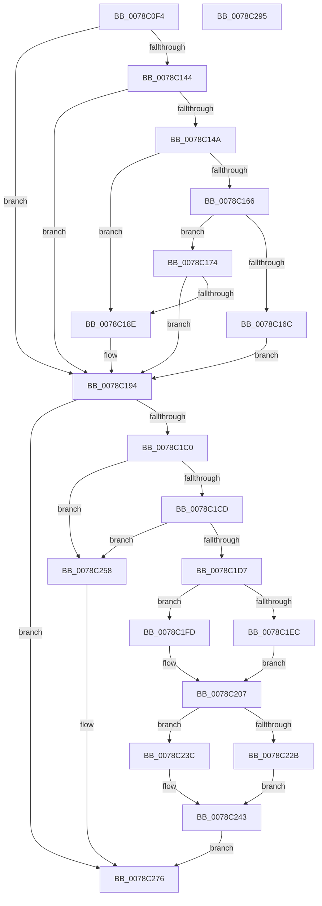

# RtlpInitCodePageTables

- RVA: `0x0078C0F4`–`0x0078C296` (길이 `418` bytes)
- VA: `0x000000014078C0F4`
- 실행 섹션: `PAGE`
- PDB 이름 있음: `예`; PDB Function 태그: `아니요`
- unwind 정보 RVA: `0x0008C20C`
- 디코드: `103`개 명령, `418/418` bytes 표시
- 미해석 바이트: `0` (있으면 어셈블리에 `.byte`로 보존)

> 이 문서는 커널 이미지의 기계어와 PDB 기호를 분석해 생성했습니다. 4번과 5번은 함수 원형과 자료형을 바이너리 사용 방식에서 추정한 C 해석이며 원본 소스 복구 결과는 아닙니다.

## 1. Dependencies

- 직접 호출 지점: **7**; 고유 호출 대상: **5**
- 직접 호출자로 확인된 함수: **1**
- RIP 상대 이미지 참조: **7**

### Outgoing calls
- `0x0078C117` → [PsGetCurrentServerSiloGlobals](../../text/2F/PsGetCurrentServerSiloGlobals_function_002FE1F0.md) (function, `0x002FE1F0`)
- `0x0078C15D` → [NtGetNlsSectionPtr](../A1/NtGetNlsSectionPtr_function_00A195B0.md) (function, `0x00A195B0`)
- `0x0078C185` → [NtGetNlsSectionPtr](../A1/NtGetNlsSectionPtr_function_00A195B0.md) (function, `0x00A195B0`)
- `0x0078C19A` → [RtlInitCodePageTable](RtlInitCodePageTable_function_0078BD40.md) (function, `0x0078BD40`)
- `0x0078C1A5` → [RtlInitCodePageTable](RtlInitCodePageTable_function_0078BD40.md) (function, `0x0078BD40`)
- `0x0078C1AA` → [PsGetCurrentServerSilo](../../text/22/PsGetCurrentServerSilo_function_00225710.md) (function, `0x00225710`)
- `0x0078C1B2` → [HalAdjustResourceList](../../text/48/HalAdjustResourceList_function_0048FDC0.md) (function, `0x0048FDC0`)

### Direct callers
- [ExInitializeNls](../AD/ExInitializeNls_function_00ADB178.md) at `0x00ADB209`

### Static image references
- `0x0078C1D7` → RVA `0x00FD80C8` (`PAGEDATA`; write)
- `0x0078C1DE` → RVA `0x00FD8A00` (`PAGEDATA`; read)
- `0x0078C1F0` → RVA `0x00FD8298` (`PAGEDATA`; write)
- `0x0078C213` → RVA `0x00FD803D` (`PAGEDATA`; write)
- `0x0078C21D` → RVA `0x00FD80CC` (`PAGEDATA`; write)
- `0x0078C22F` → RVA `0x00FD8090` (`PAGEDATA`; write)
- `0x0078C24F` → RVA `0x00FD8000` (`PAGEDATA`; write)

## 2. Other-region calls and transfers

- 다른 실행 섹션으로 향하는 call: **3**
  - `0x0078C117` → [PsGetCurrentServerSiloGlobals](../../text/2F/PsGetCurrentServerSiloGlobals_function_002FE1F0.md) (`PAGE` → `.text`)
  - `0x0078C1AA` → [PsGetCurrentServerSilo](../../text/22/PsGetCurrentServerSilo_function_00225710.md) (`PAGE` → `.text`)
  - `0x0078C1B2` → [HalAdjustResourceList](../../text/48/HalAdjustResourceList_function_0048FDC0.md) (`PAGE` → `.text`)
- 별도 외부 분기/꼬리 이동을 확인하지 못했습니다.

## 3. Assembly (complete function range)

```asm
0078C0F4  48 89 5C 24 08                  mov qword ptr [rsp + 8], rbx
0078C0F9  48 89 6C 24 10                  mov qword ptr [rsp + 0x10], rbp
0078C0FE  48 89 74 24 18                  mov qword ptr [rsp + 0x18], rsi
0078C103  57                              push rdi
0078C104  41 54                           push r12
0078C106  41 55                           push r13
0078C108  41 56                           push r14
0078C10A  41 57                           push r15
0078C10C  48 83 EC 30                     sub rsp, 0x30
0078C110  0F B7 EA                        movzx ebp, dx
0078C113  44 0F B7 F9                     movzx r15d, cx
0078C117  E8 D4 20 B7 FF                  call 0x1402fe1f0
0078C11C  41 BD E9 FD 00 00               mov r13d, 0xfde9
0078C122  45 33 E4                        xor r12d, r12d
0078C125  48 8D B8 08 04 00 00            lea rdi, [rax + 0x408]
0078C12C  4C 8D B7 80 00 00 00            lea r14, [rdi + 0x80]
0078C133  48 8D 9F 88 00 00 00            lea rbx, [rdi + 0x88]
0078C13A  48 8D 77 40                     lea rsi, [rdi + 0x40]
0078C13E  66 45 3B FD                     cmp r15w, r13w
0078C142  74 50                           je 0x14078c194
0078C144  66 41 3B ED                     cmp bp, r13w
0078C148  74 4A                           je 0x14078c194
0078C14A  41 8B D7                        mov edx, r15d
0078C14D  4C 89 64 24 20                  mov qword ptr [rsp + 0x20], r12
0078C152  4D 8B CE                        mov r9, r14
0078C155  41 8D 4C 24 0B                  lea ecx, [r12 + 0xb]
0078C15A  45 33 C0                        xor r8d, r8d
0078C15D  E8 4E D4 28 00                  call 0x140a195b0
0078C162  85 C0                           test eax, eax
0078C164  78 28                           js 0x14078c18e
0078C166  66 41 3B EF                     cmp bp, r15w
0078C16A  75 08                           jne 0x14078c174
0078C16C  49 8B 06                        mov rax, qword ptr [r14]
0078C16F  48 89 03                        mov qword ptr [rbx], rax
0078C172  EB 20                           jmp 0x14078c194
0078C174  45 33 C0                        xor r8d, r8d
0078C177  4C 89 64 24 20                  mov qword ptr [rsp + 0x20], r12
0078C17C  8B D5                           mov edx, ebp
0078C17E  4C 8B CB                        mov r9, rbx
0078C181  41 8D 48 0B                     lea ecx, [r8 + 0xb]
0078C185  E8 26 D4 28 00                  call 0x140a195b0
0078C18A  85 C0                           test eax, eax
0078C18C  79 06                           jns 0x14078c194
0078C18E  4D 89 26                        mov qword ptr [r14], r12
0078C191  4C 89 23                        mov qword ptr [rbx], r12
0078C194  49 8B 0E                        mov rcx, qword ptr [r14]
0078C197  48 8B D7                        mov rdx, rdi
0078C19A  E8 A1 FB FF FF                  call 0x14078bd40
0078C19F  48 8B 0B                        mov rcx, qword ptr [rbx]
0078C1A2  48 8B D6                        mov rdx, rsi
0078C1A5  E8 96 FB FF FF                  call 0x14078bd40
0078C1AA  E8 61 95 A9 FF                  call 0x140225710
0078C1AF  48 8B D8                        mov rbx, rax
0078C1B2  E8 09 3C D0 FF                  call 0x14048fdc0
0078C1B7  48 3B D8                        cmp rbx, rax
0078C1BA  0F 85 B6 00 00 00               jne 0x14078c276
0078C1C0  0F B7 07                        movzx eax, word ptr [rdi]
0078C1C3  66 41 3B C5                     cmp ax, r13w
0078C1C7  0F 84 8B 00 00 00               je 0x14078c258
0078C1CD  66 44 39 2E                     cmp word ptr [rsi], r13w
0078C1D1  0F 84 81 00 00 00               je 0x14078c258
0078C1D7  66 89 05 EA BE 84 00            mov word ptr [rip + 0x84beea], ax
0078C1DE  48 8D 0D 1B C8 84 00            lea rcx, [rip + 0x84c81b]
0078C1E5  66 44 39 67 0C                  cmp word ptr [rdi + 0xc], r12w
0078C1EA  74 11                           je 0x14078c1fd
0078C1EC  48 8B 47 38                     mov rax, qword ptr [rdi + 0x38]
0078C1F0  48 89 05 A1 C0 84 00            mov qword ptr [rip + 0x84c0a1], rax
0078C1F7  48 8B 47 38                     mov rax, qword ptr [rdi + 0x38]
0078C1FB  EB 0A                           jmp 0x14078c207
0078C1FD  48 89 0D 94 C0 84 00            mov qword ptr [rip + 0x84c094], rcx
0078C204  48 8B C1                        mov rax, rcx
0078C207  48 89 87 90 00 00 00            mov qword ptr [rdi + 0x90], rax
0078C20E  66 44 39 67 0C                  cmp word ptr [rdi + 0xc], r12w
0078C213  0F 95 05 23 BE 84 00            setne byte ptr [rip + 0x84be23]
0078C21A  0F B7 06                        movzx eax, word ptr [rsi]
0078C21D  66 89 05 A8 BE 84 00            mov word ptr [rip + 0x84bea8], ax
0078C224  66 44 39 66 0C                  cmp word ptr [rsi + 0xc], r12w
0078C229  74 11                           je 0x14078c23c
0078C22B  48 8B 46 38                     mov rax, qword ptr [rsi + 0x38]
0078C22F  48 89 05 5A BE 84 00            mov qword ptr [rip + 0x84be5a], rax
0078C236  48 8B 4E 38                     mov rcx, qword ptr [rsi + 0x38]
0078C23A  EB 07                           jmp 0x14078c243
0078C23C  48 89 0D 4D BE 84 00            mov qword ptr [rip + 0x84be4d], rcx
0078C243  48 89 8F 98 00 00 00            mov qword ptr [rdi + 0x98], rcx
0078C24A  66 44 39 66 0C                  cmp word ptr [rsi + 0xc], r12w
0078C24F  0F 95 05 AA BD 84 00            setne byte ptr [rip + 0x84bdaa]
0078C256  EB 1E                           jmp 0x14078c276
0078C258  66 44 89 2D 68 BE 84 00         mov word ptr [rip + 0x84be68], r13w
0078C260  66 44 89 2D 64 BE 84 00         mov word ptr [rip + 0x84be64], r13w
0078C268  44 88 25 CE BD 84 00            mov byte ptr [rip + 0x84bdce], r12b
0078C26F  44 88 25 8A BD 84 00            mov byte ptr [rip + 0x84bd8a], r12b
0078C276  48 8B 5C 24 60                  mov rbx, qword ptr [rsp + 0x60]
0078C27B  33 C0                           xor eax, eax
0078C27D  48 8B 6C 24 68                  mov rbp, qword ptr [rsp + 0x68]
0078C282  48 8B 74 24 70                  mov rsi, qword ptr [rsp + 0x70]
0078C287  48 83 C4 30                     add rsp, 0x30
0078C28B  41 5F                           pop r15
0078C28D  41 5E                           pop r14
0078C28F  41 5D                           pop r13
0078C291  41 5C                           pop r12
0078C293  5F                              pop rdi
0078C294  C3                              ret
0078C295  CC                              int3
```

## 4. C-style interpretation (structured pseudocode)

```c
__int64 __fastcall RtlpInitCodePageTables(unsigned __int16 a1, unsigned __int16 a2, int a3)
{
    __int64 result;
    __int64 v_r12;
    __int64 v_rsp;
    unsigned __int64 v_stack_m38;
    unsigned __int64 v_stack_p10;
    unsigned __int64 v_stack_p18;
    unsigned __int64 v_stack_p8;

    v_stack_p8 = v_rbx;
    v_stack_p10 = v_rbp;
    v_stack_p18 = v_rsi;
    v_rsp = (v_rsp) - (48);
    result = PsGetCurrentServerSiloGlobals(a1, a2, a3, a4);
    v_r12 = 0;
    if (a1 == ((unsigned __int16)((unsigned int)(0xFDE9ULL)))) goto loc_0078C194;
    if (a2 == ((unsigned __int16)((unsigned int)(0xFDE9ULL)))) goto loc_0078C194;
    v_stack_m38 = 0;
    a3 = 0;
    result = NtGetNlsSectionPtr(v_r12 + 11, (unsigned int)(a1), a3, result + 1032 + 128);
    if (sign_flag) goto loc_0078C18E;
    if (a2 != a1) goto loc_0078C174;
    *(unsigned __int64 *)(result + 1032 + 136) = *(unsigned __int64 *)(result + 1032 + 128);
    goto loc_0078C194;
loc_0078C174:
    a3 = 0;
    v_stack_m38 = 0;
    result = NtGetNlsSectionPtr(a3 + 11, (unsigned int)(a2), a3, result + 1032 + 136);
    if (sign_flag) {
        *(unsigned __int64 *)(result + 1032 + 128) = 0;
        *(unsigned __int64 *)(result + 1032 + 136) = 0;
    }
    result = RtlInitCodePageTable(*(unsigned __int64 *)(result + 1032 + 128), result + 1032, a3, result + 1032 + 136);
    result = RtlInitCodePageTable(*(unsigned __int64 *)(result + 1032 + 136), result + 1032 + 64, a3, result + 1032 + 136);
    result = PsGetCurrentServerSilo(*(unsigned __int64 *)(result + 1032 + 136), result + 1032 + 64, a3, result + 1032 + 136);
    result = HalAdjustResourceList(*(unsigned __int64 *)(result + 1032 + 136), result + 1032 + 64, a3, result + 1032 + 136);
    if (result != result) goto loc_0078C276;
    if (((unsigned __int16)(*(unsigned __int16 *)(result + 1032))) == ((unsigned __int16)((unsigned int)(0xFDE9ULL)))) goto loc_0078C258;
    if ((*(unsigned __int16 *)(result + 1032 + 64)) == ((unsigned __int16)((unsigned int)(0xFDE9ULL)))) goto loc_0078C258;
    *(unsigned __int16 *)(v_rip + 8699626) = (unsigned __int16)(*(unsigned __int16 *)(result + 1032));
    if ((*(unsigned __int16 *)(result + 1032 + 12)) == 0) goto loc_0078C1FD;
    *(unsigned __int64 *)(v_rip + 8700065) = *(unsigned __int64 *)(result + 1032 + 56);
    goto loc_0078C207;
loc_0078C1FD:
    *(unsigned __int64 *)(v_rip + 8700052) = v_rip + 8701979;
loc_0078C207:
    *(unsigned __int64 *)(result + 1032 + 144) = v_rip + 8701979;
    *(unsigned __int16 *)(v_rip + 8699560) = (unsigned __int16)(*(unsigned __int16 *)(result + 1032 + 64));
    if ((*(unsigned __int16 *)(result + 1032 + 64 + 12)) == 0) goto loc_0078C23C;
    *(unsigned __int64 *)(v_rip + 8699482) = *(unsigned __int64 *)(result + 1032 + 64 + 56);
    goto loc_0078C243;
loc_0078C23C:
    *(unsigned __int64 *)(v_rip + 8699469) = *(unsigned __int64 *)(result + 1032 + 64 + 56);
loc_0078C243:
    *(unsigned __int64 *)(result + 1032 + 152) = *(unsigned __int64 *)(result + 1032 + 64 + 56);
    goto loc_0078C276;
loc_0078C258:
    *(unsigned __int16 *)(v_rip + 8699496) = (unsigned __int16)((unsigned int)(0xFDE9ULL));
    *(unsigned __int16 *)(v_rip + 8699492) = (unsigned __int16)((unsigned int)(0xFDE9ULL));
    *(unsigned __int8 *)(v_rip + 8699342) = 0;
    *(unsigned __int8 *)(v_rip + 8699274) = 0;
loc_0078C276:
    result = 0;
    v_rsp = (v_rsp) + (48);
    return result;
}
```

## 5. (Beta) C Style

```c
int64_t RtlpInitCodePageTables(uint16_t Arg1, uint16_t Arg2, int32_t Arg3)
{
    int64_t result;
    int64_t local_r12;
    int64_t local_rsp;
    uint64_t v_stack_m38;
    uint64_t v_stack_p10;
    uint64_t v_stack_p18;
    uint64_t v_stack_p8;

    v_stack_p8 = local_rbx;
    v_stack_p10 = local_rbp;
    v_stack_p18 = local_rsi;
    local_rsp = (local_rsp) - (48);
    result = PsGetCurrentServerSiloGlobals(Arg1, Arg2, Arg3, a4);
    local_r12 = 0;
    if (Arg1 == ((uint16_t)((uint32_t)(0xFDE9ULL)))) goto loc_0078C194;
    if (Arg2 == ((uint16_t)((uint32_t)(0xFDE9ULL)))) goto loc_0078C194;
    v_stack_m38 = 0;
    Arg3 = 0;
    result = NtGetNlsSectionPtr(local_r12 + 11, (uint32_t)(Arg1), Arg3, result + 1032 + 128);
    if (sign_flag) goto loc_0078C18E;
    if (Arg2 != Arg1) goto loc_0078C174;
    *(uint64_t *)(result + 0x408 + 0x88) = *(uint64_t *)(result + 0x408 + 0x80);
    goto loc_0078C194;
loc_0078C174:
    Arg3 = 0;
    v_stack_m38 = 0;
    result = NtGetNlsSectionPtr(Arg3 + 11, (uint32_t)(Arg2), Arg3, result + 1032 + 136);
    if (sign_flag) {
        *(uint64_t *)(result + 0x408 + 0x80) = 0;
        *(uint64_t *)(result + 0x408 + 0x88) = 0;
    }
    result = RtlInitCodePageTable(*(uint64_t *)(result + 0x408 + 0x80), result + 1032, Arg3, result + 1032 + 136);
    result = RtlInitCodePageTable(*(uint64_t *)(result + 0x408 + 0x88), result + 1032 + 64, Arg3, result + 1032 + 136);
    result = PsGetCurrentServerSilo(*(uint64_t *)(result + 0x408 + 0x88), result + 1032 + 64, Arg3, result + 1032 + 136);
    result = HalAdjustResourceList(*(uint64_t *)(result + 0x408 + 0x88), result + 1032 + 64, Arg3, result + 1032 + 136);
    if (result != result) goto loc_0078C276;
    if (((uint16_t)(*(uint16_t *)(result + 0x408))) == ((uint16_t)((uint32_t)(0xFDE9ULL)))) goto loc_0078C258;
    if ((*(uint16_t *)(result + 0x408 + 0x40)) == ((uint16_t)((uint32_t)(0xFDE9ULL)))) goto loc_0078C258;
    *(uint16_t *)(v_rip + 0x84BEEA) = (uint16_t)(*(uint16_t *)(result + 0x408));
    if ((*(uint16_t *)(result + 0x408 + 0xC)) == 0) goto loc_0078C1FD;
    *(uint64_t *)(v_rip + 0x84C0A1) = *(uint64_t *)(result + 0x408 + 0x38);
    goto loc_0078C207;
loc_0078C1FD:
    *(uint64_t *)(v_rip + 0x84C094) = v_rip + 8701979;
loc_0078C207:
    *(uint64_t *)(result + 0x408 + 0x90) = v_rip + 8701979;
    *(uint16_t *)(v_rip + 0x84BEA8) = (uint16_t)(*(uint16_t *)(result + 0x408 + 0x40));
    if ((*(uint16_t *)(result + 0x408 + 0x40 + 0xC)) == 0) goto loc_0078C23C;
    *(uint64_t *)(v_rip + 0x84BE5A) = *(uint64_t *)(result + 0x408 + 0x40 + 0x38);
    goto loc_0078C243;
loc_0078C23C:
    *(uint64_t *)(v_rip + 0x84BE4D) = *(uint64_t *)(result + 0x408 + 0x40 + 0x38);
loc_0078C243:
    *(uint64_t *)(result + 0x408 + 0x98) = *(uint64_t *)(result + 0x408 + 0x40 + 0x38);
    goto loc_0078C276;
loc_0078C258:
    *(uint16_t *)(v_rip + 0x84BE68) = (uint16_t)((uint32_t)(0xFDE9ULL));
    *(uint16_t *)(v_rip + 0x84BE64) = (uint16_t)((uint32_t)(0xFDE9ULL));
    *(uint8_t *)(v_rip + 0x84BDCE) = 0;
    *(uint8_t *)(v_rip + 0x84BD8A) = 0;
loc_0078C276:
    result = 0;
    local_rsp = (local_rsp) + (48);
    return result;
}
```

## 6. Execution-region graph

[열기: 2D/3D 그래프와 함수 탐색 컨트롤 패널](../../../control-panel.html?section=page&rva=0x0078C0F4&view=graph)

- 2D 그래프는 위에서 아래로 흐르고, 3D 그래프는 빈 공간을 드래그해 회전합니다. Shift+드래그는 이동, 휠은 확대·축소, 함수 노드 선택은 대상 보고서 이동입니다.

### Static fallback


