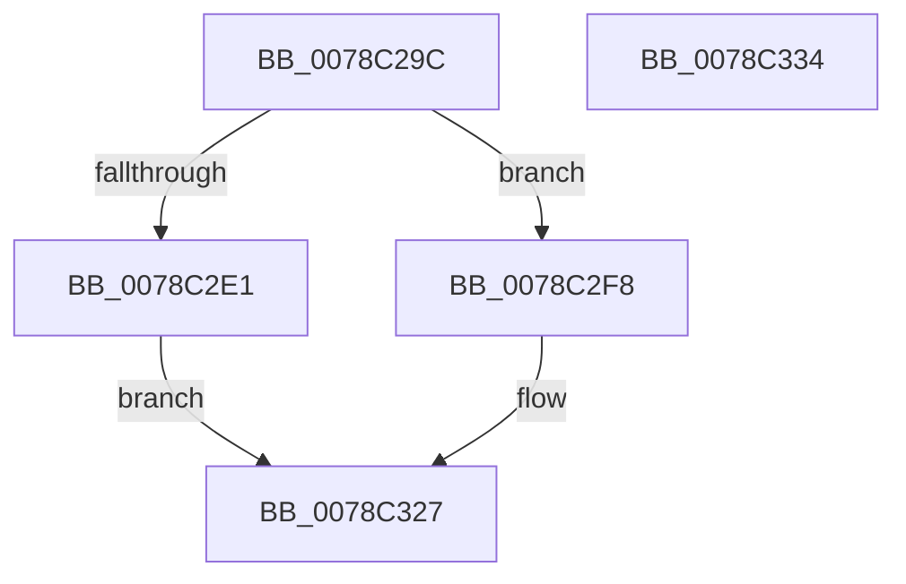

# RtlpInitUppercaseTables

- RVA: `0x0078C29C`–`0x0078C335` (길이 `153` bytes)
- VA: `0x000000014078C29C`
- 실행 섹션: `PAGE`
- PDB 이름 있음: `예`; PDB Function 태그: `아니요`
- unwind 정보 RVA: `0x0006E5F8`
- 디코드: `38`개 명령, `153/153` bytes 표시
- 미해석 바이트: `0` (있으면 어셈블리에 `.byte`로 보존)

> 이 문서는 커널 이미지의 기계어와 PDB 기호를 분석해 생성했습니다. 4번과 5번은 함수 원형과 자료형을 바이너리 사용 방식에서 추정한 C 해석이며 원본 소스 복구 결과는 아닙니다.

## 1. Dependencies

- 직접 호출 지점: **2**; 고유 호출 대상: **2**
- 직접 호출자로 확인된 함수: **1**
- RIP 상대 이미지 참조: **0**

### Outgoing calls
- `0x0078C2A6` → [PsGetCurrentServerSiloGlobals](../../text/2F/PsGetCurrentServerSiloGlobals_function_002FE1F0.md) (function, `0x002FE1F0`)
- `0x0078C2C7` → [NtGetNlsSectionPtr](../A1/NtGetNlsSectionPtr_function_00A195B0.md) (function, `0x00A195B0`)

### Direct callers
- [ExInitializeNls](../AD/ExInitializeNls_function_00ADB178.md) at `0x00ADB20E`

### Static image references
- 디코드된 RIP-relative 메모리 참조가 없습니다.

## 2. Other-region calls and transfers

- 다른 실행 섹션으로 향하는 call: **1**
  - `0x0078C2A6` → [PsGetCurrentServerSiloGlobals](../../text/2F/PsGetCurrentServerSiloGlobals_function_002FE1F0.md) (`PAGE` → `.text`)
- 별도 외부 분기/꼬리 이동을 확인하지 못했습니다.

## 3. Assembly (complete function range)

```asm
0078C29C  48 89 5C 24 08                  mov qword ptr [rsp + 8], rbx
0078C2A1  57                              push rdi
0078C2A2  48 83 EC 30                     sub rsp, 0x30
0078C2A6  E8 45 1F B7 FF                  call 0x1402fe1f0
0078C2AB  33 FF                           xor edi, edi
0078C2AD  4C 8D 4C 24 48                  lea r9, [rsp + 0x48]
0078C2B2  45 33 C0                        xor r8d, r8d
0078C2B5  48 89 7C 24 48                  mov qword ptr [rsp + 0x48], rdi
0078C2BA  33 D2                           xor edx, edx
0078C2BC  48 89 7C 24 20                  mov qword ptr [rsp + 0x20], rdi
0078C2C1  48 8B D8                        mov rbx, rax
0078C2C4  8D 4F 0E                        lea ecx, [rdi + 0xe]
0078C2C7  E8 E4 D2 28 00                  call 0x140a195b0
0078C2CC  48 8B 4C 24 48                  mov rcx, qword ptr [rsp + 0x48]
0078C2D1  85 C0                           test eax, eax
0078C2D3  48 0F 48 CF                     cmovs rcx, rdi
0078C2D7  48 89 4C 24 48                  mov qword ptr [rsp + 0x48], rcx
0078C2DC  48 85 C9                        test rcx, rcx
0078C2DF  75 17                           jne 0x14078c2f8
0078C2E1  48 89 BB B0 04 00 00            mov qword ptr [rbx + 0x4b0], rdi
0078C2E8  48 89 BB B8 04 00 00            mov qword ptr [rbx + 0x4b8], rdi
0078C2EF  48 89 BB A8 04 00 00            mov qword ptr [rbx + 0x4a8], rdi
0078C2F6  EB 2F                           jmp 0x14078c327
0078C2F8  48 8D 41 04                     lea rax, [rcx + 4]
0078C2FC  48 87 83 B0 04 00 00            xchg qword ptr [rbx + 0x4b0], rax
0078C303  48 8B 4C 24 48                  mov rcx, qword ptr [rsp + 0x48]
0078C308  0F B7 41 02                     movzx eax, word ptr [rcx + 2]
0078C30C  48 83 C0 02                     add rax, 2
0078C310  48 8D 14 41                     lea rdx, [rcx + rax*2]
0078C314  48 87 93 B8 04 00 00            xchg qword ptr [rbx + 0x4b8], rdx
0078C31B  48 8B 44 24 48                  mov rax, qword ptr [rsp + 0x48]
0078C320  48 89 83 A8 04 00 00            mov qword ptr [rbx + 0x4a8], rax
0078C327  48 8B 5C 24 40                  mov rbx, qword ptr [rsp + 0x40]
0078C32C  33 C0                           xor eax, eax
0078C32E  48 83 C4 30                     add rsp, 0x30
0078C332  5F                              pop rdi
0078C333  C3                              ret
0078C334  CC                              int3
```

## 4. C-style interpretation (structured pseudocode)

```c
__int64 __fastcall RtlpInitUppercaseTables(__int64 a1, int a2, int a3)
{
    __int64 result;
    __int64 v_rdi;
    __int64 v_rsp;
    unsigned __int64 v_stack_m18;
    unsigned __int64 v_stack_p10;
    unsigned __int64 v_stack_p8;

    v_stack_p8 = v_rbx;
    v_rsp = (v_rsp) - (48);
    result = PsGetCurrentServerSiloGlobals(a1, a2, a3, a4);
    v_rdi = 0;
    a3 = 0;
    v_stack_p10 = 0;
    a2 = 0;
    v_stack_m18 = 0;
    result = NtGetNlsSectionPtr(v_rdi + 14, a2, a3, v_stack_p10);
    a1 = v_stack_p10;
    if (sign_flag) { a1 = 0; }
    v_stack_p10 = a1;
    if (a1 != 0) goto loc_0078C2F8;
    *(unsigned __int64 *)(result + 1200) = 0;
    *(unsigned __int64 *)(result + 1208) = 0;
    *(unsigned __int64 *)(result + 1192) = 0;
    goto loc_0078C327;
loc_0078C2F8:
    result = (*(unsigned __int16 *)(v_stack_p10 + 2)) + (2);
    *(unsigned __int64 *)(result + 1192) = v_stack_p10;
loc_0078C327:
    result = 0;
    v_rsp = (v_rsp) + (48);
    return result;
}
```

## 5. (Beta) C Style

```c
int64_t RtlpInitUppercaseTables(int64_t Arg1, int32_t Arg2, int32_t Arg3)
{
    int64_t result;
    int64_t local_rdi;
    int64_t local_rsp;
    uint64_t v_stack_m18;
    uint64_t v_stack_p10;
    uint64_t v_stack_p8;

    v_stack_p8 = local_rbx;
    local_rsp = (local_rsp) - (48);
    result = PsGetCurrentServerSiloGlobals(Arg1, Arg2, Arg3, a4);
    local_rdi = 0;
    Arg3 = 0;
    v_stack_p10 = 0;
    Arg2 = 0;
    v_stack_m18 = 0;
    result = NtGetNlsSectionPtr(local_rdi + 14, Arg2, Arg3, v_stack_p10);
    Arg1 = v_stack_p10;
    if (sign_flag) { Arg1 = 0; }
    v_stack_p10 = Arg1;
    if (Arg1 != 0) goto loc_0078C2F8;
    *(uint64_t *)(result + 0x4B0) = 0;
    *(uint64_t *)(result + 0x4B8) = 0;
    *(uint64_t *)(result + 0x4A8) = 0;
    goto loc_0078C327;
loc_0078C2F8:
    result = (*(uint16_t *)(v_stack_p10 + 0x2)) + (2);
    *(uint64_t *)(result + 0x4A8) = v_stack_p10;
loc_0078C327:
    result = 0;
    local_rsp = (local_rsp) + (48);
    return result;
}
```

## 6. Execution-region graph

[열기: 2D/3D 그래프와 함수 탐색 컨트롤 패널](../../../control-panel.html?section=page&rva=0x0078C29C&view=graph)

- 2D 그래프는 위에서 아래로 흐르고, 3D 그래프는 빈 공간을 드래그해 회전합니다. Shift+드래그는 이동, 휠은 확대·축소, 함수 노드 선택은 대상 보고서 이동입니다.

### Static fallback


