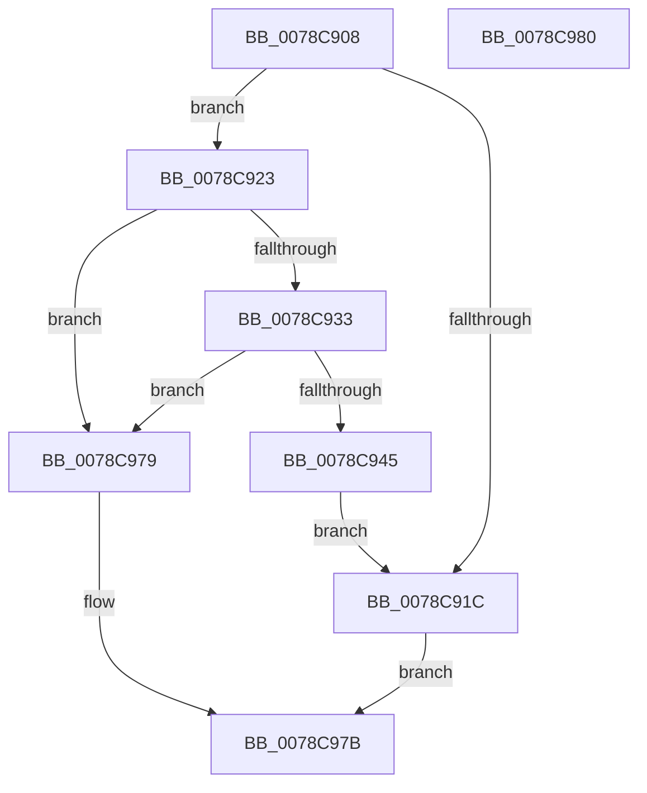

# RtlpInitializeStackTraceDatabase

- RVA: `0x0078C908`–`0x0078C981` (길이 `121` bytes)
- VA: `0x000000014078C908`
- 실행 섹션: `PAGE`
- PDB 이름 있음: `예`; PDB Function 태그: `아니요`
- unwind 정보 RVA: `0x0005D2F4`
- 디코드: `30`개 명령, `121/121` bytes 표시
- 미해석 바이트: `0` (있으면 어셈블리에 `.byte`로 보존)

> 이 문서는 커널 이미지의 기계어와 PDB 기호를 분석해 생성했습니다. 4번과 5번은 함수 원형과 자료형을 바이너리 사용 방식에서 추정한 C 해석이며 원본 소스 복구 결과는 아닙니다.

## 1. Dependencies

- 직접 호출 지점: **2**; 고유 호출 대상: **2**
- 직접 호출자로 확인된 함수: **1**
- RIP 상대 이미지 참조: **1**

### Outgoing calls
- `0x0078C928` → [RtlStdInitializeStackDatabase](RtlStdInitializeStackDatabase_function_0078C7CC.md) (function, `0x0078C7CC`)
- `0x0078C972` → [NtFreeVirtualMemory](../87/NtFreeVirtualMemory_function_0087FE10.md) (function, `0x0087FE10`)

### Direct callers
- [InitBootProcessor](../../init/C1/InitBootProcessor_function_00C1B1C8.md) at `0x00C1BCB7`

### Static image references
- `0x0078C912` → RVA `0x00F05C48` (`.data`; read)

## 2. Other-region calls and transfers

- 다른 실행 섹션으로 향하는 call: **0**
- 별도 외부 분기/꼬리 이동을 확인하지 못했습니다.

## 3. Assembly (complete function range)

```asm
0078C908  48 83 EC 38                     sub rsp, 0x38
0078C90C  48 83 64 24 58 00               and qword ptr [rsp + 0x58], 0
0078C912  48 83 3D 2E 93 77 00 00         cmp qword ptr [rip + 0x77932e], 0
0078C91A  74 07                           je 0x14078c923
0078C91C  B8 0A 02 00 C0                  mov eax, 0xc000020a
0078C921  EB 58                           jmp 0x14078c97b
0078C923  4C 8D 4C 24 58                  lea r9, [rsp + 0x58]
0078C928  E8 9F FE FF FF                  call 0x14078c7cc
0078C92D  8B D0                           mov edx, eax
0078C92F  85 C0                           test eax, eax
0078C931  78 46                           js 0x14078c979
0078C933  48 8B 4C 24 58                  mov rcx, qword ptr [rsp + 0x58]
0078C938  33 C0                           xor eax, eax
0078C93A  F0 48 0F B1 0D 05 93 77 00      lock cmpxchg qword ptr [rip + 0x779305], rcx
0078C943  74 34                           je 0x14078c979
0078C945  48 8B 4C 24 58                  mov rcx, qword ptr [rsp + 0x58]
0078C94A  4C 8D 44 24 58                  lea r8, [rsp + 0x58]
0078C94F  48 89 4C 24 20                  mov qword ptr [rsp + 0x20], rcx
0078C954  48 8D 54 24 20                  lea rdx, [rsp + 0x20]
0078C959  41 B9 00 80 00 00               mov r9d, 0x8000
0078C95F  48 8B 81 B8 00 00 00            mov rax, qword ptr [rcx + 0xb8]
0078C966  48 2B C1                        sub rax, rcx
0078C969  48 83 C9 FF                     or rcx, 0xffffffffffffffff
0078C96D  48 89 44 24 58                  mov qword ptr [rsp + 0x58], rax
0078C972  E8 99 34 0F 00                  call 0x14087fe10
0078C977  EB A3                           jmp 0x14078c91c
0078C979  8B C2                           mov eax, edx
0078C97B  48 83 C4 38                     add rsp, 0x38
0078C97F  C3                              ret
0078C980  CC                              int3
```

## 4. C-style interpretation (structured pseudocode)

```c
__int64 __fastcall RtlpInitializeStackTraceDatabase(void)
{
    __int64 result;
    __int64 v_rsp;
    unsigned __int64 v_stack_m18;
    unsigned __int64 v_stack_p20;

    v_rsp = (v_rsp) - (56);
    if ((*(unsigned __int64 *)(v_rip + 7836462)) == 0) goto loc_0078C923;
loc_0078C91C:
    goto loc_0078C97B;
loc_0078C923:
    result = RtlStdInitializeStackDatabase(a1, a2, a3, v_stack_p20);
    if (sign_flag) goto loc_0078C979;
    result = 0;
    if (condition_is_equal) goto loc_0078C979;
    v_stack_m18 = v_stack_p20;
    result = (*(unsigned __int64 *)(v_stack_p20 + 184)) - (v_stack_p20);
    a1 = (v_stack_p20) | (-1);
    v_stack_p20 = result;
    result = NtFreeVirtualMemory(a1, v_stack_m18, v_stack_p20, (unsigned int)(0x8000ULL));
    goto loc_0078C91C;
loc_0078C979:
loc_0078C97B:
    v_rsp = (v_rsp) + (56);
    return (unsigned int)((unsigned int)(v_stack_m18));
}
```

## 5. (Beta) C Style

```c
void RtlpInitializeStackTraceDatabase(void)
{
    int64_t result;
    int64_t local_rsp;
    uint64_t v_stack_m18;
    uint64_t v_stack_p20;

    local_rsp = (local_rsp) - (56);
    if ((*(uint64_t *)(v_rip + 0x77932E)) == 0) goto loc_0078C923;
loc_0078C91C:
    goto loc_0078C97B;
loc_0078C923:
    result = RtlStdInitializeStackDatabase(a1, a2, a3, v_stack_p20);
    if (sign_flag) goto loc_0078C979;
    result = 0;
    if (condition_is_equal) goto loc_0078C979;
    v_stack_m18 = v_stack_p20;
    result = (*(uint64_t *)(v_stack_p20 + 0xB8)) - (v_stack_p20);
    a1 = (v_stack_p20) | (-1);
    v_stack_p20 = result;
    result = NtFreeVirtualMemory(a1, v_stack_m18, v_stack_p20, (uint32_t)(0x8000ULL));
    goto loc_0078C91C;
loc_0078C979:
loc_0078C97B:
    local_rsp = (local_rsp) + (56);
    return (uint32_t)((uint32_t)(v_stack_m18));
}
```

## 6. Execution-region graph

[열기: 2D/3D 그래프와 함수 탐색 컨트롤 패널](../../../control-panel.html?section=page&rva=0x0078C908&view=graph)

- 2D 그래프는 위에서 아래로 흐르고, 3D 그래프는 빈 공간을 드래그해 회전합니다. Shift+드래그는 이동, 휠은 확대·축소, 함수 노드 선택은 대상 보고서 이동입니다.

### Static fallback


