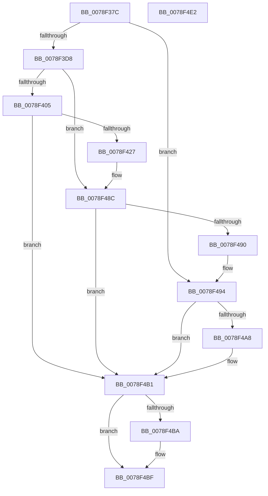

# RtlpIsAppContainer

- RVA: `0x0078F37C`–`0x0078F4E3` (길이 `359` bytes)
- VA: `0x000000014078F37C`
- 실행 섹션: `PAGE`
- PDB 이름 있음: `예`; PDB Function 태그: `아니요`
- unwind 정보 RVA: `0x000BE0BC`
- 디코드: `91`개 명령, `359/359` bytes 표시
- 미해석 바이트: `0` (있으면 어셈블리에 `.byte`로 보존)

> 이 문서는 커널 이미지의 기계어와 PDB 기호를 분석해 생성했습니다. 4번과 5번은 함수 원형과 자료형을 바이너리 사용 방식에서 추정한 C 해석이며 원본 소스 복구 결과는 아닙니다.

## 1. Dependencies

- 직접 호출 지점: **7**; 고유 호출 대상: **6**
- 직접 호출자로 확인된 함수: **1**
- RIP 상대 이미지 참조: **1**

### Outgoing calls
- `0x0078F3F3` → [ZwOpenThreadTokenEx](../../text/6A/ZwOpenThreadTokenEx_function_006AD6B0.md) (function, `0x006AD6B0`)
- `0x0078F418` → [ZwOpenProcessTokenEx](../../text/6A/ZwOpenProcessTokenEx_function_006AD6D0.md) (function, `0x006AD6D0`)
- `0x0078F47C` → [ZwDuplicateToken](../../text/6A/ZwDuplicateToken_function_006AD910.md) (function, `0x006AD910`)
- `0x0078F487` → [ZwClose](../../text/6A/ZwClose_function_006AD2B0.md) (function, `0x006AD2B0`)
- `0x0078F49D` → [SeQueryInformationToken](../8B/SeQueryInformationToken_function_008B5090.md) (function, `0x008B5090`)
- `0x0078F4BA` → [ZwClose](../../text/6A/ZwClose_function_006AD2B0.md) (function, `0x006AD2B0`)
- `0x0078F4C8` → [_security_check_cookie](../../text/6A/_security_check_cookie_function_006AC640.md) (function, `0x006AC640`)

### Direct callers
- [sub_00B37784](../B3/Unknown_function_00B37784.md) at `0x00B37863`

### Static image references
- `0x0078F393` → RVA `0x00E0A740` (`.data`; read)

## 2. Other-region calls and transfers

- 다른 실행 섹션으로 향하는 call: **6**
  - `0x0078F3F3` → [ZwOpenThreadTokenEx](../../text/6A/ZwOpenThreadTokenEx_function_006AD6B0.md) (`PAGE` → `.text`)
  - `0x0078F418` → [ZwOpenProcessTokenEx](../../text/6A/ZwOpenProcessTokenEx_function_006AD6D0.md) (`PAGE` → `.text`)
  - `0x0078F47C` → [ZwDuplicateToken](../../text/6A/ZwDuplicateToken_function_006AD910.md) (`PAGE` → `.text`)
  - `0x0078F487` → [ZwClose](../../text/6A/ZwClose_function_006AD2B0.md) (`PAGE` → `.text`)
  - `0x0078F4BA` → [ZwClose](../../text/6A/ZwClose_function_006AD2B0.md) (`PAGE` → `.text`)
  - `0x0078F4C8` → [_security_check_cookie](../../text/6A/_security_check_cookie_function_006AC640.md) (`PAGE` → `.text`)
- 별도 외부 분기/꼬리 이동을 확인하지 못했습니다.

## 3. Assembly (complete function range)

```asm
0078F37C  4C 8B DC                        mov r11, rsp
0078F37F  49 89 5B 18                     mov qword ptr [r11 + 0x18], rbx
0078F383  49 89 7B 20                     mov qword ptr [r11 + 0x20], rdi
0078F387  55                              push rbp
0078F388  49 8D 6B A1                     lea rbp, [r11 - 0x5f]
0078F38C  48 81 EC 90 00 00 00            sub rsp, 0x90
0078F393  48 8B 05 A6 B3 67 00            mov rax, qword ptr [rip + 0x67b3a6]
0078F39A  48 33 C4                        xor rax, rsp
0078F39D  48 89 45 4F                     mov qword ptr [rbp + 0x4f], rax
0078F3A1  83 65 F7 00                     and dword ptr [rbp - 9], 0
0078F3A5  33 C0                           xor eax, eax
0078F3A7  48 83 65 07 00                  and qword ptr [rbp + 7], 0
0078F3AC  0F 57 C0                        xorps xmm0, xmm0
0078F3AF  48 83 65 FF 00                  and qword ptr [rbp - 1], 0
0078F3B4  48 8B FA                        mov rdi, rdx
0078F3B7  48 89 45 2F                     mov qword ptr [rbp + 0x2f], rax
0078F3BB  89 45 37                        mov dword ptr [rbp + 0x37], eax
0078F3BE  48 89 45 3F                     mov qword ptr [rbp + 0x3f], rax
0078F3C2  89 45 47                        mov dword ptr [rbp + 0x47], eax
0078F3C5  88 02                           mov byte ptr [rdx], al
0078F3C7  0F 11 45 0F                     movups xmmword ptr [rbp + 0xf], xmm0
0078F3CB  0F 11 45 1F                     movups xmmword ptr [rbp + 0x1f], xmm0
0078F3CF  48 85 C9                        test rcx, rcx
0078F3D2  0F 85 BC 00 00 00               jne 0x14078f494
0078F3D8  48 8D 45 FF                     lea rax, [rbp - 1]
0078F3DC  41 B9 00 02 00 00               mov r9d, 0x200
0078F3E2  8D 51 08                        lea edx, [rcx + 8]
0078F3E5  49 89 43 88                     mov qword ptr [r11 - 0x78], rax
0078F3E9  48 C7 C1 FE FF FF FF            mov rcx, 0xfffffffffffffffe
0078F3F0  41 B0 01                        mov r8b, 1
0078F3F3  E8 B8 E2 F1 FF                  call 0x1406ad6b0
0078F3F8  8B D8                           mov ebx, eax
0078F3FA  3D 7C 00 00 C0                  cmp eax, 0xc000007c
0078F3FF  0F 85 87 00 00 00               jne 0x14078f48c
0078F405  4C 8D 4D 07                     lea r9, [rbp + 7]
0078F409  BA 0A 00 00 00                  mov edx, 0xa
0078F40E  41 B8 00 02 00 00               mov r8d, 0x200
0078F414  48 83 C9 FF                     or rcx, 0xffffffffffffffff
0078F418  E8 B3 E2 F1 FF                  call 0x1406ad6d0
0078F41D  8B D8                           mov ebx, eax
0078F41F  85 C0                           test eax, eax
0078F421  0F 88 8A 00 00 00               js 0x14078f4b1
0078F427  48 83 65 17 00                  and qword ptr [rbp + 0x17], 0
0078F42C  48 8D 45 3F                     lea rax, [rbp + 0x3f]
0078F430  48 83 65 1F 00                  and qword ptr [rbp + 0x1f], 0
0078F435  4C 8D 45 0F                     lea r8, [rbp + 0xf]
0078F439  48 83 65 2F 00                  and qword ptr [rbp + 0x2f], 0
0078F43E  B9 02 00 00 00                  mov ecx, 2
0078F443  48 89 45 37                     mov qword ptr [rbp + 0x37], rax
0078F447  45 33 C9                        xor r9d, r9d
0078F44A  48 8D 45 FF                     lea rax, [rbp - 1]
0078F44E  89 4D 43                        mov dword ptr [rbp + 0x43], ecx
0078F451  48 89 44 24 28                  mov qword ptr [rsp + 0x28], rax
0078F456  89 4C 24 20                     mov dword ptr [rsp + 0x20], ecx
0078F45A  8D 51 06                        lea edx, [rcx + 6]
0078F45D  48 8B 4D 07                     mov rcx, qword ptr [rbp + 7]
0078F461  C7 45 0F 30 00 00 00            mov dword ptr [rbp + 0xf], 0x30
0078F468  C7 45 27 00 02 00 00            mov dword ptr [rbp + 0x27], 0x200
0078F46F  C7 45 3F 0C 00 00 00            mov dword ptr [rbp + 0x3f], 0xc
0078F476  66 C7 45 47 01 00               mov word ptr [rbp + 0x47], 1
0078F47C  E8 8F E4 F1 FF                  call 0x1406ad910
0078F481  48 8B 4D 07                     mov rcx, qword ptr [rbp + 7]
0078F485  8B D8                           mov ebx, eax
0078F487  E8 24 DE F1 FF                  call 0x1406ad2b0
0078F48C  85 DB                           test ebx, ebx
0078F48E  78 21                           js 0x14078f4b1
0078F490  48 8B 4D FF                     mov rcx, qword ptr [rbp - 1]
0078F494  4C 8D 45 F7                     lea r8, [rbp - 9]
0078F498  BA 1D 00 00 00                  mov edx, 0x1d
0078F49D  E8 EE 5B 12 00                  call 0x1408b5090
0078F4A2  8B D8                           mov ebx, eax
0078F4A4  85 C0                           test eax, eax
0078F4A6  78 09                           js 0x14078f4b1
0078F4A8  83 7D F7 00                     cmp dword ptr [rbp - 9], 0
0078F4AC  0F 95 C0                        setne al
0078F4AF  88 07                           mov byte ptr [rdi], al
0078F4B1  48 8B 4D FF                     mov rcx, qword ptr [rbp - 1]
0078F4B5  48 85 C9                        test rcx, rcx
0078F4B8  74 05                           je 0x14078f4bf
0078F4BA  E8 F1 DD F1 FF                  call 0x1406ad2b0
0078F4BF  8B C3                           mov eax, ebx
0078F4C1  48 8B 4D 4F                     mov rcx, qword ptr [rbp + 0x4f]
0078F4C5  48 33 CC                        xor rcx, rsp
0078F4C8  E8 73 D1 F1 FF                  call 0x1406ac640
0078F4CD  4C 8D 9C 24 90 00 00 00         lea r11, [rsp + 0x90]
0078F4D5  49 8B 5B 20                     mov rbx, qword ptr [r11 + 0x20]
0078F4D9  49 8B 7B 28                     mov rdi, qword ptr [r11 + 0x28]
0078F4DD  49 8B E3                        mov rsp, r11
0078F4E0  5D                              pop rbp
0078F4E1  C3                              ret
0078F4E2  CC                              int3
```

## 4. C-style interpretation (structured pseudocode)

```c
__int64 __fastcall RtlpIsAppContainer(__int64 a1, __int64 a2)
{
    __int64 result;
    __int64 v_rsp;
    unsigned __int64 v_stack_m70;
    unsigned int v_stack_m78;
    unsigned __int64 v_stack_m8;

    *(unsigned __int64 *)(v_rsp + 24) = v_rbx;
    *(unsigned __int64 *)(v_rsp + 32) = v_rdi;
    v_rsp = (v_rsp) - (144);
    result = (*(unsigned __int64 *)(v_rip + 6796198)) ^ (v_rsp);
    *(unsigned __int64 *)(v_rsp - 95 + 79) = result;
    result = 0;
    *(unsigned __int64 *)(v_rsp - 95 + 47) = 0;
    *(unsigned int *)(v_rsp - 95 + 55) = 0;
    *(unsigned __int64 *)(v_rsp - 95 + 63) = 0;
    *(unsigned int *)(v_rsp - 95 + 71) = 0;
    *(unsigned __int8 *)(a2) = 0;
    *(unsigned __int64 *)(v_rsp - 95 + 15) = v_xmm0;
    *(unsigned __int64 *)(v_rsp - 95 + 31) = v_xmm0;
    if (a1 != 0) goto loc_0078F494;
    *(unsigned __int64 *)(v_rsp - 120) = v_rsp - 95 - 1;
    result = ZwOpenThreadTokenEx(-2, a1 + 8, 1, 512);
    if (((unsigned int)(result)) != 0xC000007CULL) goto loc_0078F48C;
    a1 = (-2) | (-1);
    result = ZwOpenProcessTokenEx(a1, 10, 512, v_rsp - 95 + 7);
    if (sign_flag) goto loc_0078F4B1;
    *(unsigned __int64 *)(v_rsp - 95 + 55) = v_rsp - 95 + 63;
    a4 = 0;
    *(unsigned int *)(v_rsp - 95 + 67) = 2;
    v_stack_m70 = v_rsp - 95 - 1;
    v_stack_m78 = 2;
    *(unsigned int *)(v_rsp - 95 + 15) = 48;
    *(unsigned int *)(v_rsp - 95 + 39) = 512;
    *(unsigned int *)(v_rsp - 95 + 63) = 12;
    *(unsigned __int16 *)(v_rsp - 95 + 71) = 1;
    result = ZwDuplicateToken(*(unsigned __int64 *)(v_rsp - 95 + 7), 2 + 6, v_rsp - 95 + 15, a4);
    result = ZwClose(*(unsigned __int64 *)(v_rsp - 95 + 7), 2 + 6, v_rsp - 95 + 15, a4);
loc_0078F48C:
    if (sign_flag) goto loc_0078F4B1;
loc_0078F494:
    result = SeQueryInformationToken(*(unsigned __int64 *)(v_rsp - 95 - 1), 29, v_rsp - 95 - 9, a4);
    if (!(sign_flag)) {
        result = ((*(unsigned int *)(v_rsp - 95 - 9)) != 0) ? 1 : 0;
        *(unsigned __int8 *)(a2) = (unsigned __int8)(result);
    }
    if (*(unsigned __int64 *)(v_rsp - 95 - 1) != 0) {
        result = ZwClose(*(unsigned __int64 *)(v_rsp - 95 - 1), 29, v_rsp - 95 - 9, a4);
    }
    a1 = (*(unsigned __int64 *)(v_rsp - 95 + 79)) ^ (v_rsp);
    result = _security_check_cookie(a1, 29, v_rsp - 95 - 9, a4);
    return result;
}
```

## 5. (Beta) C Style

```c
int64_t RtlpIsAppContainer(int64_t Arg1, void *Arg2)
{
    uint8_t *arg2 = (uint8_t *)Arg2;

    int64_t result;
    int64_t local_rsp;
    uint64_t v_stack_m70;
    uint32_t v_stack_m78;
    uint64_t v_stack_m8;

    *(uint64_t *)(local_rsp + 0x18) = local_rbx;
    *(uint64_t *)(local_rsp + 0x20) = local_rdi;
    local_rsp = (local_rsp) - (144);
    result = (*(uint64_t *)(v_rip + 0x67B3A6)) ^ (local_rsp);
    *(uint64_t *)(local_rsp - 0x5F + 0x4F) = result;
    result = 0;
    *(uint64_t *)(local_rsp - 0x5F + 0x2F) = 0;
    *(uint32_t *)(local_rsp - 0x5F + 0x37) = 0;
    *(uint64_t *)(local_rsp - 0x5F + 0x3F) = 0;
    *(uint32_t *)(local_rsp - 0x5F + 0x47) = 0;
    *(uint8_t *)(arg2) = 0;
    *(uint64_t *)(local_rsp - 0x5F + 0xF) = v_xmm0;
    *(uint64_t *)(local_rsp - 0x5F + 0x1F) = v_xmm0;
    if (Arg1 != 0) goto loc_0078F494;
    *(uint64_t *)(local_rsp - 0x78) = local_rsp - 95 - 1;
    result = ZwOpenThreadTokenEx(-2, Arg1 + 8, 1, 512);
    if (((uint32_t)(result)) != 0xC000007CULL) goto loc_0078F48C;
    Arg1 = (-2) | (-1);
    result = ZwOpenProcessTokenEx(Arg1, 10, 512, local_rsp - 95 + 7);
    if (sign_flag) goto loc_0078F4B1;
    *(uint64_t *)(local_rsp - 0x5F + 0x37) = local_rsp - 95 + 63;
    a4 = 0;
    *(uint32_t *)(local_rsp - 0x5F + 0x43) = 2;
    v_stack_m70 = local_rsp - 95 - 1;
    v_stack_m78 = 2;
    *(uint32_t *)(local_rsp - 0x5F + 0xF) = 48;
    *(uint32_t *)(local_rsp - 0x5F + 0x27) = 512;
    *(uint32_t *)(local_rsp - 0x5F + 0x3F) = 12;
    *(uint16_t *)(local_rsp - 0x5F + 0x47) = 1;
    result = ZwDuplicateToken(*(uint64_t *)(local_rsp - 0x5F + 0x7), 2 + 6, local_rsp - 95 + 15, a4);
    result = ZwClose(*(uint64_t *)(local_rsp - 0x5F + 0x7), 2 + 6, local_rsp - 95 + 15, a4);
loc_0078F48C:
    if (sign_flag) goto loc_0078F4B1;
loc_0078F494:
    result = SeQueryInformationToken(*(uint64_t *)(local_rsp - 0x5F - 0x1), 29, local_rsp - 95 - 9, a4);
    if (!(sign_flag)) {
        result = ((*(uint32_t *)(local_rsp - 0x5F - 0x9)) != 0) ? 1 : 0;
        *(uint8_t *)(arg2) = (uint8_t)(result);
    }
    if (*(uint64_t *)(local_rsp - 0x5F - 0x1) != 0) {
        result = ZwClose(*(uint64_t *)(local_rsp - 0x5F - 0x1), 29, local_rsp - 95 - 9, a4);
    }
    Arg1 = (*(uint64_t *)(local_rsp - 0x5F + 0x4F)) ^ (local_rsp);
    result = _security_check_cookie(Arg1, 29, local_rsp - 95 - 9, a4);
    return result;
}
```

### 관측된 메모리 오프셋

구조체 형식이 확인되지 않은 접근은 인자 기준의 오프셋으로만 기록했습니다.

| 기준 인자 | 오프셋 표현 | 폭 (bit) | 접근 |
|---|---:|---:|---|
| `Arg2` | `+ 0x0` | `8` | `W` |

## 6. Execution-region graph

[열기: 2D/3D 그래프와 함수 탐색 컨트롤 패널](../../../control-panel.html?section=page&rva=0x0078F37C&view=graph)

- 2D 그래프는 위에서 아래로 흐르고, 3D 그래프는 빈 공간을 드래그해 회전합니다. Shift+드래그는 이동, 휠은 확대·축소, 함수 노드 선택은 대상 보고서 이동입니다.

### Static fallback


