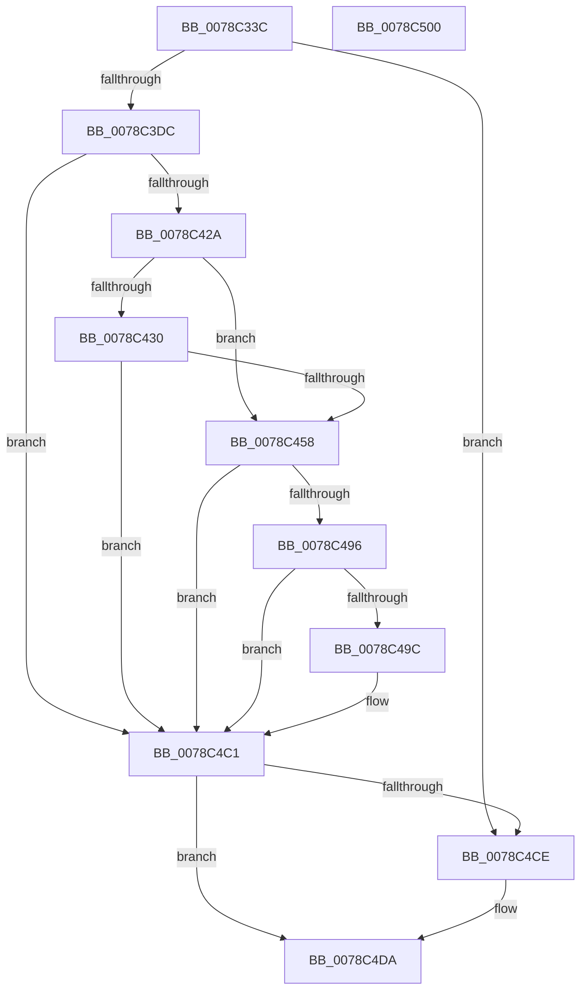

# RtlpQueryNlsSystemCodePages

- RVA: `0x0078C33C`–`0x0078C501` (길이 `453` bytes)
- VA: `0x000000014078C33C`
- 실행 섹션: `PAGE`
- PDB 이름 있음: `예`; PDB Function 태그: `아니요`
- unwind 정보 RVA: `0x000CF820`
- 디코드: `112`개 명령, `453/453` bytes 표시
- 미해석 바이트: `0` (있으면 어셈블리에 `.byte`로 보존)

> 이 문서는 커널 이미지의 기계어와 PDB 기호를 분석해 생성했습니다. 4번과 5번은 함수 원형과 자료형을 바이너리 사용 방식에서 추정한 C 해석이며 원본 소스 복구 결과는 아닙니다.

## 1. Dependencies

- 직접 호출 지점: **12**; 고유 호출 대상: **6**
- 직접 호출자로 확인된 함수: **1**
- RIP 상대 이미지 참조: **4**

### Outgoing calls
- `0x0078C39B` → [RtlInitUnicodeString](../../text/42/RtlInitUnicodeString_function_0042A780.md) (function, `0x0042A780`)
- `0x0078C3CF` → [ZwOpenKey](../../text/6A/ZwOpenKey_function_006AD310.md) (function, `0x006AD310`)
- `0x0078C3F5` → [RtlInitUnicodeString](../../text/42/RtlInitUnicodeString_function_0042A780.md) (function, `0x0042A780`)
- `0x0078C41B` → [ZwQueryValueKey](../../text/6A/ZwQueryValueKey_function_006AD3B0.md) (function, `0x006AD3B0`)
- `0x0078C43D` → [RtlInitUnicodeString](../../text/42/RtlInitUnicodeString_function_0042A780.md) (function, `0x0042A780`)
- `0x0078C44D` → [RtlUnicodeStringToInteger](../99/RtlUnicodeStringToInteger_function_00993480.md) (function, `0x00993480`)
- `0x0078C463` → [RtlInitUnicodeString](../../text/42/RtlInitUnicodeString_function_0042A780.md) (function, `0x0042A780`)
- `0x0078C48B` → [ZwQueryValueKey](../../text/6A/ZwQueryValueKey_function_006AD3B0.md) (function, `0x006AD3B0`)
- `0x0078C4A9` → [RtlInitUnicodeString](../../text/42/RtlInitUnicodeString_function_0042A780.md) (function, `0x0042A780`)
- `0x0078C4BA` → [RtlUnicodeStringToInteger](../99/RtlUnicodeStringToInteger_function_00993480.md) (function, `0x00993480`)
- `0x0078C4C5` → [ZwClose](../../text/6A/ZwClose_function_006AD2B0.md) (function, `0x006AD2B0`)
- `0x0078C4E3` → [_security_check_cookie](../../text/6A/_security_check_cookie_function_006AC640.md) (function, `0x006AC640`)

### Direct callers
- [ExInitializeNls](../AD/ExInitializeNls_function_00ADB178.md) at `0x00ADB1F1`

### Static image references
- `0x0078C356` → RVA `0x00E0A740` (`.data`; read)
- `0x0078C384` → RVA `0x00B05490` (` ?? ::NNGAKEGL::`string'`; read)
- `0x0078C3DF` → RVA `0x00B05480` (` ?? ::NNGAKEGL::`string'`; read)
- `0x0078C458` → RVA `0x00B05470` (` ?? ::NNGAKEGL::`string'`; read)

## 2. Other-region calls and transfers

- 다른 실행 섹션으로 향하는 call: **10**
  - `0x0078C39B` → [RtlInitUnicodeString](../../text/42/RtlInitUnicodeString_function_0042A780.md) (`PAGE` → `.text`)
  - `0x0078C3CF` → [ZwOpenKey](../../text/6A/ZwOpenKey_function_006AD310.md) (`PAGE` → `.text`)
  - `0x0078C3F5` → [RtlInitUnicodeString](../../text/42/RtlInitUnicodeString_function_0042A780.md) (`PAGE` → `.text`)
  - `0x0078C41B` → [ZwQueryValueKey](../../text/6A/ZwQueryValueKey_function_006AD3B0.md) (`PAGE` → `.text`)
  - `0x0078C43D` → [RtlInitUnicodeString](../../text/42/RtlInitUnicodeString_function_0042A780.md) (`PAGE` → `.text`)
  - `0x0078C463` → [RtlInitUnicodeString](../../text/42/RtlInitUnicodeString_function_0042A780.md) (`PAGE` → `.text`)
  - `0x0078C48B` → [ZwQueryValueKey](../../text/6A/ZwQueryValueKey_function_006AD3B0.md) (`PAGE` → `.text`)
  - `0x0078C4A9` → [RtlInitUnicodeString](../../text/42/RtlInitUnicodeString_function_0042A780.md) (`PAGE` → `.text`)
  - `0x0078C4C5` → [ZwClose](../../text/6A/ZwClose_function_006AD2B0.md) (`PAGE` → `.text`)
  - `0x0078C4E3` → [_security_check_cookie](../../text/6A/_security_check_cookie_function_006AC640.md) (`PAGE` → `.text`)
- 별도 외부 분기/꼬리 이동을 확인하지 못했습니다.

## 3. Assembly (complete function range)

```asm
0078C33C  48 89 5C 24 18                  mov qword ptr [rsp + 0x18], rbx
0078C341  48 89 74 24 20                  mov qword ptr [rsp + 0x20], rsi
0078C346  55                              push rbp
0078C347  57                              push rdi
0078C348  41 56                           push r14
0078C34A  48 8D 6C 24 B9                  lea rbp, [rsp - 0x47]
0078C34F  48 81 EC D0 00 00 00            sub rsp, 0xd0
0078C356  48 8B 05 E3 E3 67 00            mov rax, qword ptr [rip + 0x67e3e3]
0078C35D  48 33 C4                        xor rax, rsp
0078C360  48 89 45 3F                     mov qword ptr [rbp + 0x3f], rax
0078C364  45 33 F6                        xor r14d, r14d
0078C367  C7 01 E9 FD 00 00               mov dword ptr [rcx], 0xfde9
0078C36D  C7 02 E9 FD 00 00               mov dword ptr [rdx], 0xfde9
0078C373  48 8B FA                        mov rdi, rdx
0078C376  48 8B F1                        mov rsi, rcx
0078C379  44 89 75 EB                     mov dword ptr [rbp - 0x15], r14d
0078C37D  0F 57 C0                        xorps xmm0, xmm0
0078C380  44 89 75 03                     mov dword ptr [rbp + 3], r14d
0078C384  48 8D 15 05 91 37 00            lea rdx, [rip + 0x379105]
0078C38B  44 89 75 A7                     mov dword ptr [rbp - 0x59], r14d
0078C38F  48 8D 4D D7                     lea rcx, [rbp - 0x29]
0078C393  4C 89 75 AF                     mov qword ptr [rbp - 0x51], r14
0078C397  0F 11 45 D7                     movups xmmword ptr [rbp - 0x29], xmm0
0078C39B  E8 E0 E3 C9 FF                  call 0x14042a780
0078C3A0  48 8D 45 D7                     lea rax, [rbp - 0x29]
0078C3A4  C7 45 E7 30 00 00 00            mov dword ptr [rbp - 0x19], 0x30
0078C3AB  0F 57 C0                        xorps xmm0, xmm0
0078C3AE  48 89 45 F7                     mov qword ptr [rbp - 9], rax
0078C3B2  4C 8D 45 E7                     lea r8, [rbp - 0x19]
0078C3B6  4C 89 75 EF                     mov qword ptr [rbp - 0x11], r14
0078C3BA  BA 00 00 00 80                  mov edx, 0x80000000
0078C3BF  C7 45 FF 40 02 00 00            mov dword ptr [rbp - 1], 0x240
0078C3C6  48 8D 4D AF                     lea rcx, [rbp - 0x51]
0078C3CA  F3 0F 7F 45 07                  movdqu xmmword ptr [rbp + 7], xmm0
0078C3CF  E8 3C 0F F2 FF                  call 0x1406ad310
0078C3D4  85 C0                           test eax, eax
0078C3D6  0F 88 F2 00 00 00               js 0x14078c4ce
0078C3DC  0F 57 C0                        xorps xmm0, xmm0
0078C3DF  48 8D 15 9A 90 37 00            lea rdx, [rip + 0x37909a]
0078C3E6  0F 57 C9                        xorps xmm1, xmm1
0078C3E9  48 8D 4D B7                     lea rcx, [rbp - 0x49]
0078C3ED  0F 11 45 B7                     movups xmmword ptr [rbp - 0x49], xmm0
0078C3F1  0F 11 4D C7                     movups xmmword ptr [rbp - 0x39], xmm1
0078C3F5  E8 86 E3 C9 FF                  call 0x14042a780
0078C3FA  48 8B 4D AF                     mov rcx, qword ptr [rbp - 0x51]
0078C3FE  48 8D 45 A7                     lea rax, [rbp - 0x59]
0078C402  48 89 44 24 28                  mov qword ptr [rsp + 0x28], rax
0078C407  4C 8D 4D 17                     lea r9, [rbp + 0x17]
0078C40B  45 8D 46 02                     lea r8d, [r14 + 2]
0078C40F  C7 44 24 20 24 00 00 00         mov dword ptr [rsp + 0x20], 0x24
0078C417  48 8D 55 B7                     lea rdx, [rbp - 0x49]
0078C41B  E8 90 0F F2 FF                  call 0x1406ad3b0
0078C420  8B D8                           mov ebx, eax
0078C422  85 C0                           test eax, eax
0078C424  0F 88 97 00 00 00               js 0x14078c4c1
0078C42A  83 7D 1B 01                     cmp dword ptr [rbp + 0x1b], 1
0078C42E  75 28                           jne 0x14078c458
0078C430  48 8D 55 23                     lea rdx, [rbp + 0x23]
0078C434  66 44 89 75 39                  mov word ptr [rbp + 0x39], r14w
0078C439  48 8D 4D C7                     lea rcx, [rbp - 0x39]
0078C43D  E8 3E E3 C9 FF                  call 0x14042a780
0078C442  4C 8B C6                        mov r8, rsi
0078C445  41 8D 56 0A                     lea edx, [r14 + 0xa]
0078C449  48 8D 4D C7                     lea rcx, [rbp - 0x39]
0078C44D  E8 2E 70 20 00                  call 0x140993480
0078C452  8B D8                           mov ebx, eax
0078C454  85 C0                           test eax, eax
0078C456  78 69                           js 0x14078c4c1
0078C458  48 8D 15 11 90 37 00            lea rdx, [rip + 0x379011]
0078C45F  48 8D 4D B7                     lea rcx, [rbp - 0x49]
0078C463  E8 18 E3 C9 FF                  call 0x14042a780
0078C468  48 8B 4D AF                     mov rcx, qword ptr [rbp - 0x51]
0078C46C  48 8D 45 A7                     lea rax, [rbp - 0x59]
0078C470  48 89 44 24 28                  mov qword ptr [rsp + 0x28], rax
0078C475  4C 8D 4D 17                     lea r9, [rbp + 0x17]
0078C479  41 B8 02 00 00 00               mov r8d, 2
0078C47F  C7 44 24 20 24 00 00 00         mov dword ptr [rsp + 0x20], 0x24
0078C487  48 8D 55 B7                     lea rdx, [rbp - 0x49]
0078C48B  E8 20 0F F2 FF                  call 0x1406ad3b0
0078C490  8B D8                           mov ebx, eax
0078C492  85 C0                           test eax, eax
0078C494  78 2B                           js 0x14078c4c1
0078C496  83 7D 1B 01                     cmp dword ptr [rbp + 0x1b], 1
0078C49A  75 25                           jne 0x14078c4c1
0078C49C  48 8D 55 23                     lea rdx, [rbp + 0x23]
0078C4A0  66 44 89 75 39                  mov word ptr [rbp + 0x39], r14w
0078C4A5  48 8D 4D C7                     lea rcx, [rbp - 0x39]
0078C4A9  E8 D2 E2 C9 FF                  call 0x14042a780
0078C4AE  4C 8B C7                        mov r8, rdi
0078C4B1  48 8D 4D C7                     lea rcx, [rbp - 0x39]
0078C4B5  BA 0A 00 00 00                  mov edx, 0xa
0078C4BA  E8 C1 6F 20 00                  call 0x140993480
0078C4BF  8B D8                           mov ebx, eax
0078C4C1  48 8B 4D AF                     mov rcx, qword ptr [rbp - 0x51]
0078C4C5  E8 E6 0D F2 FF                  call 0x1406ad2b0
0078C4CA  85 DB                           test ebx, ebx
0078C4CC  79 0C                           jns 0x14078c4da
0078C4CE  C7 06 E9 FD 00 00               mov dword ptr [rsi], 0xfde9
0078C4D4  C7 07 E9 FD 00 00               mov dword ptr [rdi], 0xfde9
0078C4DA  33 C0                           xor eax, eax
0078C4DC  48 8B 4D 3F                     mov rcx, qword ptr [rbp + 0x3f]
0078C4E0  48 33 CC                        xor rcx, rsp
0078C4E3  E8 58 01 F2 FF                  call 0x1406ac640
0078C4E8  4C 8D 9C 24 D0 00 00 00         lea r11, [rsp + 0xd0]
0078C4F0  49 8B 5B 30                     mov rbx, qword ptr [r11 + 0x30]
0078C4F4  49 8B 73 38                     mov rsi, qword ptr [r11 + 0x38]
0078C4F8  49 8B E3                        mov rsp, r11
0078C4FB  41 5E                           pop r14
0078C4FD  5F                              pop rdi
0078C4FE  5D                              pop rbp
0078C4FF  C3                              ret
0078C500  CC                              int3
```

## 4. C-style interpretation (structured pseudocode)

```c
__int64 __fastcall RtlpQueryNlsSystemCodePages(__int64 a1, __int64 a2)
{
    __int64 result;
    __int64 v_r14;
    __int64 v_rbx;
    __int64 v_rsp;
    unsigned __int64 v_stack_m18;
    unsigned __int64 v_stack_m20;
    unsigned __int16 v_stack_m26;
    unsigned __int64 v_stack_m3C;
    unsigned int v_stack_m44;
    unsigned __int64 v_stack_m48;
    unsigned __int64 v_stack_m58;
    unsigned int v_stack_m5C;
    unsigned __int64 v_stack_m5F;
    unsigned int v_stack_m60;
    unsigned __int64 v_stack_m68;
    unsigned __int64 v_stack_m70;
    unsigned int v_stack_m74;
    unsigned int v_stack_m78;
    unsigned __int64 v_stack_m88;
    unsigned __int64 v_stack_m98;
    unsigned __int64 v_stack_mA8;
    unsigned __int64 v_stack_mB0;
    unsigned int v_stack_mB8;
    unsigned __int64 v_stack_mC0;
    unsigned int v_stack_mC8;
    unsigned __int64 v_stack_p18;
    unsigned __int64 v_stack_p20;

    v_stack_p18 = v_rbx;
    v_stack_p20 = v_rsi;
    v_rsp = (v_rsp) - (208);
    result = (*(unsigned __int64 *)(v_rip + 6808547)) ^ (v_rsp);
    v_stack_m20 = result;
    v_r14 = 0;
    *(unsigned int *)(a1) = 0xFDE9ULL;
    *(unsigned int *)(a2) = 0xFDE9ULL;
    v_stack_m74 = 0;
    v_stack_m5C = 0;
    v_stack_mB8 = 0;
    v_stack_mB0 = 0;
    v_stack_m88 = v_xmm0;
    result = RtlInitUnicodeString(v_stack_m88, v_rip + 3641605, a3, a4);
    v_stack_m78 = 48;
    v_stack_m68 = v_stack_m88;
    v_stack_m70 = 0;
    v_stack_m60 = 576;
    v_stack_m58 = v_xmm0;
    result = ZwOpenKey(v_stack_mB0, (unsigned int)(0x80000000ULL), v_stack_m78, a4);
    if (sign_flag) goto loc_0078C4CE;
    v_stack_mA8 = v_xmm0;
    v_stack_m98 = v_xmm1;
    result = RtlInitUnicodeString(v_stack_mA8, v_rip + 3641498, v_stack_m78, a4);
    v_stack_mC0 = v_stack_mB8;
    v_stack_mC8 = 36;
    result = ZwQueryValueKey(v_stack_mB0, v_stack_mA8, v_r14 + 2, v_stack_m48);
    if (sign_flag) goto loc_0078C4C1;
    if (v_stack_m44 != 1) goto loc_0078C458;
    v_stack_m26 = 0;
    result = RtlInitUnicodeString(v_stack_m98, v_stack_m3C, v_r14 + 2, v_stack_m48);
    result = RtlUnicodeStringToInteger(v_stack_m98, v_r14 + 10, a1, v_stack_m48);
    if (sign_flag) goto loc_0078C4C1;
loc_0078C458:
    result = RtlInitUnicodeString(v_stack_mA8, v_rip + 3641361, a1, v_stack_m48);
    v_stack_mC0 = v_stack_mB8;
    v_stack_mC8 = 36;
    result = ZwQueryValueKey(v_stack_mB0, v_stack_mA8, 2, v_stack_m48);
    if (sign_flag) goto loc_0078C4C1;
    v_rbx = (unsigned int)((unsigned int)(result));
    if (v_stack_m44 == 1) {
        a2 = v_stack_m3C;
        v_stack_m26 = 0;
        a1 = v_stack_m98;
        result = RtlInitUnicodeString(a1, a2, 2, v_stack_m48);
        a3 = a2;
        a1 = v_stack_m98;
        a2 = 10;
        result = RtlUnicodeStringToInteger(a1, a2, a3, v_stack_m48);
        v_rbx = (unsigned int)(result);
    }
    result = ZwClose(v_stack_mB0, a2, a3, v_stack_m48);
    if (sign_flag) {
        *(unsigned int *)(a1) = 0xFDE9ULL;
        *(unsigned int *)(a2) = 0xFDE9ULL;
    }
    result = 0;
    a1 = (v_stack_m20) ^ (v_rsp);
    result = _security_check_cookie(a1, a2, a3, v_stack_m48);
    return result;
}
```

## 5. (Beta) C Style

```c
int64_t RtlpQueryNlsSystemCodePages(void *Arg1, void *Arg2)
{
    uint8_t *arg1 = (uint8_t *)Arg1;
    uint8_t *arg2 = (uint8_t *)Arg2;

    int64_t result;
    int64_t local_r14;
    int64_t local_rbx;
    int64_t local_rsp;
    uint64_t v_stack_m18;
    uint64_t v_stack_m20;
    uint16_t v_stack_m26;
    uint64_t v_stack_m3C;
    uint32_t v_stack_m44;
    uint64_t v_stack_m48;
    uint64_t v_stack_m58;
    uint32_t v_stack_m5C;
    uint64_t v_stack_m5F;
    uint32_t v_stack_m60;
    uint64_t v_stack_m68;
    uint64_t v_stack_m70;
    uint32_t v_stack_m74;
    uint32_t v_stack_m78;
    uint64_t v_stack_m88;
    uint64_t v_stack_m98;
    uint64_t v_stack_mA8;
    uint64_t v_stack_mB0;
    uint32_t v_stack_mB8;
    uint64_t v_stack_mC0;
    uint32_t v_stack_mC8;
    uint64_t v_stack_p18;
    uint64_t v_stack_p20;

    v_stack_p18 = local_rbx;
    v_stack_p20 = local_rsi;
    local_rsp = (local_rsp) - (208);
    result = (*(uint64_t *)(v_rip + 0x67E3E3)) ^ (local_rsp);
    v_stack_m20 = result;
    local_r14 = 0;
    *(uint32_t *)(arg1) = 0xFDE9ULL;
    *(uint32_t *)(arg2) = 0xFDE9ULL;
    v_stack_m74 = 0;
    v_stack_m5C = 0;
    v_stack_mB8 = 0;
    v_stack_mB0 = 0;
    v_stack_m88 = v_xmm0;
    result = RtlInitUnicodeString(v_stack_m88, v_rip + 3641605, a3, a4);
    v_stack_m78 = 48;
    v_stack_m68 = v_stack_m88;
    v_stack_m70 = 0;
    v_stack_m60 = 576;
    v_stack_m58 = v_xmm0;
    result = ZwOpenKey(v_stack_mB0, (uint32_t)(0x80000000ULL), v_stack_m78, a4);
    if (sign_flag) goto loc_0078C4CE;
    v_stack_mA8 = v_xmm0;
    v_stack_m98 = v_xmm1;
    result = RtlInitUnicodeString(v_stack_mA8, v_rip + 3641498, v_stack_m78, a4);
    v_stack_mC0 = v_stack_mB8;
    v_stack_mC8 = 36;
    result = ZwQueryValueKey(v_stack_mB0, v_stack_mA8, local_r14 + 2, v_stack_m48);
    if (sign_flag) goto loc_0078C4C1;
    if (v_stack_m44 != 1) goto loc_0078C458;
    v_stack_m26 = 0;
    result = RtlInitUnicodeString(v_stack_m98, v_stack_m3C, local_r14 + 2, v_stack_m48);
    result = RtlUnicodeStringToInteger(v_stack_m98, local_r14 + 10, Arg1, v_stack_m48);
    if (sign_flag) goto loc_0078C4C1;
loc_0078C458:
    result = RtlInitUnicodeString(v_stack_mA8, v_rip + 3641361, Arg1, v_stack_m48);
    v_stack_mC0 = v_stack_mB8;
    v_stack_mC8 = 36;
    result = ZwQueryValueKey(v_stack_mB0, v_stack_mA8, 2, v_stack_m48);
    if (sign_flag) goto loc_0078C4C1;
    local_rbx = (uint32_t)((uint32_t)(result));
    if (v_stack_m44 == 1) {
        Arg2 = v_stack_m3C;
        v_stack_m26 = 0;
        Arg1 = v_stack_m98;
        result = RtlInitUnicodeString(Arg1, Arg2, 2, v_stack_m48);
        a3 = Arg2;
        Arg1 = v_stack_m98;
        Arg2 = 10;
        result = RtlUnicodeStringToInteger(Arg1, Arg2, a3, v_stack_m48);
        local_rbx = (uint32_t)(result);
    }
    result = ZwClose(v_stack_mB0, Arg2, a3, v_stack_m48);
    if (sign_flag) {
        *(uint32_t *)(arg1) = 0xFDE9ULL;
        *(uint32_t *)(arg2) = 0xFDE9ULL;
    }
    result = 0;
    Arg1 = (v_stack_m20) ^ (local_rsp);
    result = _security_check_cookie(Arg1, Arg2, a3, v_stack_m48);
    return result;
}
```

### 관측된 메모리 오프셋

구조체 형식이 확인되지 않은 접근은 인자 기준의 오프셋으로만 기록했습니다.

| 기준 인자 | 오프셋 표현 | 폭 (bit) | 접근 |
|---|---:|---:|---|
| `Arg1` | `+ 0x0` | `32` | `W` |
| `Arg2` | `+ 0x0` | `32` | `W` |

## 6. Execution-region graph

[열기: 2D/3D 그래프와 함수 탐색 컨트롤 패널](../../../control-panel.html?section=page&rva=0x0078C33C&view=graph)

- 2D 그래프는 위에서 아래로 흐르고, 3D 그래프는 빈 공간을 드래그해 회전합니다. Shift+드래그는 이동, 휠은 확대·축소, 함수 노드 선택은 대상 보고서 이동입니다.

### Static fallback


