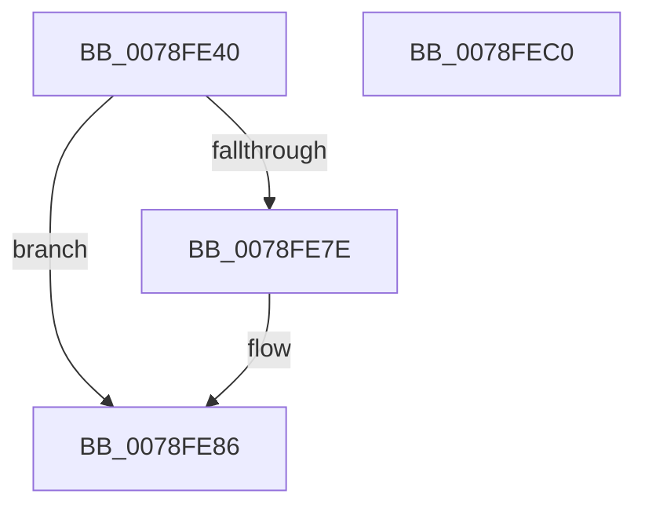

# RtlpQueryTimeZoneKeyNameRoutine

- RVA: `0x0078FE40`–`0x0078FEC1` (길이 `129` bytes)
- VA: `0x000000014078FE40`
- 실행 섹션: `PAGE`
- PDB 이름 있음: `예`; PDB Function 태그: `아니요`
- unwind 정보 RVA: `0x0005C954`
- 디코드: `37`개 명령, `129/129` bytes 표시
- 미해석 바이트: `0` (있으면 어셈블리에 `.byte`로 보존)

> 이 문서는 커널 이미지의 기계어와 PDB 기호를 분석해 생성했습니다. 4번과 5번은 함수 원형과 자료형을 바이너리 사용 방식에서 추정한 C 해석이며 원본 소스 복구 결과는 아닙니다.

## 1. Dependencies

- 직접 호출 지점: **2**; 고유 호출 대상: **2**
- 직접 호출자로 확인된 함수: **0**
- RIP 상대 이미지 참조: **0**

### Outgoing calls
- `0x0078FE60` → [wcsnlen](../../text/50/wcsnlen_function_00501D60.md) (function, `0x00501D60`)
- `0x0078FE94` → [memcpy](../../text/6C/memcpy_function_006C6840.md) (function, `0x006C6840`)

### Direct callers
- 이 함수 시작 RVA로 연결되는 직접 call은 확인되지 않았습니다. 간접 호출은 완전히 역산할 수 없습니다.

### Static image references
- 디코드된 RIP-relative 메모리 참조가 없습니다.

## 2. Other-region calls and transfers

- 다른 실행 섹션으로 향하는 call: **2**
  - `0x0078FE60` → [wcsnlen](../../text/50/wcsnlen_function_00501D60.md) (`PAGE` → `.text`)
  - `0x0078FE94` → [memcpy](../../text/6C/memcpy_function_006C6840.md) (`PAGE` → `.text`)
- 별도 외부 분기/꼬리 이동을 확인하지 못했습니다.

## 3. Assembly (complete function range)

```asm
0078FE40  48 89 5C 24 08                  mov qword ptr [rsp + 8], rbx
0078FE45  48 89 6C 24 10                  mov qword ptr [rsp + 0x10], rbp
0078FE4A  48 89 74 24 18                  mov qword ptr [rsp + 0x18], rsi
0078FE4F  57                              push rdi
0078FE50  48 83 EC 20                     sub rsp, 0x20
0078FE54  41 8B D1                        mov edx, r9d
0078FE57  49 8B C8                        mov rcx, r8
0078FE5A  48 D1 EA                        shr rdx, 1
0078FE5D  49 8B E8                        mov rbp, r8
0078FE60  E8 FB 1E D7 FF                  call 0x140501d60
0078FE65  48 8B 74 24 58                  mov rsi, qword ptr [rsp + 0x58]
0078FE6A  48 8B F8                        mov rdi, rax
0078FE6D  0F B7 46 02                     movzx eax, word ptr [rsi + 2]
0078FE71  48 8D 0C 7D 02 00 00 00         lea rcx, [rdi*2 + 2]
0078FE79  48 3B C8                        cmp rcx, rax
0078FE7C  76 08                           jbe 0x14078fe86
0078FE7E  8B F8                           mov edi, eax
0078FE80  48 D1 EF                        shr rdi, 1
0078FE83  48 FF CF                        dec rdi
0078FE86  48 8B 4E 08                     mov rcx, qword ptr [rsi + 8]
0078FE8A  48 8D 1C 3F                     lea rbx, [rdi + rdi]
0078FE8E  4C 8B C3                        mov r8, rbx
0078FE91  48 8B D5                        mov rdx, rbp
0078FE94  E8 A7 69 F3 FF                  call 0x1406c6840
0078FE99  48 8B 46 08                     mov rax, qword ptr [rsi + 8]
0078FE9D  33 C9                           xor ecx, ecx
0078FE9F  48 8B 6C 24 38                  mov rbp, qword ptr [rsp + 0x38]
0078FEA4  66 03 FF                        add di, di
0078FEA7  66 89 0C 03                     mov word ptr [rbx + rax], cx
0078FEAB  33 C0                           xor eax, eax
0078FEAD  48 8B 5C 24 30                  mov rbx, qword ptr [rsp + 0x30]
0078FEB2  66 89 3E                        mov word ptr [rsi], di
0078FEB5  48 8B 74 24 40                  mov rsi, qword ptr [rsp + 0x40]
0078FEBA  48 83 C4 20                     add rsp, 0x20
0078FEBE  5F                              pop rdi
0078FEBF  C3                              ret
0078FEC0  CC                              int3
```

## 4. C-style interpretation (structured pseudocode)

```c
__int64 __fastcall RtlpQueryTimeZoneKeyNameRoutine(__int64 a1, __int64 a2, __int64 a3, int a4, __int64 a5, __int64 a6)
{
    __int64 result;
    __int64 v_rdi;
    __int64 v_rsp;
    unsigned __int64 v_stack_p10;
    unsigned __int64 v_stack_p18;
    unsigned __int64 v_stack_p8;

    v_stack_p8 = v_rbx;
    v_stack_p10 = v_rbp;
    v_stack_p18 = v_rsi;
    v_rsp = (v_rsp) - (32);
    a2 = ((unsigned int)(a4)) >> (1);
    result = wcsnlen(a3, a2, a3, a4);
    v_rdi = result;
    if ((result * 2 + 2) >= = (*(unsigned __int16 *)(a6 + 2))) {
        v_rdi = (unsigned int)(*(unsigned __int16 *)(a6 + 2));
        v_rdi = (v_rdi) >> (1);
        v_rdi = (v_rdi) - 1;
    }
    result = memcpy(*(unsigned __int64 *)(a6 + 8), a3, v_rdi + v_rdi * 1, a4);
    a1 = 0;
    v_rdi = (unsigned __int16)((v_rdi) + ((unsigned __int16)(v_rdi)));
    *(unsigned __int16 *)(v_rdi + v_rdi * 1 + *(unsigned __int64 *)(a6 + 8) * 1) = 0;
    result = 0;
    *(unsigned __int16 *)(a6) = (unsigned __int16)(v_rdi);
    v_rsp = (v_rsp) + (32);
    return result;
}
```

## 5. (Beta) C Style

```c
int64_t RtlpQueryTimeZoneKeyNameRoutine(int64_t Arg1, int64_t Arg2, int64_t Arg3, int32_t Arg4, uint64_t Arg5, void *Arg6)
{
    uint8_t *arg6 = (uint8_t *)Arg6;

    int64_t result;
    int64_t local_rdi;
    int64_t local_rsp;
    uint64_t v_stack_p10;
    uint64_t v_stack_p18;
    uint64_t v_stack_p8;

    v_stack_p8 = local_rbx;
    v_stack_p10 = local_rbp;
    v_stack_p18 = local_rsi;
    local_rsp = (local_rsp) - (32);
    Arg2 = ((uint32_t)(Arg4)) >> (1);
    result = wcsnlen(Arg3, Arg2, Arg3, Arg4);
    local_rdi = result;
    if ((result * 2 + 2) >= = (*(uint16_t *)(arg6 + 0x2))) {
        local_rdi = (uint32_t)(*(uint16_t *)(arg6 + 0x2));
        local_rdi = (local_rdi) >> (1);
        local_rdi = (local_rdi) - 1;
    }
    result = memcpy(*(uint64_t *)(arg6 + 0x8), Arg3, local_rdi + local_rdi * 1, Arg4);
    Arg1 = 0;
    local_rdi = (uint16_t)((local_rdi) + ((uint16_t)(local_rdi)));
    *(uint16_t *)(local_rdi + local_rdi * 1 + *(uint64_t *)(arg6 + 0x8) * 1) = 0;
    result = 0;
    *(uint16_t *)(arg6) = (uint16_t)(local_rdi);
    local_rsp = (local_rsp) + (32);
    return result;
}
```

### 관측된 메모리 오프셋

구조체 형식이 확인되지 않은 접근은 인자 기준의 오프셋으로만 기록했습니다.

| 기준 인자 | 오프셋 표현 | 폭 (bit) | 접근 |
|---|---:|---:|---|
| `Arg6` | `+ 0x0` | `16` | `W` |
| `Arg6` | `+ 0x2` | `16` | `R` |
| `Arg6` | `+ 0x8` | `64` | `R` |

## 6. Execution-region graph

[열기: 2D/3D 그래프와 함수 탐색 컨트롤 패널](../../../control-panel.html?section=page&rva=0x0078FE40&view=graph)

- 2D 그래프는 위에서 아래로 흐르고, 3D 그래프는 빈 공간을 드래그해 회전합니다. Shift+드래그는 이동, 휠은 확대·축소, 함수 노드 선택은 대상 보고서 이동입니다.

### Static fallback


