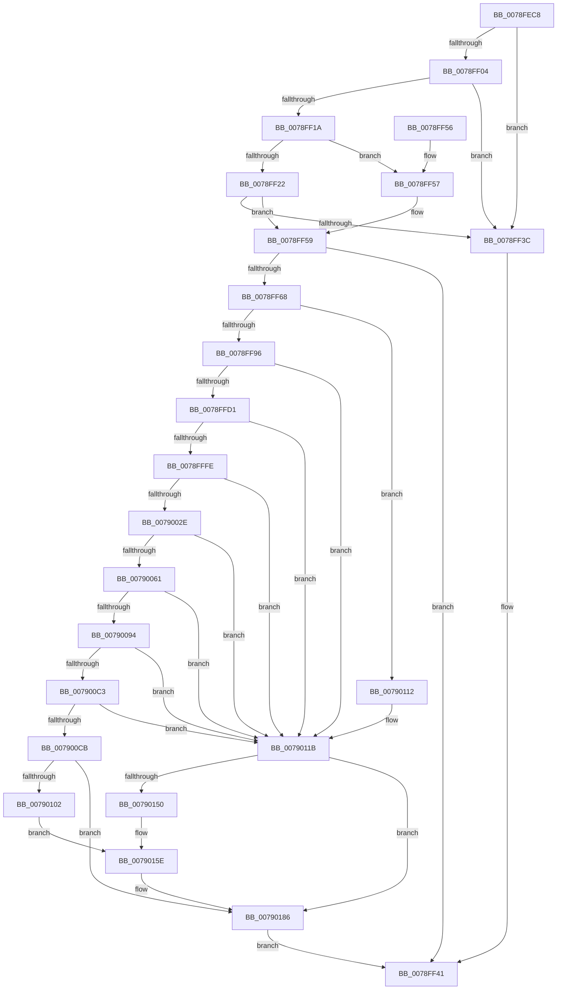

# RtlpSetTimeZoneInformationWorker

- RVA: `0x0078FEC8`–`0x00790196` (길이 `718` bytes)
- VA: `0x000000014078FEC8`
- 실행 섹션: `PAGE`
- PDB 이름 있음: `예`; PDB Function 태그: `아니요`
- unwind 정보 RVA: `0x000CFA54`
- 디코드: `174`개 명령, `718/718` bytes 표시
- 미해석 바이트: `0` (있으면 어셈블리에 `.byte`로 보존)

> 이 문서는 커널 이미지의 기계어와 PDB 기호를 분석해 생성했습니다. 4번과 5번은 함수 원형과 자료형을 바이너리 사용 방식에서 추정한 C 해석이며 원본 소스 복구 결과는 아닙니다.

## 1. Dependencies

- 직접 호출 지점: **15**; 고유 호출 대상: **4**
- 직접 호출자로 확인된 함수: **4**
- RIP 상대 이미지 참조: **9**

### Outgoing calls
- `0x0078FEF7` → [wcsnlen](../../text/50/wcsnlen_function_00501D60.md) (function, `0x00501D60`)
- `0x0078FF0D` → [wcsnlen](../../text/50/wcsnlen_function_00501D60.md) (function, `0x00501D60`)
- `0x0078FF2C` → [wcsnlen](../../text/50/wcsnlen_function_00501D60.md) (function, `0x00501D60`)
- `0x0078FF5F` → [RtlpGetTimeZoneInfoHandle](../A6/RtlpGetTimeZoneInfoHandle_function_00A6BD8C.md) (function, `0x00A6BD8C`)
- `0x0078FF89` → [RtlWriteRegistryValue](../A6/RtlWriteRegistryValue_function_00A6C620.md) (function, `0x00A6C620`)
- `0x0078FFC1` → [RtlWriteRegistryValue](../A6/RtlWriteRegistryValue_function_00A6C620.md) (function, `0x00A6C620`)
- `0x0078FFF1` → [RtlWriteRegistryValue](../A6/RtlWriteRegistryValue_function_00A6C620.md) (function, `0x00A6C620`)
- `0x00790021` → [RtlWriteRegistryValue](../A6/RtlWriteRegistryValue_function_00A6C620.md) (function, `0x00A6C620`)
- `0x00790054` → [RtlWriteRegistryValue](../A6/RtlWriteRegistryValue_function_00A6C620.md) (function, `0x00A6C620`)
- `0x00790087` → [RtlWriteRegistryValue](../A6/RtlWriteRegistryValue_function_00A6C620.md) (function, `0x00A6C620`)
- `0x007900BA` → [RtlWriteRegistryValue](../A6/RtlWriteRegistryValue_function_00A6C620.md) (function, `0x00A6C620`)
- `0x007900F3` → [RtlWriteRegistryValue](../A6/RtlWriteRegistryValue_function_00A6C620.md) (function, `0x00A6C620`)
- `0x00790145` → [RtlWriteRegistryValue](../A6/RtlWriteRegistryValue_function_00A6C620.md) (function, `0x00A6C620`)
- `0x0079017F` → [RtlWriteRegistryValue](../A6/RtlWriteRegistryValue_function_00A6C620.md) (function, `0x00A6C620`)
- `0x0079018A` → [ZwClose](../../text/6A/ZwClose_function_006AD2B0.md) (function, `0x006AD2B0`)

### Direct callers
- [RtlSetDynamicTimeZoneInformation](RtlSetDynamicTimeZoneInformation_function_0078FB00.md) at `0x0078FB09`
- [RtlSetTimeZoneInformation](RtlSetTimeZoneInformation_function_0078FB20.md) at `0x0078FB29`
- [ExpSetTimeZoneInformation](../7C/ExpSetTimeZoneInformation_function_007C5240.md) at `0x007C54DC`
- [ExpSetTimeZoneInformation](../7C/ExpSetTimeZoneInformation_function_007C5240.md) at `0x007C5501`
- [ExpRefreshTimeZoneInformation](../A6/ExpRefreshTimeZoneInformation_function_00A6B46C.md) at `0x00A6B6FE`

### Static image references
- `0x0078FF6C` → RVA `0x00B4B040` (`szBias`; read)
- `0x0078FFA6` → RVA `0x00B4BAF0` (`szStandardName`; read)
- `0x0078FFE2` → RVA `0x00B4BAB0` (`szStandardBias`; read)
- `0x00790012` → RVA `0x00B4BB68` (`szStandardStart`; read)
- `0x0079003E` → RVA `0x00B4BAD0` (`szDaylightName`; read)
- `0x00790078` → RVA `0x00B4BA90` (`szDaylightBias`; read)
- `0x007900AB` → RVA `0x00B4BB48` (`szDaylightStart`; read)
- `0x007900E4` → RVA `0x00B4B7B0` (`szTimeZoneKeyName`; read)
- `0x00790162` → RVA `0x00B4C110` (`szDynamicDaylightDisabled`; read)

## 2. Other-region calls and transfers

- 다른 실행 섹션으로 향하는 call: **4**
  - `0x0078FEF7` → [wcsnlen](../../text/50/wcsnlen_function_00501D60.md) (`PAGE` → `.text`)
  - `0x0078FF0D` → [wcsnlen](../../text/50/wcsnlen_function_00501D60.md) (`PAGE` → `.text`)
  - `0x0078FF2C` → [wcsnlen](../../text/50/wcsnlen_function_00501D60.md) (`PAGE` → `.text`)
  - `0x0079018A` → [ZwClose](../../text/6A/ZwClose_function_006AD2B0.md) (`PAGE` → `.text`)
- 별도 외부 분기/꼬리 이동을 확인하지 못했습니다.

## 3. Assembly (complete function range)

```asm
0078FEC8  48 89 5C 24 10                  mov qword ptr [rsp + 0x10], rbx
0078FECD  55                              push rbp
0078FECE  56                              push rsi
0078FECF  57                              push rdi
0078FED0  41 54                           push r12
0078FED2  41 55                           push r13
0078FED4  41 56                           push r14
0078FED6  41 57                           push r15
0078FED8  48 8B EC                        mov rbp, rsp
0078FEDB  48 83 EC 30                     sub rsp, 0x30
0078FEDF  48 83 65 58 00                  and qword ptr [rbp + 0x58], 0
0078FEE4  4C 8D 71 04                     lea r14, [rcx + 4]
0078FEE8  8B F2                           mov esi, edx
0078FEEA  48 8B D9                        mov rbx, rcx
0078FEED  BF 20 00 00 00                  mov edi, 0x20
0078FEF2  49 8B CE                        mov rcx, r14
0078FEF5  8B D7                           mov edx, edi
0078FEF7  E8 64 1E D7 FF                  call 0x140501d60
0078FEFC  4C 8B F8                        mov r15, rax
0078FEFF  48 3B C7                        cmp rax, rdi
0078FF02  73 38                           jae 0x14078ff3c
0078FF04  4C 8D 63 58                     lea r12, [rbx + 0x58]
0078FF08  8B D7                           mov edx, edi
0078FF0A  49 8B CC                        mov rcx, r12
0078FF0D  E8 4E 1E D7 FF                  call 0x140501d60
0078FF12  4C 8B E8                        mov r13, rax
0078FF15  48 3B C7                        cmp rax, rdi
0078FF18  73 22                           jae 0x14078ff3c
0078FF1A  81 FE B0 01 00 00               cmp esi, 0x1b0
0078FF20  72 35                           jb 0x14078ff57
0078FF22  48 8D 8B AC 00 00 00            lea rcx, [rbx + 0xac]
0078FF29  8D 57 60                        lea edx, [rdi + 0x60]
0078FF2C  E8 2F 1E D7 FF                  call 0x140501d60
0078FF31  48 8B F8                        mov rdi, rax
0078FF34  48 3D 80 00 00 00               cmp rax, 0x80
0078FF3A  72 1D                           jb 0x14078ff59
0078FF3C  B8 0D 00 00 C0                  mov eax, 0xc000000d
0078FF41  48 8B 5C 24 78                  mov rbx, qword ptr [rsp + 0x78]
0078FF46  48 83 C4 30                     add rsp, 0x30
0078FF4A  41 5F                           pop r15
0078FF4C  41 5E                           pop r14
0078FF4E  41 5D                           pop r13
0078FF50  41 5C                           pop r12
0078FF52  5F                              pop rdi
0078FF53  5E                              pop rsi
0078FF54  5D                              pop rbp
0078FF55  C3                              ret
0078FF56  CC                              int3
0078FF57  33 FF                           xor edi, edi
0078FF59  48 8D 55 58                     lea rdx, [rbp + 0x58]
0078FF5D  B1 01                           mov cl, 1
0078FF5F  E8 28 BE 2D 00                  call 0x140a6bd8c
0078FF64  85 C0                           test eax, eax
0078FF66  78 D9                           js 0x14078ff41
0078FF68  48 8B 55 58                     mov rdx, qword ptr [rbp + 0x58]
0078FF6C  4C 8D 05 CD B0 3B 00            lea r8, [rip + 0x3bb0cd]
0078FF73  B8 04 00 00 00                  mov eax, 4
0078FF78  B9 00 00 00 40                  mov ecx, 0x40000000
0078FF7D  89 44 24 28                     mov dword ptr [rsp + 0x28], eax
0078FF81  44 8B C8                        mov r9d, eax
0078FF84  48 89 5C 24 20                  mov qword ptr [rsp + 0x20], rbx
0078FF89  E8 92 C6 2D 00                  call 0x140a6c620
0078FF8E  85 C0                           test eax, eax
0078FF90  0F 88 7C 01 00 00               js 0x140790112
0078FF96  48 8B 55 58                     mov rdx, qword ptr [rbp + 0x58]
0078FF9A  42 8D 04 7D 02 00 00 00         lea eax, [r15*2 + 2]
0078FFA2  89 44 24 28                     mov dword ptr [rsp + 0x28], eax
0078FFA6  4C 8D 05 43 BB 3B 00            lea r8, [rip + 0x3bbb43]
0078FFAD  41 BF 00 00 00 40               mov r15d, 0x40000000
0078FFB3  4C 89 74 24 20                  mov qword ptr [rsp + 0x20], r14
0078FFB8  41 8B CF                        mov ecx, r15d
0078FFBB  41 B9 01 00 00 00               mov r9d, 1
0078FFC1  E8 5A C6 2D 00                  call 0x140a6c620
0078FFC6  45 33 F6                        xor r14d, r14d
0078FFC9  85 C0                           test eax, eax
0078FFCB  0F 88 4A 01 00 00               js 0x14079011b
0078FFD1  48 8B 55 58                     mov rdx, qword ptr [rbp + 0x58]
0078FFD5  45 8D 4E 04                     lea r9d, [r14 + 4]
0078FFD9  48 8D 43 54                     lea rax, [rbx + 0x54]
0078FFDD  44 89 4C 24 28                  mov dword ptr [rsp + 0x28], r9d
0078FFE2  4C 8D 05 C7 BA 3B 00            lea r8, [rip + 0x3bbac7]
0078FFE9  48 89 44 24 20                  mov qword ptr [rsp + 0x20], rax
0078FFEE  41 8B CF                        mov ecx, r15d
0078FFF1  E8 2A C6 2D 00                  call 0x140a6c620
0078FFF6  85 C0                           test eax, eax
0078FFF8  0F 88 1D 01 00 00               js 0x14079011b
0078FFFE  48 8B 55 58                     mov rdx, qword ptr [rbp + 0x58]
00790002  48 8D 43 44                     lea rax, [rbx + 0x44]
00790006  C7 44 24 28 10 00 00 00         mov dword ptr [rsp + 0x28], 0x10
0079000E  45 8D 4E 03                     lea r9d, [r14 + 3]
00790012  4C 8D 05 4F BB 3B 00            lea r8, [rip + 0x3bbb4f]
00790019  48 89 44 24 20                  mov qword ptr [rsp + 0x20], rax
0079001E  41 8B CF                        mov ecx, r15d
00790021  E8 FA C5 2D 00                  call 0x140a6c620
00790026  85 C0                           test eax, eax
00790028  0F 88 ED 00 00 00               js 0x14079011b
0079002E  48 8B 55 58                     mov rdx, qword ptr [rbp + 0x58]
00790032  42 8D 04 6D 02 00 00 00         lea eax, [r13*2 + 2]
0079003A  89 44 24 28                     mov dword ptr [rsp + 0x28], eax
0079003E  4C 8D 05 8B BA 3B 00            lea r8, [rip + 0x3bba8b]
00790045  4C 89 64 24 20                  mov qword ptr [rsp + 0x20], r12
0079004A  41 8B CF                        mov ecx, r15d
0079004D  45 8D 66 01                     lea r12d, [r14 + 1]
00790051  45 8B CC                        mov r9d, r12d
00790054  E8 C7 C5 2D 00                  call 0x140a6c620
00790059  85 C0                           test eax, eax
0079005B  0F 88 BA 00 00 00               js 0x14079011b
00790061  48 8B 55 58                     mov rdx, qword ptr [rbp + 0x58]
00790065  48 8D 83 A8 00 00 00            lea rax, [rbx + 0xa8]
0079006C  C7 44 24 28 04 00 00 00         mov dword ptr [rsp + 0x28], 4
00790074  45 8D 4E 04                     lea r9d, [r14 + 4]
00790078  4C 8D 05 11 BA 3B 00            lea r8, [rip + 0x3bba11]
0079007F  48 89 44 24 20                  mov qword ptr [rsp + 0x20], rax
00790084  41 8B CF                        mov ecx, r15d
00790087  E8 94 C5 2D 00                  call 0x140a6c620
0079008C  85 C0                           test eax, eax
0079008E  0F 88 87 00 00 00               js 0x14079011b
00790094  48 8B 55 58                     mov rdx, qword ptr [rbp + 0x58]
00790098  48 8D 83 98 00 00 00            lea rax, [rbx + 0x98]
0079009F  C7 44 24 28 10 00 00 00         mov dword ptr [rsp + 0x28], 0x10
007900A7  45 8D 4E 03                     lea r9d, [r14 + 3]
007900AB  4C 8D 05 96 BA 3B 00            lea r8, [rip + 0x3bba96]
007900B2  48 89 44 24 20                  mov qword ptr [rsp + 0x20], rax
007900B7  41 8B CF                        mov ecx, r15d
007900BA  E8 61 C5 2D 00                  call 0x140a6c620
007900BF  85 C0                           test eax, eax
007900C1  78 58                           js 0x14079011b
007900C3  81 FE B0 01 00 00               cmp esi, 0x1b0
007900C9  72 50                           jb 0x14079011b
007900CB  48 8B 55 58                     mov rdx, qword ptr [rbp + 0x58]
007900CF  48 8D 8B AC 00 00 00            lea rcx, [rbx + 0xac]
007900D6  8D 04 7D 02 00 00 00            lea eax, [rdi*2 + 2]
007900DD  45 8B CC                        mov r9d, r12d
007900E0  89 44 24 28                     mov dword ptr [rsp + 0x28], eax
007900E4  4C 8D 05 C5 B6 3B 00            lea r8, [rip + 0x3bb6c5]
007900EB  48 89 4C 24 20                  mov qword ptr [rsp + 0x20], rcx
007900F0  41 8B CF                        mov ecx, r15d
007900F3  E8 28 C5 2D 00                  call 0x140a6c620
007900F8  8B F8                           mov edi, eax
007900FA  85 C0                           test eax, eax
007900FC  0F 88 84 00 00 00               js 0x140790186
00790102  0F B6 83 AC 01 00 00            movzx eax, byte ptr [rbx + 0x1ac]
00790109  89 45 40                        mov dword ptr [rbp + 0x40], eax
0079010C  48 8D 45 40                     lea rax, [rbp + 0x40]
00790110  EB 4C                           jmp 0x14079015e
00790112  45 33 F6                        xor r14d, r14d
00790115  41 BF 00 00 00 40               mov r15d, 0x40000000
0079011B  48 8B 55 58                     mov rdx, qword ptr [rbp + 0x58]
0079011F  48 8D 45 40                     lea rax, [rbp + 0x40]
00790123  C7 44 24 28 02 00 00 00         mov dword ptr [rsp + 0x28], 2
0079012B  4C 8D 05 7E B6 3B 00            lea r8, [rip + 0x3bb67e]
00790132  41 B9 01 00 00 00               mov r9d, 1
00790138  48 89 44 24 20                  mov qword ptr [rsp + 0x20], rax
0079013D  41 8B CF                        mov ecx, r15d
00790140  66 44 89 75 40                  mov word ptr [rbp + 0x40], r14w
00790145  E8 D6 C4 2D 00                  call 0x140a6c620
0079014A  8B F8                           mov edi, eax
0079014C  85 C0                           test eax, eax
0079014E  78 36                           js 0x140790186
00790150  0F B6 83 AC 01 00 00            movzx eax, byte ptr [rbx + 0x1ac]
00790157  89 45 50                        mov dword ptr [rbp + 0x50], eax
0079015A  48 8D 45 50                     lea rax, [rbp + 0x50]
0079015E  48 8B 55 58                     mov rdx, qword ptr [rbp + 0x58]
00790162  4C 8D 05 A7 BF 3B 00            lea r8, [rip + 0x3bbfa7]
00790169  C7 44 24 28 04 00 00 00         mov dword ptr [rsp + 0x28], 4
00790171  41 B9 04 00 00 00               mov r9d, 4
00790177  41 8B CF                        mov ecx, r15d
0079017A  48 89 44 24 20                  mov qword ptr [rsp + 0x20], rax
0079017F  E8 9C C4 2D 00                  call 0x140a6c620
00790184  8B F8                           mov edi, eax
00790186  48 8B 4D 58                     mov rcx, qword ptr [rbp + 0x58]
0079018A  E8 21 D1 F1 FF                  call 0x1406ad2b0
0079018F  8B C7                           mov eax, edi
00790191  E9 AB FD FF FF                  jmp 0x14078ff41
```

## 4. C-style interpretation (structured pseudocode)

```c
__int64 __fastcall RtlpSetTimeZoneInformationWorker(__int64 a1, int a2)
{
    __int64 result;
    __int64 v_r14;
    __int64 v_rdi;
    __int64 v_rsp;
    unsigned __int64 v_stack_p10;
    unsigned int v_stack_p18;
    unsigned __int64 v_stack_p20;
    unsigned int v_stack_p28;
    unsigned int v_stack_p8;

    v_stack_p10 = v_rbx;
    v_rsp = (v_rsp) - (48);
    result = wcsnlen(a1 + 4, 32, a3, a4);
    if (result >= 32) goto loc_0078FF3C;
    result = wcsnlen(a1 + 88, 32, a3, a4);
    if (result >= 32) goto loc_0078FF3C;
    if (((unsigned int)((unsigned int)(a2))) < 432) goto loc_0078FF57;
    result = wcsnlen(a1 + 172, 32 + 96, a3, a4);
    if (result < 128) goto loc_0078FF59;
loc_0078FF3C:
loc_0078FF41:
    v_rsp = (v_rsp) + (48);
    return (unsigned int)(0xC000000DULL);
loc_0078FF57:
    v_rdi = 0;
loc_0078FF59:
    result = RtlpGetTimeZoneInfoHandle(1, v_stack_p20, a3, a4);
    if (sign_flag) goto loc_0078FF41;
    v_stack_p28 = 4;
    v_stack_p20 = v_stack_p10;
    result = RtlWriteRegistryValue((unsigned int)(0x40000000ULL), v_stack_p20, v_rip + 3911885, 4);
    if (sign_flag) goto loc_00790112;
    v_stack_p28 = (unsigned int)(result * 2 + 2);
    v_stack_p20 = a1 + 4;
    result = RtlWriteRegistryValue((unsigned int)((unsigned int)((unsigned int)(0x40000000ULL))), v_stack_p20, v_rip + 3914563, 1);
    v_r14 = 0;
    if (sign_flag) goto loc_0079011B;
    v_stack_p28 = (unsigned int)(v_r14 + 4);
    v_stack_p20 = v_stack_p10 + 84;
    result = RtlWriteRegistryValue((unsigned int)((unsigned int)((unsigned int)(0x40000000ULL))), v_stack_p20, v_rip + 3914439, v_r14 + 4);
    if (sign_flag) goto loc_0079011B;
    v_stack_p28 = 16;
    v_stack_p20 = v_stack_p10 + 68;
    result = RtlWriteRegistryValue((unsigned int)((unsigned int)((unsigned int)(0x40000000ULL))), v_stack_p20, v_rip + 3914575, v_r14 + 3);
    if (sign_flag) goto loc_0079011B;
    v_stack_p28 = (unsigned int)(result * 2 + 2);
    v_stack_p20 = a1 + 88;
    result = RtlWriteRegistryValue((unsigned int)((unsigned int)((unsigned int)(0x40000000ULL))), v_stack_p20, v_rip + 3914379, (unsigned int)((unsigned int)(v_r14 + 1)));
    if (sign_flag) goto loc_0079011B;
    v_stack_p28 = 4;
    v_stack_p20 = v_stack_p10 + 168;
    result = RtlWriteRegistryValue((unsigned int)((unsigned int)((unsigned int)(0x40000000ULL))), v_stack_p20, v_rip + 3914257, v_r14 + 4);
    if (sign_flag) goto loc_0079011B;
    v_stack_p28 = 16;
    v_stack_p20 = v_stack_p10 + 152;
    result = RtlWriteRegistryValue((unsigned int)((unsigned int)((unsigned int)(0x40000000ULL))), v_stack_p20, v_rip + 3914390, v_r14 + 3);
    if (sign_flag) goto loc_0079011B;
    if (((unsigned int)((unsigned int)(a2))) < 432) goto loc_0079011B;
    v_stack_p28 = (unsigned int)(v_rdi * 2 + 2);
    v_stack_p20 = v_stack_p10 + 172;
    result = RtlWriteRegistryValue((unsigned int)((unsigned int)((unsigned int)(0x40000000ULL))), v_stack_p20, v_rip + 3913413, (unsigned int)((unsigned int)(v_r14 + 1)));
    if (sign_flag) goto loc_00790186;
    v_stack_p8 = (unsigned int)(*(unsigned __int8 *)(v_stack_p10 + 428));
    goto loc_0079015E;
loc_00790112:
    v_r14 = 0;
loc_0079011B:
    v_stack_p28 = 2;
    v_stack_p20 = v_stack_p8;
    v_stack_p8 = 0;
    result = RtlWriteRegistryValue((unsigned int)((unsigned int)((unsigned int)(0x40000000ULL))), v_stack_p20, v_rip + 3913342, 1);
    if (sign_flag) goto loc_00790186;
    v_stack_p18 = (unsigned int)(*(unsigned __int8 *)(v_stack_p10 + 428));
loc_0079015E:
    v_stack_p28 = 4;
    v_stack_p20 = v_stack_p18;
    result = RtlWriteRegistryValue((unsigned int)((unsigned int)((unsigned int)(0x40000000ULL))), v_stack_p20, v_rip + 3915687, 4);
loc_00790186:
    result = ZwClose(v_stack_p20, v_stack_p20, v_rip + 3915687, 4);
    goto loc_0078FF41;
}
```

## 5. (Beta) C Style

```c
int64_t RtlpSetTimeZoneInformationWorker(void *Arg1, int32_t Arg2)
{
    uint8_t *arg1 = (uint8_t *)Arg1;

    int64_t result;
    int64_t local_r14;
    int64_t local_rdi;
    int64_t local_rsp;
    uint64_t v_stack_p10;
    uint32_t v_stack_p18;
    uint64_t v_stack_p20;
    uint32_t v_stack_p28;
    uint32_t v_stack_p8;

    v_stack_p10 = local_rbx;
    local_rsp = (local_rsp) - (48);
    result = wcsnlen(Arg1 + 4, 32, a3, a4);
    if (result >= 32) goto loc_0078FF3C;
    result = wcsnlen(Arg1 + 88, 32, a3, a4);
    if (result >= 32) goto loc_0078FF3C;
    if (((uint32_t)((uint32_t)(Arg2))) < 432) goto loc_0078FF57;
    result = wcsnlen(Arg1 + 172, 32 + 96, a3, a4);
    if (result < 128) goto loc_0078FF59;
loc_0078FF3C:
loc_0078FF41:
    local_rsp = (local_rsp) + (48);
    return (uint32_t)(0xC000000DULL);
loc_0078FF57:
    local_rdi = 0;
loc_0078FF59:
    result = RtlpGetTimeZoneInfoHandle(1, v_stack_p20, a3, a4);
    if (sign_flag) goto loc_0078FF41;
    v_stack_p28 = 4;
    v_stack_p20 = v_stack_p10;
    result = RtlWriteRegistryValue((uint32_t)(0x40000000ULL), v_stack_p20, v_rip + 3911885, 4);
    if (sign_flag) goto loc_00790112;
    v_stack_p28 = (uint32_t)(result * 2 + 2);
    v_stack_p20 = Arg1 + 4;
    result = RtlWriteRegistryValue((uint32_t)((uint32_t)((uint32_t)(0x40000000ULL))), v_stack_p20, v_rip + 3914563, 1);
    local_r14 = 0;
    if (sign_flag) goto loc_0079011B;
    v_stack_p28 = (uint32_t)(local_r14 + 4);
    v_stack_p20 = v_stack_p10 + 84;
    result = RtlWriteRegistryValue((uint32_t)((uint32_t)((uint32_t)(0x40000000ULL))), v_stack_p20, v_rip + 3914439, local_r14 + 4);
    if (sign_flag) goto loc_0079011B;
    v_stack_p28 = 16;
    v_stack_p20 = v_stack_p10 + 68;
    result = RtlWriteRegistryValue((uint32_t)((uint32_t)((uint32_t)(0x40000000ULL))), v_stack_p20, v_rip + 3914575, local_r14 + 3);
    if (sign_flag) goto loc_0079011B;
    v_stack_p28 = (uint32_t)(result * 2 + 2);
    v_stack_p20 = Arg1 + 88;
    result = RtlWriteRegistryValue((uint32_t)((uint32_t)((uint32_t)(0x40000000ULL))), v_stack_p20, v_rip + 3914379, (uint32_t)((uint32_t)(local_r14 + 1)));
    if (sign_flag) goto loc_0079011B;
    v_stack_p28 = 4;
    v_stack_p20 = v_stack_p10 + 168;
    result = RtlWriteRegistryValue((uint32_t)((uint32_t)((uint32_t)(0x40000000ULL))), v_stack_p20, v_rip + 3914257, local_r14 + 4);
    if (sign_flag) goto loc_0079011B;
    v_stack_p28 = 16;
    v_stack_p20 = v_stack_p10 + 152;
    result = RtlWriteRegistryValue((uint32_t)((uint32_t)((uint32_t)(0x40000000ULL))), v_stack_p20, v_rip + 3914390, local_r14 + 3);
    if (sign_flag) goto loc_0079011B;
    if (((uint32_t)((uint32_t)(Arg2))) < 432) goto loc_0079011B;
    v_stack_p28 = (uint32_t)(local_rdi * 2 + 2);
    v_stack_p20 = v_stack_p10 + 172;
    result = RtlWriteRegistryValue((uint32_t)((uint32_t)((uint32_t)(0x40000000ULL))), v_stack_p20, v_rip + 3913413, (uint32_t)((uint32_t)(local_r14 + 1)));
    if (sign_flag) goto loc_00790186;
    v_stack_p8 = (uint32_t)(*(uint8_t *)(v_stack_p10 + 0x1AC));
    goto loc_0079015E;
loc_00790112:
    local_r14 = 0;
loc_0079011B:
    v_stack_p28 = 2;
    v_stack_p20 = v_stack_p8;
    v_stack_p8 = 0;
    result = RtlWriteRegistryValue((uint32_t)((uint32_t)((uint32_t)(0x40000000ULL))), v_stack_p20, v_rip + 3913342, 1);
    if (sign_flag) goto loc_00790186;
    v_stack_p18 = (uint32_t)(*(uint8_t *)(v_stack_p10 + 0x1AC));
loc_0079015E:
    v_stack_p28 = 4;
    v_stack_p20 = v_stack_p18;
    result = RtlWriteRegistryValue((uint32_t)((uint32_t)((uint32_t)(0x40000000ULL))), v_stack_p20, v_rip + 3915687, 4);
loc_00790186:
    result = ZwClose(v_stack_p20, v_stack_p20, v_rip + 3915687, 4);
    goto loc_0078FF41;
}
```

### 관측된 메모리 오프셋

구조체 형식이 확인되지 않은 접근은 인자 기준의 오프셋으로만 기록했습니다.

| 기준 인자 | 오프셋 표현 | 폭 (bit) | 접근 |
|---|---:|---:|---|
| `Arg1` | `+ 0x4` | `64` | `R` |
| `Arg1` | `+ 0x44` | `64` | `R` |
| `Arg1` | `+ 0x54` | `64` | `R` |
| `Arg1` | `+ 0x58` | `64` | `R` |
| `Arg1` | `+ 0x98` | `64` | `R` |
| `Arg1` | `+ 0xA8` | `64` | `R` |
| `Arg1` | `+ 0xAC` | `64` | `R` |
| `Arg1` | `+ 0x1AC` | `8` | `R` |

## 6. Execution-region graph

[열기: 2D/3D 그래프와 함수 탐색 컨트롤 패널](../../../control-panel.html?section=page&rva=0x0078FEC8&view=graph)

- 2D 그래프는 위에서 아래로 흐르고, 3D 그래프는 빈 공간을 드래그해 회전합니다. Shift+드래그는 이동, 휠은 확대·축소, 함수 노드 선택은 대상 보고서 이동입니다.

### Static fallback


