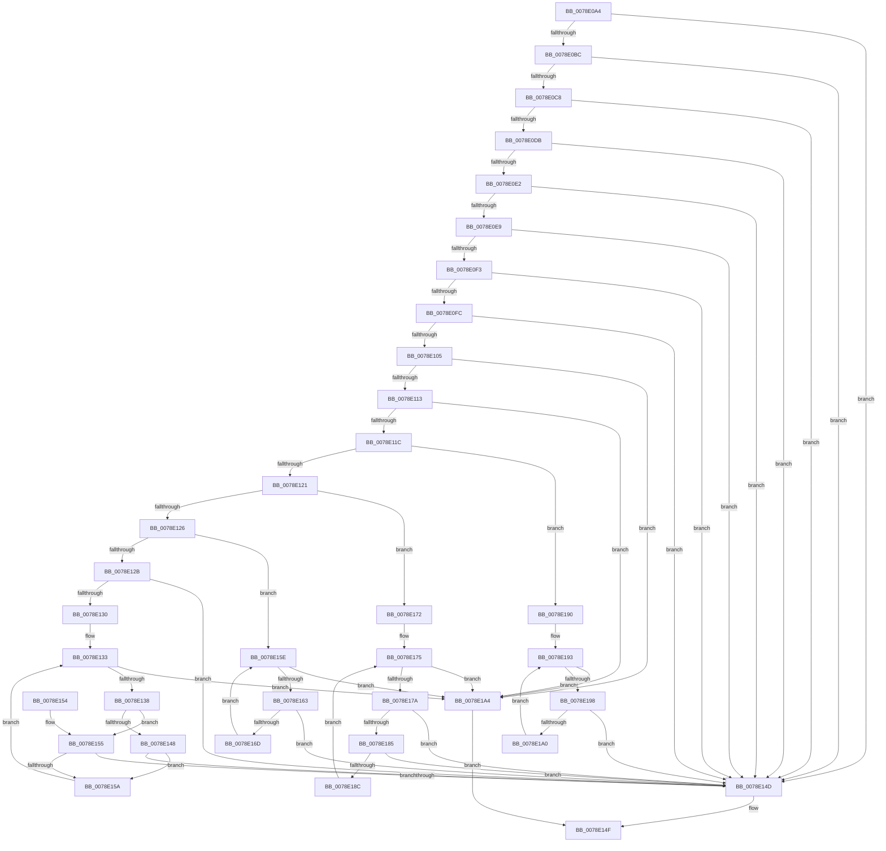

# RtlpValidAttribute

- RVA: `0x0078E0A4`–`0x0078E1A8` (길이 `260` bytes)
- VA: `0x000000014078E0A4`
- 실행 섹션: `PAGE`
- PDB 이름 있음: `예`; PDB Function 태그: `아니요`
- unwind 정보 RVA: `0x000CF924`
- 디코드: `85`개 명령, `260/260` bytes 표시
- 미해석 바이트: `0` (있으면 어셈블리에 `.byte`로 보존)

> 이 문서는 커널 이미지의 기계어와 PDB 기호를 분석해 생성했습니다. 4번과 5번은 함수 원형과 자료형을 바이너리 사용 방식에서 추정한 C 해석이며 원본 소스 복구 결과는 아닙니다.

## 1. Dependencies

- 직접 호출 지점: **1**; 고유 호출 대상: **1**
- 직접 호출자로 확인된 함수: **1**
- RIP 상대 이미지 참조: **0**

### Outgoing calls
- `0x0078E0D2` → [RtlStringCchLengthW](../../text/43/RtlStringCchLengthW_function_00435A70.md) (function, `0x00435A70`)

### Direct callers
- [RtlAddResourceAttributeAce](RtlAddResourceAttributeAce_function_0078D7F0.md) at `0x0078D953`

### Static image references
- 디코드된 RIP-relative 메모리 참조가 없습니다.

## 2. Other-region calls and transfers

- 다른 실행 섹션으로 향하는 call: **1**
  - `0x0078E0D2` → [RtlStringCchLengthW](../../text/43/RtlStringCchLengthW_function_00435A70.md) (`PAGE` → `.text`)
- 별도 외부 분기/꼬리 이동을 확인하지 못했습니다.

## 3. Assembly (complete function range)

```asm
0078E0A4  48 83 EC 28                     sub rsp, 0x28
0078E0A8  45 33 D2                        xor r10d, r10d
0078E0AB  4C 8B D9                        mov r11, rcx
0078E0AE  4C 89 54 24 30                  mov qword ptr [rsp + 0x30], r10
0078E0B3  48 85 C9                        test rcx, rcx
0078E0B6  0F 84 91 00 00 00               je 0x14078e14d
0078E0BC  48 8B 09                        mov rcx, qword ptr [rcx]
0078E0BF  48 85 C9                        test rcx, rcx
0078E0C2  0F 84 85 00 00 00               je 0x14078e14d
0078E0C8  4C 8D 44 24 30                  lea r8, [rsp + 0x30]
0078E0CD  BA FF FF 00 00                  mov edx, 0xffff
0078E0D2  E8 99 79 CA FF                  call 0x140435a70
0078E0D7  85 C0                           test eax, eax
0078E0D9  78 72                           js 0x14078e14d
0078E0DB  4C 39 54 24 30                  cmp qword ptr [rsp + 0x30], r10
0078E0E0  74 6B                           je 0x14078e14d
0078E0E2  66 45 39 53 0A                  cmp word ptr [r11 + 0xa], r10w
0078E0E7  75 64                           jne 0x14078e14d
0078E0E9  41 F7 43 0C C0 FF 00 00         test dword ptr [r11 + 0xc], 0xffc0
0078E0F1  75 5A                           jne 0x14078e14d
0078E0F3  45 8B 43 10                     mov r8d, dword ptr [r11 + 0x10]
0078E0F7  45 85 C0                        test r8d, r8d
0078E0FA  74 51                           je 0x14078e14d
0078E0FC  49 8B 53 18                     mov rdx, qword ptr [r11 + 0x18]
0078E100  48 85 D2                        test rdx, rdx
0078E103  74 48                           je 0x14078e14d
0078E105  41 0F B7 4B 08                  movzx ecx, word ptr [r11 + 8]
0078E10A  83 E9 01                        sub ecx, 1
0078E10D  0F 84 91 00 00 00               je 0x14078e1a4
0078E113  83 E9 01                        sub ecx, 1
0078E116  0F 84 88 00 00 00               je 0x14078e1a4
0078E11C  83 E9 01                        sub ecx, 1
0078E11F  74 6F                           je 0x14078e190
0078E121  83 E9 02                        sub ecx, 2
0078E124  74 4C                           je 0x14078e172
0078E126  83 E9 01                        sub ecx, 1
0078E129  74 33                           je 0x14078e15e
0078E12B  83 F9 0A                        cmp ecx, 0xa
0078E12E  75 1D                           jne 0x14078e14d
0078E130  41 8B CA                        mov ecx, r10d
0078E133  41 3B C8                        cmp ecx, r8d
0078E136  73 6C                           jae 0x14078e1a4
0078E138  8B C1                           mov eax, ecx
0078E13A  48 03 C0                        add rax, rax
0078E13D  44 8B 4C C2 08                  mov r9d, dword ptr [rdx + rax*8 + 8]
0078E142  4C 39 14 C2                     cmp qword ptr [rdx + rax*8], r10
0078E146  75 0D                           jne 0x14078e155
0078E148  45 85 C9                        test r9d, r9d
0078E14B  74 0D                           je 0x14078e15a
0078E14D  32 C0                           xor al, al
0078E14F  48 83 C4 28                     add rsp, 0x28
0078E153  C3                              ret
0078E154  CC                              int3
0078E155  45 85 C9                        test r9d, r9d
0078E158  74 F3                           je 0x14078e14d
0078E15A  FF C1                           inc ecx
0078E15C  EB D5                           jmp 0x14078e133
0078E15E  45 3B D0                        cmp r10d, r8d
0078E161  73 41                           jae 0x14078e1a4
0078E163  41 8B C2                        mov eax, r10d
0078E166  48 83 3C C2 01                  cmp qword ptr [rdx + rax*8], 1
0078E16B  77 E0                           ja 0x14078e14d
0078E16D  41 FF C2                        inc r10d
0078E170  EB EC                           jmp 0x14078e15e
0078E172  41 8B C2                        mov eax, r10d
0078E175  41 3B C0                        cmp eax, r8d
0078E178  73 2A                           jae 0x14078e1a4
0078E17A  8B C8                           mov ecx, eax
0078E17C  48 03 C9                        add rcx, rcx
0078E17F  4C 39 14 CA                     cmp qword ptr [rdx + rcx*8], r10
0078E183  74 C8                           je 0x14078e14d
0078E185  44 39 54 CA 08                  cmp dword ptr [rdx + rcx*8 + 8], r10d
0078E18A  74 C1                           je 0x14078e14d
0078E18C  FF C0                           inc eax
0078E18E  EB E5                           jmp 0x14078e175
0078E190  41 8B CA                        mov ecx, r10d
0078E193  41 3B C8                        cmp ecx, r8d
0078E196  73 0C                           jae 0x14078e1a4
0078E198  8B C1                           mov eax, ecx
0078E19A  4C 39 14 C2                     cmp qword ptr [rdx + rax*8], r10
0078E19E  74 AD                           je 0x14078e14d
0078E1A0  FF C1                           inc ecx
0078E1A2  EB EF                           jmp 0x14078e193
0078E1A4  B0 01                           mov al, 1
0078E1A6  EB A7                           jmp 0x14078e14f
```

## 4. C-style interpretation (structured pseudocode)

```c
__int64 __fastcall RtlpValidAttribute(__int64 a1)
{
    __int64 result;
    __int64 v_r10;
    __int64 v_rsp;
    unsigned __int64 v_stack_p8;

    v_rsp = (v_rsp) - (40);
    v_r10 = 0;
    v_stack_p8 = 0;
    if (a1 == 0) goto loc_0078E14D;
    if (*(unsigned __int64 *)(a1) == 0) goto loc_0078E14D;
    result = RtlStringCchLengthW(*(unsigned __int64 *)(a1), (unsigned int)(0xFFFFULL), v_stack_p8, a4);
    if (sign_flag) goto loc_0078E14D;
    if (v_stack_p8 == 0) goto loc_0078E14D;
    if ((*(unsigned __int16 *)(a1 + 10)) != 0) goto loc_0078E14D;
    if (((*(unsigned int *)(a1 + 12)) & (0xFFC0ULL)) != 0) goto loc_0078E14D;
    if ((unsigned int)((unsigned int)(*(unsigned int *)(a1 + 16))) == 0) goto loc_0078E14D;
    if (*(unsigned __int64 *)(a1 + 24) == 0) goto loc_0078E14D;
    a1 = (unsigned int)((*(unsigned __int16 *)(a1 + 8)) - (1));
    if (condition_is_equal) goto loc_0078E1A4;
    a1 = (unsigned int)((a1) - (1));
    if (condition_is_equal) goto loc_0078E1A4;
    a1 = (unsigned int)((a1) - (1));
    if (condition_is_equal) goto loc_0078E190;
    a1 = (unsigned int)((a1) - (2));
    if (condition_is_equal) goto loc_0078E172;
    a1 = (unsigned int)((a1) - (1));
    if (condition_is_equal) goto loc_0078E15E;
    if (((unsigned int)(a1)) != 10) goto loc_0078E14D;
loc_0078E133:
    if (0 >= ((unsigned int)((unsigned int)(*(unsigned int *)(a1 + 16))))) goto loc_0078E1A4;
    result = (0) + (0);
    if ((*(unsigned __int64 *)(*(unsigned __int64 *)(a1 + 24) + result * 8)) != 0) goto loc_0078E155;
    if ((unsigned int)((unsigned int)(*(unsigned int *)(*(unsigned __int64 *)(a1 + 24) + result * 8 + 8))) == 0) goto loc_0078E15A;
loc_0078E14D:
    result = 0;
loc_0078E14F:
    v_rsp = (v_rsp) + (40);
    return result;
loc_0078E155:
    if ((unsigned int)((unsigned int)(*(unsigned int *)(*(unsigned __int64 *)(a1 + 24) + result * 8 + 8))) == 0) goto loc_0078E14D;
loc_0078E15A:
    a1 = (unsigned int)((0) + 1);
    goto loc_0078E133;
loc_0078E15E:
    if (0 >= ((unsigned int)((unsigned int)(*(unsigned int *)(a1 + 16))))) goto loc_0078E1A4;
    if ((*(unsigned __int64 *)(*(unsigned __int64 *)(a1 + 24) + 0 * 8)) > 1) goto loc_0078E14D;
    v_r10 = (unsigned int)((v_r10) + 1);
    goto loc_0078E15E;
loc_0078E172:
loc_0078E175:
    if (((unsigned int)((unsigned int)((unsigned int)(v_r10)))) >= ((unsigned int)((unsigned int)(*(unsigned int *)(a1 + 16))))) goto loc_0078E1A4;
    a1 = ((unsigned int)((unsigned int)((unsigned int)((unsigned int)(v_r10))))) + ((unsigned int)((unsigned int)((unsigned int)((unsigned int)(v_r10)))));
    if ((*(unsigned __int64 *)(*(unsigned __int64 *)(a1 + 24) + a1 * 8)) == v_r10) goto loc_0078E14D;
    if ((*(unsigned int *)(*(unsigned __int64 *)(a1 + 24) + a1 * 8 + 8)) == ((unsigned int)(v_r10))) goto loc_0078E14D;
    result = (unsigned int)(((unsigned int)((unsigned int)(v_r10))) + 1);
    goto loc_0078E175;
loc_0078E190:
loc_0078E193:
    if (((unsigned int)((unsigned int)((unsigned int)(v_r10)))) >= ((unsigned int)((unsigned int)(*(unsigned int *)(a1 + 16))))) goto loc_0078E1A4;
    if ((*(unsigned __int64 *)(*(unsigned __int64 *)(a1 + 24) + (unsigned int)((unsigned int)((unsigned int)((unsigned int)(v_r10)))) * 8)) == v_r10) goto loc_0078E14D;
    a1 = (unsigned int)(((unsigned int)((unsigned int)(v_r10))) + 1);
    goto loc_0078E193;
loc_0078E1A4:
    goto loc_0078E14F;
}
```

## 5. (Beta) C Style

```c
int64_t RtlpValidAttribute(int64_t Arg1)
{
    int64_t result;
    int64_t local_r10;
    int64_t local_rsp;
    uint64_t v_stack_p8;

    local_rsp = (local_rsp) - (40);
    local_r10 = 0;
    v_stack_p8 = 0;
    if (Arg1 == 0) goto loc_0078E14D;
    if (*(uint64_t *)(Arg1) == 0) goto loc_0078E14D;
    result = RtlStringCchLengthW(*(uint64_t *)(Arg1), (uint32_t)(0xFFFFULL), v_stack_p8, a4);
    if (sign_flag) goto loc_0078E14D;
    if (v_stack_p8 == 0) goto loc_0078E14D;
    if ((*(uint16_t *)(Arg1 + 0xA)) != 0) goto loc_0078E14D;
    if (((*(uint32_t *)(Arg1 + 0xC)) & (0xFFC0ULL)) != 0) goto loc_0078E14D;
    if ((uint32_t)((uint32_t)(*(uint32_t *)(Arg1 + 0x10))) == 0) goto loc_0078E14D;
    if (*(uint64_t *)(Arg1 + 0x18) == 0) goto loc_0078E14D;
    Arg1 = (uint32_t)((*(uint16_t *)(Arg1 + 0x8)) - (1));
    if (condition_is_equal) goto loc_0078E1A4;
    Arg1 = (uint32_t)((Arg1) - (1));
    if (condition_is_equal) goto loc_0078E1A4;
    Arg1 = (uint32_t)((Arg1) - (1));
    if (condition_is_equal) goto loc_0078E190;
    Arg1 = (uint32_t)((Arg1) - (2));
    if (condition_is_equal) goto loc_0078E172;
    Arg1 = (uint32_t)((Arg1) - (1));
    if (condition_is_equal) goto loc_0078E15E;
    if (((uint32_t)(Arg1)) != 10) goto loc_0078E14D;
loc_0078E133:
    if (0 >= ((uint32_t)((uint32_t)(*(uint32_t *)(Arg1 + 0x10))))) goto loc_0078E1A4;
    result = (0) + (0);
    if ((*(uint64_t *)(*(uint64_t *)(Arg1 + 0x18) + result * 8)) != 0) goto loc_0078E155;
    if ((uint32_t)((uint32_t)(*(uint32_t *)(*(uint64_t *)(Arg1 + 0x18) + result * 8 + 0x8))) == 0) goto loc_0078E15A;
loc_0078E14D:
    result = 0;
loc_0078E14F:
    local_rsp = (local_rsp) + (40);
    return result;
loc_0078E155:
    if ((uint32_t)((uint32_t)(*(uint32_t *)(*(uint64_t *)(Arg1 + 0x18) + result * 8 + 0x8))) == 0) goto loc_0078E14D;
loc_0078E15A:
    Arg1 = (uint32_t)((0) + 1);
    goto loc_0078E133;
loc_0078E15E:
    if (0 >= ((uint32_t)((uint32_t)(*(uint32_t *)(Arg1 + 0x10))))) goto loc_0078E1A4;
    if ((*(uint64_t *)(*(uint64_t *)(Arg1 + 0x18) + 0x0 * 8)) > 1) goto loc_0078E14D;
    local_r10 = (uint32_t)((local_r10) + 1);
    goto loc_0078E15E;
loc_0078E172:
loc_0078E175:
    if (((uint32_t)((uint32_t)((uint32_t)(local_r10)))) >= ((uint32_t)((uint32_t)(*(uint32_t *)(Arg1 + 0x10))))) goto loc_0078E1A4;
    Arg1 = ((uint32_t)((uint32_t)((uint32_t)((uint32_t)(local_r10))))) + ((uint32_t)((uint32_t)((uint32_t)((uint32_t)(local_r10)))));
    if ((*(uint64_t *)(*(uint64_t *)(Arg1 + 0x18) + Arg1 * 8)) == local_r10) goto loc_0078E14D;
    if ((*(uint32_t *)(*(uint64_t *)(Arg1 + 0x18) + Arg1 * 8 + 0x8)) == ((uint32_t)(local_r10))) goto loc_0078E14D;
    result = (uint32_t)(((uint32_t)((uint32_t)(local_r10))) + 1);
    goto loc_0078E175;
loc_0078E190:
loc_0078E193:
    if (((uint32_t)((uint32_t)((uint32_t)(local_r10)))) >= ((uint32_t)((uint32_t)(*(uint32_t *)(Arg1 + 0x10))))) goto loc_0078E1A4;
    if ((*(uint64_t *)(*(uint64_t *)(Arg1 + 0x18) + (uint32_t)((uint32_t)((uint32_t)((uint32_t)(local_r10)))) * 8)) == local_r10) goto loc_0078E14D;
    Arg1 = (uint32_t)(((uint32_t)((uint32_t)(local_r10))) + 1);
    goto loc_0078E193;
loc_0078E1A4:
    goto loc_0078E14F;
}
```

## 6. Execution-region graph

[열기: 2D/3D 그래프와 함수 탐색 컨트롤 패널](../../../control-panel.html?section=page&rva=0x0078E0A4&view=graph)

- 2D 그래프는 위에서 아래로 흐르고, 3D 그래프는 빈 공간을 드래그해 회전합니다. Shift+드래그는 이동, 휠은 확대·축소, 함수 노드 선택은 대상 보고서 이동입니다.

### Static fallback


