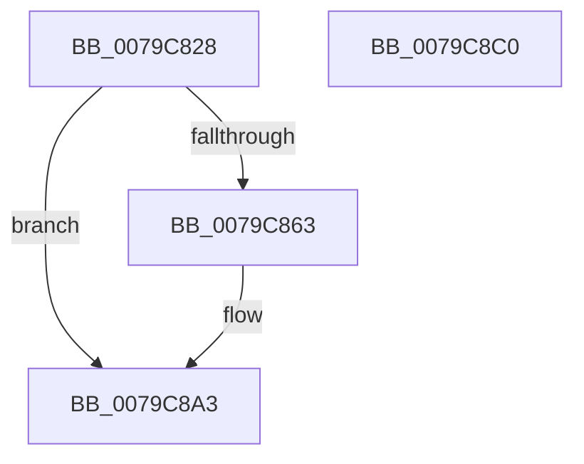

# BCryptGenerateSymmetricKey

- RVA: `0x0079C828`–`0x0079C8C1` (길이 `153` bytes)
- VA: `0x000000014079C828`
- 실행 섹션: `PAGE`
- PDB 이름 있음: `예`; PDB Function 태그: `아니요`
- unwind 정보 RVA: `0x00060130`
- 디코드: `40`개 명령, `153/153` bytes 표시
- 미해석 바이트: `0` (있으면 어셈블리에 `.byte`로 보존)

> 이 문서는 커널 이미지의 기계어와 PDB 기호를 분석해 생성했습니다. 4번과 5번은 함수 원형과 자료형을 바이너리 사용 방식에서 추정한 C 해석이며 원본 소스 복구 결과는 아닙니다.

## 1. Dependencies

- 직접 호출 지점: **3**; 고유 호출 대상: **3**
- 직접 호출자로 확인된 함수: **2**
- RIP 상대 이미지 참조: **1**

### Outgoing calls
- `0x0079C859` → [ExGetExtensionTable](../../text/42/ExGetExtensionTable_function_00428814.md) (function, `0x00428814`)
- `0x0079C890` → [guard_dispatch_icall](../../text/6B/guard_dispatch_icall_function_006BAAD0.md) (function, `0x006BAAD0`)
- `0x0079C89E` → [ExReleaseExtensionTable](../../text/45/ExReleaseExtensionTable_function_00456DC0.md) (function, `0x00456DC0`)

### Direct callers
- [SecureDump_SymmetricEncryptionSetup](../../text/5A/SecureDump_SymmetricEncryptionSetup_function_005A3774.md) at `0x005A381D`
- [SmCrEncStart](../7A/SmCrEncStart_function_007AA208.md) at `0x007AA38E`

### Static image references
- `0x0079C847` → RVA `0x00F04E30` (`.data`; read)

## 2. Other-region calls and transfers

- 다른 실행 섹션으로 향하는 call: **3**
  - `0x0079C859` → [ExGetExtensionTable](../../text/42/ExGetExtensionTable_function_00428814.md) (`PAGE` → `.text`)
  - `0x0079C890` → [guard_dispatch_icall](../../text/6B/guard_dispatch_icall_function_006BAAD0.md) (`PAGE` → `.text`)
  - `0x0079C89E` → [ExReleaseExtensionTable](../../text/45/ExReleaseExtensionTable_function_00456DC0.md) (`PAGE` → `.text`)
- 별도 외부 분기/꼬리 이동을 확인하지 못했습니다.

## 3. Assembly (complete function range)

```asm
0079C828  48 8B C4                        mov rax, rsp
0079C82B  48 89 58 08                     mov qword ptr [rax + 8], rbx
0079C82F  48 89 68 10                     mov qword ptr [rax + 0x10], rbp
0079C833  48 89 70 18                     mov qword ptr [rax + 0x18], rsi
0079C837  48 89 78 20                     mov qword ptr [rax + 0x20], rdi
0079C83B  41 56                           push r14
0079C83D  48 83 EC 40                     sub rsp, 0x40
0079C841  4C 8B F1                        mov r14, rcx
0079C844  41 8B F9                        mov edi, r9d
0079C847  48 8B 0D E2 85 76 00            mov rcx, qword ptr [rip + 0x7685e2]
0079C84E  49 8B F0                        mov rsi, r8
0079C851  48 8B EA                        mov rbp, rdx
0079C854  BB 02 00 00 C0                  mov ebx, 0xc0000002
0079C859  E8 B6 BF C8 FF                  call 0x140428814
0079C85E  48 85 C0                        test rax, rax
0079C861  74 40                           je 0x14079c8a3
0079C863  4C 8B 90 98 00 00 00            mov r10, qword ptr [rax + 0x98]
0079C86A  44 8B CF                        mov r9d, edi
0079C86D  8B 44 24 78                     mov eax, dword ptr [rsp + 0x78]
0079C871  4C 8B C6                        mov r8, rsi
0079C874  83 64 24 30 00                  and dword ptr [rsp + 0x30], 0
0079C879  48 8B D5                        mov rdx, rbp
0079C87C  89 44 24 28                     mov dword ptr [rsp + 0x28], eax
0079C880  49 8B CE                        mov rcx, r14
0079C883  48 8B 44 24 70                  mov rax, qword ptr [rsp + 0x70]
0079C888  48 89 44 24 20                  mov qword ptr [rsp + 0x20], rax
0079C88D  49 8B C2                        mov rax, r10
0079C890  E8 3B E2 F1 FF                  call 0x1406baad0
0079C895  48 8B 0D 94 85 76 00            mov rcx, qword ptr [rip + 0x768594]
0079C89C  8B D8                           mov ebx, eax
0079C89E  E8 1D A5 CB FF                  call 0x140456dc0
0079C8A3  48 8B 6C 24 58                  mov rbp, qword ptr [rsp + 0x58]
0079C8A8  8B C3                           mov eax, ebx
0079C8AA  48 8B 5C 24 50                  mov rbx, qword ptr [rsp + 0x50]
0079C8AF  48 8B 74 24 60                  mov rsi, qword ptr [rsp + 0x60]
0079C8B4  48 8B 7C 24 68                  mov rdi, qword ptr [rsp + 0x68]
0079C8B9  48 83 C4 40                     add rsp, 0x40
0079C8BD  41 5E                           pop r14
0079C8BF  C3                              ret
0079C8C0  CC                              int3
```

## 4. C-style interpretation (structured pseudocode)

```c
__int64 __fastcall BCryptGenerateSymmetricKey(__int64 a1, __int64 a2, __int64 a3, int a4, __int64 a5, unsigned int a6)
{
    __int64 result;
    __int64 v_r10;
    __int64 v_rbx;
    __int64 v_rsp;
    unsigned int v_stack_m18;
    unsigned int v_stack_m20;
    unsigned __int64 v_stack_m28;
    unsigned __int64 v_stack_p10;
    unsigned __int64 v_stack_p18;
    unsigned __int64 v_stack_p20;
    unsigned __int64 v_stack_p8;

    *(unsigned __int64 *)(v_rsp + 8) = v_rbx;
    *(unsigned __int64 *)(v_rsp + 16) = v_rbp;
    *(unsigned __int64 *)(v_rsp + 24) = v_rsi;
    *(unsigned __int64 *)(v_rsp + 32) = v_rdi;
    v_rsp = (v_rsp) - (64);
    result = ExGetExtensionTable(*(unsigned __int64 *)(v_rip + 7767522), a2, a3, a4);
    v_rbx = (unsigned int)(0xC0000002ULL);
    if (result != 0) {
        v_r10 = *(unsigned __int64 *)(result + 152);
        a4 = (unsigned int)((unsigned int)(a4));
        result = a6;
        a3 = a3;
        a2 = a2;
        v_stack_m20 = (unsigned int)(result);
        a1 = a1;
        result = a5;
        v_stack_m28 = result;
        result = v_r10;
        result = guard_dispatch_icall(a1, a2, a3, a4);
        a1 = *(unsigned __int64 *)(v_rip + 7767444);
        v_rbx = (unsigned int)(result);
        result = ExReleaseExtensionTable(a1, a2, a3, a4);
    }
    v_rsp = (v_rsp) + (64);
    return (unsigned int)((unsigned int)(v_rbx));
}
```

## 5. (Beta) C Style

```c
int64_t BCryptGenerateSymmetricKey(int64_t Arg1, int64_t Arg2, int64_t Arg3, int32_t Arg4, int64_t Arg5, uint32_t Arg6)
{
    int64_t result;
    int64_t local_r10;
    int64_t local_rbx;
    int64_t local_rsp;
    uint32_t v_stack_m18;
    uint32_t v_stack_m20;
    uint64_t v_stack_m28;
    uint64_t v_stack_p10;
    uint64_t v_stack_p18;
    uint64_t v_stack_p20;
    uint64_t v_stack_p8;

    *(uint64_t *)(local_rsp + 0x8) = local_rbx;
    *(uint64_t *)(local_rsp + 0x10) = local_rbp;
    *(uint64_t *)(local_rsp + 0x18) = local_rsi;
    *(uint64_t *)(local_rsp + 0x20) = local_rdi;
    local_rsp = (local_rsp) - (64);
    result = ExGetExtensionTable(*(uint64_t *)(v_rip + 0x7685E2), Arg2, Arg3, Arg4);
    local_rbx = (uint32_t)(0xC0000002ULL);
    if (result != 0) {
        local_r10 = *(uint64_t *)(result + 0x98);
        Arg4 = (uint32_t)((uint32_t)(Arg4));
        result = Arg6;
        Arg3 = Arg3;
        Arg2 = Arg2;
        v_stack_m20 = (uint32_t)(result);
        Arg1 = Arg1;
        result = Arg5;
        v_stack_m28 = result;
        result = local_r10;
        result = guard_dispatch_icall(Arg1, Arg2, Arg3, Arg4);
        Arg1 = *(uint64_t *)(v_rip + 0x768594);
        local_rbx = (uint32_t)(result);
        result = ExReleaseExtensionTable(Arg1, Arg2, Arg3, Arg4);
    }
    local_rsp = (local_rsp) + (64);
    return (uint32_t)((uint32_t)(local_rbx));
}
```

## 6. Execution-region graph

[열기: 2D/3D 그래프와 함수 탐색 컨트롤 패널](../../../control-panel.html?section=page&rva=0x0079C828&view=graph)

- 2D 그래프는 위에서 아래로 흐르고, 3D 그래프는 빈 공간을 드래그해 회전합니다. Shift+드래그는 이동, 휠은 확대·축소, 함수 노드 선택은 대상 보고서 이동입니다.

### Static fallback


